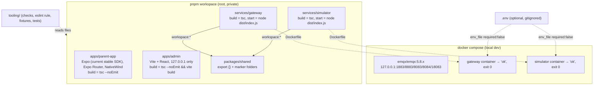

# Design Document: Phase 0 Skeleton

## Overview

Phase 0 creates an empty, pinned, strict-TypeScript pnpm monorepo with five packages, a Supabase CLI scaffold, a local Compose stack (EMQX + gateway + simulator) and the approved connection panel. No product behaviour ships. All "behaviour" in this phase lives in repo-level checks (Panel_Check, Secret_Check, manifest, naming and boundary checks), and those checks are the only real logic, so they get property-based tests.

Recorded on **7 October 2026**. That date fixes the Node.js Active LTS line (Req 1.3). The Expo SDK is not fixed here: it is the current stable SDK, resolved and recorded in Task 1 at implementation time (Req 4.2).

### Key design decisions

| # | Decision | Rationale |
|---|---|---|
| D1 | Node **24** (Active LTS on 7 Oct 2026). | Node 24 stays Active LTS until 20 Oct 2026. Node 26 is promoted after the recorded date, so Req 1.3 resolves to 24 ([endoflife.date](https://endoflife.date/nodejs)). |
| D2 | Expo: the **current stable SDK**, whichever matches the Expo Go installed on the founder's phone (iOS or Android). Resolved and recorded in Task 1, then every Expo-managed package is pinned exactly. | Expo Go runs only the SDK it was built for ([Expo docs](https://docs.expo.dev/troubleshooting/expo-go-version-mismatch/)), so the SDK is chosen against the founder's actual Expo Go at implementation time, not hard-coded in the spec. Expo Go is a Phase 0 convenience only. Phase 2 moves the parent app to an Expo dev build (`expo-dev-client`) for Rive. See "Expo SDK and Expo Go" under Open Points. |
| D3 | One React version, the one the resolved Expo SDK pairs with, for both the parent app and the admin console. Admin pins the same `react`, `react-dom` and `@types/react` versions as the parent app. | With `node-linker=hoisted`, two React versions would put one under a nested `node_modules` and risk duplicate-React errors in Metro or Vite. |
| D4 | One TypeScript version across the workspace, declared in every package. | Every `build` script calls `tsc` from its own package. Declaring it per package guarantees the binary resolves in Docker filtered installs too. |
| D5 | Dependency direction is enforced by a small local ESLint rule. | Built-in `no-restricted-imports` misses `require()` and `import()`. `import-x/no-restricted-paths` needs resolver setup and skips `require` by default. `eslint-plugin-boundaries` is heavy for five packages. A local rule covering all four import forms is short and can be property-tested (Property 9). |
| D6 | ESLint without type information (`typescript-eslint` `recommended`, not `recommended-type-checked`). | Req 3.5 says `pnpm lint` must pass before `pnpm build`. Type-aware lint would need `packages/shared/dist` to exist. |
| D7 | EMQX **5.8.x** (Apache-2.0), not 5.9+ (BSL 1.1). | From 5.9.0 the image is licensed under BSL 1.1 ([Docker Hub](https://hub.docker.com/r/emqx/emqx)). 5.8.x is the last Apache-2.0 line and is enough for loopback-only local dev. The production broker licence is a separate decision for Omar. |
| D8 | Gateway and simulator write `ok\n` and let the event loop drain. They never call `process.exit()`. | `process.exit()` can truncate piped stdout on Windows. Natural exit gives code 0 with stdout flushed. |
| D9 | Repo-level checks live in a root `tooling/` folder, which is not a workspace package. | Req 1.1 allows exactly five packages. The checks span the whole repo, so they cannot belong to any one package. Package-local tests stay in each package's `test/`. |
| D10 | Supabase CLI is run once via `pnpm dlx` to generate `config.toml`. It is not a dependency in Phase 0. | The `supabase` npm package downloads a binary in a postinstall script. Phase 0 runs no Supabase commands. Phase 1 adds it as a pinned devDependency. |

## Architecture



The Phase 0 dependency graph has two edges: gateway → shared and simulator → shared. Neither imports shared. The edges exist to exercise the `workspace:` protocol and to make `pnpm -r build` run in topological order (Req 2.10). Nothing opens a network connection except EMQX, which listens on loopback only.

### Pinned versions

Every value below is pinned exactly in its manifest. "Verify" means the version is my best known value and must be confirmed at implementation time with the stated method, then pinned exactly. Every `~` or `^` that a tool writes is rewritten to the resolved exact version taken from `pnpm-lock.yaml`. The manifest test (Property 7) fails if any range is left behind.

"Resolved in Task 1" means the spec deliberately holds no value. Every Expo-managed package follows the current stable Expo SDK, resolved in Task 1 via `npx create-expo-app` / `pnpm view expo version` + `npx expo install --fix`, then pinned exactly. The resolved values are reported in the task result.

| Item | Pin | Status | Resolution method |
|---|---|---|---|
| Node.js (`.nvmrc`, `engines.node`) | `24.21.0` | Seen in the nodejs.org release list. Verify it is the latest 24.x patch. | [nodejs.org/en/blog/release](https://nodejs.org/en/blog/release/). Take the newest `24.x.y (LTS)`. |
| pnpm (`packageManager`) | `pnpm@10.20.0` | Verify | `pnpm view pnpm@10 version`. Take the newest 10.x. Do not jump to a new major in Phase 0. |
| TypeScript (every package) | Resolved in Task 1 | Follows the resolved SDK | `npx expo install typescript --check` gives the range the resolved SDK expects. Pin the newest exact version inside that range (`pnpm view typescript@<range> version`) and use it in every package (D4). |
| Expo SDK (`expo`) | Resolved in Task 1 | Current stable SDK | `npx create-expo-app` / `pnpm view expo version`, then `npx expo install --fix`. Pin the resolved patch. |
| `expo-router` | Resolved in Task 1 | Follows the resolved SDK | `npx expo install expo-router` |
| `react-native` | Resolved in Task 1 | Follows the resolved SDK | `npx expo install react-native` |
| `react` (app and admin) | Resolved in Task 1 | The SDK's React pairing | `npx expo install react`. Admin pins the same value (D3). |
| `react-dom` (admin) | Resolved in Task 1 | Matches `react` | The same exact version as `react` (D3). |
| `@types/react` (app and admin) | Resolved in Task 1 | Follows the resolved SDK | `npx expo install @types/react`. Admin pins the same value (D3). |
| `@types/react-dom` (admin) | Resolved in Task 1 | Matches `react`'s minor | `pnpm view @types/react-dom@<react major.minor> version` |
| `react-native-reanimated` / `react-native-worklets` | Resolved in Task 1 | NativeWind peers, bundled in Expo Go for the resolved SDK | `npx expo install react-native-reanimated react-native-worklets`. If the resolved SDK does not use `react-native-worklets`, leave it out. |
| `react-native-safe-area-context` / `react-native-screens` | Resolved in Task 1 | Expo Router peers | `npx expo install …` |
| `expo-linking` / `expo-constants` / `expo-status-bar` | Resolved in Task 1 | Expo Router peers | `npx expo install …` |
| NativeWind | Resolved in Task 1 | The major officially supported by the resolved SDK | Check the NativeWind installation docs for the resolved SDK, then `pnpm view nativewind@<major> version`. |
| Tailwind CSS (app) | Resolved in Task 1 | The major that NativeWind major requires | `pnpm view tailwindcss@<major> version` |
| Vite | `7.1.12` | Verify | `pnpm view vite@7 version` |
| `@vitejs/plugin-react` | `5.0.4` | Verify | `pnpm view @vitejs/plugin-react@5 version` |
| ESLint / `@eslint/js` | `9.39.1` / `9.39.1` | Verify | `pnpm view eslint@9 version`. Stay on 9.x unless `typescript-eslint` officially supports a newer major. |
| `typescript-eslint` | `8.46.4` | Verify | `pnpm view typescript-eslint@8 version` |
| `globals` | `16.5.0` | Verify | `pnpm view globals version` |
| Prettier | `3.6.2` | Verify | `pnpm view prettier@3 version` |
| Vitest | `3.2.4` | Verify | `pnpm view vitest version`. A newer major is acceptable if it supports Vite 7 and Node 24. |
| fast-check | `4.3.0` | Verify | `pnpm view fast-check@4 version` |
| `@types/node` | `24.10.1` | Verify | `pnpm view @types/node@24 version` |
| `yaml` (Compose check) | `2.8.1` | Verify | `pnpm view yaml@2 version` |
| `smol-toml` (TOML 1.0 parse, Req 9.3) | `1.4.2` | Verify | `pnpm view smol-toml version` |
| Supabase CLI (generates `config.toml` once) | `2.54.11` | Verify | `pnpm view supabase version`, then `pnpm dlx --allow-build=supabase supabase@<ver> init`. Record the version in a comment on line 1 of `config.toml` and in the README. |
| EMQX image | `emqx/emqx:5.8.6` | Verify that it is the last 5.8.x tag | Docker Hub `emqx/emqx` tags. Pick the highest `5.8.x`. Licence: Apache-2.0. 5.9.0 and later are BSL 1.1. |
| Node base image | `node:24.21.0-bookworm-slim` | Must equal `.nvmrc` | `docker manifest inspect node:<nvmrc>-bookworm-slim` |
| Docker Compose (prerequisite) | ≥ `2.24.0` | Floor, not a pin | Needed for `env_file` long syntax with `required: false`. |

The exact `engines.node` means pnpm refuses to install (`ERR_PNPM_UNSUPPORTED_ENGINE`) on any other Node patch. This is intended: Req 1.4 asks for exact equality. The README tells contributors to run `nvm use`, `fnm use` or `volta pin` to match `.nvmrc`.

## Components and Interfaces

### Phase 0 file tree

Every file name is kebab-case under the Req 1.11 rule. The only exceptions are `README.md`, `Dockerfile` and `_layout.tsx`. Empty structure.md folders that hold no Phase 0 content (`src/components`, `src/features`, `assets`, `src/mqtt` and so on) are not created. Later phases add them.

```
xelulu/
├─ .github/workflows/ci.yml          cross-platform verification (Req 1.13, 2.8, 7.8)
├─ .dockerignore
├─ .env.example                      Appendix A, verbatim
├─ .gitignore
├─ .npmrc
├─ .nvmrc
├─ .prettierignore
├─ .prettierrc.json
├─ README.md
├─ docker-compose.yml
├─ eslint.config.mjs
├─ package.json
├─ pnpm-lock.yaml
├─ pnpm-workspace.yaml
├─ tsconfig.base.json
├─ tsconfig.test.json                type-checks tooling/ and package test/ folders
├─ vitest.config.ts
├─ apps/
│  ├─ parent-app/
│  │  ├─ app/_layout.tsx
│  │  ├─ app/index.tsx
│  │  ├─ app.json
│  │  ├─ babel.config.js
│  │  ├─ global.css
│  │  ├─ metro.config.js
│  │  ├─ nativewind-env.d.ts
│  │  ├─ package.json
│  │  ├─ tailwind.config.js
│  │  └─ tsconfig.json
│  └─ admin/
│     ├─ index.html
│     ├─ package.json
│     ├─ tsconfig.json
│     ├─ vite.config.ts
│     └─ src/
│        ├─ app.tsx
│        ├─ main.tsx
│        └─ styles.css
├─ services/
│  ├─ gateway/
│  │  ├─ Dockerfile
│  │  ├─ package.json
│  │  ├─ tsconfig.json
│  │  ├─ src/index.ts
│  │  └─ test/start.test.ts
│  └─ simulator/
│     ├─ Dockerfile
│     ├─ package.json
│     ├─ tsconfig.json
│     ├─ src/index.ts
│     └─ test/start.test.ts
├─ packages/
│  └─ shared/
│     ├─ package.json
│     ├─ tsconfig.json
│     ├─ src/index.ts
│     ├─ src/gateway-contract/.gitkeep
│     ├─ src/domain/.gitkeep
│     └─ test/exports.test.ts
├─ supabase/
│  ├─ .gitignore                     as generated by `supabase init`
│  ├─ config.toml
│  ├─ seed.sql
│  ├─ functions/.gitkeep
│  └─ migrations/.gitkeep
├─ tooling/
│  ├─ checks/                        pure check functions (see below)
│  ├─ eslint/xelulu-plugin.mjs
│  ├─ eslint/no-cross-package-import.mjs
│  ├─ fixtures/approved-panel.txt    reference copy of Appendix A (Req 11.6)
│  └─ test/*.test.ts
├─ docs/                             existing, untouched
└─ .kiro/                            existing, untouched
```

Package names are `@xelulu/parent-app`, `@xelulu/admin`, `@xelulu/gateway`, `@xelulu/simulator` and `@xelulu/shared`. Every package has version `0.0.0` and `"private": true`.

### Root configuration

**`pnpm-workspace.yaml`**

```yaml
packages:
  - "apps/*"
  - "services/*"
  - "packages/*"
onlyBuiltDependencies:
  - esbuild
```

pnpm 10 blocks dependency lifecycle scripts by default. `onlyBuiltDependencies` allow-lists only what install actually needs (esbuild, used by Vite and Vitest). During implementation, any further entry must come from pnpm's "Ignored build scripts" warning and be justified in the task result.

**`.npmrc`**

```
node-linker=hoisted
save-exact=true
```

`save-exact` makes `pnpm add` write exact versions. `npx expo install` writes its own `~` specifiers, so those are rewritten by hand (see Pinned versions).

**`.nvmrc`**: `24.21.0`, on one line.

**Root `package.json`**

```json
{
  "name": "xelulu",
  "private": true,
  "type": "module",
  "packageManager": "pnpm@10.20.0",
  "engines": { "node": "24.21.0" },
  "scripts": {
    "build": "pnpm -r build",
    "lint": "eslint . --max-warnings=0",
    "format:check": "prettier --check .",
    "format": "prettier --write .",
    "test": "pnpm build && tsc -p tsconfig.test.json && vitest run",
    "start:app": "pnpm --filter @xelulu/parent-app start",
    "dev:admin": "pnpm --filter @xelulu/admin dev",
    "start:gateway": "pnpm --silent --filter @xelulu/gateway start",
    "start:simulator": "pnpm --silent --filter @xelulu/simulator start"
  },
  "devDependencies": {
    "@eslint/js": "9.39.1",
    "@types/node": "24.10.1",
    "eslint": "9.39.1",
    "fast-check": "4.3.0",
    "globals": "16.5.0",
    "prettier": "3.6.2",
    "smol-toml": "1.4.2",
    "typescript": "<exact version resolved in Task 1>",
    "typescript-eslint": "8.46.4",
    "vitest": "3.2.4",
    "yaml": "2.8.1"
  }
}
```

- `pnpm -r build` runs every workspace package's `build` in topological order. The root is excluded because `include-workspace-root` is off by default. On failure pnpm exits non-zero and prints `ERR_PNPM_RECURSIVE_RUN_FIRST_FAIL @xelulu/<pkg>@0.0.0 build`, which names the package (Req 2.7).
- `--silent` on the start scripts suppresses pnpm's `> pkg@ver start` banner, so stdout stays exactly `ok` (Req 6.4).
- Every script uses only `pnpm`, `eslint`, `prettier`, `tsc`, `vitest` and `&&`. `&&` behaves the same in `cmd.exe`, which pnpm uses on Windows, and in `sh`. The scripts use no `rm`, `cp`, env-var prefixes or globs that need shell expansion (Req 2.8, 3.3, 3.4).

**`tsconfig.base.json`**: only strictness and hygiene options. Each package sets its own `module`, `target`, `lib` and `jsx`, so the base never overrides Expo's settings.

```json
{
  "compilerOptions": {
    "strict": true,
    "noUncheckedIndexedAccess": true,
    "noImplicitOverride": true,
    "noFallthroughCasesInSwitch": true,
    "forceConsistentCasingInFileNames": true,
    "isolatedModules": true,
    "esModuleInterop": true,
    "resolveJsonModule": true,
    "skipLibCheck": true
  }
}
```

**`tsconfig.test.json`**: extends the base and sets `noEmit`, `module`/`moduleResolution` `NodeNext`, `target` `ES2023` and `types: ["node"]`. It includes `tooling/**/*.ts`, `services/*/test/**/*.ts`, `packages/*/test/**/*.ts` and `vitest.config.ts`.

**`.gitignore`**

```
node_modules/
dist/
*.tsbuildinfo
coverage/
apps/parent-app/.expo/
apps/parent-app/expo-env.d.ts
.env
.env.*
!/.env.example
.DS_Store
```

`.env.*` matches at any depth. `!/.env.example` re-includes only the root file (Req 12.1). Build outputs are the `dist/` folders: gateway, simulator and shared write `dist/` with `tsc`, and admin writes `dist/` with Vite. The parent app has no build output (Req 12.2).

**`.dockerignore`**: `**/node_modules`, `**/dist`, `.git`, `.env`, `.env.*`, `docs`, `.kiro`, `apps/parent-app/.expo`. Excluding `.env` keeps secrets out of the Docker build context, which matters because the build context is the repo root.

**`.prettierrc.json`**: `{ "printWidth": 100, "singleQuote": false, "trailingComma": "all", "endOfLine": "auto" }`. Setting `endOfLine: "auto"` stops CRLF checkouts on Windows (`core.autocrlf`) from failing `format:check`.

**`.prettierignore`**: `node_modules/`, `**/dist/`, `apps/parent-app/.expo/`, `apps/parent-app/expo-env.d.ts`, `pnpm-lock.yaml`, `.env.example`, `tooling/fixtures/`, `docs/`, `.kiro/`. Prettier 3 also reads `.gitignore`. `.kiro/` and `docs/` are excluded so `format:check` never reformats specs or source documents.

### ESLint flat config and the dependency-direction rule

`eslint.config.mjs` uses `defineConfig` from `eslint/config`:

1. `ignores`: `**/node_modules/`, `**/dist/`, `apps/parent-app/.expo/`, `apps/parent-app/expo-env.d.ts`, `pnpm-lock.yaml`, `.env.example`, `docs/`, `.kiro/`, `coverage/`.
2. `js.configs.recommended` for all JS and TS.
3. `tseslint.configs.recommended`, scoped to `**/*.{ts,tsx}`.
4. `**/*.{js,cjs}`: `sourceType: "commonjs"` with `globals.node`. This covers `babel.config.js`, `metro.config.js` and `tailwind.config.js`.
5. `**/*.mjs` and `**/*.ts`: `globals.node`. `apps/admin/src/**`: `globals.browser`.
6. `**/*.{ts,tsx,js,jsx,mjs,cjs}`: plugin `xelulu` with rule `xelulu/no-cross-package-import: "error"`. The rule options are built at config load. They hold `rootDir` (the directory of `eslint.config.mjs`) and a package table read from `apps/*/package.json`, `services/*/package.json` and `packages/*/package.json`: `{ dir, name, kind: "app" | "service" | "shared" }`.

No package contains its own ESLint or Prettier config (Req 3.1, 3.2). The admin and parent app packages use the root configs.

**Rule `no-cross-package-import`** (`tooling/eslint/no-cross-package-import.mjs`)

| Visited node | Specifier source |
|---|---|
| `ImportDeclaration` | `source.value` |
| `ExportNamedDeclaration` / `ExportAllDeclaration` with a `source` | `source.value` |
| `ImportExpression` | `Literal` value, or a `TemplateLiteral` with no expressions |
| `CallExpression` where the callee is the identifier `require` and the argument is a string literal | `arguments[0].value` |

Algorithm (a pure function `classifyImport(fromFile, specifier, options)`, reused by the property test):

1. Owner = the package whose `dir` is a prefix of `relative(rootDir, fromFile)`. Separators are normalised to `/`, which handles Windows paths. If there is no owner (for example `tooling/` or root configs), allow the import.
2. Target:
   - Relative or absolute specifier: resolve it against `dirname(fromFile)` and find the package by path prefix.
   - Bare specifier: match a package `name` exactly, or as `name/` followed by a subpath.
   - Anything else (third-party packages, Node built-ins): no target, so allow.
3. Report `"<owner> must not import from <target> (apps/* and services/* are leaves; only packages/shared may be imported)"` when the target exists, `target.dir !== owner.dir`, and `target.kind` is `app` or `service`. ESLint reports the file and line (Req 13.3).
4. Imports within the owner's own package, and imports of `@xelulu/shared` by name, are never reported (Req 13.5).

Known limitation: `import(expr)` and `require(expr)` with non-literal arguments cannot be resolved and are not reported. Phase 0 has none. The manifest check (Req 13.1, 13.2) is the second line of defence at the dependency level.

### Parent app (`apps/parent-app`)

- **`package.json`**: `"main": "expo-router/entry"`. Scripts: `"start": "expo start"` and `"build": "tsc --noEmit"`.
  - Dependencies: `expo`, `expo-router`, `expo-linking`, `expo-constants`, `expo-status-bar`, `react`, `react-native`, `react-native-safe-area-context`, `react-native-screens`, `react-native-reanimated`, `react-native-worklets`, `nativewind`. Every one is pinned exactly.
  - devDependencies: `tailwindcss`, `typescript`, `@types/react`.
  - Every version is the one resolved in Task 1 for the current stable SDK (see Pinned versions).
  - Every runtime module is in the Expo Go runtime for the resolved SDK or is pure JS (Req 4.8). `expo-dev-client`, `rive-react-native`, `lottie-react-native`, MQTT and WebSocket libraries are absent (Req 4.8, 4.9).
- **`app.json`**:
  - `name: "Xelulu"`, `slug: "xelulu"`, `scheme: "xelulu"`, `userInterfaceStyle: "automatic"`, `plugins: ["expo-router"]`, `experiments.typedRoutes: false`.
  - No `owner`, `updates`, `extra` or URLs.
  - Typed routes are off, so `tsc --noEmit` does not depend on the generated `expo-env.d.ts` in a clean clone.
- **NativeWind and Tailwind:** use the NativeWind major officially supported by the resolved SDK (and its matching Tailwind major). The config files below show the NativeWind 4 / Tailwind 3 shape. If the supported major differs, follow that major's official setup with the same intent: one palette source read by the contrast test, text sizes still ≥ 16 pt, and no animation.
- **`babel.config.js`**: `presets: [["babel-preset-expo", { jsxImportSource: "nativewind" }], "nativewind/babel"]`. Confirm against the resolved SDK whether `babel-preset-expo` adds the worklets/Reanimated plugin automatically; add it by hand only if it does not. `babel-preset-expo` resolves through `expo` with the hoisted linker. If resolution fails, it is added through `npx expo install babel-preset-expo` and pinned.
- **`metro.config.js`**: `withNativeWind(getDefaultConfig(__dirname), { input: "./global.css" })`. SDK 52+ `getDefaultConfig` detects the monorepo root and sets `watchFolders`.
- **`global.css`**: the three `@tailwind` directives.
- **`nativewind-env.d.ts`**: `/// <reference types="nativewind/types" />`.
- **`tailwind.config.js`**:
  - `content: ["./app/**/*.{ts,tsx}"]`, `presets: [require("nativewind/preset")]`.
  - The placeholder palette lives in `theme.extend.colors.placeholder`. The contrast test reads it, so the colours have a single source.
- **`tsconfig.json`**: `"extends": ["expo/tsconfig.base", "../../tsconfig.base.json"]`. The root base is listed last, so its strict options win. Includes `**/*.ts`, `**/*.tsx` and `nativewind-env.d.ts`. Multiple `extends` entries are supported since TS 5.0.
- **`app/_layout.tsx`**: imports `../global.css` and renders `<Slot />`. A layout is not a route, so the only route is `/` (Req 4.4).
- **`app/index.tsx`**: one `View` holding exactly two `Text` elements.

```tsx
<View className="flex-1 items-center justify-center bg-placeholder-bg dark:bg-placeholder-bg-dark px-6">
  <Text accessibilityRole="header" className="text-[28px] font-bold text-placeholder-title dark:text-placeholder-title-dark">
    Xelulu
  </Text>
  <Text className="mt-3 text-[18px] text-placeholder-body dark:text-placeholder-body-dark">
    Phase 0 placeholder
  </Text>
</View>
```

- The text uses arbitrary pixel sizes because NativeWind's native rem can be smaller than 16 px (14 px in NativeWind 4), so `text-base` could render below 16 pt and fail Req 4.7. Whatever NativeWind major is resolved, text sizes must be ≥ 16 pt.
- No `allowFontScaling={false}` and no `maxFontSizeMultiplier` (Req 4.6).
- No `Animated`, Reanimated, Moti, `animate-*` or `transition-*` classes (Req 4.10).
- Dark variants follow the system appearance, which is NativeWind's default media strategy.

**Placeholder palette** (shared by the app and admin, contrast against the background):

| Mode | Background | Title | Body |
|---|---|---|---|
| Light | `#FFFFFF` | `#1F2937` (≈14.7:1) | `#374151` (≈10.3:1) |
| Dark | `#111827` | `#F9FAFB` (≈17.0:1) | `#E5E7EB` (≈14.2:1) |

The contrast test computes the exact ratios and asserts ≥ 4.5:1 for each pair.

### Admin console (`apps/admin`)

- **`package.json`**: `"private": true`, `"type": "module"`, `"description": "Xelulu admin console. Internal only; never shipped to consumers."`.
  - Scripts: `"dev": "vite"`, `"build": "tsc --noEmit && vite build"`, `"preview": "vite preview"`.
  - Dependencies: `react` and `react-dom`, at the exact React version the resolved SDK uses (D3). devDependencies: `vite`, `@vitejs/plugin-react`, `typescript`, `@types/react`, `@types/react-dom`.
  - Req 2.4 and 5.9 are met because the build includes `vite build`. The type-check covers the "no TypeScript errors" clause.
- **`vite.config.ts`**:
  - `plugins: [react()]`.
  - `server: { host: "127.0.0.1", port: 5173, strictPort: true }` and `preview: { host: "127.0.0.1", port: 4173, strictPort: true }`.
  - Binding to `127.0.0.1` (not `localhost`) avoids resolving to `::1` only or to all interfaces (Req 5.3). With `strictPort`, the server fails instead of drifting to another port.
- **`tsconfig.json`**: extends the base. `jsx: "react-jsx"`, `module: "ESNext"`, `moduleResolution: "Bundler"`, `target`/`lib` `ES2022` + `DOM`, `noEmit`.
  - It deliberately does **not** include `vite/client` types, so `import.meta.env` is a type error. Reading env becomes a build failure (Req 5.6).
  - The CSS import is a side-effect import, which TS does not resolve.
- **`index.html`**: `<html lang="en">`, `<meta charset="UTF-8">`, the viewport meta, `<title>Xelulu admin (internal only)</title>`, `<div id="root">` and `<script type="module" src="/src/main.tsx">`. It links no external fonts, scripts or images (Req 5.10).
- **`src/main.tsx`**: `createRoot(document.getElementById("root")!).render(<StrictMode><App /></StrictMode>)` and imports `./styles.css`.
- **`src/app.tsx`**: `<main><h1>Xelulu</h1><p>Phase 0 placeholder</p></main>`. This is the only `h1` (Req 5.4).
- **`src/styles.css`**:
  - `:root { color-scheme: light dark; --xl-bg; --xl-title; --xl-body }` uses the light palette. A `@media (prefers-color-scheme: dark)` block holds the dark palette.
  - System font stack, `h1` at 2rem and `p` at 1.125rem.
  - No `animation`, `transition` or `@keyframes`.

### Gateway and simulator (`services/gateway`, `services/simulator`)

The two services are identical in Phase 0.

- **`package.json`**: `"private": true`, `"type": "module"`.
  - Scripts: `"build": "tsc -p tsconfig.json"` and `"start": "node dist/index.js"`.
  - Dependencies: `"@xelulu/shared": "workspace:*"`. devDependencies: `typescript`, `@types/node`.
- **`tsconfig.json`**: extends the base. `module`/`moduleResolution` `NodeNext`, `target` `ES2023`, `lib` `["ES2023"]`, `types: ["node"]`, `rootDir: "src"`, `outDir: "dist"`, `include: ["src"]`.
- **`src/index.ts`**:

```ts
// Phase 0 placeholder: prove the package builds and runs. No network, no env reads.
process.stdout.write("ok\n");
```

  The process exits with code 0 when the event loop drains (D8). If `dist/index.js` is missing, `node` exits with code 1 (`ERR_MODULE_NOT_FOUND`) and prints nothing to stdout (Req 6.8, 7.7).
- **`test/start.test.ts`**: see Testing Strategy.

**Dockerfile** (gateway shown; the simulator's is the same with names swapped). The build context is the repo root.

```dockerfile
FROM node:24.21.0-bookworm-slim AS build
ENV COREPACK_ENABLE_DOWNLOAD_PROMPT=0
RUN corepack enable
WORKDIR /repo
COPY package.json pnpm-lock.yaml pnpm-workspace.yaml .npmrc tsconfig.base.json ./
COPY apps/parent-app/package.json apps/parent-app/
COPY apps/admin/package.json apps/admin/
COPY services/gateway/package.json services/gateway/
COPY services/simulator/package.json services/simulator/
COPY packages/shared/package.json packages/shared/
RUN pnpm install --frozen-lockfile --filter @xelulu/gateway...
COPY packages/shared packages/shared
COPY services/gateway services/gateway
RUN pnpm --filter @xelulu/gateway... build

FROM node:24.21.0-bookworm-slim
WORKDIR /app
COPY --from=build /repo/services/gateway/dist ./dist
USER node
CMD ["node", "dist/index.js"]
```

- All five manifests are copied so the frozen lockfile matches every importer. `--filter @xelulu/gateway...` installs and builds only the gateway and its dependency, shared.
- The runtime stage copies only `dist`, because Phase 0 has no runtime dependencies. Phase 1 switches to `pnpm deploy` when real dependencies arrive.
- `corepack` ships with Node 24. It reads `packageManager`, so the image uses the pinned pnpm.

### Shared package (`packages/shared`)

- **`package.json`**: `"private": true`, `"type": "module"`, `"main": "./dist/index.js"`, `"types": "./dist/index.d.ts"`, `"exports": { ".": { "types": "./dist/index.d.ts", "default": "./dist/index.js" } }`.
  - Script: `"build": "tsc -p tsconfig.json"`.
  - No `dependencies`. devDependencies are only `typescript` and `@types/node` (Req 8.9).
- **`tsconfig.json`**: same as the services, plus `declaration: true`.
- **`src/index.ts`**: `export {};` plus a one-line comment saying the contract arrives with Prompt 0.3. It has zero named exports and no default export (Req 8.7).
- **`src/gateway-contract/.gitkeep`** and **`src/domain/.gitkeep`**: empty files, one per folder (Req 8.5, 8.6).
- **`test/exports.test.ts`**: imports `../dist/index.js` and asserts `Object.keys(ns)` is empty and `"default" in ns` is false.

### Supabase scaffold (`supabase/`)

- Generate the scaffold once with `pnpm dlx --allow-build=supabase supabase@<ver> init` at the repo root. Answer "no" to the VS Code and IntelliJ Deno settings prompts.
- Keep the generated `config.toml` as is, except:
  - Line 1 holds the comment `# Generated by Supabase CLI <ver> (supabase init).`
  - `project_id = "xelulu"`.
- Every secret-bearing setting in the generated file is either commented out or written as `env(NAME)`, for example `openai_api_key = "env(OPENAI_API_KEY)"`. Local URLs use `127.0.0.1` (Req 9.4, 12.6).
- The CLI's `.gitignore` (`.branches`, `.temp`, `.env*`) is kept.
- `migrations/.gitkeep` is the only entry in `migrations/` (Req 9.5). `functions/.gitkeep` keeps the structure.md folder without any source file (Req 9.8).
- `seed.sql` holds one line: `-- Xelulu seed data. Empty until Phase 1.` (Req 9.6).
- The test holds the expected set of top-level tables, copied from the generated file at implementation and pinned to the recorded CLI version (Req 9.1). For CLI 2.x the expected set is `api`, `db`, `realtime`, `studio`, `inbucket`, `storage`, `auth`, `edge_runtime`, `analytics` and `experimental`, plus the `project_id` key. The final list is confirmed against the generated file.

### Compose stack (`docker-compose.yml`)

```yaml
# Local development only.
# EMQX uses its image's default dashboard credentials. They are for local development only:
# never reuse them, and never expose these ports beyond 127.0.0.1.
name: xelulu
services:
  emqx:
    image: emqx/emqx:5.8.6 # Apache-2.0. EMQX 5.9+ is BSL 1.1 (see README).
    ports:
      - "127.0.0.1:1883:1883" # MQTT
      - "127.0.0.1:8883:8883" # MQTTS
      - "127.0.0.1:8083:8083" # MQTT over WS
      - "127.0.0.1:8084:8084" # MQTT over WSS
      - "127.0.0.1:18083:18083" # Dashboard
    healthcheck:
      test: ["CMD", "/opt/emqx/bin/emqx", "ctl", "status"]
      interval: 5s
      timeout: 5s
      retries: 24
    restart: "no"
  gateway:
    build: { context: ., dockerfile: services/gateway/Dockerfile }
    env_file:
      - path: ./.env
        required: false
    restart: "no"
  simulator:
    build: { context: ., dockerfile: services/simulator/Dockerfile }
    env_file:
      - path: ./.env
        required: false
    restart: "no"
```

- `gateway` and `simulator` have no `ports` (Req 10.13).
- They have no `depends_on`, because they don't connect to EMQX in Phase 0.
- Attached `docker compose up` keeps EMQX running after the two containers exit. It prints `gateway-1 exited with code N` (Req 10.10, 10.14).
- The compose file holds no `environment:` entries and no dashboard username or password (Req 10.12).
- There is no top-level `version:` key, which is obsolete in Compose v2.

### Connection panel and README

- **`.env.example`** is Appendix A byte for byte, UTF-8 without a BOM. `tooling/fixtures/approved-panel.txt` is a second, independent copy used as the Panel_Check reference (Req 11.6).
- **`README.md` outline:**
  1. **What this is.** Phase 0 skeleton, no product behaviour.
  2. **Prerequisites.**
     - Node from `.nvmrc`, with the `nvm use` / `fnm use` hint.
     - pnpm `10.20.0` via `corepack enable`, or `npm install -g pnpm@10.20.0`.
     - Docker with `docker compose` ≥ 2.24.
     - Expo Go on the founder's phone (iOS or Android), matching the Expo SDK number used by the parent app (the current stable SDK resolved in Task 1). Expo Go is a Phase 0 convenience only; Phase 2 moves to a dev build.
  3. **Setup.**
     - `pnpm install`.
     - Copy the panel: `Copy-Item .env.example .env` (PowerShell) or `cp .env.example .env` (POSIX).
     - `.env` is git-ignored, must never be committed, and is optional for Compose.
  4. **Commands.** `pnpm build`, `pnpm lint`, `pnpm format:check`, `pnpm test`.
  5. **Run each piece, with the expected result:**
     - `pnpm start:app`: Expo Go on the founder's phone shows the placeholder.
     - `pnpm dev:admin`: `http://127.0.0.1:5173` shows the placeholder.
     - `pnpm start:gateway` and `pnpm start:simulator`: each prints `ok` and exits with code 0.
     - `docker compose up`: EMQX, gateway and simulator containers start. The gateway and simulator print `ok` and exit.
  6. **Notes.**
     - The admin console is internal only, is never shipped to consumers, and its dev server listens on localhost only.
     - EMQX default dashboard credentials are for local development only. Ports 1883, 8883, 8083, 8084 and 18083 are bound to `127.0.0.1` only. The README does not print the credentials. It links to the EMQX docs instead.
     - `packages/shared/src/gateway-contract/` is empty on purpose until the Document B revision is approved.
     - Licences: EMQX 5.8.x is Apache-2.0. The Supabase CLI version used for `init` is recorded here.
  7. **Repo layout** (short), linking to `.kiro/steering/structure.md`.

  Every command except the copy step is identical across shells (Req 14.10).

### CI workflow (`.github/workflows/ci.yml`)

- **`checks` job:** matrix `ubuntu-latest`, `macos-latest`, `windows-latest`.
  - `actions/setup-node` with `node-version-file: .nvmrc`, then `corepack enable`.
  - `pnpm install --frozen-lockfile`, then `git diff --exit-code pnpm-lock.yaml`.
  - `pnpm lint`, `pnpm format:check`, `pnpm test` (which runs build). Then `pnpm start:gateway` and `pnpm start:simulator`.
- **`compose` job** (Ubuntu only): runs the Compose smoke test (see Testing Strategy).
- Actions are pinned to full commit SHAs.

If the repo has no GitHub remote yet, the same commands are run by hand on each OS before Phase 0 is signed off.

## Data Models

Phase 0 has no domain or database model. The only data structures are the inputs and outputs of the repo checks in `tooling/checks/`. Every function there is pure: it takes strings or parsed objects and never touches the filesystem. Thin loaders in the tests do the I/O. This is what makes the checks property-testable.

```ts
// tooling/checks/panel.ts
export type PanelLine =
  | { kind: "blank" | "comment"; lineNo: number; raw: string }
  | { kind: "decl"; lineNo: number; raw: string; key: string; value: string }; // value = text after "=", trimmed

export type PanelIssue =
  | { kind: "panel_missing" }
  | { kind: "line_mismatch"; lineNo: number }            // 1-based, first differing line (Req 11.10)
  | { kind: "missing_key"; key: string }
  | { kind: "unknown_key"; key: string }
  | { kind: "duplicate_key"; key: string }
  | { kind: "out_of_order"; key: string }
  | { kind: "non_empty_value"; key: string; lineNo: number }; // never carries the value

export function normaliseText(text: string): string[];          // CRLF→LF, drop one trailing EOL, split
export function parsePanel(text: string): PanelLine[];
export function checkPanel(actual: string | null, approved: string): PanelIssue[]; // [] = pass

// tooling/checks/secret-scan.ts
export type SecretFinding = { path: string; lineNo: number; key: string }; // no value field by construction
export function scanText(path: string, text: string, keys: readonly string[]): SecretFinding[];
export function isEmptyEquivalent(value: string): boolean; // "", whitespace, "", '', ${NAME}, env(NAME)
export function formatFindings(findings: SecretFinding[]): string;

// tooling/checks/exact-version.ts
export function isExactVersion(spec: string): boolean;          // MAJOR.MINOR.PATCH[-prerelease]
export function checkManifestDeps(
  manifest: Record<string, unknown>, workspaceNames: ReadonlySet<string>,
): { field: string; name: string; spec: string; reason: string }[];

// tooling/checks/kebab-case.ts
export const NAME_EXCEPTIONS: ReadonlySet<string>; // "README.md", "Dockerfile", "_layout.tsx"
export function isKebabFileName(basename: string): boolean;

// tooling/checks/env-reads.ts
export type EnvRead = { lineNo: number; name: string | null }; // null = destructuring / computed access
export function findEnvReads(source: string): EnvRead[];

// tooling/checks/url-scan.ts
export type UrlFinding = { path: string; lineNo: number; host: string }; // host only, never userinfo or path
export function findNonLocalUrls(path: string, text: string): UrlFinding[];

// tooling/checks/contrast.ts
export function contrastRatio(fgHex: string, bgHex: string): number; // WCAG 2.x relative luminance

// tooling/eslint/no-cross-package-import.mjs (pure core, exported for tests)
// classifyImport(fromFile, specifier, { rootDir, packages }) -> { owner, target, violation: boolean }
```

### Parsing rules (single source for Panel_Check and Secret_Check)

- **Panel declaration line** (Req 11.5, 11.6): a line is blank or a comment if it is empty after trimming or starts with `#` after leading whitespace. Otherwise `^([A-Za-z_][A-Za-z0-9_]*)=(.*)$` declares a key.
  - The value is everything after `=`, trimmed. There is no inline-comment rule for the panel: any trailing text, including `#` text, is a non-empty value (and also a `line_mismatch` against the approved panel).
- **Secret assignment line** (Req 12.3): `^\s*(?:export\s+|-\s+)?"?(KEY)"?\s*(=|:)\s*(.*)$`, where `KEY` is one of the Panel_Keys.
  - The quoted-key form (`"KEY": …`) goes beyond the requirement. It is a conservative addition that also covers JSON.
  - Secret_Check keeps its own defensive inline-comment rule for other file types (YAML, TOML, shell): within the captured rest of the line, the first match of `\s#` starts a comment, and the value is the text before it, trimmed.
  - The value counts as empty only under `isEmptyEquivalent`: empty, whitespace-only, `""`, `''`, a single `${NAME}` or a single `env(NAME)`, optionally quoted.
- **Files scanned:** `git ls-files -z --cached --others --exclude-standard`. This is the tracked files plus untracked, non-ignored files, which is stricter than the requirement and catches secrets before the first commit.
  - Files with a NUL byte in their first 8 KiB are skipped as binary (for example the `.docx` and `.pdf` files in `docs/`).
- **Panel_Key list:** derived at runtime from `tooling/fixtures/approved-panel.txt` with `parsePanel`. It is never hard-coded a second time.
- **Kebab-case** (Req 1.11): drop one leading `.`, split on `.`, and require every part to match `^[a-z0-9]+(?:-[a-z0-9]+)*$`.
  - The rule applies to every tracked file outside `docs/` and `.kiro/`. Those folders hold pre-existing documents (for example `docs/A-master-build-guide.docx`) that Phase 0 does not introduce.
- **Exact version** (Req 1.8): `^(0|[1-9]\d*)\.(0|[1-9]\d*)\.(0|[1-9]\d*)(-[0-9A-Za-z-]+(\.[0-9A-Za-z-]+)*)?$`.
  - Build metadata (`+…`) is rejected.
  - A dependency whose name is a workspace package must instead start with `workspace:`.

## Correctness Properties

*A property is a characteristic or behavior that should hold true across all valid executions of a system-essentially, a formal statement about what the system should do. Properties serve as the bridge between human-readable specifications and machine-verifiable correctness guarantees.*

In Phase 0 the only logic is in the repo checks. The properties target those check functions, which are pure (see Data Models). Fixed repo facts are covered by the deterministic checks in Testing Strategy.

Merged criteria (reflection): Req 11.2 and 11.12 are merged into Property 1. Req 11.3, 11.4, 11.7 and 11.9 are merged into Property 3. Req 12.3, 12.4 and 12.7 (detecting non-empty values and passing empty-equivalent ones) are merged into the biconditional Property 5. Req 12.5 and 12.8 are merged into Property 8. Req 13.3 and 13.5 are merged into the biconditional Property 9.

### Property 1: Approved panel accepted under any line-ending variant

*For any* choice of line ending (LF or CRLF) and *for any* choice of whether the file ends with one trailing line ending, `checkPanel(render(approved, eol, trailing), approved)` returns no issues.

**Validates: Requirements 11.2, 11.12**

### Property 2: Panel declaration value rule

*For any* key matching `[A-Za-z_][A-Za-z0-9_]*` and any single-line text `v` of printable characters (including `#` and whitespace), `parsePanel` applied to `KEY=` + `v` yields one declaration with key `KEY` and value `v.trim()`. Its value is empty exactly when `v` is empty or whitespace-only; text such as ` # note` after `=` is a non-empty value. A line whose first non-whitespace character is `#`, or that is blank, yields no declaration.

**Validates: Requirements 11.5, 11.6**

### Property 3: Every panel mutation is rejected and names its keys

*For any* variant kind in {drop one Panel_Key line, duplicate one Panel_Key line, add one line with a key absent from the panel, give one Panel_Key a non-empty value of 1–64 printable non-`#` characters with at least one non-whitespace character, swap two Panel_Key lines}, and *for any* randomly chosen target key or keys, `checkPanel(variant, approved)` returns at least one issue, and the set of keys named in its key-level issues contains every affected key.

- The test runs at least 100 cases per kind.
- A value made only of whitespace is empty under Req 11.5, so it is not a "non-empty" variant. The generator excludes it.

**Validates: Requirements 11.3, 11.4, 11.7, 11.9**

### Property 4: First differing line is reported

*For any* approved panel and *for any* single-line edit at 1-based line `i` (replace one character, insert one character or append text), `checkPanel` reports `line_mismatch` with `lineNo === i`. *For any* truncation or extension of the panel by whole lines, it reports `lineNo === min(lenA, lenB) + 1`.

**Validates: Requirements 11.10**

### Property 5: Secret_Check flags exactly the non-empty assignments and never leaks them

*For any* file content built from random filler lines plus `n ≥ 0` injected assignment lines, where each injected line uses:

- a random Panel_Key,
- a random form (`KEY=`, `KEY: `, `export KEY=`, `- KEY=`, `- KEY: `, any leading whitespace),
- an optional trailing ` # comment`,
- a value drawn either from the empty-equivalent set (no text, whitespace only, `""`, `''`, `${NAME}`, `env(NAME)`) or from non-empty literals of 8–64 printable non-`#` characters,

`scanText` returns exactly the `(path, lineNo, key)` triples of the lines that carry non-empty literals, in line order. In addition, `formatFindings` output contains none of the injected literal values.

**Validates: Requirements 12.3, 12.4, 12.7, 9.4, 9.9, 10.12, 14.9**

### Property 6: Kebab-case file-name validator

*For any* name built from one to four dot-separated parts, each a non-empty run of `[a-z0-9]` segments joined by single hyphens, with an optional single leading dot, `isKebabFileName` returns `true`. *For any* such name mutated to contain an uppercase letter, an underscore, a space, a double hyphen, or a part that starts or ends with a hyphen, it returns `false`, unless the name is in `NAME_EXCEPTIONS`.

**Validates: Requirements 1.11**

### Property 7: Exact-version validator

*For any* generated `MAJOR.MINOR.PATCH` with no leading zeros and an optional pre-release suffix, `isExactVersion` returns `true`. *For any* generated spec that adds a range operator (`^`, `~`, `>`, `<`, `>=`, `<=`, `=`), uses `*`, `x`, `X`, a dist-tag, `||`, a hyphen range, a partial version, build metadata, a git URL, a file path or a tarball URL, it returns `false`.

`checkManifestDeps` reports a dependency exactly when it is (a) a workspace package name without a `workspace:` spec, or (b) a non-workspace name whose spec fails `isExactVersion`.

**Validates: Requirements 1.2, 1.3, 1.8, 8.9, 13.1**

### Property 8: Environment-read detector

*For any* identifier `NAME` and *for any* access form (`process.env.NAME`, `process.env["NAME"]`, `process.env['NAME']`, `import.meta.env.NAME`) embedded in random surrounding code, `findEnvReads` returns that read with `name === NAME`. The parent-app check fails, reporting the file and `NAME`, exactly when `NAME` does not start with `EXPO_PUBLIC_`. *For any* destructuring or computed access of `process.env`, the detector returns a read with `name === null`, and the check always fails on it.

**Validates: Requirements 12.5, 12.8, 5.6, 6.6, 7.4**

### Property 9: Dependency-direction rule

*For any*:

- owner package `O` and target package `T` drawn from the five workspace packages,
- import form in {static `import`, `export … from`, `import()`, `require()`},
- specifier style in {relative path from a random file depth inside `O` to a random file inside `T`, package name, package name + subpath},

linting a file inside `O` with `xelulu/no-cross-package-import` produces exactly one error, located on the import's line, if and only if `T ≠ O` and `T` is under `apps/*` or `services/*`. Otherwise it produces none. This covers imports within `O` and imports of `@xelulu/shared` by name. Paths use either separator style.

**Validates: Requirements 13.3, 13.5, 5.8, 6.7, 7.5, 8.8**

### Property 10: Non-local URL detector

*For any* scheme in {http, https, ws, wss, mqtt, mqtts, postgres, postgresql} and any host, `findNonLocalUrls` flags a URL on a non-comment code line exactly when the host is not `localhost`, `127.0.0.1` or `[::1]`. It never flags URLs on comment lines (`//`, `#`, `*`, `--`) or `$schema` values. The finding reports only the host, never userinfo, path or query.

**Validates: Requirements 12.6, 5.10**

## Error Handling

| Situation | Behaviour |
|---|---|
| Wrong Node patch | pnpm stops with `ERR_PNPM_UNSUPPORTED_ENGINE` (exact `engines.node`). The README points to `nvm use` / `fnm use`. |
| Lockfile out of date | `pnpm install --frozen-lockfile` exits non-zero without writing (Req 1.14). CI also runs `git diff --exit-code pnpm-lock.yaml`. |
| A package build fails | `pnpm -r build` stops and prints `ERR_PNPM_RECURSIVE_RUN_FIRST_FAIL <pkg> build`, then exits non-zero (Req 2.7, 8.3). |
| `dist/` missing at start | `node dist/index.js` throws `ERR_MODULE_NOT_FOUND`, prints nothing on stdout and exits with code 1 (Req 6.8, 7.7). |
| Founder's Expo Go does not support the current stable SDK | Task 1 stops and the mismatch is raised with Omar before the parent app is scaffolded. |
| Admin port busy | `strictPort` makes Vite fail with a clear message instead of moving to another port. |
| EMQX host port busy | Compose fails for `emqx` with a bind error. The README notes the five ports. |
| Compose older than 2.24 | The `env_file` long syntax is rejected. The README states the floor. |
| No `.env` | Compose skips it (`required: false`). Packages read no env, so behaviour is unchanged (Req 4.12, 6.5, 7.6, 10.7). |
| Panel_Check failure | Lists every issue: missing file, first differing line number and each offending key name. It never prints values (Req 11.7, 11.10, 11.11). |
| Secret_Check failure | Lists every `path:line KEY` finding. It never prints values (Req 12.4). |
| Secret_Check without git | The test fails with "git is required for Secret_Check". It never silently skips. |
| Ignored dependency build scripts | pnpm warns. Only `esbuild` is allow-listed. Any new entry needs justification. |

## Security Notes

- **Network exposure:**
  - The only listening service is EMQX, bound to `127.0.0.1` on five ports and using image-default dashboard credentials with anonymous MQTT. This is unauthenticated for local dev. Loopback binding keeps it off the LAN. Never use it beyond local dev.
  - The admin dev server binds to `127.0.0.1` and has no authentication. It shows no data in Phase 0.
  - The gateway, simulator and parent app open no sockets.
- **Secrets:**
  - `.env` and `.env.*` are ignored at every depth. `.dockerignore` keeps `.env` out of the build context.
  - Secret_Check scans tracked and untracked non-ignored files. No secret appears in compose files, Dockerfiles, README or `config.toml`. Supabase secrets stay `env(NAME)`.
- **App boundary:** the parent app reads no env and depends on nothing from `apps/admin`. Both are enforced by tests and the lint rule.
- **Supply chain:**
  - Exact pins and a frozen lockfile.
  - pnpm 10 blocks lifecycle scripts except `esbuild`.
  - The Supabase CLI runs only through `dlx` at scaffold time.
  - GitHub Actions are pinned by SHA.
- **Licences:**
  - EMQX 5.8.x is Apache-2.0. 5.9+ is BSL 1.1, which converts to Apache-2.0 four years after each release ([EMQX licence FAQ](https://www.emqx.com/en/content/license-faq)). Flagged for Omar: the production broker (EMQX Cloud, or self-hosted under BSL) needs a licence decision before Phase 3.
  - EMQX 5.8.x receives limited upstream maintenance. That is acceptable only because it is loopback-only local dev.
- **Photosensitivity:** both placeholders contain no animation, transition or flashing. Enforced by the placeholder tests.

## Open Points

### OP-1: inline comments in `.env.example` (RESOLVED)

- **Resolution:** per Omar's amendment, every comment in Appendix A sits on its own line directly above its key. Keys, key order, section headers and comment text are unchanged, and every value is empty.
- **Consequence:** every line is either a full-line comment, a blank line or a bare `KEY=`. Docker Compose, Node `dotenv`, `util.parseEnv`, `@expo/env` and Vite all read a bare `KEY=` as `""`, so no parser-agreement test is needed. The earlier `env-parsing.test.ts` and the Compose OP-1 parse check are dropped, and `dotenv` is not a Phase 0 dependency.
- **Panel_Check:** has no inline-comment rule. Any text after `=` is a non-empty value (see Parsing rules).
- **Note for later phases:** these parsers set keys to `""`, not unset. Config loaders from Phase 1 on must treat `""` as "not set".

### OP-2: where the parent app reads `EXPO_PUBLIC_*`

Deferred to the first phase that needs app env (the Phase 1 Supabase client). Phase 0 reads no env, and tests enforce it.

Recorded candidate: a small parent-app start wrapper. It reads the root `.env` with `dotenv.parse` (a pinned `dotenv` added in that phase), without touching `process.env`, keeps only `EXPO_PUBLIC_*` keys, and starts `expo start` with just those added to the child process env. Nothing is copied into `apps/parent-app`, and non-public keys never enter the Metro process.

The alternative, loading the root `.env` inside `app.config.ts`, is rejected. It would put every backend secret into the bundler's environment.

### OP-3: `xelulu/{device_id}/ota`

Untouched. The contract is on hold, and the contract folder holds only its marker.

### Expo SDK and Expo Go (decision, replaces OP-4)

- **Decision:** the parent app uses the current stable Expo SDK, whichever matches the Expo Go installed on the founder's phone, on iOS or Android. Only the founder's phone is required, not both platforms (Req 4.2, 4.3).
- **Resolution:** Task 1 resolves the SDK via `npx create-expo-app` / `pnpm view expo version` + `npx expo install --fix`, confirms the founder's Expo Go supports it, pins every Expo-managed package exactly and reports the versions in the task result. The spec holds no SDK number.
- **Blocker rule:** if neither platform's Expo Go supports the current stable SDK, stop and raise it with Omar.
- **Scope:** Expo Go is a Phase 0 convenience only. From Phase 2 the parent app moves to an Expo dev build (`expo-dev-client`) for Rive, which removes the dependency on Expo Go's SDK.

## Testing Strategy

### Tooling

- **Test runner:** Vitest, configured by the root `vitest.config.ts`.
  - `include: ["tooling/test/**/*.test.ts", "services/*/test/**/*.test.ts", "packages/*/test/**/*.test.ts"]`, `environment: "node"`, `testTimeout: 30000`.
  - `pnpm test` runs `pnpm build`, type-checks the tests (`tsconfig.test.json`), then runs `vitest run`.
- **Property-based testing:** fast-check, with every property at `numRuns ≥ 100`.
  - Each property is one `fc.assert` test, tagged with a comment: `// Feature: phase-0-skeleton, Property <n>: <title>`.
  - Property 3 is one parameterised test (`describe.each` over the five variant kinds), so each kind gets its own 100 runs (Req 11.9).
- **Parent app:** no jest-expo in Phase 0. The placeholder has no behaviour to render-test, so static source checks cover it. jest-expo + React Native Testing Library arrive with the first real screen.

### Property tests

| File | Properties |
|---|---|
| `tooling/test/panel-check.test.ts` | 1, 2, 3, 4 |
| `tooling/test/secret-check.test.ts` | 5 |
| `tooling/test/file-names.test.ts` | 6 |
| `tooling/test/manifests.test.ts` | 7 |
| `tooling/test/env-reads.test.ts` | 8 |
| `tooling/test/no-cross-package-import.test.ts` | 9. Uses ESLint's `Linter.verify` with synthetic package tables, plus `RuleTester` examples. |
| `tooling/test/url-scan.test.ts` | 10 |

### Deterministic checks on the real repo

Each property test file also applies its check function to the real repo. For example, Panel_Check runs against `.env.example`, and Secret_Check runs against the `git ls-files` output.

| File | Covers |
|---|---|
| `tooling/test/manifests.test.ts` | Req 1.1, 1.2, 1.3, 1.4, 1.8, 1.9, 2.2–2.5, 3.1, 3.2, 4.1, 4.2, 4.8, 4.9, 5.7, 6.2, 6.3, 6.7, 7.2, 7.5, 8.8, 8.9, 13.1, 13.2. Includes a static check that scripts contain no `rm`, `cp`, `export` or `VAR=` prefixes. |
| `tooling/test/tsconfig.test.ts` | Req 1.5, 1.6, 4.1, 5.1, 6.1, 7.1, 8.1. Runs `tsc --showConfig -p <pkg>`: `strict` is true, no strict-family option is false, and the extends chain includes the root base. |
| `tooling/test/layout.test.ts` | Req 1.7, 1.10, 3.1, 3.2 (no per-package configs), 4.4 (only `_layout.tsx` and `index.tsx` under `app/`), 6.1, 7.1, 8.4–8.6 (each folder is exactly `[".gitkeep"]` with zero bytes), 9.5, 9.8. |
| `tooling/test/gitignore.test.ts` | Req 12.1, 12.2. Runs `git check-ignore --no-index` on `.env`, `.env.local`, `apps/parent-app/.env`, `apps/parent-app/.env.local`, `node_modules`, every `dist/` and `apps/parent-app/.expo/`. Asserts `.env.example` is not ignored. |
| `tooling/test/lint-format.test.ts` | Req 3.7–3.9. ESLint `isPathIgnored` and Prettier `getFileInfo` for each excluded path. `lintText` on a deliberate error reports its path. `prettier.check` on unformatted text is false. |
| `tooling/test/placeholder.test.ts` | Req 4.5, 4.6, 4.7 (every `text-[Npx]` ≥ 16, no `text-xs`/`sm`/`base`), 4.10, 5.4, 5.6 (no `import.meta.env`; built `apps/admin/dist` contains no Panel_Key name), 5.8, 6.6 and 7.4 (no `node:net`, `http`, `https`, `dgram`, `tls`, `ws` or `mqtt` imports). |
| `tooling/test/contrast.test.ts` | Req 4.7, 5.5. Parent-app palette from `tailwind.config.js`, admin palette from `styles.css` custom properties, light and dark: every pair ≥ 4.5:1. Includes known-value checks of `contrastRatio` (black/white = 21). |
| `tooling/test/supabase.test.ts` | Req 9.1–9.4, 9.6, 9.7, 9.9. Parses with `smol-toml`, compares the top-level table set, checks `project_id`, checks secret-like keys are `env(…)` or absent, checks seed lines, and finds no SQL statements. |
| `tooling/test/compose-static.test.ts` | Req 10.1–10.5, 10.11–10.13. Parses with `yaml` and reads the Dockerfile `FROM` lines. |
| `tooling/test/panel-check.test.ts` (examples) | Req 11.1 (no BOM, valid UTF-8), 11.3, 11.6 (the reference path differs from the panel path), 11.8, 11.11 (`checkPanel(null, …)` gives `panel_missing`). |
| `tooling/test/readme.test.ts` | Req 14.1–14.9. Required phrases. Every `pnpm <script>` named exists in a manifest. The pnpm version and SDK number match the manifests. Both copy commands are present. |
| `services/gateway/test/start.test.ts`, `services/simulator/test/start.test.ts` | Req 6.4, 6.5, 6.8, 7.3, 7.6, 7.7. Spawn `node dist/index.js` and `pnpm --silent start`: stdout `ok\n`, stderr empty, exit 0, under 5 s. Repeat with every Panel_Key removed from the env, then with every Panel_Key set to a sentinel; the outcome must be identical. Spawn `node dist/index.js` in a temp dir with no `dist`: non-zero exit and no `ok`. |
| `packages/shared/test/exports.test.ts` | Req 8.7. |

### Integration and CI

- **CI `checks` matrix** (Windows, macOS, Linux): Req 1.12, 1.13, 2.1, 2.6, 2.8, 2.9, 3.5, 3.6, 4.11, 5.9, 7.8, 8.2, 13.4.
- **CI `compose` job** (Ubuntu): Req 10.6–10.10.
  1. `docker compose config` with no `.env` succeeds.
  2. Req 10.6: with `.env` copied from `.env.example`, `docker compose config --format json` lists every Panel_Key in the `gateway` and `simulator` environments. The temporary `.env` is deleted afterwards.
  3. `docker compose up -d --build`.
  4. Poll `http://127.0.0.1:18083` for up to 120 s.
  5. Wait for `gateway` and `simulator` to exit within 60 s. Logs are exactly `ok`, `ExitCode` is 0 and `RestartCount` is 0.
  6. Sleep 30 s. Both are still exited and `emqx` is still running.
  7. `ss -ltn` shows the five ports on `127.0.0.1` only.
- **One-off verifications** (reported in the task result): Req 1.14 (a stale lockfile fails frozen install and stays unchanged), 2.7 and 8.3 (an injected type error fails `pnpm build` and the package is named), 2.10 (shared builds before gateway and simulator in `pnpm -r build` output), 10.14 (overriding the gateway command to exit 1 reports the code and leaves EMQX up).

### Manual checklist (Done when)

| # | Done when | Manual steps |
|---|---|---|
| 1 | `pnpm install` and `pnpm build` pass | In a fresh clone with the `.nvmrc` Node and no `.env`: `pnpm install`, `pnpm build`. Both exit 0 and `git status` is clean. |
| 2 | Expo app opens on the founder's phone in Expo Go | `pnpm start:app`. Scan the QR code with Expo Go on the founder's phone (iOS or Android), running the current stable SDK resolved in Task 1, on the same LAN. Within 60 s: "Xelulu" and "Phase 0 placeholder" appear, with no red or yellow box. Toggle dark mode and check the text stays readable. Set the largest system font and check the text scales. Run the VoiceOver/TalkBack heading check on the title. |
| 3 | Admin console opens locally | `pnpm dev:admin`. Open the printed `http://127.0.0.1:5173` in Chrome, Edge, Firefox or Safari: only the title and message are shown. DevTools Network shows same-origin requests only. Requesting the host's LAN IP on port 5173 fails to connect. |
| 4 | Gateway and simulator log "ok" | `pnpm start:gateway` and `pnpm start:simulator`: each prints `ok` and returns to the prompt with `$LASTEXITCODE` / `$?` equal to 0. |
| 5 | `docker compose up` starts EMQX | With no `.env`: `docker compose up`. EMQX becomes healthy and `http://127.0.0.1:18083` loads the dashboard. Gateway and simulator print `ok` and exit with code 0. Repeat with `.env` present. |
| 6 | `.env.example` complete and empty | `pnpm test` passes (Panel_Check, Secret_Check). A visual diff against Appendix A shows no change. |

Accessibility note: these checks cover contrast, font size, heading semantics and font scaling. Full WCAG validation needs manual testing with assistive technologies and expert review. That is out of scope for a placeholder.
