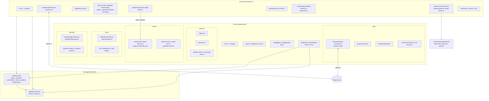
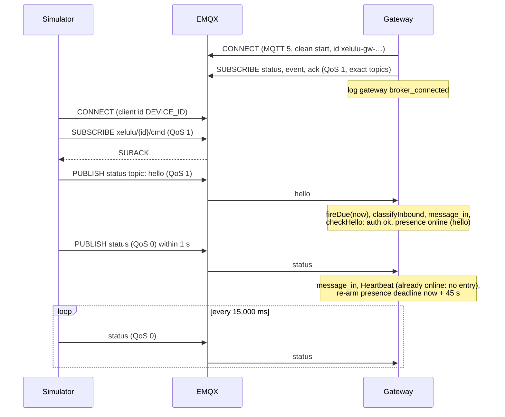
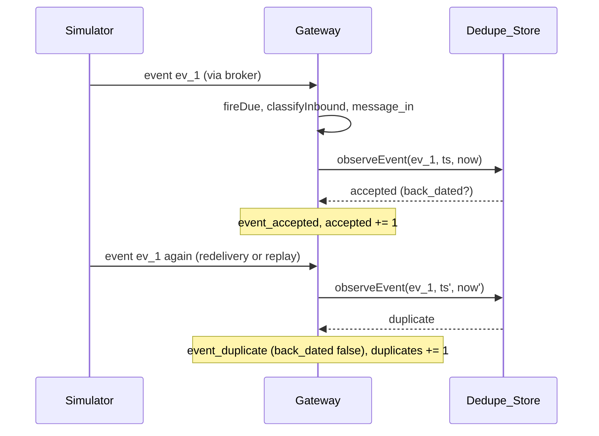
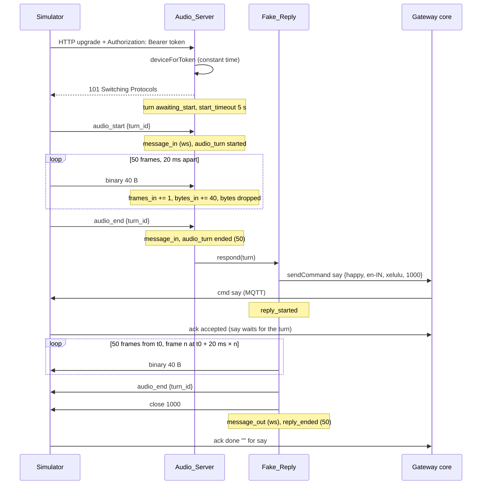
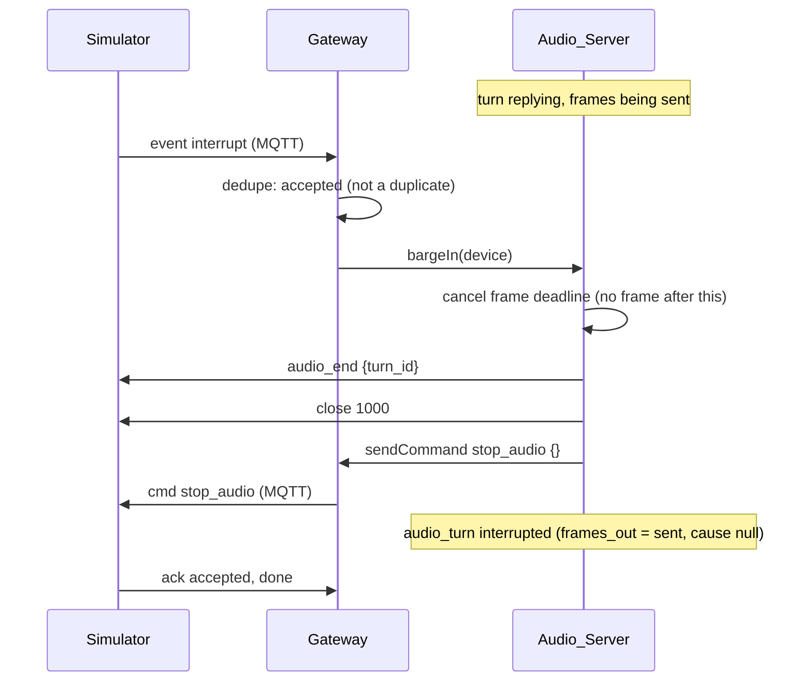
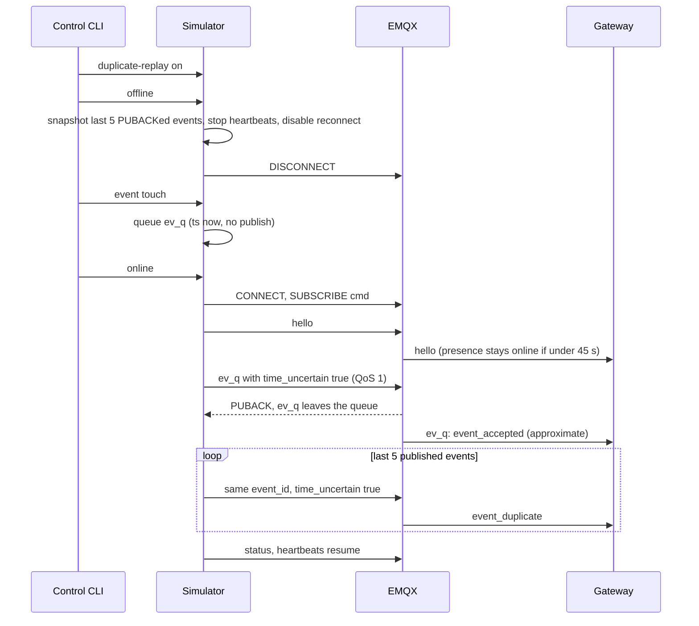
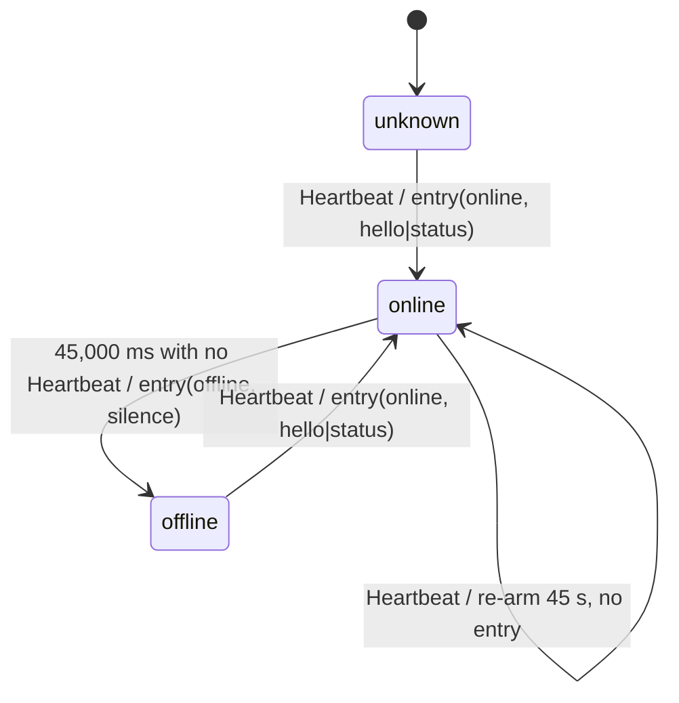
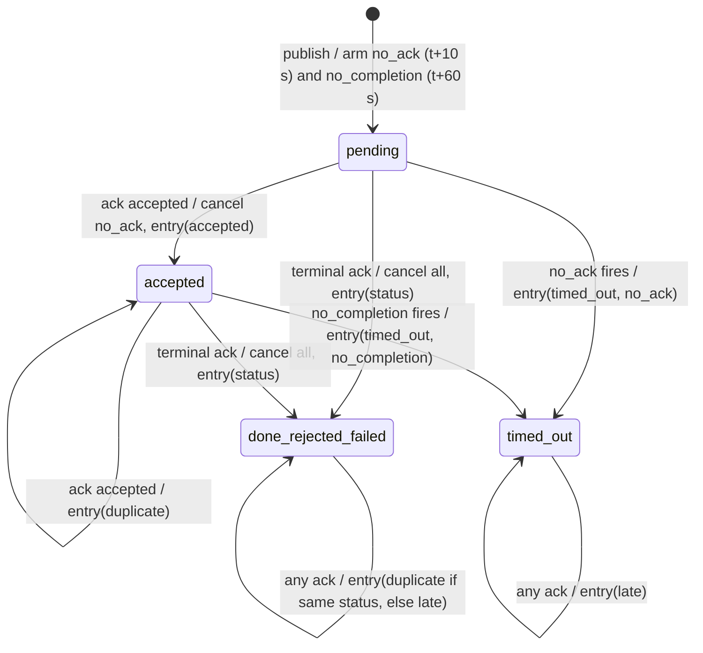
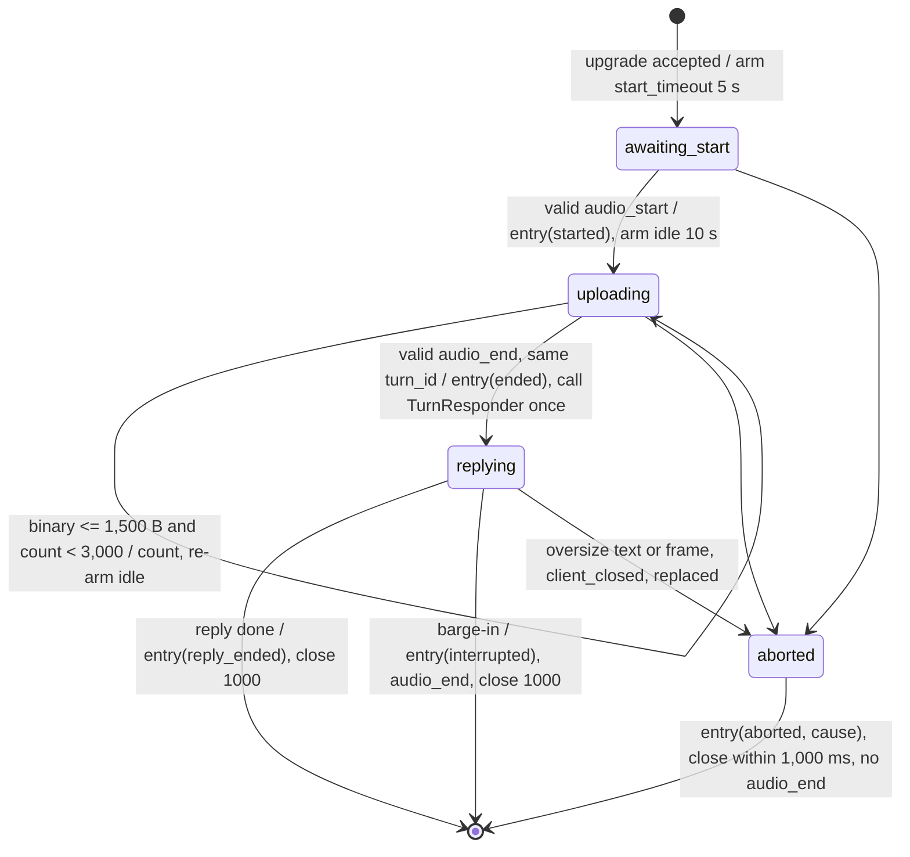

# Design Document: Phase 1.2 gateway and simulator

## Overview

This phase turns the two Phase 0 stubs into running services that speak Document B v2 (`proto_ver` 2) over EMQX:

- `services/gateway` connects to the Broker, validates every inbound message with the Phase 1 contract, tracks presence, dedupes events, matches acks to commands, runs the per-turn audio WebSocket server with a Fake_Reply, and publishes the Gateway_Log (stdout plus an in-process subscription).
- `services/simulator` is a fake robot. It connects as `DEVICE_ID`, sends hello and heartbeats, fires events, obeys every command with a contract-valid ack under an Ack_Policy, plays a synthetic audio turn, and queues and replays events across an offline toggle. A loopback Control_Surface (web panel, JSON API, CLI) drives it.
- `packages/shared/src/gateway-log/` gains the Gateway_Log types and constants and the Safe_Issue helper, so the admin console (Phase 1.3) can read the log without importing from `services/`.

Every wire shape, topic and codec comes from `@xelulu/shared`. Neither service declares a wire type. No Supabase, no brain, no Opus. Hardware-facing choices (G8 auth header, G11 `/cmd`-only subscription, G18 downstream framing, R10 `ts` on hello and ack, ruling 2 and 3 shapes and ranges, OP7, OP8) are final for Phases 1.2–5 and confirmed at Phase 6 (G52). Nothing in this design waits on, or needs, anyone outside the software side before Phase 6.

The design is built around one idea: every rule with a number in it (45 s, 10 s, 60 s, 15 s, 7 days, 10,000, 1,000, 500, 20, 32) lives in a pure module that takes time and input as arguments. Transport adapters are thin and are the only files that import `mqtt`, `ws` or `node:http`. That split is what makes the property tests cheap and lets `pnpm test` run with no Docker and no broker.

### Versions and licences

Looked up on the build machine with `corepack pnpm view <pkg> version license` (pnpm 10.34.6, Node 24.21.0). No package was installed while writing this design.

| Package | Exact version | Licence | Where | Notes |
|---|---|---|---|---|
| `mqtt` (MQTT.js) | `5.16.0` | MIT | `dependencies` of gateway and simulator | Current `latest`. Engines `node >=16`. Ships its own types. Depends on `ws ^8.18.3`, so it dedupes with the pin below. |
| `ws` | `8.22.0` | MIT | `dependencies` of gateway and simulator | Current `latest` (8.x is the current major). |
| `@types/ws` | `8.18.2` | MIT | `devDependencies` of gateway and simulator | Matches `ws` 8. |

All three are added with `pnpm --filter @xelulu/gateway add mqtt@5.16.0 ws@8.22.0 --save-exact` (and the same for the simulator), plus `pnpm --filter <pkg> add -D @types/ws@8.18.2 --save-exact`, so `pnpm-lock.yaml` updates and `install --frozen-lockfile` stays green. `.npmrc` already sets `save-exact=true`.

MQTT.js pulls in `debug`, which writes to stderr only when a `DEBUG` env var is set. `DEBUG` is not a Panel_Key, so it is never set in Compose; this is noted in Risks.

### Key decisions

| # | Decision | Ties to |
|---|---|---|
| D1 | Pin `mqtt` 5.16.0, `ws` 8.22.0 and `@types/ws` 8.18.2, the same in both services. | G1, Req 22.10 |
| D2 | Pure cores, thin adapters. Presence, dedupe, ack tracking, the inbound pipeline, audio turn stages, Ack_Policy, Offline_Queue and config parsing take `now` and inputs as arguments and return decisions plus Log_Entries. Only files under named `transport/` folders import `mqtt`, `ws`, `node:http` or other network modules. | G35, Req 22.2 |
| D3 | One `Clock` per service. `now()` is `Date.now()` clamped to never go backwards; timers go through a keyed `Deadlines` scheduler that calls `globalThis.setTimeout` at call time, so Vitest fake timers drive it. Before handling any inbound message or request, the service calls `deadlines.fireDue(clock.now())`. | G35, G49 |
| D4 | MQTT.js auto-reconnect is off (`reconnectPeriod: 0`). Each connection attempt is a new client; our own backoff (1, 2, 4, 8, 16, 30 s) runs on the Clock. `queueQoSZero: false`, `resubscribe: false`. | G10, G32, Req 3.4 |
| D5 | Omar approved. The R2 Safe_Issue rule and the declared-field-name set live once, in `packages/shared/src/gateway-log/`, as `toSafeIssues` and `CONTRACT_FIELD_NAMES`. Both are pure (no I/O). The set is derived at module load by walking the exported contract schemas, never by restating them. The gateway, the simulator and the Phase 1.3 admin console all use this one implementation. | G21, G22, Req 4.5 |
| D6 | The audio server uses `ws` in `noServer` mode behind `node:http`. Upgrade auth reads `Authorization: Bearer <token>` and answers 401 itself. `perMessageDeflate: false`, `maxPayload: 65536`. Binary frames reach the core as a byte length only. | G8, G17, G19, Req 21.2 |
| D7 | Omar approved (G53). Every WebSocket message is capped at 65,536 bytes (`ws` `maxPayload`), and the limit is not raised. A message over 65,536 bytes is closed by `ws` before the gateway learns whether it was text or binary; in every stage the turn is aborted with cause `frame_too_large`. Every message up to 65,536 bytes is classified exactly (`text_too_large` above 4,096 bytes of text, `frame_too_large` above 1,500 bytes of binary). This now matches Requirements 9.11 and 9.12 literally; risk K8 is resolved. | G19, G53, Req 9.4, 9.11, 9.12 |
| D8 | Upgrades are accepted on any request path at the audio port. The bearer token is the only gate. | G7, G8 |
| D9 | The simulator sends every event through one Outbox. An event leaves it only on PUBACK. On a drop, unacknowledged events stay at the head and replay after the next hello with `time_uncertain: true`. `duplicate_replay` re-publishes the last 5 PUBACKed events from a ring buffer. | G31, G50 |
| D10 | Local surfaces share one request guard design (Host, Origin, method, content type, body cap), written once per service because services never import each other. | G24, G25, G46 |
| D11 | The simulator panel is static `panel/index.html`, `panel/panel.css` and `panel/panel.js`, served same-origin with a strict CSP. One ESLint block gives `services/simulator/panel/**/*.js` browser globals and ES module syntax. | G25, Req 20.3 |
| D12 | Service tests import TypeScript sources (`../src/*.js`), not `dist`, because the service builds emit no declarations. Start tests still run the built `dist/index.js`. | G35 |
| D13 | The Compose_Acceptance_Check is one self-contained TypeScript file, `tooling/compose/compose-acceptance.ts`, run with Node 24's built-in type stripping and only `node:` imports. Its pure assertion helpers are exported and unit-tested. It never writes a `KEY=value` line or a `scheme://` literal into its own source. | G36, Req 23 |
| D14 | Images get a production-only `deps` stage. The runtime stage keeps the workspace layout (`/repo/node_modules`, `/repo/packages/shared`, `/repo/services/<svc>`) so `@xelulu/shared`, `mqtt` and `ws` resolve, and the CLIs run with `docker compose exec <svc> node dist/cli.js …`. | G1, G24, G25 |
| D15 | Config errors exit with code 2, operator listen errors with 3, crashes with 1. Process warnings are silenced at start-up so nothing but the allowed lines reach stderr. | Req 1.3, 13.8, 21.3, 21.6 |

## Architecture



Dependencies point one way: both services import `@xelulu/shared` only. Inside a service, pure modules never import transport modules; transport modules implement interfaces declared next to the pure code and are passed in by the composition root (`gateway.ts`, `simulator.ts`).

### Runtime shape

- Gateway process: one `Gateway` object created by `createGateway(config, deps)` in `gateway.ts`. `index.ts` reads config through `env.ts`, installs crash and signal handlers, builds the real deps (system clock, MQTT.js connector, `ws` listener, HTTP listener, stdout sink) and calls `start()`.
- Simulator process: one `Simulator` object created by `createSimulator(config, deps)` in `simulator.ts`, wired the same way.
- Tests build the same objects with an in-memory broker double, Vitest fake timers and, for audio and HTTP, real loopback sockets on OS-assigned ports.

### Sequences

Connect, hello and heartbeat (Req 3, 5, 6, 15):



Event accept and duplicate (Req 7):



Command and ack, with both timeouts (Req 8):

```mermaid
sequenceDiagram
  participant O as Operator CLI
  participant G as Gateway
  participant S as Simulator
  O->>G: POST /v1/commands {device_id, action, data}
  G->>G: checks: registered, online, connected, serialiseCmdMessage
  G->>S: cmd (QoS 1) via broker
  G-->>O: {ok, cmd_id}
  Note over G: message_out; arm no_ack (t+10 s) and no_completion (t+60 s)
  alt default policy
    S->>G: ack accepted
    Note over G: ack_result accepted; cancel no_ack
    S->>G: ack done ""
    Note over G: ack_result done; cancel all
  else silent policy
    Note over G: at t+10 s: ack_result timed_out (no_ack)
  else accept_only policy
    S->>G: ack accepted
    Note over G: at t+60 s: ack_result timed_out (no_completion)
  end
  S->>G: any later ack
  Note over G: ack_result duplicate or late; nothing published
```

Audio turn and Fake_Reply (Req 9, 10, 18):



Barge-in (Req 11):



Offline toggle and replay with `duplicate_replay` (Req 19, 7):



## Components and Interfaces

### File layout

All file names are kebab-case. Transport folders (the only places allowed to import network modules, Req 22.2) are marked `[T]`.

```
services/gateway/
├─ Dockerfile                      deps / build / runtime stages (see Compose)
├─ package.json                    deps: @xelulu/shared, mqtt 5.16.0, ws 8.22.0; dev: @types/ws 8.18.2
├─ src/
│  ├─ index.ts                     entry: silence warnings, read config, install handlers, start
│  ├─ cli.ts                       operator CLI entry (dist/cli.js)
│  ├─ env.ts                       Env_Module: the only env reads (8 static names)
│  ├─ config.ts                    pure parseGatewayConfig(raw) -> Config | ConfigError
│  ├─ config-error-writer.ts       the one stderr line (config and listen errors)
│  ├─ clock.ts                     Clock, systemClock
│  ├─ deadlines.ts                 keyed deadline scheduler over a Clock
│  ├─ ids.ts                       random URL-safe ids (node:crypto)
│  ├─ backoff.ts                   1 s doubling to 30 s
│  ├─ crash.ts                     uncaughtException / unhandledRejection / signals
│  ├─ gateway.ts                   createGateway(config, deps): composition root
│  ├─ log/
│  │  ├─ logger.ts                 the only stdout writer: one JSON line per entry
│  │  └─ gateway-log.ts            seq, ring buffer (1,000), subscribers
│  ├─ mqtt/
│  │  ├─ mqtt-transport.ts         MqttConnector / MqttConnection interfaces (types only)
│  │  ├─ broker-session.ts         connect, backoff, subscribe, connected flag, gateway entries
│  │  ├─ inbound-pipeline.ts       Req 4.1 steps as a pure classifier
│  │  ├─ command-sender.ts         Req 8.1/8.2: build, refuse, publish, track
│  │  ├─ ack-tracker.ts            Pending/Retained_Commands, timers, ack classification
│  │  └─ transport/ [T]
│  │     └─ mqtt-js-connector.ts   MQTT.js 5 adapter
│  ├─ devices/
│  │  ├─ registry.ts               one-device registry, constant-time token match, auth_failed mark
│  │  ├─ presence.ts               presence state machine
│  │  ├─ dedupe-store.ts           (device_id, event_id) store, counts, highest ts
│  │  └─ event-log-data.ts         Closed_Enum projection of event data
│  ├─ audio/
│  │  ├─ audio-transport.ts        AudioListen / AudioSocket interfaces (types only)
│  │  ├─ audio-turn.ts             per-turn stage machine and limits
│  │  ├─ audio-server.ts           turns by device, replace, barge-in hook
│  │  ├─ synthetic-frame.ts        the 40-byte constant pattern
│  │  └─ transport/ [T]
│  │     └─ ws-audio-listener.ts   node:http + ws noServer, Bearer check, 401
│  ├─ brain/
│  │  ├─ provider-declaration.ts   DataHandlingDeclaration
│  │  ├─ stt-provider.ts           SttProvider interface
│  │  ├─ llm-provider.ts           LlmProvider interface
│  │  ├─ tts-provider.ts           TtsProvider interface
│  │  ├─ stub-providers.ts         three stubs that throw; not wired
│  │  ├─ turn-responder.ts         TurnResponder interface
│  │  └─ fake-reply.ts             the only TurnResponder
│  └─ operator/
│     ├─ operator-routes.ts        pure route handler
│     ├─ request-guard.ts          Host / Origin / method / content type / cap
│     ├─ snapshot.ts               devices response builder
│     └─ transport/ [T]
│        ├─ http-listener.ts       node:http on 127.0.0.1
│        └─ http-client.ts         used by cli.ts only
└─ test/                           see Testing Strategy

services/simulator/
├─ Dockerfile
├─ package.json                    same deps and versions as the gateway
├─ panel/
│  ├─ index.html                   static panel, no external resource
│  ├─ panel.css                    focus styles, no animation or transition
│  └─ panel.js                     same-origin fetch to /api/*
├─ src/
│  ├─ index.ts, cli.ts, env.ts, config.ts, config-error-writer.ts
│  ├─ clock.ts, deadlines.ts, ids.ts, backoff.ts, crash.ts
│  ├─ simulator.ts                 createSimulator(config, deps)
│  ├─ log/
│  │  └─ logger.ts                 the only stdout writer: Simulator log entries
│  ├─ mqtt/
│  │  ├─ mqtt-transport.ts         same interface shape as the gateway's (copied)
│  │  ├─ device-link.ts            connect, backoff, subscribe /cmd, hello, heartbeat, offline toggle
│  │  └─ transport/ [T]
│  │     └─ mqtt-js-connector.ts
│  ├─ device/
│  │  ├─ device-state.ts           battery, charging, mode, volume, settings (G26)
│  │  ├─ heartbeat.ts              status builder and 15 s schedule
│  │  ├─ event-factory.ts          defaults (Req 16.7), build + validate
│  │  ├─ outbox.ts                 Offline_Queue, in-flight, duplicate ring
│  │  ├─ ack-policy.ts             overrides and resolution
│  │  └─ command-handler.ts        apply, idempotency memory, ack plan
│  ├─ audio/
│  │  ├─ audio-transport.ts        ClientAudioSocket interface
│  │  ├─ audio-turn-client.ts      upstream frames, reply counting, result
│  │  ├─ synthetic-frame.ts        same 40-byte pattern (copied)
│  │  └─ transport/ [T]
│  │     └─ ws-audio-client.ts
│  └─ control/
│     ├─ control-routes.ts         pure route handler
│     ├─ request-guard.ts
│     ├─ panel-assets.ts           reads panel/ files once at start (read-only fs)
│     └─ transport/ [T]
│        ├─ http-listener.ts
│        └─ http-client.ts         used by cli.ts only
└─ test/

packages/shared/src/gateway-log/
├─ constants.ts                    GATEWAY_LOG_VERSION and the frozen lists
├─ entries.ts                      GatewayLogEntry and one type per kind
├─ contract-field-names.ts         CONTRACT_FIELD_NAMES (walks the exported schemas)
├─ safe-issues.ts                  toSafeIssues
└─ index.ts                        explicit named exports
```

The transport folders named for the Repo_Check (Req 22.2) are exactly:

- `services/gateway/src/mqtt/transport/`, `services/gateway/src/audio/transport/`, `services/gateway/src/operator/transport/`
- `services/simulator/src/mqtt/transport/`, `services/simulator/src/audio/transport/`, `services/simulator/src/control/transport/`

`src/safety/` (structure.md) is not created in this phase; it arrives with the voice loop's guardrails. `src/index.ts` stays in both services (Req 22.9).

### packages/shared/src/gateway-log/

Not part of the frozen contract and not covered by `proto_ver`. `gateway-log/index.ts` uses explicit named exports, and `packages/shared/src/index.ts` adds `export * from "./gateway-log/index.js";`.

```ts
// constants.ts
import { ACK_STATUSES } from "../gateway-contract/index.js";

/** Numbers the Gateway_Log shape (G43). Bump by 1 whenever a kind or field changes. */
export const GATEWAY_LOG_VERSION = 1 as const;

export const GATEWAY_LOG_KINDS = Object.freeze([
  "gateway", "message_in", "message_out", "message_rejected", "auth",
  "presence", "event_accepted", "event_duplicate", "ack_result", "audio_turn",
] as const);
export type GatewayLogKind = (typeof GATEWAY_LOG_KINDS)[number];

export const GATEWAY_STATES = Object.freeze([
  "starting", "broker_connected", "broker_disconnected", "audio_listening", "stopping",
] as const);
export type GatewayState = (typeof GATEWAY_STATES)[number];

/** The five Safe_Issue kinds the gateway adds (G38). Gateway_Log values, not wire values. */
export const GATEWAY_ISSUE_KINDS = Object.freeze([
  "invalid_topic", "unknown_device", "payload_too_large", "device_id_mismatch", "auth_failed",
] as const);
export type GatewayIssueKind = (typeof GATEWAY_ISSUE_KINDS)[number];

/** The fixed Abort_Cause list (glossary; Req 9.8, 9.9, 9.11, 9.12, 10.5, 10.7). */
export const ABORT_CAUSES = Object.freeze([
  "invalid_message", "text_too_large", "frame_before_start", "end_before_start",
  "duplicate_start", "turn_id_mismatch", "frame_too_large", "too_many_frames",
  "start_timeout", "idle_timeout", "client_closed", "replaced",
  "device_offline", "broker_disconnected",
] as const);
export type AbortCause = (typeof ABORT_CAUSES)[number];

/** Causes allowed on an `interrupted` entry besides null (Req 11.6). */
export const INTERRUPT_CAUSES = Object.freeze(["device_offline", "broker_disconnected"] as const);
export type InterruptCause = (typeof INTERRUPT_CAUSES)[number];

export const AUDIO_TURN_PHASES = Object.freeze([
  "started", "ended", "reply_started", "reply_ended", "interrupted", "aborted",
] as const);
export type AudioTurnPhase = (typeof AUDIO_TURN_PHASES)[number];

export const ACK_RESULT_OUTCOMES = Object.freeze([
  ...ACK_STATUSES, "timed_out", "duplicate", "late", "unmatched",
] as const);
export type AckResultOutcome = (typeof ACK_RESULT_OUTCOMES)[number];

export const TIMEOUT_CAUSES = Object.freeze(["no_ack", "no_completion"] as const);
export type TimeoutCause = (typeof TIMEOUT_CAUSES)[number];

export const PRESENCE_CAUSES = Object.freeze(["hello", "status", "silence"] as const);
export type PresenceCause = (typeof PRESENCE_CAUSES)[number];

/** R2 limits (G21, Req 4.5). */
export const SAFE_ISSUE_LIMITS = Object.freeze({
  max_issues: 20,
  max_unknown_key_code_points: 32,
} as const);
```

```ts
// entries.ts
import type {
  AckReason, ButtonAction, ButtonName, CmdAction, ContractIssueKind, EventKind,
  Mode, MotionKind, TopicSuffix, TouchGesture, TouchZone, WakeSource,
} from "../gateway-contract/index.js";

export type LogTransport = "mqtt" | "ws";
export type LogTopicSuffix = Exclude<TopicSuffix, "cmd">;
export type MessageVariantName =
  | "hello" | "status" | EventKind | "audio_start" | "audio_end" | "ack" | CmdAction;
export type AuthOutcome = "ok" | "failed";
export type EventOrdering = "device_ts" | "approximate";

export type SafeIssueKind = ContractIssueKind | GatewayIssueKind;
export type SafeIssue = {
  readonly path: readonly (string | number)[];
  readonly kind: SafeIssueKind;
};

type LogEntryBase<K extends GatewayLogKind> = {
  readonly log_ver: typeof GATEWAY_LOG_VERSION;
  readonly seq: number;          // 1 for the first entry after process start, +1 each entry
  readonly at: string;           // YYYY-MM-DDTHH:mm:ss.sssZ from the gateway Clock
  readonly kind: K;
};

export type GatewayStateLogEntry = LogEntryBase<"gateway"> & {
  readonly state: GatewayState;
};

export type MessageInLogEntry = LogEntryBase<"message_in"> & {
  readonly transport: LogTransport;
  readonly device_id: string;
  readonly topic_suffix: LogTopicSuffix | null;   // null for ws
  readonly variant: MessageVariantName;
  readonly event_id: string | null;
  readonly cmd_id: string | null;
  readonly turn_id: string | null;
  readonly battery_pct: number | null;            // status only
  readonly charging: boolean | null;              // status only
  readonly mode: Mode | null;                     // status only
};

export type MessageOutLogEntry = LogEntryBase<"message_out"> & {
  readonly transport: LogTransport;
  readonly device_id: string;
  readonly variant: CmdAction | "audio_end";
  readonly cmd_id: string | null;                 // null for ws
  readonly turn_id: string | null;                // null for mqtt
};

export type MessageRejectedLogEntry = LogEntryBase<"message_rejected"> & {
  readonly transport: LogTransport;
  readonly device_id: string | null;              // null for invalid_topic / unknown_device (G37)
  readonly topic_suffix: TopicSuffix | null;      // null for ws or an unparsable topic
  readonly issues: readonly SafeIssue[];          // 1 to 20
};

export type AuthLogEntry = LogEntryBase<"auth"> & {
  readonly transport: LogTransport;
  readonly device_id: string | null;              // null when no Registered_Device matches
  readonly outcome: AuthOutcome;
};

export type PresenceLogEntry = LogEntryBase<"presence"> & {
  readonly device_id: string;
  readonly state: "online" | "offline";
  readonly cause: PresenceCause;
};

/** Only Closed_Enum data keys are logged (Req 12.4). */
export type LoggedEvent =
  | { readonly event: "touch"; readonly data: { readonly zone: TouchZone; readonly gesture: TouchGesture } }
  | { readonly event: "wake"; readonly data: { readonly source: WakeSource } }
  | { readonly event: "motion"; readonly data: { readonly event: MotionKind } }
  | { readonly event: "button"; readonly data: { readonly button: ButtonName; readonly action: ButtonAction } }
  | { readonly event: "cry" | "nfc" | "interrupt" | "error"; readonly data: { readonly [k: string]: never } };

type EventLogFields = {
  readonly device_id: string;
  readonly event_id: string;
  readonly time_uncertain: boolean;               // false when the event leaves it out
  readonly back_dated: boolean;
  readonly ordering: EventOrdering;
  readonly device_ts: number;                     // the event's ts, unix seconds, unchanged
  readonly received_at: string;                   // same form as `at`
} & LoggedEvent;

export type EventAcceptedLogEntry = LogEntryBase<"event_accepted"> & EventLogFields;
export type EventDuplicateLogEntry = LogEntryBase<"event_duplicate"> & EventLogFields & {
  readonly back_dated: false;
};

export type AckResultLogEntry = LogEntryBase<"ack_result"> & {
  readonly device_id: string;
  readonly cmd_id: string;
  readonly action: CmdAction | null;              // null for unmatched
  readonly outcome: AckResultOutcome;
  readonly reason: "" | AckReason | null;         // null for timed_out
  readonly timeout_cause: TimeoutCause | null;    // set only when outcome is timed_out
};

export type AudioTurnLogEntry = LogEntryBase<"audio_turn"> & {
  readonly device_id: string;
  readonly turn_id: string | null;                // null before a valid audio_start
  readonly phase: AudioTurnPhase;
  readonly frames_in: number;
  readonly bytes_in: number;
  readonly frames_out: number;
  readonly cause: AbortCause | null;              // aborted: an Abort_Cause; interrupted: null or an InterruptCause
  readonly issues: readonly SafeIssue[];          // only for cause invalid_message, else []
};

export type GatewayLogEntry =
  | GatewayStateLogEntry | MessageInLogEntry | MessageOutLogEntry | MessageRejectedLogEntry
  | AuthLogEntry | PresenceLogEntry | EventAcceptedLogEntry | EventDuplicateLogEntry
  | AckResultLogEntry | AudioTurnLogEntry;

export type GatewayLogEntryOf<K extends GatewayLogKind> = Extract<GatewayLogEntry, { kind: K }>;
```

No entry type has a field for `auth`, tokens, passwords, `fw_ver`, Open_Vocabulary values, error `code` or `detail`, `card_id`, `active_child_id`, `manifest_url`, `quiet_hours`, audio bytes, transcripts or names (Req 12.5). A compile-time test checks that the union of all entry keys equals the list in Req 12.4.

```ts
// contract-field-names.ts
import { z } from "zod";
import { /* the 24 variant schemas and 4 union schemas */ } from "../gateway-contract/index.js";

/** Every field name declared anywhere in the contract's schemas, sorted, frozen. */
export const CONTRACT_FIELD_NAMES: readonly string[] = Object.freeze(
  [...collectFieldNames([/* all exported schemas */])].sort(),
);
```

`collectFieldNames` walks each schema with `instanceof` checks on Zod 4 classic classes:

- `z.ZodObject`: add every key of `.shape`, then walk each value.
- `z.ZodOptional`, `z.ZodNullable`: walk `.unwrap()`.
- `z.ZodUnion` and `z.ZodDiscriminatedUnion`: walk each of `.options`.
- `z.ZodArray`: walk `.element`.
- Anything else (literals, enums, strings, numbers, booleans): a leaf, no names.

Refinements (`superRefine`) stay on the same `ZodObject` in Zod 4, so the walk sees refined objects as objects. The walk is shared-package internal code; the services never import `zod` (Req 2.3). The resulting list is the 58 names: `action`, `active_child_id`, `angular_mrad_s`, `auth`, `battery_pct`, `brightness`, `button`, `card_id`, `charging`, `cmd`, `cmd_id`, `code`, `color`, `confidence`, `content_id`, `data`, `detail`, `device_id`, `dir_deg`, `duration_hint_ms`, `duration_s`, `effect`, `end`, `event`, `event_id`, `expression`, `eyes`, `fault`, `fw_ver`, `gesture`, `lang`, `language`, `level`, `linear_mms`, `loop`, `manifest_url`, `max_dist_mm`, `mode`, `movement_on`, `name`, `proto`, `proto_ver`, `quiet_hours`, `reason`, `source`, `start`, `status`, `target`, `temp_c`, `time_uncertain`, `ts`, `turn_id`, `type`, `value`, `voice`, `volume`, `wifi_rssi`, `zone`. The shared test holds this list as an independent oracle written from the Document B field tables (see Testing Strategy).

```ts
// safe-issues.ts
import type { ContractIssue } from "../gateway-contract/index.js";

/** R2 (G21, Req 4.5). Pure, never throws. */
export function toSafeIssues(issues: readonly (ContractIssue | SafeIssue)[]): SafeIssue[];
```

### Public exports added to the Shared_Entry

**Runtime values** (13 names; `EXPECTED_RUNTIME_EXPORTS` goes from 144 to 157):

`GATEWAY_LOG_VERSION`, `GATEWAY_LOG_KINDS`, `GATEWAY_STATES`, `GATEWAY_ISSUE_KINDS`, `ABORT_CAUSES`, `INTERRUPT_CAUSES`, `AUDIO_TURN_PHASES`, `ACK_RESULT_OUTCOMES`, `TIMEOUT_CAUSES`, `PRESENCE_CAUSES`, `SAFE_ISSUE_LIMITS`, `CONTRACT_FIELD_NAMES`, `toSafeIssues`.

**Types only** (added to the `import type` block and `ListedTypes` in `exports.test.ts`):

`GatewayLogEntry`, `GatewayLogEntryOf`, `GatewayLogKind`, `GatewayStateLogEntry`, `MessageInLogEntry`, `MessageOutLogEntry`, `MessageRejectedLogEntry`, `AuthLogEntry`, `PresenceLogEntry`, `EventAcceptedLogEntry`, `EventDuplicateLogEntry`, `AckResultLogEntry`, `AudioTurnLogEntry`, `GatewayState`, `GatewayIssueKind`, `SafeIssue`, `SafeIssueKind`, `AbortCause`, `InterruptCause`, `AudioTurnPhase`, `AckResultOutcome`, `TimeoutCause`, `PresenceCause`, `LogTransport`, `LogTopicSuffix`, `MessageVariantName`, `AuthOutcome`, `EventOrdering`, `LoggedEvent`.

None of these names collides with a Phase 1 export. Every Phase 1 name stays in both lists (Req 22.6).

### Clock, deadlines and ids (both services)

```ts
// clock.ts
export type TimerHandle = { readonly id: unknown };
export interface Clock {
  /** Milliseconds since the epoch, never smaller than the previous call. */
  now(): number;
  setTimer(fn: () => void, delayMs: number): TimerHandle;
  clearTimer(handle: TimerHandle): void;
}
export const systemClock: Clock = {
  now: monotonicNow,                                   // Math.max(last, Date.now())
  setTimer: (fn, ms) => ({ id: globalThis.setTimeout(fn, Math.max(0, ms)) }),
  clearTimer: (h) => globalThis.clearTimeout(h.id as ReturnType<typeof setTimeout>),
};
export function isoAt(ms: number): string;             // new Date(ms).toISOString()
export function unixSeconds(ms: number): number;       // Math.floor(ms / 1000)
```

`systemClock` looks up `globalThis.setTimeout` and `Date.now` on every call, never at import, so `vi.useFakeTimers({ toFake: ["setTimeout", "clearTimeout", "setInterval", "clearInterval", "Date"] })` drives it no matter when the module loaded. `setImmediate`, `nextTick` and `queueMicrotask` stay real so socket I/O keeps flowing in loopback tests.

```ts
// deadlines.ts
export interface Deadlines {
  /** Replaces any deadline with the same key. Fires fn when clock.now() >= dueAt. */
  schedule(key: string, dueAt: number, fn: () => void): void;
  cancel(key: string): void;
  /** Runs every deadline with dueAt <= now, in (dueAt, scheduling order) order, synchronously. */
  fireDue(now: number): void;
  nextDue(): number | null;
}
export function createDeadlines(clock: Clock): Deadlines;
```

`createDeadlines` keeps one real timer armed for the earliest deadline and re-arms after every change. The armed timer's callback is `fireDue(clock.now())`. Inbound handlers (MQTT message, WebSocket message, HTTP request) call `fireDue(clock.now())` first, which is how G49 holds even when a heartbeat and its 45 s timer land in the same event-loop turn: the timer always wins, so a heartbeat at exactly 45,000 ms gives `offline` then `online`, and an ack at exactly 10,000 ms is `late`.

```ts
// ids.ts (node:crypto, not a network module)
export interface IdSource { next(prefix: "" | "ev_" | "t_"): string }
export const randomIds: IdSource; // prefix + randomBytes(16).toString("base64url"): 22 URL-safe chars
```

The gateway uses prefix `""` for `cmd_id`; the simulator uses `ev_` and `t_` (G16). A process-local `Set` of issued ids guards uniqueness (Req 8.1, 16.3); a collision (2^-128) draws again.

```ts
// backoff.ts
export function backoffDelayMs(failedAttempts: number): number; // 1000 * 2^n, capped at 30000
```

`failedAttempts` is 0 before the first reconnect attempt, so the sequence is 1, 2, 4, 8, 16, 30, 30 … s, and it resets to 0 after a successful connection (Req 3.4, G32).

### Config and the Env_Module (both services)

`env.ts` is the only module that touches `process.env` (Req 1.1, 22.1). It reads each key by a static name and passes a plain record to the pure parser:

```ts
// services/gateway/src/env.ts
export function readGatewayConfig(): ConfigResult<GatewayConfig> {
  // One static read per G3 key, as [key, value] tuples so no line looks like a Panel_Key assignment.
  return parseGatewayConfig(
    Object.fromEntries([
      ["APP_ENV", process.env.APP_ENV],
      ["MQTT_BROKER_URL", process.env.MQTT_BROKER_URL],
      // … the other six G3 keys, one static read each
    ]),
  );
}
```

The simulator's `env.ts` is the same with its own eight G3 keys (`SIMULATOR_PANEL_PORT` instead of `GATEWAY_OPERATOR_PORT`).

```ts
// config.ts (pure)
export type GatewayConfig = Readonly<{
  localMode: boolean;
  broker: Readonly<{ url: string; scheme: "mqtt" | "mqtts"; host: string; port: number;
                     username: string | null; password: string | null }>;
  audio: Readonly<{ url: string; scheme: "ws" | "wss"; host: string; port: number;
                    listenHost: "127.0.0.1" | "0.0.0.0" }>;
  device: Readonly<{ deviceId: string; token: string }>;
  operatorPort: number;
}>;
export type ConfigResult<C> =
  | { readonly ok: true; readonly config: C }
  | { readonly ok: false; readonly offendingKeys: readonly string[] };
export function parseGatewayConfig(raw: Readonly<Record<string, string | undefined>>): ConfigResult<GatewayConfig>;
```

Parsing rules (applied to every key, collecting every offending key, never short-circuiting):

1. Local_Mode is `raw.APP_ENV === "local"` exactly.
2. Required keys: every G3 key except `APP_ENV`, and except `MQTT_USERNAME` and `MQTT_PASSWORD` in Local_Mode. Missing or `""` is offending. Values are not trimmed.
3. `MQTT_BROKER_URL` and `AUDIO_WSS_URL`: `URL.parse(value)` must return a URL with a non-empty `hostname`. Scheme from `protocol` without the colon. Outside Local_Mode the scheme must be `mqtts` / `wss`; in Local_Mode `mqtt` or `mqtts` / `ws` or `wss`. Anything else is offending. Port is the URL port, else 1883 / 8883 (MQTT) or 80 / 443 (G7).
4. Outside Local_Mode, an empty `MQTT_USERNAME` or `MQTT_PASSWORD` is offending.
5. `DEVICE_ID` is offending if `buildTopic(value, "status")` throws.
6. Port keys must match `/^[0-9]+$/` and lie in 1–65535.
7. `audio.listenHost` is `127.0.0.1` when the URL host is `localhost`, `127.0.0.1` or `[::1]`, else `0.0.0.0` (G7).
8. Empty credentials become `null`, so no credential is sent (Req 3.1).
9. The result is deep-frozen (`Object.freeze` at every level, Req 1.2).

`offendingKeys` are listed in G3 order, each once. The parser never returns or stores a value it rejected.

There is no field for TLS options. TLS verification is Node's default (`rejectUnauthorized: true`, host name check via `servername`), and no source file may contain `rejectUnauthorized`, `checkServerIdentity` or `NODE_TLS_REJECT_UNAUTHORIZED` (service test, Req 1.6).

**Config error line** (`config-error-writer.ts`, Req 1.3), written once to stderr, then exit code 2:

```
gateway config error: MQTT_BROKER_URL, AUDIO_WSS_URL, GATEWAY_OPERATOR_PORT
simulator config error: DEVICE_ID
```

**Operator listen error line** (Req 13.8), then exit code 3:

```
gateway listen error: GATEWAY_OPERATOR_PORT
```

These are the only stderr lines either service ever writes (Req 21.3). Both lines carry key names only.

### Logging (both services)

`log/logger.ts` is the only module that calls `process.stdout.write` (Req 21.7). It exposes:

```ts
export interface LineSink { writeLine(json: string): void }
export const stdoutSink: LineSink; // process.stdout.write(json + "\n")
```

Gateway `log/gateway-log.ts`:

```ts
export interface GatewayLog {
  /** Adds seq, at and log_ver, stores, writes stdout, delivers. Returns the full entry. */
  add<E extends GatewayLogEntry>(fields: Omit<E, "seq" | "at" | "log_ver">): E;
  /** Delivers the backlog in seq order, then later entries. Returns an idempotent unsubscribe. */
  subscribe(fn: (entry: GatewayLogEntry) => void): () => void;
  /** Retained entries with seq > after (all retained when after is undefined). */
  since(after?: number): readonly GatewayLogEntry[];
}
export function createGatewayLog(clock: Clock, sink: LineSink): GatewayLog;
```

- `seq` starts at 1 and increments per entry. `at` is `isoAt(clock.now())`.
- Ring buffer of the last 1,000 entries (G23).
- `add` freezes the entry, writes `JSON.stringify(entry)` to the sink, then delivers to each subscriber in subscription order inside `try/catch`. A subscriber that throws is removed before the next subscriber is called; nothing is written about it (its error text could hold anything).
- `subscribe` copies the backlog, delivers it synchronously, then registers the subscriber. Because `add` is synchronous and single-threaded, nothing can be added between the copy and the registration, so there is no gap and no repeat (Req 12.6, 12.9).
- Entries are built only from typed fields. Numbers are integers or contract-finite values; nothing is `undefined` (fields are always present, null when empty), which is what Req 12.11 needs.

Simulator `log/logger.ts` writes Simulator log entries (shape under Data Models) with its own `seq` and `at`.

### Crash, signals and warnings (both services)

`crash.ts`:

```ts
export function installProcessHandlers(proc: ProcessLike, onFatal: () => void, onStop: () => void): void;
```

- First statement in `index.ts`: `process.removeAllListeners("warning")`, which removes Node's default warning printer, so no process warning reaches stderr (Req 21.3). A test emits a warning in a child process and checks stderr is empty.
- `uncaughtException` and `unhandledRejection`: write one entry (gateway: `gateway` `stopping`; simulator: `simulator` `crashed`) with no error text, then `process.exit(1)` within 5 s (Req 21.6, G51). The handler never reads `err.message` or `err.stack`.
- `SIGTERM` and `SIGINT`: write `stopping`, close listeners and the broker connection, exit 0. Node as PID 1 in a container does not handle signals by default, so this is needed for `docker compose down`.

### MQTT transport interface (both services)

```ts
// mqtt/mqtt-transport.ts (types only; copied in each service)
export type MqttConnectOptions = Readonly<{
  url: string; clientId: string; username: string | null; password: string | null;
}>;
export interface MqttConnection {
  /** Resolves on SUBACK. Rejects if the connection closes first. */
  subscribe(topics: readonly string[], qos: 0 | 1): Promise<void>;
  /** QoS 1 resolves on PUBACK; QoS 0 on write. Rejects if the connection closes first. retain is always false. */
  publish(topic: string, payload: string, qos: 0 | 1): Promise<void>;
  onMessage(fn: (topic: string, payload: Uint8Array) => void): void;
  /** Called once when an established connection ends for any reason. */
  onClose(fn: () => void): void;
  end(): Promise<void>;
}
/** One connection attempt. Rejects (with no detail) if the attempt fails. */
export type MqttConnector = (options: MqttConnectOptions) => Promise<MqttConnection>;
```

`transport/mqtt-js-connector.ts` implements `MqttConnector` with:

```ts
mqtt.connect(options.url, {
  protocolVersion: 5, clean: true, properties: { sessionExpiryInterval: 0 },
  clientId, username: username ?? undefined, password: password ?? undefined,
  reconnectPeriod: 0, connectTimeout: 10_000, keepalive: 30,
  queueQoSZero: false, resubscribe: false,
});
```

It resolves on the first `connect` event and rejects on `error` or `close` before it. After that it forwards `message` and maps the first `close` to `onClose`. Publish always passes `{ qos, retain: false }`. In-flight QoS 1 callbacks fail on close (MQTT.js `flushOnClose`), which is what lets the simulator's Outbox keep unacknowledged events. The adapter never logs; errors become a plain rejection with no message. TLS settings are MQTT.js defaults over `node:tls`, so certificate chain and host name are always verified (Req 1.6). A failed TLS handshake ends the attempt before any MQTT packet, so no credential, token or Document B message is sent (Req 1.9).

### In-memory broker double (tests)

`test/support/memory-broker.ts` in each service (copied, because services and their tests never import each other):

```ts
export interface MemoryBroker {
  connector: MqttConnector;                         // pass to createGateway / createSimulator
  peer(clientId: string): Promise<MqttConnection>;  // a fake device or fake gateway on the same broker
  published: ReadonlyArray<{ clientId: string; topic: string; payload: string; qos: 0 | 1; retain: false }>;
  subscriptions(clientId: string): ReadonlyArray<{ topic: string; qos: 0 | 1 }>;
  failNextConnects(n: number): void;                // connection attempts reject
  drop(clientId: string): void;                     // ends a live connection (onClose fires)
  holdPubacks(clientId: string, on: boolean): void; // QoS 1 publishes stay pending until released
  releasePubacks(clientId: string): void;
  connectAttempts: ReadonlyArray<{ at: number; options: MqttConnectOptions }>;
}
```

Routing is exact topic match only (the services never use wildcards). Delivery is asynchronous through `queueMicrotask`, like a real socket. It records `retain: false` from the call site, so a test can assert nothing is retained. It is not an MQTT 5 broker; protocol-level behaviour is covered by the Compose_Acceptance_Check against real EMQX (G35).

### Gateway

#### Composition

```ts
export type GatewayDeps = Readonly<{
  clock: Clock;
  connectMqtt: MqttConnector;
  listenAudio: AudioListen;
  listenOperator: OperatorListen;
  sink: LineSink;
  ids: IdSource;
  /** Test only: listen on these ports instead of the Config's (0 = OS-assigned). */
  listenPorts?: Readonly<{ audio?: number; operator?: number }>;
}>;
export interface Gateway {
  start(): Promise<void>;
  stop(): Promise<void>;
  readonly log: GatewayLog;
  sendCommand(req: CommandRequest): CommandResult;
  snapshot(): DevicesSnapshot;
  audioPort(): number;
  operatorPort(): number | null;
}
export function createGateway(config: GatewayConfig, deps: GatewayDeps): Gateway;
```

`start()` order: `gateway` `starting`; audio listen (then `audio_listening`); in Local_Mode, operator listen (failure → listen error line, exit 3); broker session start. Nothing opens a socket before the config is parsed.

#### Broker session (`mqtt/broker-session.ts`)

- Client id `xelulu-gw-` + `ids.next("")` (unique per process, G10).
- On connect: subscribe once to the three topics from `buildTopic(deviceId, "status" | "event" | "ack")` at QoS 1 for each Registered_Device (Req 3.2), then set `connected = true` and add `gateway` `broker_connected`. A failed subscribe ends the connection and counts as a failed attempt.
- On close of an established connection: `connected = false`, add `broker_disconnected`, schedule a reconnect with `backoffDelayMs`.
- On a failed attempt: no entry (Req 3.5), schedule the next attempt.
- `publishCmd(deviceId, payload)`: `publish(buildTopic(deviceId, "cmd"), payload, 1)`. This is the only publish call in the gateway (Req 3.3, 3.6).

#### Inbound pipeline (`mqtt/inbound-pipeline.ts`)

A pure function:

```ts
export type InboundDecision =
  | { kind: "reject"; entry: Omit<MessageRejectedLogEntry, "seq" | "at" | "log_ver"> }
  | { kind: "hello"; deviceId: string; message: HelloMessage }
  | { kind: "status"; deviceId: string; message: StatusMessage }
  | { kind: "event"; deviceId: string; message: EventMessage }
  | { kind: "ack"; deviceId: string; message: AckMessage };

export function classifyInbound(
  topic: string, payload: Uint8Array,
  registry: { isRegistered(id: string): boolean; isAuthFailed(id: string): boolean },
): InboundDecision;
```

Steps, in order, each stopping the pipeline on failure (Req 4.1):

1. `parseTopic(topic)`. Fail → reject, `device_id: null`, `topic_suffix: null`, one issue `{ path: [], kind: "invalid_topic" }` (Req 4.9).
2. Registered? No → reject, `device_id: null`, the suffix, `unknown_device` (Req 4.10).
3. `payload.byteLength > 8192` → reject with the topic's `device_id`, `payload_too_large` (Req 4.2). Exactly 8,192 continues.
4. Decode UTF-8 (`TextDecoder`, non-fatal) and `parseDeviceMessage(suffix, text)`. Fail → reject with `toSafeIssues(error.issues)` (Req 4.3).
5. Hello: `message.device_id !== topic device_id` → reject with one issue `{ path: ["device_id"], kind: "device_id_mismatch" }` (Req 4.4).
6. Not a hello and the device is `auth_failed` → reject with `auth_failed` (Req 5.6).

After an accept decision, the gateway adds `message_in` first (Req 4.6), then dispatches. Since no step reads a field before `parseDeviceMessage`, and the reject entries are built only from the parsed topic, constants and Safe_Issues, a rejected payload's values cannot reach a log (Req 4.7).

#### Registry and hello auth (`devices/registry.ts`)

```ts
export interface Registry {
  isRegistered(deviceId: string): boolean;
  isAuthFailed(deviceId: string): boolean;
  /** Constant-time token check; marks or clears auth_failed. */
  checkHello(deviceId: string, auth: string): "ok" | "failed";
  /** Bearer token -> device id, constant-time against each registered token. */
  deviceForToken(token: string): string | null;
  helloSeen(deviceId: string): boolean;
}
export function createRegistry(device: { deviceId: string; token: string }): Registry;
```

Token comparison: `timingSafeEqual(sha256(a), sha256(b)) && a.length === b.length` (both digests are always computed, so time does not depend on where the strings differ or on their lengths, Req 5.2, 9.2). The registry holds exactly one device (G5). The mark lives in memory and starts clear (Req 5.7).

Hello handling: `checkHello` → `auth` entry (`ok` / `failed`, transport `mqtt`) → on `ok`, a Heartbeat (Req 5.3, 5.4).

#### Presence (`devices/presence.ts`)

```ts
type PresenceState = "unknown" | "online" | "offline";
export interface Presence {
  state(deviceId: string): PresenceState;
  lastHeartbeatAt(deviceId: string): number | null;
  /** Returns the presence entry to add, if the state changed. Re-arms the silence deadline. */
  heartbeat(deviceId: string, at: number, cause: "hello" | "status"): PresenceChange | null;
  /** Called by the deadline at lastHeartbeat + 45,000. */
  expire(deviceId: string): PresenceChange | null;
}
```

State machine (per device, start `unknown`, no entry at start, Req 6.7):



The deadline key is `presence:<device_id>`, due at `lastHeartbeatAt + 45_000`. `unknown` never goes to `offline` because no deadline exists before the first Heartbeat. Events, acks and rejected messages never call `heartbeat` (Req 6.4).

#### Dedupe store (`devices/dedupe-store.ts`)

Per device:

```ts
type DeviceDedupe = {
  pairs: Map<string, number>;  // event_id -> first-acceptance time; insertion order = time order
  highestTs: number | null;    // over all accepted events since start, unaffected by eviction
  accepted: number;
  duplicates: number;
};
export function observeEvent(d: DeviceDedupe, eventId: string, ts: number, now: number):
  { kind: "accepted"; backDated: boolean } | { kind: "duplicate" };
```

Algorithm for one valid event at time `now`:

1. Expire from the head: while the oldest pair has `now - firstAt >= 604_800_000`, delete it (Req 7.8). Because the Clock never goes backwards, insertion order is first-acceptance order, so the head is always the oldest.
2. If `pairs.has(eventId)`: `duplicates += 1`, return duplicate (Req 7.2).
3. Else: `backDated = highestTs !== null && ts < highestTs`; `highestTs = max(highestTs, ts)`; if `pairs.size === 10_000`, delete the head (Req 7.7); `pairs.set(eventId, now)`; `accepted += 1`; return accepted (Req 7.1, 7.3, 7.4).

`ts` never affects acceptance or order (Req 7.3). The log entry takes `time_uncertain` (false when absent), `ordering` (`approximate` when true, else `device_ts`), `device_ts = ts`, `received_at = isoAt(now)` (Req 7.5, 7.6, 7.11). `event-log-data.ts` projects `data` to the `LoggedEvent` shape: touch `{zone, gesture}`, wake `{source}`, motion `{event}`, button `{button, action}`, everything else `{}`.

#### Commands and acks (`mqtt/command-sender.ts`, `mqtt/ack-tracker.ts`)

```ts
export type CommandRequest = Readonly<{ device_id: string; action: string; data: unknown }>;
export type CommandError =
  | { code: "unknown_device" } | { code: "device_offline" } | { code: "broker_disconnected" }
  | { code: "invalid_command"; issues: readonly SafeIssue[] };
export type CommandResult = { ok: true; cmd_id: string } | { ok: false; error: CommandError };
```

`sendCommand` (Req 8.1, 8.2, G39) checks in order: registered, presence `online`, broker `connected`, then builds `{ proto_ver: PROTO_VER, cmd_id, action, data }` and calls `serialiseCmdMessage` inside `try`. A `ContractError` gives `invalid_command` with `toSafeIssues(error.issues)`. The draw of a `cmd_id` happens only after the first three checks pass, and an unused id is never reissued. On success: `publishCmd` (fire and forget; a publish that rejects later is handled by the timeouts), record the command, add `message_out`. Nothing is queued on refusal.

Retained_Command record and ack tracker state machine:

```ts
type RetainedCommand = {
  cmd_id: string; action: CmdAction; publishedAt: number;
  state: "pending" | "accepted";
  outcome: null | { status: "done" | "rejected" | "failed" | "timed_out";
                    reason: "" | AckReason | null; timeoutCause: TimeoutCause | null };
};
// per device: Map<cmd_id, RetainedCommand>, insertion order = publish order, at most 1,000
```



- Both deadlines are armed at publish (`ack:<device>:<cmd_id>:10` and `:60`). The 60 s one is measured from publish, not from `accepted` (Req 8.6).
- An ack for no Retained_Command of that device gives `unmatched`, `action: null` (Req 8.9).
- `reason` is recorded exactly as received; status is never rewritten from the reason (Req 8.4).
- No outcome ever publishes anything (Req 8.7). There is no retry code path at all.
- Eviction: when a device's 1,001st command is recorded, the oldest is deleted and its deadlines cancelled with no entry; a later ack for it is `unmatched` (Req 8.13). A device needs 1,000 commands inside 60 s to evict a pending one; that is noted in Risks.

#### Audio server (`audio/*`)

Transport interface (types only):

```ts
export type AudioInbound =
  | { kind: "text"; text: string; byteLength: number }
  | { kind: "binary"; byteLength: number }        // bytes are never passed in
  | { kind: "too_large" }                         // ws maxPayload exceeded (D7)
  | { kind: "closed" };
export interface AudioSocket {
  sendText(text: string): void;
  sendBinary(frame: Uint8Array): void;
  close(code: 1000 | 1008 | 1009 | 1001): void;   // terminate() follows after 1,000 ms if still open
  onInbound(fn: (m: AudioInbound) => void): void;
}
export type AudioListen = (opts: {
  host: string; port: number;
  authenticate(authorization: string | undefined): string | null;  // device id or null
  onAuthFailed(): void;
  onTurn(deviceId: string, socket: AudioSocket): void;
}) => Promise<{ port: number; close(): Promise<void> }>;
```

`transport/ws-audio-listener.ts`: `http.createServer` answers plain HTTP with 426 and no log. On `upgrade`, it reads `Authorization`; anything other than exactly `Bearer <non-empty token>` or a token with no device → writes `HTTP/1.1 401 Unauthorized`, `Connection: close`, destroys the socket and calls `onAuthFailed` (gateway adds `auth` `failed`, transport `ws`, `device_id` null, Req 9.3). Otherwise `wss.handleUpgrade` and `onTurn`. The `message` handler converts `(data, isBinary)` into `AudioInbound` and drops `data` before returning, so no reference to frame bytes outlives the handler (Req 9.6, 21.2). `maxPayload` errors become `too_large`.

Turn stage machine (`audio-turn.ts`), one per socket:



Inbound handling per stage (Req 9.4–9.12):

| Stage | Inbound | Result |
|---|---|---|
| any stage | `too_large` (any message > 65,536 B, text or binary) | abort `frame_too_large` (D7, G53) |
| any before `replying` | text > 4,096 B and ≤ 65,536 B | abort `text_too_large` |
| any before `replying` | text that fails `parseAudioControlMessage` | abort `invalid_message` with Safe_Issues |
| `awaiting_start` | `audio_start` | record `turn_id`, `message_in`, `started` |
| `awaiting_start` | binary | abort `frame_before_start` |
| `awaiting_start` | `audio_end` | abort `end_before_start` |
| `awaiting_start` | no `audio_start` by upgrade + 5,000 ms | abort `start_timeout` |
| `uploading` | `audio_start` | abort `duplicate_start` |
| `uploading` | `audio_end` with other `turn_id` | abort `turn_id_mismatch` |
| `uploading` | binary > 1,500 B and ≤ 65,536 B | abort `frame_too_large` |
| `uploading` | binary when 3,000 already counted | abort `too_many_frames` |
| `uploading` | binary ≤ 1,500 B | `frames_in += 1`, `bytes_in += byteLength` |
| `uploading` | `audio_end`, same `turn_id` | `message_in`, `ended`, then TurnResponder |
| `uploading` | 10,000 ms with no message | abort `idle_timeout` |
| before `replying` | `closed` | abort `client_closed` |
| `replying` | binary ≤ 1,500 B | released, counts unchanged |
| `replying` | text ≤ 4,096 B | parsed; invalid → `message_rejected` (ws); valid start or end ignored |
| `replying` | text > 4,096 B / binary > 1,500 B (each ≤ 65,536 B) | abort `text_too_large` / `frame_too_large` |
| `replying` | `closed` | Fake_Reply stops; abort `client_closed` with frames sent |

Abort closes with 1008 (protocol) or 1009 (size) or 1001 (replaced), then `terminate()` after 1,000 ms if still open (Req 9.8). `audio-server.ts` keeps `Map<device_id, AudioTurn>`; a new accepted upgrade for a device first aborts the old turn with `replaced` (Req 9.9). Valid `audio_start` and `audio_end` produce `message_in` entries with transport `ws`; binary frames produce none.

#### Brain seams (`brain/*`)

```ts
// provider-declaration.ts
export type DataHandlingDeclaration = Readonly<{
  vendorRetainsRequestData: boolean;
  vendorMayTrainOnRequestData: boolean;
}>;

// stt-provider.ts (llm-provider.ts and tts-provider.ts follow the same pattern)
export interface SttProvider {
  readonly dataHandling: DataHandlingDeclaration;
  transcribe(turn: SttTurnInput): Promise<SttResult>;
}
export interface LlmProvider {
  readonly dataHandling: DataHandlingDeclaration;
  reply(input: LlmTurnInput): Promise<LlmReply>;
}
export interface TtsProvider {
  readonly dataHandling: DataHandlingDeclaration;
  synthesise(input: TtsInput): AsyncIterable<Uint8Array>;
}

// stub-providers.ts: StubSttProvider, StubLlmProvider, StubTtsProvider
// dataHandling = { vendorRetainsRequestData: false, vendorMayTrainOnRequestData: false }
// every method throws new Error("not implemented") without touching its arguments.

// turn-responder.ts
export interface TurnResponder {
  respond(turn: ReplyTarget): void;  // called exactly once per turn whose upload ended
}
export interface ReplyTarget {
  readonly deviceId: string;
  readonly turnId: string;
  sendFrame(frame: Uint8Array): boolean;   // false once the turn is closed or interrupted
  finish(): void;                          // audio_end + close 1000 + reply_ended
  abort(cause: "device_offline" | "broker_disconnected"): void;
  readonly signal: { readonly stopped: boolean; onStop(fn: () => void): void };
}
```

The input types (`SttTurnInput` and so on) are placeholders with no audio or transcript fields yet; the voice-loop spec defines them. Nothing outside `brain/` imports `stub-providers.ts` (Req 14.2, Repo_Check).

`fake-reply.ts` (`createFakeReply(deps)`, the only TurnResponder, Req 10):

1. `sendCommand({ device_id, action: "say", data: { expression: "happy", lang: "en-IN", voice: "xelulu", duration_hint_ms: 1000 } })`.
2. On `device_offline` or `broker_disconnected`: `abort(cause)`, no frames, no `audio_end` (Req 10.5).
3. Else add `reply_started` and send frame 1 immediately (0 ms after publish), then frames 2–50 at `t0 + 20 ms × n` via deadlines anchored on `t0` so there is no drift (Req 10.2).
4. After frame 50: `serialiseAudioEndMessage({ proto_ver: 2, ts, type: "audio_end", turn_id })`, `message_out` (ws), close 1000, `reply_ended` with `frames_out: 50` (Req 10.3).
5. If the socket closes or the turn is replaced first, the deadline is cancelled, no more frames or `audio_end`, the `say` stays tracked, and the turn's single `aborted` entry carries the frames sent (Req 10.7).

`synthetic-frame.ts` holds the 40-byte ASCII pattern `XLU-SYNTHETIC-PLACEHOLDER-FRAME-NOTAUDIO` and returns a fresh `Uint8Array` copy per call (Req 10.4, G17). The same constant is copied into the simulator.

Barge-in (`audio-server.ts`, Req 11): when the event handler accepts a new `interrupt` (never a duplicate) and the device's turn is `replying` with frames still due, the server synchronously cancels the frame deadline, sends `audio_end` (serialised), adds `message_out` (ws), closes 1000, calls `sendCommand` for `stop_audio` with `data: {}`, and only then adds the `interrupted` entry with the real `frames_out`, so the entry can carry the refusal cause (`device_offline` or `broker_disconnected`) when `stop_audio` is refused. A refused `stop_audio` is not retried or queued. An `interrupt` with no reply in flight changes nothing (Req 11.4).

#### Operator_Surface (`operator/*`)

Listens only in Local_Mode, only on `127.0.0.1:GATEWAY_OPERATOR_PORT` (Req 13.1, 13.2). `transport/http-listener.ts` reads the body with an 8 KiB cap: on `Content-Length` over the cap, or once the running count passes it, it stops reading, answers 413 with `Connection: close` and destroys the socket after the response (Req 13.7). The pure `operator-routes.ts` handles everything else:

```ts
export type HttpRequestIn = Readonly<{
  method: string; path: string; query: Readonly<Record<string, string>>;
  host: string | undefined; origin: string | undefined; contentType: string | undefined;
  body: string;      // already capped
}>;
export type HttpResponseOut = Readonly<{ status: number; body: unknown }>;
```

| Method | Path | Request | Success (200) |
|---|---|---|---|
| `GET` | `/v1/devices` | none | `{ "ok": true, "devices": [DeviceSnapshot] }` |
| `GET` | `/v1/log` | optional `?after=<non-negative integer>` | `{ "ok": true, "entries": [GatewayLogEntry] }` |
| `POST` | `/v1/commands` | `{ "device_id": string, "action": string, "data": object }` | `{ "ok": true, "cmd_id": string }` |

```ts
type DeviceSnapshot = {
  device_id: string;
  presence: "unknown" | "online" | "offline";
  last_heartbeat_at: string | null;
  auth_failed: boolean;
  events_accepted: number;
  events_duplicate: number;
  commands: Array<{                 // last 100 Retained_Commands, oldest first
    cmd_id: string; action: CmdAction;
    state: "pending" | "accepted" | "done" | "rejected" | "failed" | "timed_out";
    reason: "" | AckReason | null;
    timeout_cause: "no_ack" | "no_completion" | null;
  }>;
};
```

Error shape, for every refusal: `{ "ok": false, "error": { "code": <code>, "issues"?: SafeIssue[] } }`. The response never echoes a submitted value (Req 13.7, 13.9).

| Check (in order) | Code | Status |
|---|---|---|
| `Host` is not `127.0.0.1:<port>` or `localhost:<port>` (case-insensitive) | `forbidden_host` | 403 |
| any `Origin` header | `forbidden_origin` | 403 |
| unknown path | `unknown_route` | 404 |
| method not defined for the path (including GET on `/v1/commands`) | `method_not_allowed` | 405 |
| POST without `application/json` (optional `; charset=utf-8`) | `unsupported_media_type` | 415 |
| body over 8 KiB (transport) | `body_too_large` | 413 |
| body not valid JSON | `invalid_json` | 400 |
| body not a JSON object | `not_object` | 400 |
| missing, extra or wrongly typed field; bad `after` | `invalid_fields` + issues (`invalid_type` at `[field]`, `unrecognized_keys` at `[key]`, through `toSafeIssues`) | 400 |
| Command_Error `unknown_device` | `unknown_device` | 404 |
| Command_Error `device_offline` | `device_offline` | 409 |
| Command_Error `broker_disconnected` | `broker_disconnected` | 503 |
| Command_Error `invalid_command` | `invalid_command` + issues | 422 |

Response headers: `Content-Type: application/json; charset=utf-8`, `Cache-Control: no-store`, `X-Content-Type-Options: nosniff`. `sendCommand` returns synchronously, so the response is well within 1,000 ms and never waits for an ack (Req 13.3).

**Operator CLI** (`src/cli.ts`, built to `dist/cli.js`):

```
node dist/cli.js devices
node dist/cli.js log [--after <seq>]
node dist/cli.js send <device_id> <action> <data-json>
```

It reads the Config through `env.ts`, calls only `127.0.0.1:<operatorPort>` with `transport/http-client.ts` (5 s timeout), and prints the response body as one JSON line to stdout.

| Exit | Meaning | Output |
|---|---|---|
| 0 | success response | JSON on stdout |
| 1 | error response | JSON on stdout |
| 2 | usage error (unknown command, bad argument, `data-json` not JSON) | one stderr line |
| 3 | surface not reachable or no answer within 5 s | one stderr line: `operator surface not reachable` |
| 4 | not in Local_Mode | one stderr line: `operator surface is local-only` |
| 5 | config error | the config error line |

The CLI never prints env values, request values it was given, or tokens.

### Simulator

#### Device link (`mqtt/device-link.ts`)

- Client id `DEVICE_ID`, MQTT 5, clean start, Config credentials (Req 15.1).
- On connect: subscribe to `buildTopic(deviceId, "cmd")` at QoS 1 only (G11, Req 15.2). After SUBACK: publish hello (`serialiseHelloMessage`, QoS 1): `{ proto_ver: 2, ts, type: "hello", device_id, fw_ver: "sim-0.1.0", auth: token, proto: 2 }`.
- After the hello's PUBACK: run the Outbox replay (if any), then publish the first status (QoS 0) immediately and arm the 15 s heartbeat anchored on that status (`t1 + 15,000 × n`), so intervals are 15,000 ms exactly on the injected clock (Req 15.3, 15.4, 19.4).
- On drop (not toggled offline): stop heartbeats, `broker_disconnected`, reconnect with `backoffDelayMs` (Req 15.5, 15.7).
- Offline toggle: abort any audio turn (`toggled_offline`), stop heartbeats, disable reconnect, `end()`. Online toggle: enable reconnect and connect now (Req 19.1, 19.4). A toggle to the current state is a no-op that reports the state (Req 19.8).
- Status payload built by `heartbeat.ts` from `device-state.ts` with exactly the status schema fields (Req 15.3).

#### Event factory (`device/event-factory.ts`)

```ts
export type EventRequest = Readonly<{ event: string; data?: Readonly<Record<string, unknown>> }>;
export function buildEvent(req: EventRequest, eventId: string, ts: number):
  | { ok: true; message: EventMessage }
  | { ok: false; issues: readonly SafeIssue[] };
```

1. `event` must be in `EVENT_KINDS`, else `{ path: ["event"], kind: "invalid_value" }`.
2. Fill only omitted `data` fields from the defaults of Req 16.7 (touch `belly`/`tap`; wake `hey_lulu`; cry 0.9/6; motion `pickup`/0; button `belly_talk`/`press`; nfc `sim-card-1`; error `sim_error`/`""`; interrupt `{}`). Supplied values are kept as given, even if invalid.
3. Build `{ proto_ver: 2, ts, type: "event", event_id, event, data }` (no `time_uncertain`) and call `serialiseEventMessage` in `try`; a `ContractError` gives `toSafeIssues(error.issues)` (Req 16.4).

Default values are taken from the contract constants where they are list members (`TOUCH_ZONES` contains `belly`, and so on; a unit test checks each default is a member), so no wire value list is restated (Req 2.4).

#### Outbox and Offline_Queue (`device/outbox.ts`)

```ts
type QueuedEvent = Readonly<{ event_id: string; event: EventKind; data: unknown; ts: number }>;
type Outbox = {
  queue: QueuedEvent[];        // head = oldest; at most 500 (Offline_Queue)
  inFlight: QueuedEvent | null;
  recentPublished: QueuedEvent[]; // ring of the last 5 PUBACKed events, publish order
  duplicateReplay: boolean;
};
```

- Online, new event: published straight away (no `time_uncertain`), held as in-flight until PUBACK. PUBACK adds it to `recentPublished`. If the connection closes first, it moves to the head of `queue`.
- Offline (toggled or dropped), new event: appended to `queue`. At 500, the head is removed and one `queue_dropped` entry carries its `event_id` (Req 19.2, 19.3).
- Replay after hello: publish the head with `time_uncertain: true` and the original `event_id`, `event`, `data` and `ts`; remove it only on PUBACK; repeat until empty. A drop or offline toggle mid-replay leaves the unacknowledged head in place; the next hello resumes from it (Req 19.4, 19.7).
- After an offline-to-online toggle with `duplicateReplay` on: once the queue is empty, re-publish `recentPublished` (as captured when going offline) in order with `time_uncertain: true`, before the first status (Req 19.5). These are fire-and-forget at QoS 1.
- Order is preserved because replay is strictly sequential (one in flight at a time).

#### Ack_Policy (`device/ack-policy.ts`)

```ts
export type AckOverride =
  | { mode: "reject"; reason: AckReason }
  | { mode: "fail"; reason: "" | AckReason }
  | { mode: "accept_only" }
  | { mode: "silent" };
export type AckPolicy = Readonly<{ all: AckOverride | null; byAction: Readonly<Partial<Record<CmdAction, AckOverride>>> }>;
export function resolveOverride(policy: AckPolicy, action: CmdAction): AckOverride | null; // byAction[action] ?? all ?? null
export function ackPlan(o: AckOverride | null): { apply: boolean; acks: Array<{ status: AckStatus; reason: "" | AckReason }> };
```

| Override | Apply (G27) | Acks |
|---|---|---|
| none | yes | `accepted ""`, `done ""` |
| `reject` | no | `rejected <reason>` |
| `fail` | yes | `accepted ""`, `failed <reason>` |
| `accept_only` | yes | `accepted ""` |
| `silent` | yes | none |

The plan is fixed at receipt (Req 17.1, G47). Overrides are validated against `ACK_REASONS` and `CMD_ACTIONS`; a `reject` without a valid reason is refused (Req 17.7).

#### Command handler (`device/command-handler.ts`)

1. `parseCmdMessage(text)`. Fail → `message_rejected` simulator entry with Safe_Issues and `proto_ver_mismatch: true` when any issue path is `["proto_ver"]`; no ack, nothing recorded (Req 17.9, G30).
2. `cmd_id` in the 1,000-entry memory → re-publish the acks already sent, in order; anything still due for the first receipt is sent once when it falls due (Req 17.8, G29).
3. Else resolve the plan, apply (set_mode → mode; volume → volume; config → stored settings, `active_child_id` shows in status; ota → nothing fetched; others → logged by action and `cmd_id`), then publish acks with `serialiseAckMessage` on `buildTopic(deviceId, "ack")` at QoS 1, `ts` at publish time (Req 17.10). `done` follows `accepted` in the same tick.
4. Special cases: `say` while a turn is in progress and no `say` override → `accepted` now, `done` on the turn's reply `audio_end`, or `failed ""` if the turn fails (Req 18.4). `stop_audio` during a turn → mark the turn stopped (later reply frames are not counted), then the plan (Req 18.5).

#### Audio turn client (`audio/*`)

```ts
export interface ClientAudioSocket {
  sendText(text: string): void;
  sendBinary(frame: Uint8Array): void;
  close(): void;
  onInbound(fn: (m: { kind: "text"; text: string } | { kind: "binary" } | { kind: "closed" }) => void): void;
}
export type OpenAudioSocket = (url: string, token: string) =>
  Promise<ClientAudioSocket>; // rejects "upgrade_refused" or "connect_failed"
```

`transport/ws-audio-client.ts`: `new WebSocket(url, { headers: { Authorization: "Bearer " + token }, perMessageDeflate: false, maxPayload: 65536, handshakeTimeout: 5000 })`. An `unexpected-response` (401) rejects with `upgrade_refused`. Reply frame bytes are dropped in the handler; only the event "binary" goes up.

`audio-turn-client.ts` (Req 18): refuse with `offline` or `turn_in_progress`; open; send `audio_start` (new `t_` id); 50 Synthetic_Frames at 20 ms on the injected clock; `audio_end`; count reply frames and record `latency_ms = firstReplyFrameAt − ownAudioEndAt` (null if none); on the reply's `audio_end` with the same `turn_id` report `complete`, or `interrupted` if an interrupt was fired during the reply. Failure causes: `upgrade_refused`, `connect_failed`, `socket_closed`, `invalid_message`, `turn_id_mismatch`, `reply_timeout` (10,000 ms after own `audio_end`), `toggled_offline`.

#### Control_Surface (`control/*`)

Listens on `127.0.0.1:SIMULATOR_PANEL_PORT` in every mode (Req 20.1, G46). Same transport and guard pattern as the Operator_Surface, with a 16 KiB body cap and these differences: an `Origin` equal to `http://127.0.0.1:<port>` or `http://localhost:<port>` is allowed (the panel's own fetches); any other `Origin` is refused. The origin strings are built from parts at start-up, not written as literals.

| Method | Path | Request body | Success body |
|---|---|---|---|
| `GET` | `/` | none | the panel HTML |
| `GET` | `/panel.css`, `/panel.js` | none | static asset |
| `GET` | `/api/state` | none | `SimulatorState` |
| `POST` | `/api/events` | `{ "event": EventKind, "data"?: object }` | `{ "ok": true, "event_id", "ts", "queued": boolean }` |
| `POST` | `/api/audio-turn` | `{}` | `{ "ok": true, "turn_id" }` |
| `POST` | `/api/connection` | `{ "online": boolean }` | `{ "ok": true, "online": boolean }` |
| `POST` | `/api/duplicate-replay` | `{ "enabled": boolean }` | `{ "ok": true, "enabled": boolean }` |
| `POST` | `/api/ack-policy` | `{ "scope": "all" \| CmdAction, "override": AckOverride }` | `{ "ok": true, "policy": AckPolicy }` |
| `POST` | `/api/ack-policy/clear` | `{ "scope": "all" \| CmdAction }` | `{ "ok": true, "policy": AckPolicy }` |
| `POST` | `/api/battery` | `{ "battery_pct": number, "charging": boolean }` | `{ "ok": true }` |

```ts
type SimulatorState = {
  ok: true;
  device_id: string;
  online: boolean;
  queue_length: number;
  duplicate_replay: boolean;
  ack_policy: AckPolicy;
  battery_pct: number; charging: boolean; mode: Mode;
  received_commands: Array<{ cmd_id: string; action: CmdAction;
    acks: Array<{ status: AckStatus; reason: "" | AckReason }> }>;   // last 50, oldest first
  last_turn: null | { turn_id: string | null; outcome: "in_progress" | "complete" | "interrupted" | "failed";
    cause: string | null; frames_received: number; latency_ms: number | null };
  /** For the panel's controls; copied from the contract constants at start-up. */
  choices: { event_kinds: readonly EventKind[]; touch_zones: readonly TouchZone[];
    touch_gestures: readonly TouchGesture[]; wake_sources: readonly WakeSource[];
    motion_kinds: readonly MotionKind[]; buttons: readonly ButtonName[];
    button_actions: readonly ButtonAction[]; cmd_actions: readonly CmdAction[];
    ack_reasons: readonly AckReason[] };
};
```

Error codes add `unknown_operation` (404), `invalid_event` (with issues, 422), `battery_out_of_range` (422, checked by building a status with the new value and calling `serialiseStatusMessage`), `reason_required` and `invalid_reason` (422), `offline` and `turn_in_progress` (409), on top of the shared guard codes. Responses never contain `DEVICE_TOKEN`, broker credentials or any env value other than `DEVICE_ID` (Req 20.5).

Panel responses add `Content-Security-Policy: default-src 'none'; script-src 'self'; style-src 'self'; connect-src 'self'; form-action 'none'; base-uri 'none'; frame-ancestors 'none'`. `panel-assets.ts` reads the three files once at start with `readFileSync` (a read, not a write; Req 21.1 is about writes) from `new URL("../../panel/", import.meta.url)`.

The panel (Req 20.3): one `<form>` per group (events with one button per touch zone built from a server-provided list, audio turn, connection, duplicate replay, Ack_Policy, battery), every control a native `<button>`, `<input>` or `<select>` with a `<label for>`, DOM order equals visual order, `:focus-visible` outline of at least 2 px, no `animation`, `transition` or `@keyframes`, and a `<output aria-live="polite">` for results. Lists of zones, kinds, actions and reasons are fetched from `/api/state` (the server fills them from the contract constants), so `panel.js` restates no wire list.

**Simulator CLI** (`src/cli.ts`):

```
node dist/cli.js state
node dist/cli.js event <kind> [<data-json>]
node dist/cli.js audio-turn
node dist/cli.js online | offline
node dist/cli.js duplicate-replay on|off
node dist/cli.js ack-policy set <all|action> <reject|fail|accept_only|silent> [<reason>]
node dist/cli.js ack-policy clear <all|action>
node dist/cli.js battery <pct> <true|false>
```

Exit 0 with the JSON on stdout for success; 1 with the error JSON on stderr for an error response; 2 for usage; 3 when the surface does not answer within 5 s; 5 for a config error (Req 20.4).

## Data Models

### Simulator log entry

One JSON line per entry on stdout. Every field listed is always present (null when empty). Values follow G21: identifiers, Closed_Enum values, booleans and counts only.

```ts
type SimLogBase<K extends string> = { seq: number; at: string; kind: K };
type SimLogEntry =
  | SimLogBase<"simulator"> & { state: "starting" | "broker_connected" | "broker_disconnected"
      | "control_listening" | "toggled_offline" | "toggled_online" | "stopping" | "crashed" }
  | SimLogBase<"message_out"> & { variant: MessageVariantName; event_id: string | null;
      cmd_id: string | null; turn_id: string | null; ack_status: AckStatus | null;
      ack_reason: "" | AckReason | null; replay: boolean; time_uncertain: boolean }
  | SimLogBase<"message_in"> & { variant: CmdAction | "audio_end"; cmd_id: string | null;
      turn_id: string | null; duplicate: boolean }
  | SimLogBase<"message_rejected"> & { transport: "mqtt" | "ws"; proto_ver_mismatch: boolean;
      issues: SafeIssue[] }
  | SimLogBase<"command_applied"> & { cmd_id: string; action: CmdAction }
  | SimLogBase<"queue_dropped"> & { event_id: string }
  | SimLogBase<"audio_turn"> & { turn_id: string | null; phase: "started" | "complete" | "interrupted" | "failed";
      cause: string | null; frames_out: number; frames_in: number; latency_ms: number | null }
  | SimLogBase<"control_rejected"> & { code: string; issues: SafeIssue[] };
```

`MessageVariantName`, `SafeIssue`, `AckStatus` and the rest come from `@xelulu/shared`. The `cause` and `code` strings are from fixed lists in the simulator source. No entry carries `auth`, tokens, `fw_ver`, `card_id`, error `code` or `detail`, `active_child_id`, `manifest_url`, `quiet_hours`, event `data`, frame bytes or any value from an invalid input (Req 21.4).

### In-memory state

| Structure | Owner | Bound and eviction |
|---|---|---|
| Gateway_Log ring | gateway | last 1,000 entries |
| Dedupe pairs | gateway, per device | 10,000 pairs, oldest first; 7-day expiry from first acceptance |
| `highestTs`, counts | gateway, per device | none (numbers) |
| Retained_Commands | gateway, per device | 1,000 by publish order |
| Presence, auth mark | gateway, per device | one record |
| Audio turns | gateway | one per device; replaced on new upgrade |
| Issued id set | both | process lifetime (ids are 22 chars; at the rates here this stays small) |
| Offline_Queue | simulator | 500, oldest dropped and logged |
| Recent published ring | simulator | 5 |
| Idempotency memory | simulator | 1,000 `cmd_id`s with their sent acks, oldest first |
| Received commands view | simulator | last 50 |

Nothing is written to disk. A restart forgets everything (G13, G23, G44).

### Done-when data paths

| # | Gateway side | Simulator side |
|---|---|---|
| 1 | `broker_connected`, `message_in` hello, `auth ok`, `presence online hello`, `message_in` status × 2 | hello, status at once, then every 15 s |
| 2 | `message_in` + `event_accepted` per event | `/api/events` → `serialiseEventMessage` |
| 3 | `message_out`, `ack_result accepted`, `ack_result done ""`; `rejected picked_up` | Ack_Policy default and `reject` override |
| 4 | `started`, `ended` (50), `say` `message_out`, `reply_started`, `reply_ended` (50), `ack_result done` | 50 frames up, 50 down, `say` done after reply `audio_end` |
| 5 | `event_accepted` (`time_uncertain`, `approximate`) + 5 × `event_duplicate`; counts +1 / +5 | Outbox replay + `duplicate_replay` |
| 6 | `presence offline silence` at 45 s, `online hello` on return | offline toggle, online toggle |

## Correctness Properties

*A property is a characteristic or behavior that should hold true across all valid executions of a system-essentially, a formal statement about what the system should do. Properties serve as the bridge between human-readable specifications and machine-verifiable correctness guarantees.*

There is one property per property-test criterion in the requirements (1.8, 4.7, 4.8, 5.5, 6.5, 7.9, 7.10, 8.10, 12.9, 12.10, 12.11, 13.9, 16.6, 17.11, 19.6, 21.8). During reflection, the neighbouring example and edge-case criteria that the same generator already exercises were folded into each property's "Validates" list; the rest are example or integration tests (Testing Strategy). "Sentinel" below means a generated string of at least 8 characters that starts with `§` (a character no identifier, key name, issue kind or field name in the system contains), so finding it in output can only mean a value leaked.

### Property 1: Config acceptance matches the transport rules

*For any* combination of `APP_ENV` (unset, `""`, `local`, a case or whitespace variant of `local`, or another string), `MQTT_BROKER_URL` scheme (`mqtt`, `mqtts` or another), `AUDIO_WSS_URL` scheme (`ws`, `wss` or another), and `MQTT_USERNAME` and `MQTT_PASSWORD` each independently empty or non-empty, with every other key valid, the service's config parser accepts the input if and only if (Local_Mode and both schemes allowed for Local_Mode) or (not Local_Mode, `mqtts`, `wss` and both credentials non-empty); every accepted Config is frozen at every level; and every rejection lists exactly the offending keys, in G3 order, with no value.

**Validates: Requirements 1.2, 1.3, 1.4, 1.5, 1.8**

### Property 2: Rejected inbound messages are inert and leak nothing

*For any* inbound MQTT message from the rejection generator (unparsable topics; topics naming an unregistered device; payloads over 8,192 bytes; invalid JSON; a missing or wrong `proto_ver`; unknown keys whose names are 33 to 200 code points long or contain non-printable characters; wrong types; hellos whose `device_id` differs from the topic's; with sentinel values in every string field), the gateway adds exactly one `message_rejected` entry and no other entry for it; the entry's first issue kind is the kind of the first failing step of Requirement 4.1; its `device_id` is null when the topic does not parse or names an unregistered device; Presence, the auth mark, the Dedupe_Store, the highest accepted `ts`, the event counts and the Pending_Commands are unchanged; and no entry or stdout line contains a sentinel, any part of the topic string for an unparsable topic, an unknown key name longer than 32 code points, or a character outside printable ASCII in an issue path.

**Validates: Requirements 4.1, 4.2, 4.3, 4.4, 4.7, 4.9, 4.10, 7.12**

### Property 3: Safe_Issue segment rules are bounded and idempotent

*For any* list of contract issues whose path segments are non-negative integers or strings of 0 to 200 code points drawn from all of Unicode (including lone surrogates, control characters and declared field names), `toSafeIssues` keeps at most the first 20 issues in order, keeps each `kind`, leaves every numeric segment and every name in `CONTRACT_FIELD_NAMES` unchanged, turns every other string segment into at most 32 characters that are all printable ASCII (the first 32 code points, each non-printable one replaced by one `?`), and gives the same result when applied to its own output.

**Validates: Requirements 4.5, 4.8**

### Property 4: Hello auth and device tokens never appear in output

*For any* `DEVICE_TOKEN` and any hello `auth` of at least 16 characters (printable ASCII and Unicode), whether they match or not, and *for any* `Authorization: Bearer` header built from them on an audio upgrade, no Log_Entry, stdout line, stderr line or Operator_Surface response produced by the run contains any 8-character substring of the token or the `auth` value.

**Validates: Requirements 5.2, 5.3, 5.4, 5.5**

### Property 5: Presence agrees with the silence-window model

*For any* sequence of Heartbeat arrival times (hello or status, including exact 45,000 ms gaps), interleaved non-Heartbeat inputs (events, acks, invalid and `auth_failed` messages) and query times, driven through an injected clock with every due deadline fired before each input, the gateway's Presence at each query equals the model's (`online` if a Heartbeat arrived in (t − 45,000, t], `unknown` if none ever arrived, otherwise `offline`), and its `presence` entries equal the model's sequence of changes exactly: one entry per change with cause `hello`, `status` or `silence`, none for a Heartbeat while `online`, a heartbeat at exactly 45,000 ms giving `offline` then `online`, and never `unknown` to `offline`.

**Validates: Requirements 6.1, 6.2, 6.3, 6.4, 6.5, 6.6, 6.7**

### Property 6: Dedupe agrees with the set model

*For any* sequence of valid events (one to three device ids, repeated `event_id`s in any order, repeats with different `ts`, `event`, `data` and `time_uncertain`, at most 10,000 distinct pairs per device, all within 7 days of the first), the accepted pairs equal the distinct pairs, the accepted count equals their number, the duplicate count equals the sequence length minus that number, and each entry equals the model's: `event_accepted` for a first occurrence and `event_duplicate` otherwise, `back_dated` true exactly when an accepted event's `ts` is below the highest `ts` accepted before it for that device (always false on duplicates), `time_uncertain` and `ordering` from the event (`approximate` only when `time_uncertain` is true), `device_ts` equal to the event's `ts` and `received_at` equal to the arrival time.

**Validates: Requirements 7.1, 7.2, 7.3, 7.4, 7.5, 7.6, 7.9, 7.11**

### Property 7: Reprocessing a sequence only adds duplicates

*For any* sequence of valid events within the bounds of Property 6, processing it a second time leaves the accepted set and the accepted count unchanged and increases the duplicate count by exactly the sequence length.

**Validates: Requirements 7.10**

### Property 8: Ack tracking agrees with the timeout model

*For any* sequence of command publishes, acks (any status and reason, repeats, acks for unknown `cmd_id`s or for another device's commands, acks after timeouts, including arrivals at exactly 10,000 and 60,000 ms) and clock advances, driven through an injected clock, every command's final state and every `ack_result` entry equal the reference model of Requirement 8.10: the first terminal ack decides the outcome if it arrives in time; otherwise `timed_out` with `no_ack` or `no_completion`; later acks are `duplicate` (same status, or a repeat `accepted` while accepted) or `late`; acks with no Retained_Command are `unmatched` with `action` null; the recorded `reason` is the ack's `reason` unchanged; every `cmd_id` is unique and published exactly once; and no outcome leads to any further publish.

**Validates: Requirements 8.1, 8.3, 8.4, 8.5, 8.6, 8.7, 8.8, 8.9, 8.10, 8.12**

### Property 9: Subscribers see a contiguous seq stream

*For any* sequence of Log_Entry additions (up to 3,000) with subscribe and unsubscribe calls at generated points, each subscriber receives a backlog of `min(added, 1,000)` entries ending with the last entry added before it subscribed, then every later entry until it unsubscribes, with `seq` going up by exactly 1 and no gap or repeat; a second unsubscribe call has no effect.

**Validates: Requirements 12.6, 12.9**

### Property 10: Forbidden wire values never reach the log

*For any* valid or invalid inbound message (hello, status, each event kind, ack, `audio_start`, `audio_end`) whose `auth`, `fw_ver`, Open_Vocabulary fields, error `code` and `detail`, `card_id`, `active_child_id` and `manifest_url` (in operator-sent commands) are sentinels, no Log_Entry and no stdout line contains any of those sentinels.

**Validates: Requirements 12.5, 12.10**

### Property 11: Log entries are JSON-safe and round-trip through stdout

*For any* generated Log_Entry of every kind, the entry has exactly the fields Requirement 12.4 lists for its kind plus `log_ver`, `seq`, `at` and `kind`, with `log_ver` equal to `GATEWAY_LOG_VERSION` and `at` matching `YYYY-MM-DDTHH:mm:ss.sssZ`; every value is a string, finite number, boolean, null, array or plain object (never undefined, a Date, NaN or Infinity); and the single stdout line written for it parses as JSON to a value deep-equal to the entry delivered to subscribers.

**Validates: Requirements 12.3, 12.4, 12.8, 12.11**

### Property 12: Operator responses and CLI output leak nothing

*For any* `DEVICE_TOKEN` and `MQTT_PASSWORD` sentinels and *for any* operator request (valid sends, sends with sentinel string values anywhere in `data`, bodies with missing, extra or wrongly typed fields, oversize and non-JSON bodies, unknown routes and methods, foreign `Origin` and `Host`), no response body and no operator CLI stdout or stderr output contains either env sentinel or any submitted `data` sentinel, and a refused request changes no Gateway state and publishes nothing.

**Validates: Requirements 13.7, 13.9**

### Property 13: Fired events round-trip with defaults

*For any* event request across all 8 Event_Kinds whose supplied fields are contract-valid and whose omitted `data` fields are a random subset of that kind's fields, fired while online at any clock time, the payload published on the device's `event` topic parses with `parseEventMessage` to a message whose `event` is the requested kind, whose `data` equals the supplied fields plus the Requirement 16.7 defaults for exactly the omitted ones, whose `event_id` and `ts` equal the Control_Surface response, whose `ts` equals the clock's whole unix seconds, which has no `time_uncertain` key, and whose `event_id` differs from every earlier one.

**Validates: Requirements 15.6, 16.1, 16.2, 16.3, 16.6, 16.7**

### Property 14: Acks follow the Ack_Policy and repeats change nothing

*For any* sequence of valid commands (all 11 actions, repeated `cmd_id`s) and Ack_Policies (per-action, all-actions or both, changed between commands), every ack the simulator publishes parses with `parseAckMessage`, carries `ts` equal to the clock's whole seconds at publish and the command's `cmd_id`, and goes to its `ack` topic at QoS 1 unretained; the ack sequence for each `cmd_id` equals `ackPlan(resolveOverride(policy at receipt, action))`, so a per-action override wins over an all-actions one and every `rejected` ack carries an Ack_Reason; and receiving a command a second time re-sends only the acks already sent and leaves the simulator state equal to receiving it once.

**Validates: Requirements 17.1, 17.2, 17.3, 17.4, 17.5, 17.6, 17.8, 17.10, 17.11**

### Property 15: Offline events replay once, in order, with original ids

*For any* N from 0 to 600 events fired while offline and *for any* set of points during replay at which the broker connection drops before a PUBACK, once replay completes the published event messages contain each of the most recent min(N, 500) queued events at least once, the first publication of each follows firing order, each publication equals its queued event (same `event_id`, `event`, `data` and `ts`) with `time_uncertain: true`, no other `event_id` appears except the `duplicate_replay` re-publications, every event dropped from a full queue has exactly one `queue_dropped` entry, and the Offline_Queue is empty.

**Validates: Requirements 19.2, 19.3, 19.4, 19.6, 19.7**

### Property 16: Simulator output leaks nothing

*For any* invalid command (unknown keys of 33 to 200 code points, sentinel `manifest_url`, `active_child_id`, Open_Vocabulary and other string values) and *for any* Control_Surface request (valid and invalid event requests with sentinel `card_id`, `code`, `detail` and unknown keys; invalid overrides; oversize and non-JSON bodies), with `DEVICE_TOKEN` and `MQTT_PASSWORD` set to sentinels, no Simulator log entry or stdout line contains any sentinel, the token, the password or an unknown key name longer than 32 characters, every logged issue list has at most 20 Safe_Issues, and no Control_Surface response contains the token, the password or any env value other than `DEVICE_ID`.

**Validates: Requirements 20.5, 21.4, 21.8**

## Error Handling

| Situation | Behaviour | Output |
|---|---|---|
| Config invalid at start | No socket opened; exit 2 within 5 s | one stderr line, key names only |
| Operator port cannot be bound (Local_Mode) | Exit 3 | `gateway listen error: GATEWAY_OPERATOR_PORT` |
| Audio port or Control_Surface port cannot be bound | Treated as a crash: exit 1 | one `stopping` / `crashed` stdout entry, nothing on stderr |
| Broker connect attempt fails | Backoff 1 s → 30 s, forever | no entry |
| Established broker connection drops | Backoff, resubscribe on reconnect | `broker_disconnected`, later `broker_connected` |
| TLS certificate fails (chain, expiry, host) | Attempt fails before any MQTT packet or WebSocket upgrade | no entry; treated as a failed attempt |
| Subscribe fails | Connection ended, counted as a failed attempt | `broker_disconnected` if it was established |
| Inbound MQTT message invalid | Dropped, state untouched | one `message_rejected` |
| Command refused | Nothing published or queued | Command_Error to the caller; no `message_out` |
| Command publish rejects after acceptance (drop) | Nothing retried; timeouts decide the outcome | `ack_result timed_out` later |
| Ack `rejected` or `failed` (any reason) | Final; no retry, no follow-up command | `ack_result` |
| Audio upgrade without valid Bearer | HTTP 401, no socket | `auth failed` (ws, null) |
| Audio turn rule broken | Turn aborted, socket closed (1008, 1009 or 1001), `terminate()` after 1,000 ms | one `audio_turn aborted` |
| `say` refused for a turn | No frames, no `audio_end`, socket closed | `audio_turn aborted` with the refusal cause |
| Barge-in `stop_audio` refused | Not retried or queued | `interrupted` with the cause |
| Subscriber throws | Removed silently | nothing about it |
| Uncaught exception or unhandled rejection | One stdout entry, exit 1 within 5 s | no error text anywhere |
| SIGTERM / SIGINT | Close listeners and broker, exit 0 | `stopping` |
| Local surface request bad | Error JSON, no state change | `control_rejected` (simulator) |
| Simulator command invalid | No ack, nothing recorded | `message_rejected` with `proto_ver_mismatch` flag |
| Simulator audio turn fails | Frames stop, socket closed, result `failed` with cause | `audio_turn failed`; a pending `say` gets `failed ""` |
| Offline_Queue full | Oldest dropped | `queue_dropped` with its `event_id` |

Rules that apply everywhere:

- No error message, `cause`, stack or Zod text is ever written. Adapters reject with plain errors that carry no message, and handlers never read `err.message`.
- Every check that can refuse runs before any side effect, so a refusal never leaves partial state.
- Timers are cancelled on every terminal transition. `stop()` cancels all deadlines, so a stopped service fires nothing.

## Testing Strategy

### Tools and conventions

- Vitest 5.0.3 and fast-check 4.10.2, the existing root dev dependencies. No new test dependency.
- Each correctness property is one `it` with one `fc.assert` (or `fc.asyncProperty`) and `{ numRuns: 100 }` or more, tagged:
  `// Feature: phase-1-2-gateway-simulator, Property 8: Ack tracking agrees with the timeout model`
  Property 1 belongs to each service's own parser, so it appears once in each service's `config.test.ts` with the same tag.
- Model-based properties (5, 8) drive the pure modules with a manual test clock: `now` is a variable, `setTimer` records, and the test calls `deadlines.fireDue(t)` before each input, exactly as the services do.
- Integration tests use `vi.useFakeTimers({ toFake: ["setTimeout", "clearTimeout", "setInterval", "clearInterval", "Date"] })` and `await vi.advanceTimersByTimeAsync(ms)`, so the 45 s, 15 s, 10 s and 60 s rules run with no real waiting. Real I/O (loopback sockets) keeps working because `setImmediate`, `nextTick` and microtasks stay real; waits for socket delivery use `vi.waitFor`, which uses real timers.
- WebSocket and HTTP tests bind `127.0.0.1` port 0 and read the OS-assigned port (`listenPorts` override for the gateway; the simulator's test builds its Config with the fake gateway's port). Nothing binds `localhost` (on Windows that may resolve to `::1`) or a fixed port.
- MQTT in `pnpm test` is always the in-memory broker double. `pnpm test` needs no Docker and no network beyond loopback, so it runs on the Linux, macOS and Windows CI runners (G35).
- Service tests import `../src/*.js` (D12). Start, CLI and crash tests spawn the built `dist/` files (the root `pnpm test` builds first).
- No `it.skip`, `it.todo` or `.only` in the new test files (Req 23.9).
- No test line has the `KEY=value` or `KEY: value` shape for a Panel_Key: env records are built from `[key, value]` tuples, and URLs are built as `scheme + "://" + host`, so the secret and URL scans stay green.

### Test support (per service, copied)

| File | Purpose |
|---|---|
| `test/support/memory-broker.ts` | In-memory broker double (Components) |
| `test/support/test-clock.ts` | Manual clock for pure model tests |
| `test/support/capture-sink.ts` | `LineSink` that keeps lines for leak scans |
| `test/support/fake-device.ts` (gateway) | MQTT peer plus `ws` client built only from `@xelulu/shared` codecs |
| `test/support/fake-gateway.ts` (simulator) | MQTT peer plus `ws` server built only from `@xelulu/shared` codecs |
| `test/support/arbitraries.ts` | fast-check generators from the contract constants (sentinels, unknown keys, valid messages, invalid mutations) |
| `test/support/self-signed.ts` | Builds a throwaway self-signed certificate at test time with `node:crypto` (`generateKeyPairSync` and a minimal DER encoder); variants: untrusted, expired, wrong host. Nothing is committed. |
| `test/support/env-cases.ts` | Pinned base env and per-key cases for the start tests |

### Gateway tests (`services/gateway/test/`)

| File | Covers |
|---|---|
| `start.test.ts` | Req 1.3, 1.7, 22.3 (below) |
| `config.test.ts` | Property 1; port and URL edge examples; `DEVICE_ID` rejected by `buildTopic` (`a/b`, `""`, `+`) |
| `tls.test.ts` | Req 1.6 (source scan for `rejectUnauthorized`, `checkServerIdentity`, `NODE_TLS_REJECT_UNAUTHORIZED`; adapter options), 1.9 (loopback TLS server with the three certificate variants, a trust hook passed through deps, never Config; the server sees no application data) |
| `inbound-pipeline.test.ts` | Property 2; 8,192 vs 8,193 bytes; hello `device_id` mismatch; `invalid_topic` and `unknown_device` entries |
| `auth.test.ts` | Property 4; Req 5.1–5.4, 5.6, 5.7 examples |
| `presence.test.ts` | Property 5 |
| `dedupe-store.test.ts` | Properties 6 and 7; 10,000-pair eviction; 7-day boundary at 604,799,999 and 604,800,000 ms |
| `ack-tracker.test.ts` | Property 8; the 16-row refusal-order table (Req 8.2); 1,000-command retention (Req 8.13) |
| `broker-session.test.ts` | Req 3.1–3.7: connect options, three exact subscriptions, backoff times 1/2/4/8/16/30/30 s with `failNextConnects`, reset after success, entries, publish only on `cmd` with QoS 1 unretained |
| `gateway-log.test.ts` | Properties 9 and 11; throwing subscriber (Req 12.7) |
| `log-redaction.test.ts` | Property 10 |
| `audio-server.test.ts` | Req 9.1–9.12 over real loopback `ws`: 401 cases, every Abort_Cause in a table, `replaced`, reply-stage traffic, 1,000 ms close |
| `fake-reply.test.ts` | Req 10.1–10.7: `say` data, frame timing under fake timers, 40-byte constant, `audio_end` then close 1000, refusal and mid-reply close |
| `barge-in.test.ts` | Req 11.1–11.6 |
| `operator-surface.test.ts` | Property 12; Req 13.1, 13.3–13.5, 13.7, 13.10 tables |
| `operator-cli.test.ts` | Req 13.2, 13.6 exit codes (spawn `dist/cli.js` against a loopback listener and a closed port) |
| `brain.test.ts` | Req 14.1, 14.5, 14.6 (stubs throw, declarations false, TurnResponder is the only reply path) |
| `crash.test.ts` | Req 21.3, 21.6 (fake process emitter; child-process check that a warning prints nothing) |
| `done-when.test.ts` | Req 23.10, gateway side of Done-when 2–6 with a fake device over the broker double and loopback `ws` |

### Simulator tests (`services/simulator/test/`)

| File | Covers |
|---|---|
| `start.test.ts` | Req 1.3, 1.7, 22.3 |
| `config.test.ts` | Property 1 |
| `tls.test.ts` | Req 1.6, 1.9 for `mqtts` and `wss` |
| `device-link.test.ts` | Req 15.1–15.5, 15.7, 19.1, 19.8: subscribe `/cmd` only, hello after SUBACK with exact keys, status within 1 s and every 15,000 ms, restart on hello, drop and reconnect |
| `event-factory.test.ts` | Property 13; invalid kinds and data refused (Req 16.4); defaults are contract members |
| `command-handler.test.ts` | Property 14; `reject` override without a reason refused (Req 17.7); invalid command (Req 17.9) |
| `outbox.test.ts` | Property 15; `duplicate_replay` example (Req 19.5) |
| `audio-turn-client.test.ts` | Req 18.1–18.9 against a loopback fake gateway |
| `control-surface.test.ts` | Req 20.1, 20.2, 20.4, 20.6, 20.7 tables |
| `sim-log.test.ts` | Property 16 |
| `panel.test.ts` | Req 20.3 static: every `input`, `select` and `button` has an associated visible label, no `src`/`href` to another origin, no `animation`, `transition` or `@keyframes`, a `:focus-visible` rule, `tabindex` never positive |
| `crash.test.ts` | Req 21.3, 21.6 |
| `done-when.test.ts` | Req 23.10, simulator side of Done-when 2–6 with a fake gateway |

The panel's keyboard order and focus visibility also get a manual check during review; full WCAG validation needs manual testing with assistive technologies.

### Shared tests (`packages/shared/test/`)

| File | Covers |
|---|---|
| `gateway-log.test.ts` | Property 3; exact lists and freezing of every new constant; `GATEWAY_LOG_VERSION === 1`; `CONTRACT_FIELD_NAMES` equals the hand-written 58-name oracle, is sorted and frozen, and contains every key (at every depth) of every golden fixture; compile-time checks that each entry type's keys equal the Req 12.4 list and that no entry type has a forbidden field (Req 12.5) |
| `exports.test.ts` | Updated per Req 22.6 (below) |

### Done-when coverage in `pnpm test` (Req 23.10)

| Done when | Gateway `done-when.test.ts` | Simulator `done-when.test.ts` |
|---|---|---|
| 2 | Fake device fires 14 events (7 touch zones + 7 kinds): one `message_in` and one `event_accepted` each, no rejection, no duplicate, no `stop_audio` | 14 control requests publish 14 valid events with distinct ids |
| 3 | Operator `say` and `animate`: `message_out`, `accepted`, `done ""`; with the fake device rejecting `animate` with `picked_up`: one `rejected picked_up`, nothing more for 15 s (fake timers) | Default plan acks `accepted` then `done`; `reject picked_up` for `animate` only gives one `rejected` |
| 4 | Fake device turn: `started`, `ended` (50), `say` `message_out`, `reply_started`, `reply_ended` (50), `done` for the `say` | Turn against the fake gateway completes with 50 frames and a latency |
| 5 | Replayed event accepted with `time_uncertain`/`approximate`, 5 duplicates, counts +1 / +5 | Offline toggle, one queued event, online: hello, replay, 5 re-publications, then status |
| 6 | `offline silence` at exactly 45,000 ms after the last Heartbeat, `online hello` after the next hello | Offline toggle stops all publishing; online sends hello |

### Start tests (Req 22.3)

`start.test.ts` in each service keeps the "without a build" test and replaces the rest. Every case starts from a pinned base env: the inherited env with every Panel_Key removed (case-insensitive, as Phase 0 does), then a known value per key. Cases run under both `node dist/index.js` and `pnpm --silent start`, and each asserts: exit code non-zero within 5 s; stderr contains the service's config error line naming exactly the expected keys; no sentinel in stdout or stderr; stdout empty.

| Case | Base | Expected offending keys |
|---|---|---|
| every Panel_Key removed | nothing set | every G3 key except `APP_ENV` |
| every Panel_Key set to the sentinel `xelulu-test-sentinel` | all keys = sentinel (not Local_Mode) | `MQTT_BROKER_URL`, `AUDIO_WSS_URL`, the port key |
| one required key removed (one case per key) | a valid non-Local_Mode config (`mqtts`, `wss`, non-empty credentials) | that key |
| one key set to an invalid value (one case per URL, port and `DEVICE_ID` key) | the same valid base | that key |
| plain schemes outside Local_Mode | base with `mqtt` and `ws` | `MQTT_BROKER_URL`, `AUDIO_WSS_URL` |

The valid base points both URLs at `127.0.0.1` port 1, so a case that wrongly passes start-up fails the 5 s exit assertion instead of reaching any network. Expected key lists come from the test's own G3 table, not from the parser.

### Repo_Check changes (Requirement 22)

**`tooling/test/env-reads.test.ts`.** Replace "admin, gateway, simulator and shared sources contain no env reads at all" with three tests; the parent-app test and the Property 8 detector tests stay unchanged:

- (a) `services/gateway/src/env.ts` and `services/simulator/src/env.ts`: every `findEnvReads` result has a non-null name in that service's G3 list (written in the test as two arrays).
- (b) Both `env.ts` paths are in the scanned file list, or the test fails.
- (c) Zero env reads in `apps/admin/src`, `apps/admin/vite.config.ts`, `apps/admin/index.html`, `packages/shared/src`, and every file under the two service `src` trees except the two `env.ts` files (the guard list still names `services/gateway/src/index.ts` and `services/simulator/src/index.ts`).

**`tooling/test/placeholder.test.ts`.** The test "%s imports no network modules" becomes "%s imports network modules only in its transport folders". It keeps `NETWORK_MODULE_RE` and `moduleSpecifiers`, adds a `TRANSPORT_DIRS` table with the six folders listed under File layout, fails naming the file for any match outside them, and asserts each listed transport folder exists and holds at least one `.ts` file (so the allowance is not vacuous). The "detector sanity" test and the rest of the file stay unchanged.

**Start tests.** As above.

**`.env.example` and `tooling/fixtures/approved-panel.txt`.** Both gain the same final section after one blank line:

```
# --- Local control surfaces (Phase 1.2) ---
# [cloud] Local only. Gateway Operator_Surface port on 127.0.0.1.
GATEWAY_OPERATOR_PORT=
# [device] Local only. Simulator Control_Surface port on 127.0.0.1.
SIMULATOR_PANEL_PORT=
```

No existing line changes. `EXPECTED_KEY_COUNT` in `tooling/test/panel-check.test.ts` changes from 21 to 23; the panel properties derive everything else from the fixture.

**`tooling/test/readme.test.ts`.** The `it.each(["pnpm start:gateway", "pnpm start:simulator"])("%s prints ok and exits with code 0", …)` test becomes "%s keeps running", asserting the row contains `keeps running`. Every other README check is unchanged.

**`packages/shared/test/exports.test.ts`.** Add the 13 runtime names to `EXPECTED_RUNTIME_EXPORTS` under a `// Gateway_Log.` comment, change `toHaveLength(144)` to `toHaveLength(157)`, and add the 29 type names to the `import type` block and `ListedTypes` (with `GatewayLogEntryOf<"gateway">` for the generic). The "fixture-shaped value" test still passes: no new constant is an object carrying `proto_ver`.

**`.kiro/steering/structure.md`.** Exactly one line added inside the `packages/shared/` block, after the `src/domain/` lines:

```
│     ├─ src/gateway-log/       Gateway_Log types, constants and Safe_Issue helper (not the contract)
```

**`README.md`.** The two start rows become "Starts the service; it keeps running until stopped (needs a configured `.env`)." and the `docker compose up` row says the gateway and simulator keep running. A new section "Gateway and simulator locally" covers: the temporary Local_Mode `.env` values needed (`APP_ENV=local` and the keys by name only), `docker compose exec gateway node dist/cli.js devices | log | send …`, `docker compose exec simulator node dist/cli.js state | event … | audio-turn | online | offline | …`, the `GATEWAY_OPERATOR_PORT` and `SIMULATOR_PANEL_PORT` keys, that both surfaces are unauthenticated and loopback-only and the Operator_Surface is Local_Mode-only, and that the gateway uses `DEVICE_ID` and `DEVICE_TOKEN` as a one-device prototype registry (G5). Code examples in the README hold no Panel_Key assignment lines.

**`eslint.config.mjs`.** One block for the panel script (D11): `files: ["services/simulator/panel/**/*.js"]`, `languageOptions: { sourceType: "module", globals: globals.browser }`. No test file changes.

**Manifests.** Gateway and simulator `package.json` get exactly `@xelulu/shared` (`workspace:*`), `mqtt` `5.16.0`, `ws` `8.22.0` in `dependencies` and `@types/ws` `8.18.2` in `devDependencies`; `manifests.test.ts` passes unchanged (Req 22.10).

All other Repo_Checks keep their test files unchanged (Req 22.9). They still pass because: new file names are kebab-case; the only URLs in tracked non-test sources are built from parts; no tracked file has a non-empty Panel_Key assignment; Compose keeps no `environment`, no published service ports and `restart: "no"`; and both `src/index.ts` files remain.

### New repo checks

| Requirement | Pure detector | Test | Fixtures |
|---|---|---|---|
| 2.3, 2.4, 2.5, 2.7 | `tooling/checks/contract-use.ts` | `tooling/test/contract-use.test.ts` | `tooling/fixtures/contract-use-banned.txt`, `contract-use-clean.txt` |
| 14.2, 14.3 | `tooling/checks/service-sources.ts` (`findModuleSpecifiers`, `findFetchCalls`, `findProviderStubUse`) | `tooling/test/gateway-boundaries.test.ts` | `tooling/fixtures/gateway-boundaries-banned.txt`, `-clean.txt` |
| 21.1, 21.7 | `tooling/checks/service-sources.ts` (`findFileWrites`, `findStdioUse`) | `tooling/test/service-sources.test.ts` | `tooling/fixtures/service-sources-banned.txt`, `-clean.txt` |

Fixtures are `.txt` so TypeScript, ESLint and Prettier never treat them as source. Every detector is pure (text in, findings out), reports `{ path, lineNo, rule }` only, and is deliberately conservative (it does not skip comments or strings), like the Phase 0 detectors.

`contract-use.ts` rules, applied to every `.ts` file under both service `src` trees:

- `zod_import`: any module specifier equal to `zod` or starting with `zod/` (static import, export-from, dynamic import, `require`).
- `topic_literal`: a string or template literal whose text starts with `xelulu/` (regex on `["'\`]xelulu/`).
- `contract_type_name`: `\b(type|interface|enum|class)\s+(Name)\b` where `Name` is any name exported by `packages/shared/src/gateway-contract/index.ts`. The test reads that file and collects every name from its `export { … }` and `export type { … }` lists, so the check follows the contract without restating it.
- `wire_value_list`: an array literal of two or more string literals (possibly across lines), or a union of two or more string literals, whose values are all members of one contract list. The lists come from importing `packages/shared/dist/index.js` at test time: the 16 closed lists, the 3 known-vocabulary lists and `TOPIC_SUFFIXES`.

The real-repo test fails with `path:line rule` for each breach. The fixture test asserts the banned fixture yields exactly one finding per rule (four) and the clean fixture (using `buildTopic`, `TOUCH_ZONES`, `parseCmdMessage` and so on) yields none.

`service-sources.ts`:

- `findFileWrites`: a call to any of the 15 names in Req 21.1 as a bare identifier or member (`fs.promises.writeFile(`), and any import of one of them (even aliased) from `fs`, `node:fs`, `fs/promises` or `node:fs/promises`.
- `findStdioUse`: `console` member access and `process.stdout.write` / `process.stderr.write`. Allowed files: `src/log/logger.ts`, `src/config-error-writer.ts` and `src/cli.ts` in each service.
- `findModuleSpecifiers` + allowlist (Req 14.3): gateway sources may import only `node:` built-ins, relative paths, `@xelulu/shared`, `mqtt` and `ws`; the manifest's `dependencies` must equal exactly those three, `devDependencies` must be exactly `@types/node`, `@types/ws` and `typescript`, and neither may contain an `@supabase/` name.
- `findFetchCalls`: `fetch(` not preceded by `.` or an identifier character, and `globalThis.fetch`.
- `findProviderStubUse` (Req 14.2): outside `src/brain/`, any specifier resolving to `brain/stub-providers` and any use of `StubSttProvider`, `StubLlmProvider` or `StubTtsProvider`.

### Compose and CI (Requirements 22.5 and 23)

**Dockerfiles** (both services, same pattern; the simulator also copies `panel/`):

```dockerfile
FROM node:24.21.0-bookworm-slim AS deps
ENV COREPACK_ENABLE_DOWNLOAD_PROMPT=0
RUN corepack enable
WORKDIR /repo
COPY package.json pnpm-lock.yaml pnpm-workspace.yaml .npmrc tsconfig.base.json ./
COPY apps/parent-app/package.json apps/parent-app/
COPY apps/admin/package.json apps/admin/
COPY services/gateway/package.json services/gateway/
COPY services/simulator/package.json services/simulator/
COPY packages/shared/package.json packages/shared/
RUN pnpm install --frozen-lockfile --prod --filter @xelulu/gateway...

FROM node:24.21.0-bookworm-slim AS build
# unchanged from Phase 0: full install, copy shared and gateway, build

FROM node:24.21.0-bookworm-slim
WORKDIR /repo
COPY --from=deps /repo/node_modules ./node_modules
COPY --from=build /repo/packages/shared/package.json packages/shared/
COPY --from=build /repo/packages/shared/dist packages/shared/dist
COPY --from=build /repo/services/gateway/package.json services/gateway/
COPY --from=build /repo/services/gateway/dist services/gateway/dist
WORKDIR /repo/services/gateway
RUN node --input-type=module -e "await import('mqtt'); await import('ws'); await import('@xelulu/shared');"
USER node
CMD ["node", "dist/index.js"]
```

With `node-linker=hoisted`, the production install puts `mqtt`, `ws`, `zod` and the `@xelulu/shared` workspace link in `/repo/node_modules`. The `RUN node …` line fails the image build if any of them does not resolve. Every `FROM` stays on Node 24 (compose-static check). No Panel_Key or secret is baked in.

**`docker-compose.yml`** (gateway and simulator only; `emqx` unchanged):

```yaml
  gateway:
    build: { context: ., dockerfile: services/gateway/Dockerfile }
    env_file:
      - path: ./.env
        required: false
    depends_on:
      emqx:
        condition: service_healthy
    restart: "no"
  simulator:
    build: { context: ., dockerfile: services/simulator/Dockerfile }
    env_file:
      - path: ./.env
        required: false
    depends_on:
      emqx:
        condition: service_healthy
      gateway:
        condition: service_started
    restart: "no"
```

Both are long-running. No `ports`, no `environment`, no healthcheck text containing `password`, `secret`, `token` or `credential` (compose-static check). The simulator waits only for the gateway to start; its own reconnect and the gateway's presence logic cover the rest.

**`tooling/compose/compose-acceptance.ts`** (Compose_Acceptance_Check):

- Self-contained, `node:` imports only, erasable TypeScript syntax only (no enums, namespaces or parameter properties), run as `node tooling/compose/compose-acceptance.ts`. Type-checked by `tsconfig.test.json` and linted like other tooling. The CLI entry runs only when `process.argv[1]` resolves to the file itself, so its pure helpers can be imported by `tooling/test/compose-acceptance.test.ts`.
- Writes the temporary `.env`:
  - It fails at once if `.env` already exists.
  - Lines are built at runtime from `[key, value]` tuples joined with `"="`, and URLs from `scheme + "://" + host + ":" + port`, so the source holds no Panel_Key assignment and no `scheme://` literal. The file `.env` is git-ignored, so the scans in `pnpm test` would not list it anyway, and the compose job does not run them.
  - Values: `APP_ENV` `local`; broker `mqtt` on `emqx:1883`; audio `ws` on `gateway:8081`; `DEVICE_ID` `xlu_ci_sim`; `DEVICE_TOKEN` 32 random bytes in base64url, new per run; empty broker credentials (EMQX 5.8.9 has no authentication configured by default); `GATEWAY_OPERATOR_PORT` `8090`; `SIMULATOR_PANEL_PORT` `8091`.
- Runs `docker compose up -d` (images were built in an earlier step) and starts a 600 s budget. Every wait is bounded by both its own limit and the remaining budget.
- Reads the gateway log with `docker compose logs --no-color --no-log-prefix gateway`, parsing every line as JSON (a line that does not parse fails the run, which also proves Req 12.8). Drives the CLIs with `docker compose exec -T gateway node dist/cli.js …` and `docker compose exec -T simulator node dist/cli.js …` through `spawnSync` with argument arrays (no shell).
- Steps, in order, each polling every 500 ms (Req 23.12):
  1. Req 23.1: within 120 s, `broker_connected`, `message_in` hello from `xlu_ci_sim`, `auth ok`, `presence online hello`, two `message_in` status entries no more than 30 s after the hello.
  2. Req 23.2: fire touch once per zone (zones read from `simulator … state` `choices`), then wake, cry, motion, button, nfc, interrupt, error with default data; for each returned `event_id`, within 5 s one `message_in` and one `event_accepted`; across the step no `message_rejected`, `event_duplicate` or `stop_audio` `message_out`.
  3. Req 23.3: `gateway … send xlu_ci_sim say <data>` then `animate`; simulator state lists each `cmd_id`; within 10 s `message_out`, `accepted`, exactly one `done ""`, no `timed_out`.
  4. Req 23.4: `simulator … ack-policy set animate reject picked_up`; `send … animate`; within 10 s one `rejected picked_up`; until 15 s no `accepted`, `done`, `timed_out` or second `message_out` for it; then clear the override.
  5. Req 23.5: `simulator … audio-turn`; within 10 s the four phases in order with the counts, the `say` `message_out` before `reply_started`, `done` for it; simulator `last_turn.outcome` `complete` with 50 frames.
  6. Req 23.6: `duplicate-replay on`; read the devices counts; `offline`; fire one event; `online`; within 10 s one `event_accepted` with `time_uncertain: true` and `approximate` for the queued id, one `event_duplicate` for each of the last 5 ids fired in step 2 (motion, button, nfc, interrupt, error); counts +1 and +5.
  7. Req 23.7: `offline`; wait for `presence offline silence`; its `at` is 45.0–46.0 s after the last `message_in` hello or status before the toggle, with no earlier `offline`.
  8. Req 23.8: `online`; within 10 s a `message_in` hello and `presence online hello`.
- On the first failure or when the budget runs out, it prints `FAILED <criterion>` (for example `FAILED 23.4` or `FAILED budget`), prints the gateway and simulator logs with every occurrence of the token replaced by `[redacted]` (defence in depth; neither service logs it), and exits 1. On success it prints `PASSED 23.1–23.8` and exits 0.
- Cleanup in `finally`, plus `SIGINT`/`SIGTERM` handlers: `docker compose down -v`, then delete `.env`. It prints no env value except `DEVICE_ID` (Req 23.11).
- Unit tests cover the pure helpers: the step predicates over sample log arrays (pass and fail cases), the budget arithmetic, first-failure naming and the token redaction.

**`.github/workflows/ci.yml`:**

- `checks` job: remove the `- run: pnpm start:gateway` and `- run: pnpm start:simulator` steps.
- `compose` job (renamed "compose acceptance"; `timeout-minutes` 20 → 30). Final step order:
  1. checkout, setup-node (unchanged)
  2. "Config resolves with no .env" (kept)
  3. "Every Panel_Key reaches gateway and simulator (Req 10.6)" (kept)
  4. New "Build gateway and simulator images": `docker compose build gateway simulator`
  5. New "Start EMQX with no .env": `test ! -e .env` then `docker compose up -d emqx` (keeps Phase 0's no-`.env` assertion where "Compose up" used to make it)
  6. "EMQX dashboard answers within 120 s" (kept)
  7. "EMQX ports listen on 127.0.0.1 only" (kept)
  8. New "Compose_Acceptance_Check (Done-when 1–6)": `node tooling/compose/compose-acceptance.ts`, `timeout-minutes: 12`
  9. "Compose logs on failure" (kept)
  10. "Compose down" (kept, `if: always()`)
  11. New "Remove temporary .env" (`if: always()`): `rm -f .env`
- Removed from `compose`: "Compose up", "Gateway and simulator print ok and exit 0 within 60 s", "After 30 s, both are still exited and EMQX is still running".

The EMQX checks run before the acceptance check because the check stops the stack when it ends (Req 23.11). Building in step 4 keeps the image build outside the 600 s budget.

## Risks

| # | Risk | Mitigation |
|---|---|---|
| K1 | MQTT.js under fake timers: its keepalive and connect timers use real `setTimeout` internals and could misbehave or hang a faked test. | MQTT.js never runs in `pnpm test`; the broker double replaces it. MQTT.js runs only in the Compose_Acceptance_Check against EMQX, on real time. |
| K2 | Windows loopback and ports: `localhost` may resolve to `::1`, fixed ports may be taken, and the firewall may prompt for non-loopback binds. | Tests bind `127.0.0.1` port 0 only. The gateway binds all interfaces only when the audio host is not loopback, which no test does. |
| K3 | EMQX MQTT 5 specifics: two clients with the same client id kick each other (session takeover), the default config allows anonymous clients, and session expiry must be 0 for a clean start to mean no session. | The simulator's id is `DEVICE_ID` and Compose runs one simulator. The gateway uses a per-process id. `sessionExpiryInterval: 0` is set explicitly. Broker ACLs and credentials are a deployment-spec item. |
| K4 | Duplicates across a gateway restart: the Dedupe_Store is in memory, so a replay that crosses a restart is counted twice (G13). | Accepted for this phase; the database spec adds a unique key on (`device_id`, `event_id`). |
| K5 | Unauthenticated local surfaces (G24, G25, G46). Any local process on the machine can drive them. | Loopback binding, Host and Origin checks, no GET state changes, JSON content type, body caps, strict CSP on the panel; the Operator_Surface exists only in Local_Mode; Compose publishes no service port. Flagged for Omar. |
| K6 | Plain `ws` behind platform TLS (G6): outside Local_Mode the gateway's audio listener is plain `ws` and relies on the hosting platform to terminate TLS. | Config refuses anything but `wss` in `AUDIO_WSS_URL` outside Local_Mode; the deployment spec must put TLS in front of the listener and keep the listener unreachable directly. |
| K7 | Phase 6 hardware mismatches: the firmware may not send the Bearer header (G8), may subscribe differently (G11), may expect a downstream `audio_start` (G18), or may differ on R10, ruling 2 and 3 shapes and ranges, OP7 or OP8. | All are final for Phases 1.2–5 and confirmed at Phase 6 (G52). An auth-method mismatch is a gateway and simulator change; a wire mismatch needs a `proto_ver` bump with sign-off from both sides. The same tests then run against the real robot. |
| K8 | Resolved (G53, Omar approved). A WebSocket message over 65,536 bytes is closed by `ws` before its type is known, so it is logged as `frame_too_large` even when it was text. | Accepted, specified behaviour: Requirements 9.11 and 9.12 name `frame_too_large` for any message over 65,536 bytes in every stage, classification is exact up to 65,536 bytes, and `maxPayload` is not raised (D7). No open point remains. |
| K9 | MQTT.js depends on `debug`, which writes to stderr when `DEBUG` is set. | `DEBUG` is not a Panel_Key and Compose passes only `.env`; the start tests strip Panel_Keys but a developer shell could set `DEBUG`. Documented in the README section. |
| K10 | A device sending more than 1,000 commands' worth of traffic inside 60 s evicts pending commands without a `timed_out` entry (Req 8.13). | Unreachable with the G15 sources in this phase; noted for the command-queue spec. |
| K11 | Node's type stripping for the acceptance script could change between Node releases. | Node is pinned to 24.21.0 by `.nvmrc`; the script uses only erasable syntax and `node:` imports. |
| K12 | The hoisted production install might place a package-level `node_modules` that the runtime stage does not copy. | The `RUN node … import(…)` line in each image fails the build if any runtime import does not resolve. |
| K13 | `process.removeAllListeners("warning")` relies on Node registering its default printer as a listener. | A crash test asserts empty stderr after emitting a warning; if Node changes this, the test fails rather than leaking. |
