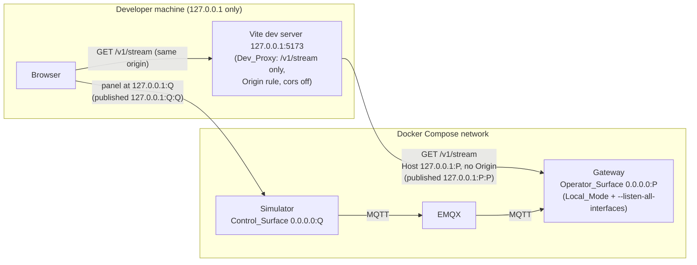
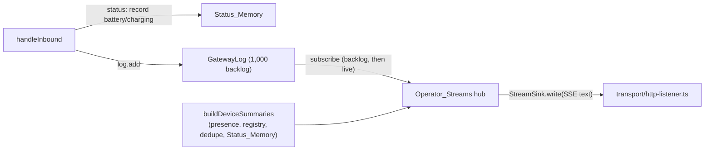

# Design Document: Phase 1.3 Admin Live Console

## Overview

Three small changes, each behind an existing seam:

1. **Gateway:** one new read-only SSE route, `GET /v1/stream`, on the existing Operator_Surface. It replays the Gateway_Log backlog and then follows it live, and sends a per-device summary whenever device state changes. All new network code stays in `services/gateway/src/operator/transport/`.
2. **Compose:** the Operator_Surface and the Simulator's Control_Surface are published on host `127.0.0.1` only, and bind all interfaces inside their containers only in Local_Mode with an explicit argument (Omar's ruling, C8).
3. **Admin console:** the Phase 0 shell becomes a two-page, read-only React app (Dashboard; Devices + Live Log) fed by the stream through a Vite dev proxy.

Nothing changes in Document B, the Gateway_Log entry types, `GATEWAY_LOG_VERSION`, the Panel, the parent app, or the Phase 1.2 request guards.

Code examples are TypeScript (the repo's only language). Choices C1 to C15 and every FLAG are in `requirements.md`.

## Architecture



Inside the Gateway:



## Components and Interfaces

### Shared: `packages/shared/src/gateway-log/stream.ts` (new)

Types for the stream payloads, plus one constant. Exported from `gateway-log/index.ts` and the package index. Not the contract, not a Log_Entry type, so `GATEWAY_LOG_VERSION` stays 1.

```ts
/** SSE event names on the Operator_Stream (Phase 1.3 C2). */
export const OPERATOR_STREAM_EVENTS = Object.freeze(["devices", "entry"] as const);
export type OperatorStreamEvent = (typeof OPERATOR_STREAM_EVENTS)[number];

export type DevicePresence = "unknown" | "online" | "offline";

/** One device in a `devices` event (C3). IDs, presence, a time, counts and telemetry only. */
export type DeviceSummary = Readonly<{
  device_id: string;
  presence: DevicePresence;
  /** ISO 8601 UTC, or null before the first Heartbeat. */
  last_heartbeat_at: string | null;
  /** From the latest accepted status; null before the first. */
  battery_pct: number | null;
  charging: boolean | null;
  events_accepted: number;
  events_duplicate: number;
}>;

/** The data of a `devices` event. */
export type OperatorStreamDevices = Readonly<{ devices: readonly DeviceSummary[] }>;
```

`packages/shared/test/exports.test.ts`: `OPERATOR_STREAM_EVENTS` joins `EXPECTED_RUNTIME_EXPORTS` (157 → 158); the four types join the `import type` list.

### Gateway

#### `src/listen-host.ts` (new, copied in the simulator)

```ts
/** The argument Compose adds to bind the local surface on every container interface (C8). */
export const LISTEN_ALL_ARGUMENT = "--listen-all-interfaces";

export function hasListenAllArgument(argv: readonly string[]): boolean {
  return argv.includes(LISTEN_ALL_ARGUMENT);
}

/** 0.0.0.0 only with Local_Mode and the argument; 127.0.0.1 in every other case. */
export function localSurfaceHost(localMode: boolean, listenAll: boolean): "127.0.0.1" | "0.0.0.0" {
  return localMode && listenAll ? "0.0.0.0" : "127.0.0.1";
}
```

`index.ts` passes `listenAllInterfaces: hasListenAllArgument(process.argv.slice(2))` in `GatewayDeps` (new optional field, default false). Other arguments stay ignored. `gateway.ts` calls `listenOperator({ host: localSurfaceHost(config.localMode, deps.listenAllInterfaces ?? false), ... })`; the `OperatorListen` `host` type widens to `"127.0.0.1" | "0.0.0.0"`. The operator CLI is unchanged: it calls `127.0.0.1`, which a `0.0.0.0` listener also serves.

#### `src/operator/device-summary.ts` (new)

```ts
export interface StatusMemory {
  record(deviceId: string, batteryPct: number, charging: boolean): void;
  latest(deviceId: string): Readonly<{ battery_pct: number; charging: boolean }> | null;
}
export function createStatusMemory(): StatusMemory;

export type SummarySources = Readonly<{
  deviceIds: readonly string[];
  presence: Pick<Presence, "state" | "lastHeartbeatAt">;
  dedupe: Pick<DedupeStore, "forDevice">;
  status: Pick<StatusMemory, "latest">;
}>;
export function buildDeviceSummaries(src: SummarySources): readonly DeviceSummary[];
```

In `handleInbound`, for a classified `status` message, `status.record(...)` runs just before `log.add(messageInEntry(d))`, so the change is visible when that `message_in` entry reaches the stream (Req 2.3). Values come from the parsed, contract-valid message, the same values the entry already logs.

#### `src/operator/operator-stream.ts` (new, pure: no network import)

The hub. It owns the stream count, SSE formatting, change detection and keep-alive timers.

```ts
export const OPERATOR_STREAM_LIMITS = Object.freeze({
  maxStreams: 4,
  maxPendingBytes: 1_048_576,
  keepAliveMs: 15_000,
});

/** What the transport gives the hub for one open response. */
export type StreamSink = Readonly<{
  /** The first write sends the 200 status and stream headers. */
  write(chunk: string): void;
  /** Bytes written but not yet flushed to the socket. */
  pending(): number;
  /** Ends the response. Idempotent. */
  end(): void;
}>;

export type StreamOpen =
  | { readonly ok: true; close(): void }
  | { readonly ok: false; readonly refusal: HttpResponseOut };

export interface OperatorStreams {
  open(sink: StreamSink): StreamOpen;
  closeAll(): void;
}

export function createOperatorStreams(deps: Readonly<{
  log: Pick<GatewayLog, "subscribe">;
  summaries: () => readonly DeviceSummary[];
  clock: Clock;
}>): OperatorStreams;

/** One SSE event: `event: <name>\ndata: <json>\n\n`. JSON.stringify output has no line break. */
export function sseEvent(name: OperatorStreamEvent, json: string): string;
export const SSE_KEEP_ALIVE = ": keep-alive\n\n";
```

`open(sink)`:

1. If 4 streams are open, return `{ ok: false, refusal: errorResponse(503, "too_many_streams") }`, write nothing.
2. `last = JSON.stringify({ devices: summaries() })`; write `sseEvent("devices", last)`.
3. Set `replaying = true`; call `log.subscribe(fn)`; set `replaying = false`. `fn(entry)` writes `sseEvent("entry", JSON.stringify(entry))`. When not replaying, it then computes `next = JSON.stringify({ devices: summaries() })` and, if `next !== last`, writes `sseEvent("devices", next)` and sets `last = next`. Because `GatewayLog.add` is synchronous and `subscribe` delivers the backlog before registering, there is no gap or repeat between backlog and live (Req 1.2), and the devices event right after the backlog is already current, so none is needed during replay.
4. Arm a keep-alive with `clock.setTimer` every 15 s writing `SSE_KEEP_ALIVE`.
5. After every write, if `sink.pending() > maxPendingBytes`, close the stream (Req 1.8).

`close()` (from the client's socket `close`, an overflow, or `closeAll()` at `stop()`): unsubscribe, clear the timer, `sink.end()`, decrement the count. Idempotent. A throwing write inside `fn` is caught by the Gateway_Log, which removes that subscriber (Phase 1.2 Req 12.7); the hub also closes the stream in that case.

`JSON.stringify(entry)` is exactly what `createGatewayLog` writes to stdout, so `entry` data equals the stdout line (Req 2.1).

#### `src/operator/operator-routes.ts` and `request-guard.ts` (changed)

- `OPERATOR_STREAM_PATH = "/v1/stream"`; `OPERATOR_ROUTES` gains `"/v1/stream": ["GET"]`. The guard (`checkRequest`) is not changed, so Host, Origin and method rules apply as for every route (Req 1.5).
- `OperatorErrorCode` gains `"too_many_streams"`.
- `checkStreamRequest(req: HttpRequestIn): HttpResponseOut | null`: any query key gives 400 `invalid_fields` with one `unrecognized_keys` Safe_Issue per key (key made safe by `toSafeIssues`, value never echoed).
- `handleOperatorRequest` answers the stream path with 404 `unknown_route`; the listener never sends it there, because a stream needs the transport.

#### `src/operator/transport/http-listener.ts` (changed)

`OperatorListen` opts gain:

```ts
/** For OPERATOR_STREAM_PATH only: a refusal to send, or null once the stream is open on sink. */
openStream(request: HttpRequestIn, sink: StreamSink): HttpResponseOut | null;
```

After preflight and the body read (the 8 KiB cap is unchanged), a request for `OPERATOR_STREAM_PATH` goes to `opts.openStream` instead of `opts.handle`. The listener's sink writes `200` with `OPERATOR_STREAM_HEADERS` (`Content-Type: text/event-stream; charset=utf-8`, `Cache-Control: no-store`, `X-Content-Type-Options: nosniff`) on the first write, uses `res.write`, reports `res.writableLength` as `pending()`, and calls the stream's `close()` on the response's `close` event. `close()` of the listener already calls `closeAllConnections()`, so `stop()` cannot hang on an open stream.

#### `src/gateway.ts` (changed)

Creates `statusMemory` and `streams = createOperatorStreams({ log, summaries, clock })`, wires `openStream: (req) => { fireDue(); return checkStreamRequest(req) ?? openOrRefusal(streams.open(sink)); }`, and calls `streams.closeAll()` in `stop()` before the listeners close. `fireDue()` first matches every other inbound request (D3).

### Simulator

- `src/listen-host.ts`: the same file as the Gateway's (copied; services never import each other).
- `simulator.ts`: `CONTROL_HOST` is replaced by `localSurfaceHost(config.localMode, deps.listenAllInterfaces ?? false)`; `SimulatorDeps` gains `listenAllInterfaces?: boolean`; the `ControlListen` `host` type widens. `index.ts` passes `hasListenAllArgument(process.argv.slice(2))`.
- The Control_Surface guard, routes and panel are unchanged. From the host the panel is at `http://127.0.0.1:Q`; its `Host` and same-origin `Origin` already pass the guard because the container listens on the same port `Q` (C10).

### Compose (`docker-compose.yml`)

```yaml
  gateway:
    build: { context: ., dockerfile: services/gateway/Dockerfile }
    # The image's CMD plus the argument that binds the Operator_Surface on all container
    # interfaces (Local_Mode only); published on host loopback only.
    command: ["node", "dist/index.js", "--listen-all-interfaces"]
    ports:
      - "127.0.0.1:${GATEWAY_OPERATOR_PORT:-8090}:${GATEWAY_OPERATOR_PORT:-8090}"
    # env_file, depends_on and restart unchanged
  simulator:
    build: { context: ., dockerfile: services/simulator/Dockerfile }
    command: ["node", "dist/index.js", "--listen-all-interfaces"]
    ports:
      - "127.0.0.1:${SIMULATOR_PANEL_PORT:-8091}:${SIMULATOR_PANEL_PORT:-8091}"
```

The header comment that says the two services publish no ports is rewritten to say each publishes one loopback-only port. Compose reads the root `.env` for interpolation; the fallback (C9) keeps `docker compose config` valid with no `.env` or with a copy of `.env.example`. Dockerfiles are unchanged.

### Admin console (`apps/admin`)

Layout cues from the design image, limited to the two pages: a left navigation column, a header bar titled "Developer Console" with the stream state on the right (like the image's "Cloud Connected" pill, as text), a device card row (Device ID, battery, state), and a "Recent Logs & Events" panel with an "All" type dropdown. Everything else in the image (API tester, camera, emergency stop, dock, configuration) is out of scope; camera and dock are also absent from v1 hardware.

| File | Role |
|---|---|
| `vite.config.ts` | Unchanged addresses (C7). `defineConfig(({ command, mode }) => ...)`: `loadEnv(mode, REPO_ROOT, "GATEWAY_OPERATOR_PORT")`, then, for `serve` only, `operatorProxy(env["GATEWAY_OPERATOR_PORT"])`. `server.cors: false`. Prints one warning line naming the key when the proxy is off. |
| `vite-proxy.ts` | Pure builder, no env read. |
| `src/app.tsx` | Shell: the one `h1`, nav, stream status, page switch. Takes an optional `createSource` for tests. |
| `src/routing/use-hash-page.ts` | `#/` → Dashboard, `#/live` → Devices + Live Log, via `hashchange`. No router dependency. |
| `src/stream/stream-client.ts` | EventSource lifecycle and backoff. |
| `src/stream/console-state.ts` | Pure reducer and selectors. |
| `src/stream/use-console-stream.ts` | `useReducer` + `useEffect` wiring client to reducer; cleanup stops the client. |
| `src/log/entry-label.ts` | Pure label per kind. |
| `src/components/stream-status.tsx` | `role="status"` text: Connecting, Live, Reconnecting (+ "data may be out of date"). |
| `src/components/device-health-table.tsx` | Table used by both pages (columns vary by prop). |
| `src/components/live-log.tsx` | Filter `<label>`+`<select>`, `<ol>` newest first. |
| `src/pages/dashboard-page.tsx` | Three tiles + Device Health table. |
| `src/pages/live-log-page.tsx` | Device table + Live_Log. |
| `src/styles.css` | Extended; keeps `--xl-bg`, `--xl-title`, `--xl-body` and the dark block; adds `:focus-visible` outlines; no animation or transition. |

#### `vite-proxy.ts`

```ts
import type { ProxyOptions } from "vite";

export const STREAM_PATH = "/v1/stream";
/** The console's own loopback origins (dev server port 5173, C7), built from parts. */
export const CONSOLE_ORIGINS: readonly string[];

/** null when rawPort is not an integer 1–65535 (Req 4.3). */
export function operatorProxy(rawPort: string | undefined): Record<string, ProxyOptions> | null;
```

The returned map has one key, `^/v1/stream(\?|$)`, with `target` built from parts as `http` + `://127.0.0.1:` + port, `changeOrigin: true` (Host becomes `127.0.0.1:P`), `bypass` returning `false` (Vite answers 404) when an `Origin` header is present and not in `CONSOLE_ORIGINS` (Req 4.4), and `configure` adding a `proxyReq` handler that removes `origin` (C5).

#### `src/stream/stream-client.ts`

```ts
export type StreamState = "connecting" | "live" | "reconnecting";

export type EventSourceLike = {
  onopen: ((ev: Event) => void) | null;
  onerror: ((ev: Event) => void) | null;
  addEventListener(type: string, fn: (ev: MessageEvent<string>) => void): void;
  close(): void;
};

export type StreamClientOptions = Readonly<{
  createSource: (url: string) => EventSourceLike;
  setTimer: (fn: () => void, ms: number) => unknown;
  clearTimer: (handle: unknown) => void;
  onState: (state: StreamState) => void;
  onOpen: () => void; // reducer reset
  onDevices: (payload: OperatorStreamDevices) => void;
  onEntry: (entry: GatewayLogEntry) => void;
}>;

/** 1,000, 2,000, 4,000, 8,000, then 10,000 ms (failures counted from 1). */
export function reconnectDelayMs(failures: number): number;

export function createStreamClient(opts: StreamClientOptions): { stop(): void };
```

The URL is the relative path `/v1/stream`. On `open`: failures = 0, `onOpen()`, state `live`. On `error`: `close()` the source (this stops the browser's own retry), failures + 1, state `reconnecting`, schedule a new source after `reconnectDelayMs(failures)`. `devices` and `entry` data are `JSON.parse`d inside `try`; a value that fails a small shape guard (entry: plain object, `kind` in `GATEWAY_LOG_KINDS`, safe-integer `seq` ≥ 1, string `at`; devices: object with a `devices` array) is ignored. `stop()` closes the source and clears the pending timer (Req 7.4).

#### `src/stream/console-state.ts`

```ts
export const LIVE_LOG_CAP = 500;

export type ConsoleState = Readonly<{
  connection: StreamState;
  /** null until the first devices event of the current connection. */
  devices: readonly DeviceSummary[] | null;
  /** Ascending seq, unique, at most LIVE_LOG_CAP. */
  entries: readonly GatewayLogEntry[];
  /** True while reconnecting after data was shown. */
  stale: boolean;
}>;

export type ConsoleAction =
  | { type: "state"; state: StreamState }
  | { type: "reset" }
  | { type: "devices"; devices: readonly DeviceSummary[] }
  | { type: "entry"; entry: GatewayLogEntry };

export function consoleReducer(s: ConsoleState, a: ConsoleAction): ConsoleState;
export function newestFirst(entries: readonly GatewayLogEntry[]): readonly GatewayLogEntry[];
export function filterByKind(
  entries: readonly GatewayLogEntry[], kind: GatewayLogKind | "all",
): readonly GatewayLogEntry[];
export function tileCounts(devices: readonly DeviceSummary[]): { total: number; online: number; offline: number };
```

`entry` inserts by `seq` (ignored when the `seq` is already held), then keeps the last 500. `reset` clears `devices` and `entries` (Req 6.6). A device with `presence` `unknown` counts in the total only.

#### `src/log/entry-label.ts`

`entryLabel(entry: GatewayLogEntry): string`, built only from Closed_Enum and ID fields already on the entry:

| Kind | Label |
|---|---|
| `event_accepted` | touch: `touch <zone> (<gesture>)`; wake: `wake (<source>)`; motion: `motion <event>`; button: `button <button> <action>`; others: the event kind (e.g. `cry`) |
| `event_duplicate` | `duplicate ` + the same text |
| `ack_result` | `ack <outcome> for <action or "unknown command"> <cmd_id>`, plus ` (<reason>)` when `reason` is non-empty, or ` (<timeout_cause>)` for `timed_out` |
| `message_out` | `sent <variant> <cmd_id or turn_id>` |
| `message_in` | `received <variant>`; for `status`: `, battery <battery_pct>%, charging yes/no` |
| `presence` | `<state> (<cause>)` |
| `gateway` | `gateway <state>` |
| `auth` | `auth <outcome>` |
| `message_rejected` | `rejected: <issue kinds, comma-separated>` |
| `audio_turn` | `audio turn <phase>`, plus ` (<cause>)` when non-null |

No UI text names a Panel_Key, so the Phase 0 bundle check stays green; the "stream off" hint says "see the README".

## Data Models

SSE on the wire (one device):

```text
event: devices
data: {"devices":[{"device_id":"xlu_000123","presence":"online","last_heartbeat_at":"2026-10-20T10:00:00.000Z","battery_pct":100,"charging":false,"events_accepted":3,"events_duplicate":0}]}

event: entry
data: {"log_ver":1,"seq":42,"at":"2026-10-20T10:00:01.250Z","kind":"event_accepted","device_id":"xlu_000123","event_id":"ev_...","event":"touch","data":{"zone":"belly","gesture":"tap"},"time_uncertain":false,"back_dated":false,"ordering":"device_ts","device_ts":1792490401,"received_at":"2026-10-20T10:00:01.250Z"}

: keep-alive

```

Devices events are sent after `presence`, status `message_in`, `event_accepted` and `event_duplicate` entries in practice; the rule is "any Device_Summary changed", not a kind list.

## Error Handling

| Situation | Behaviour |
|---|---|
| Foreign `Host` / any `Origin` at the Gateway | 403 `forbidden_host` / `forbidden_origin` (guard unchanged) |
| POST (or other non-GET) `/v1/stream` | 405 `method_not_allowed` |
| Query on `/v1/stream` | 400 `invalid_fields`, keys made safe, values not echoed |
| Fifth stream | 503 `too_many_streams` |
| Slow reader (> 1 MiB pending) | Stream closed; console reconnects and rebuilds |
| Client disconnects | Stream closed: unsubscribed, timer cleared |
| Gateway stops | `closeAll()`, then listener close |
| Not Local_Mode | No Operator_Surface at all (Phase 1.2 Req 13.2) |
| Port key unset when `pnpm dev:admin` starts | No proxy, one warning line naming the key; console shows "Reconnecting" with the README hint |
| Foreign `Origin` at the dev server | Not forwarded, 404 |
| Bad JSON or unknown shape in an SSE event | Ignored by the console |
| Gateway restart (`seq` restarts) | Stream errors, console reconnects, `reset` clears state |

## Security Notes

- FLAG (carried from Phase 1.2 G24/G46, still true): the Operator_Stream, the Control_Surface and the admin dev server are unauthenticated. Mitigations: host-loopback-only publishing, Local_Mode-only binding beyond loopback, the unchanged Host/Origin guards, the dev server's Origin rule with CORS off, and a stream that carries only Safe Log_Entries and summaries.
- Residual risk: any process on the developer's machine can read the stream at `127.0.0.1:P`, and any process inside the Compose network can reach `0.0.0.0:P` if it forges `Host: 127.0.0.1:P`. The only such processes are our own containers and the developer's tools. The data is IDs, enums, counts and times.
- No secret is added to any image, Compose entry, bundle or response.

## Correctness Properties

*A property is a characteristic or behavior that should hold true across all valid executions of a system: a formal statement about what the system should do. Properties bridge human-readable specifications and machine-verifiable correctness guarantees.*

Per Omar (C15), each property below is checked by example-based tests in this phase, not by fast-check runs.

### Property 1: Stream order and fidelity

For any retained backlog and any later Log_Entries, an Operator_Stream opened at any moment receives a `devices` event first, then `entry` events whose `seq` values go up by exactly 1 with no gap or repeat across the backlog/live seam, and each `entry` data text equals that entry's stdout line.

**Validates: Requirements 1.2, 2.1**

### Property 2: Summaries follow device state

For any Log_Entry that changes any Device_Summary, the next event after its `entry` event is a `devices` event equal to `buildDeviceSummaries` at that moment; for any Log_Entry that changes none, no `devices` event follows it. A Device_Summary's `battery_pct` and `charging` equal the latest accepted status of that device, or null before one.

**Validates: Requirements 1.3, 2.2, 2.3**

### Property 3: No secret on the stream

For any `DEVICE_TOKEN`, `MQTT_PASSWORD` and hello `auth` values of at least 8 characters, no part of the Operator_Stream text contains any of them.

**Validates: Requirements 2.4**

### Property 4: Listen host decision

For all combinations of Local_Mode and the Listen_All_Argument, a local surface listens on `0.0.0.0` exactly when both are present, and on `127.0.0.1` otherwise.

**Validates: Requirements 3.1, 3.2**

### Property 5: Live_Log window

For any sequence of `entry` actions after a `reset`, the console state holds unique `seq` values, at most 500 of them, which are the highest `seq` values received, and `newestFirst` returns them in strictly descending `seq` order.

**Validates: Requirements 6.2, 6.3**

### Property 6: Filter

For any held entries and any selected kind other than "All", every shown entry has that kind and every held entry of that kind is shown.

**Validates: Requirements 6.4**

### Property 7: Reconnect schedule

For any run of consecutive failures n ≥ 1, the delay before the next attempt is min(1,000 × 2^(n−1), 10,000) ms, and after a successful open the next failure waits 1,000 ms again.

**Validates: Requirements 7.2**

## Testing Strategy

Smoke and key-interaction tests only (C15). All run under the root `pnpm test` (Vitest).

**Gateway** (`services/gateway/test/`):
- `operator-stream.test.ts`: real loopback listener through the existing harness (`listenOperatorHttp`, port 0). A new helper `test/support/sse-reader.ts` opens `GET /v1/stream` with `node:http` and parses events incrementally. Cases: headers; first event `devices`; backlog then live `seq` order and stdout-line equality (Property 1); a status entry followed by a `devices` event with its battery, an `auth` entry followed by none (Property 2); 403 foreign `Origin`, 403 foreign `Host` (`gateway:<port>`), 405 POST, 400 query, 503 fifth stream; closing a client frees a slot; `stop()` ends open streams; sentinel token, password and `auth` absent from the full stream text (Property 3); the pure hub's overflow close with a fake sink.
- `stream-done-when.test.ts`: fake device plus Vitest fake timers (as `done-when.test.ts` does): Online with `battery_pct` 100 after hello + status; touch `belly` `event_accepted` with zone `belly`; `cry` `event_accepted`; `say` `message_out` then `ack_result` `done` with action `say`; after 45 s of silence a `presence` `offline` (`silence`) entry followed by a `devices` event with `presence` `offline`.
- `listen-host.test.ts`: the four-case table (Property 4) and the harness's recorded `operatorListens` host with and without `listenAllInterfaces`.

**Simulator** (`services/simulator/test/listen-host.test.ts`): the same table, and the recorded Control_Surface listen host in both modes with and without the argument.

**Shared**: `exports.test.ts` update.

**Admin** (`apps/admin/test/`, `// @vitest-environment jsdom` for DOM files):
- `support/fake-event-source.ts` (emits `open`, `error`, named events) and `support/entries.ts` (typed sample Log_Entries).
- `dashboard-page.test.tsx`: tiles 1/1/0 and the health row `xlu_000123`, "Online", "100%"; a second `devices` event with `offline` updates the tiles.
- `live-log.test.tsx`: newest first; 600 entries keep 500 highest (Property 5); selecting `ack_result` in the labelled filter shows only those (Property 6); the touch row reads `touch belly (tap)`.
- `stream-client.test.ts`: `reconnectDelayMs` table (Property 7); with fake timers, error → "Reconnecting", new source after 1 s, open → "Live" and reset.
- `vite-proxy.test.ts` (node environment): valid port gives the target and key; missing, empty, `0`, `65536` and `abc` give null; `bypass` rejects a foreign `Origin` and passes none or the console origin.
- Wiring: root `vitest.config.ts` includes `apps/admin/test/**/*.test.{ts,tsx}`; `apps/admin/tsconfig.json` includes `test` and `vite-proxy.ts` so `pnpm build` type-checks them; `eslint.config.mjs` gives `apps/admin/test/**` browser globals. If Vitest's transform does not pick up `jsx: "react-jsx"` from `apps/admin/tsconfig.json` for `.tsx` tests, set automatic JSX in `vitest.config.ts`.

**Repo checks** (`tooling/test/`):
- `compose-static.test.ts`: for each of gateway and simulator, `ports` equals exactly the one Requirement 3.3/3.4 string, and `command` equals `["node", "dist/index.js", "--listen-all-interfaces"]`; the no-`environment`, no-`secrets` and credential-word assertions stay.
- `env-reads.test.ts`: keeps `vite.config.ts` in the zero-findings scan and adds `vite-proxy.ts` to it; a new test finds exactly one `loadEnv(` in `vite.config.ts`, whose prefix argument is the literal `"GATEWAY_OPERATOR_PORT"`, and only `["GATEWAY_OPERATOR_PORT"]` property reads on its result; no `loadEnv` under `apps/admin/src`.
- `readme.test.ts`: the `pnpm dev:admin` row check changes to a loopback URL plus "live console".
- `compose-acceptance.test.ts`: follows the new criterion and PASSED line (below).
- `placeholder.test.ts`, `manifests.test.ts`, `url-scan.test.ts`, `secret-check.test.ts`, `contrast.test.ts`, `no-cross-package-import.test.ts`, `file-names.test.ts`: unchanged and passing.

**Compose_Acceptance_Check** (C14): a new criterion `stream`, run right after `23.1`: `docker compose port gateway <P>` and `docker compose port simulator <Q>` each print `127.0.0.1:<port>`; a `node:http` GET to `127.0.0.1:P/v1/stream` with `Host: 127.0.0.1:P` returns 200 and a first `devices` event whose only device is `DEVICE_ID_VALUE`; a GET of `127.0.0.1:Q/` returns 200. The PASSED line becomes `PASSED 23.1–23.8 + stream`. Every Phase 1.2 step is unchanged.

**Manual Done-when checklist** (browser, by nature not automated):

1. In `.env` (Local_Mode values as in the README), set `GATEWAY_OPERATOR_PORT` and `SIMULATOR_PANEL_PORT`. Run `docker compose up --build`.
2. Run `pnpm build`, then `pnpm dev:admin`; open `http://127.0.0.1:5173`. Status reads "Live".
3. Dashboard: Devices 1, Online 1, Offline 0; the health row shows the device with "Online" and a battery %.
4. Open the Simulator panel at `http://127.0.0.1:<SIMULATOR_PANEL_PORT>`; fire touch `belly`. Within about 1 s the Live_Log shows `touch belly (...)` at the top.
5. Fire `cry`: a `cry` row appears. Start an audio turn from the panel (the Gateway's Fake_Reply sends `say`): a `sent say ...` row and an `ack done for say ...` row appear.
6. Toggle the Simulator offline in the panel and wait: within about 45 s the device flips to Offline on both pages and an `offline (silence)` row appears.
7. Search the Live_Log text and the browser's network view of `/v1/stream` for the `.env` `DEVICE_TOKEN` value: it does not appear.
