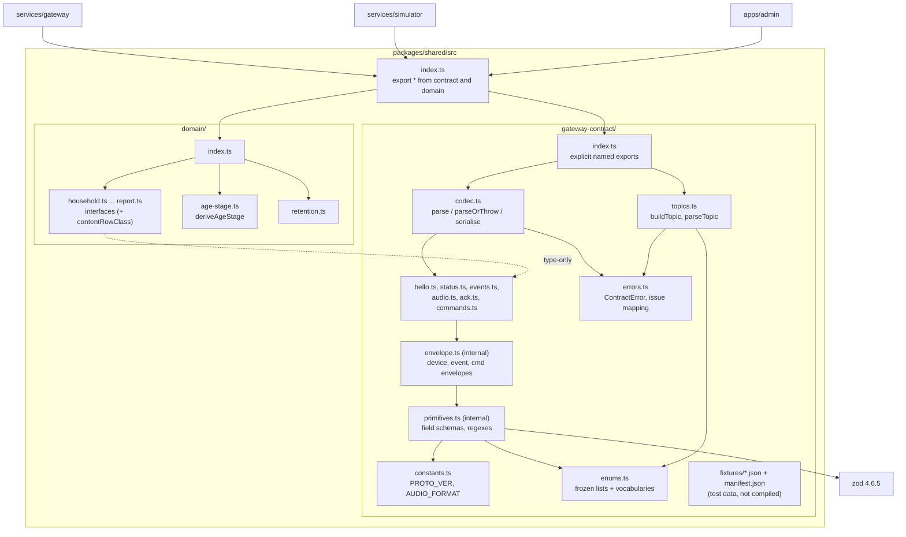
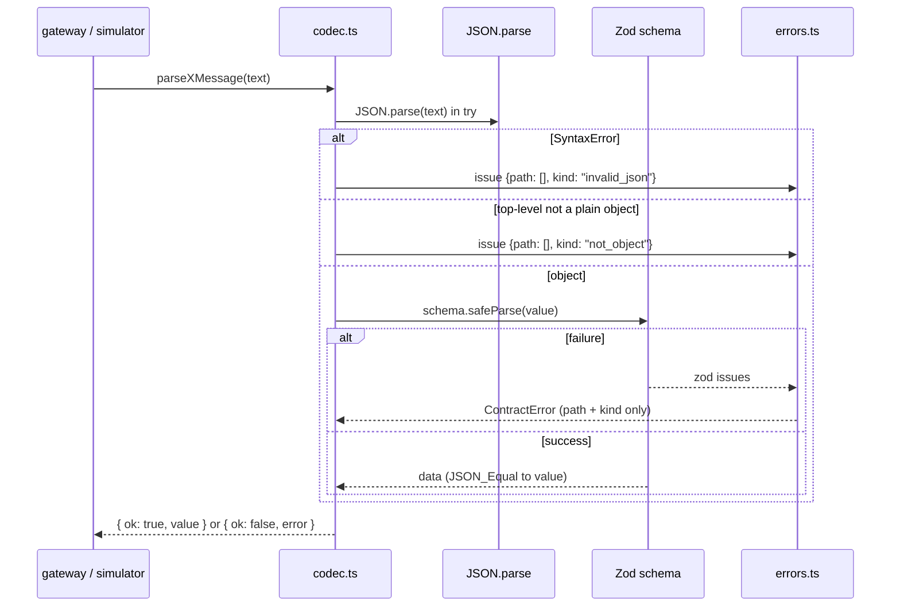

# Design Document: Phase 1 gateway contract

## Overview

This phase fills `packages/shared` with the Document B v2 contract (`proto_ver` 2) and the shared domain model. It ships:

- Zod 4 schemas, hand-written TypeScript types, frozen constants, and parse/serialise functions for every Wire_Message, in `packages/shared/src/gateway-contract/`.
- A topic builder and parser for the four MQTT topics.
- Golden fixtures (derived from the Document B v2 examples, or constructed from its field tables) plus a manifest.
- Type-only domain interfaces (with two content row classes), the transcript retention constant, a pure age-stage function and a pure `contentRowClass` helper, in `packages/shared/src/domain/`.
- Updates to the Phase 0 checks that this phase deliberately supersedes (Requirement 17), the README note, the tech steering seam section and the structure steering domain notes (Requirement 18).

The source is `docs/B-gateway-and-hardware-seam.docx`, Document B Version 2.0 (`proto_ver` 2, 8 Oct 2026, provisionally frozen pending the intern's confirmation), plus Omar's rulings of 8 Oct 2026 recorded in requirements.md.

Nothing here opens a socket, reads env vars or touches Supabase. Everything is pure and synchronous, which is what makes it suitable for property-based testing.

### Key decisions

| # | Decision | Rationale |
|---|---|---|
| D1 | Pin `zod` at `4.6.5` (exact) as the only runtime dependency of `@xelulu/shared`. | `npm view zod version` on 8 Oct 2026 returned `4.6.5`, the current stable Zod 4 release (C11). Exact pin per tech rules. |
| D2 | Import from the package root: `import { z } from "zod"`. | Since Zod 4.0.0 the root export is Zod 4 "classic". The `zod/v4` subpath exists only as a compatibility alias for the 3.25 bridge period, so using it would add nothing and could confuse later upgrades. `zod/mini` is not used: bundle size does not matter for Node consumers, and the method-chaining API is easier to review against Document B. |
| D3 | Every object is `z.strictObject(...)`. No `.passthrough()`, `.loose`, `.default()`, `.transform()`, `.coerce` or `.catch()` anywhere in the contract. | C3 and C14. With no transforms or defaults, the parsed output is always JSON_Equal to the input, which is what Requirement 10.5 needs. |
| D4 | Hand-write every wire type and assert at compile time that it equals `z.output<typeof Schema>`. | The hand-written types are the readable mirror of Document B. The assertion (in a test file covered by `tsconfig.test.json`) makes `pnpm test` fail on drift (Requirement 10.9). |
| D5 | Shared tests import the built entry `../dist/index.js`, as Phase 0's export test does. | Tests exercise exactly what consumers import. `pnpm test` already builds first. |
| D6 | Contract errors carry `{ path, kind }` issues only and a generic message. Zod's `message`, `input`, `values`, `expected` and `cause` are never copied. | C20 and safety.md §7. |
| D7 | Unknown-key issue path is the parent path plus the unknown key's name. | Requirement 3.1 asks that the path name the key's location. Key names are not field values (C20 covers values only). This is flagged in Risks. |
| D8 | Fixtures stay in `src/gateway-contract/fixtures/` as `.json`. They are never imported from `src`, so `tsc` does not copy them to `dist`, and they are not exported (C18). Tests read them with `node:fs`. | Keeps the single contract home (structure.md) without shipping test data. |
| D9 | Move `data` is `z.discriminatedUnion("cmd", [come, turn, stop])` of strict objects, nested inside the `move` option of the `action` union. | Ruling 4: speeds are optional only on `stop`. A union keyed on `cmd` keeps each shape strict and gives a narrowable `MoveCmdData` type. It nests under a field, so no union is a direct option of another union. |
| D10 | Content is two interfaces, `HouseholdContentItem` and `GlobalContentItem`, over a shared `ContentItemBase`, with `ContentItem` as their union and a pure `contentRowClass` helper. | Ruling 6: both row classes are first-class. The literal `household_id` types (`string` / `null`) make the class checkable at compile time, and the helper gives later code one place to branch. |

## Architecture



Dependencies point one way: message modules depend on primitives and enums, the codec depends on messages and errors, and the domain only takes types from the contract. Nothing in `packages/shared` imports from `apps/` or `services/` (Requirement 19.5).

### Data flow through the codec



`serialise` runs the same schema on the in-memory value, throws a `ContractError` on failure, and otherwise returns `JSON.stringify(data)`.

## Components and Interfaces

### File layout

All file names are kebab-case (Phase 0 file-name check).

```
packages/shared/
├─ package.json                      + "dependencies": { "zod": "4.6.5" }
├─ src/
│  ├─ index.ts                       export * from "./gateway-contract/index.js";
│  │                                 export * from "./domain/index.js";
│  ├─ gateway-contract/
│  │  ├─ constants.ts                PROTO_VER, AUDIO_FORMAT
│  │  ├─ topics.ts                   TOPIC_PREFIX, TOPIC_SUFFIXES, buildTopic, parseTopic
│  │  ├─ enums.ts                    closed lists, open vocabularies, their types
│  │  ├─ primitives.ts               internal field schemas and regexes (not re-exported)
│  │  ├─ envelope.ts                 internal envelope builders (not re-exported)
│  │  ├─ hello.ts                    HelloMessage, HelloMessageSchema
│  │  ├─ status.ts                   StatusMessage(+Schema), StatusTopicMessage(+Schema)
│  │  ├─ events.ts                   8 event kinds, EventMessage(+Schema), EventDataFor
│  │  ├─ audio.ts                    AudioStart/AudioEnd/AudioControl messages
│  │  ├─ ack.ts                      AckMessage(+Schema)
│  │  ├─ commands.ts                 11 actions, CmdMessage(+Schema), QuietHours
│  │  ├─ errors.ts                   ContractError, ContractIssue, ParseResult, issue mapping
│  │  ├─ codec.ts                    per-variant and union codecs, parseDeviceMessage
│  │  ├─ index.ts                    explicit named exports (the contract's public surface)
│  │  └─ fixtures/
│  │     ├─ manifest.json
│  │     └─ *.json                   one Wire_Message per file (listed under Data Models)
│  └─ domain/
│     ├─ common.ts                   IsoDate, IsoDateTime aliases
│     ├─ age-stage.ts                AGE_STAGES, AgeStage, deriveAgeStage
│     ├─ retention.ts                DEFAULT_TRANSCRIPT_RETENTION_DAYS
│     ├─ household.ts, user.ts, child-profile.ts, device.ts, session.ts,
│     │  event.ts, grandma-asset.ts, consent.ts, report.ts (type-only)
│     ├─ content-item.ts             two content row classes, ContentItem, contentRowClass
│     └─ index.ts                    explicit named exports
└─ test/
   ├─ arbitraries.ts                 fast-check generators per variant (helper, not a test)
   ├─ mutations.ts                   mutation helpers and field tables (helper, not a test)
   ├─ topics.test.ts
   ├─ codec-roundtrip.test.ts
   ├─ codec-rejection.test.ts
   ├─ codec-rules.test.ts            ack reason, config, open vocab, formats, cross-variant
   ├─ errors.test.ts                 issue shape and no-value-leak property
   ├─ generator-coverage.test.ts     Requirement 11.6 sampling
   ├─ fixtures.test.ts
   ├─ constants.test.ts              lists, frozen, read-only
   ├─ contract-types.test.ts         compile-time type equality
   ├─ exports.test.ts                replaces the Phase 0 test
   ├─ domain-types.test.ts           domain shape checks (compile-time + static)
   └─ age-stage.test.ts
```

Within `gateway-contract/` and `domain/`, imports use relative `.js` specifiers (NodeNext). `primitives.ts`, `envelope.ts` and the codec factory are not listed in `gateway-contract/index.ts`, so they never reach the Shared_Entry.

### primitives.ts (internal)

| Name | Zod | Notes |
|---|---|---|
| `protoVer` | `z.literal(PROTO_VER)` | rejects `"2"`, `1`, `3`, `2.5`, `null`, missing |
| `unixSeconds` | `z.int().min(0).max(Number.MAX_SAFE_INTEGER)` | Zod 4 `z.int()` already limits to safe integers; the explicit bounds document intent |
| `nonEmpty` | `z.string().min(1)` | identifiers, `card_id`, Open_Vocabulary fields |
| `anyString` | `z.string()` | error `code` and `detail` (ruling 3, empty allowed), `fault` items |
| `finite` | `z.number()` | Zod 4 rejects `NaN` and `±Infinity` by default |
| `nonNegFinite` | `z.number().min(0)` | `duration_s`, `max_dist_mm`, `linear_mms`, `angular_mrad_s` (ruling 3, no upper bound) |
| `degInt` | `z.int().min(0).max(359)` | wake `dir_deg` (ruling 3) |
| `nonNegInt` | `z.int().min(0)` | `duration_hint_ms` |
| `pct` | `z.int().min(0).max(100)` | `battery_pct`, volume `level`, config `volume`, LED `brightness` |
| `int` | `z.int()` | `wifi_rssi` |
| `unit` | `z.number().min(0).max(1)` | `confidence` |
| `lang` | `z.string().regex(LANG_RE)` | `LANG_RE = /^[a-z]{2,3}(?:-[A-Z][a-z]{3})?(?:-(?:[A-Z]{2}\|[0-9]{3}))?$/` (C5) |
| `hhmm` | `z.string().regex(HHMM_RE)` | `HHMM_RE = /^(?:[01][0-9]\|2[0-3]):[0-5][0-9]$/` (ruling 2) |
| `hexColor` | `z.string().regex(COLOR_RE)` | `COLOR_RE = /^#[0-9A-Fa-f]{6}$/` (ruling 2) |
| `httpsUrl` | `z.string().refine(isAbsoluteHttpsUrl, { params: { kind: "invalid_https_url" } })` | see below |
| `emptyData` | `z.strictObject({})` | the only accepted value is `{}` (C6) |
| `enumOf(list)` | `z.enum(list)` | exact, case-sensitive match against the frozen list |

`isAbsoluteHttpsUrl(s)` returns true only when all hold:

1. `s` starts with the lowercase prefix `https://`. This rules out `http:`, `wss:`, relative paths, `""`, and WHATWG's lenient forms such as `https:localhost` or a leading space (WHATWG strips whitespace, so the raw prefix check is needed).
2. `URL.parse(s)` (Node 24, WHATWG) returns a URL, without throwing.
3. That URL's `protocol` is `"https:"` and `hostname` is not `""`.

The `^` and `$` anchored regexes contain no flags, so `\d`-style classes are ASCII-only, and `$` does not match before a trailing newline in JS (no `m` flag).

### envelope.ts (internal)

```ts
// Device → cloud envelope fields shared by hello, status, event, ack, audio_start, audio_end.
const deviceEnvelope = { proto_ver: protoVer, ts: unixSeconds } as const;

// One event variant: strict, discriminated by `event`, with optional time_uncertain.
function eventSchema<K extends EventKind, D extends z.ZodType>(kind: K, data: D) {
  return z.strictObject({
    ...deviceEnvelope,
    type: z.literal("event"),
    event_id: nonEmpty,
    event: z.literal(kind),
    time_uncertain: z.boolean().optional(),
    data,
  });
}

// One command variant: strict, no ts, no type.
function cmdSchema<A extends CmdAction, D extends z.ZodType>(action: A, data: D) {
  return z.strictObject({ proto_ver: protoVer, cmd_id: nonEmpty, action: z.literal(action), data });
}
```

Because the command envelope is strict, a `ts` or `type` key on a command is an unknown key and is rejected (Requirement 2.3). Every `data` passed in is itself a `z.strictObject` (or, for `move`, a discriminated union of strict objects), so arrays and `null` fail (Requirements 2.2, 2.4).

### Message schemas

| Schema | Definition |
|---|---|
| `HelloMessageSchema` | `strictObject({ ...deviceEnvelope, type: literal("hello"), device_id: nonEmpty, fw_ver: nonEmpty, auth: nonEmpty, proto: literal(PROTO_VER) })` |
| `StatusMessageSchema` | `strictObject({ ...deviceEnvelope, type: literal("status"), battery_pct: pct, charging: boolean(), mode: enumOf(MODES), wifi_rssi: int, fault: array(anyString), active_child_id: z.string().nullable(), temp_c: finite })` |
| `StatusTopicMessageSchema` | `z.discriminatedUnion("type", [HelloMessageSchema, StatusMessageSchema])` |
| `TouchEventMessageSchema` | `eventSchema("touch", strictObject({ zone: enumOf(TOUCH_ZONES), gesture: enumOf(TOUCH_GESTURES) }))` |
| `WakeEventMessageSchema` | `eventSchema("wake", strictObject({ source: enumOf(WAKE_SOURCES), dir_deg: degInt.optional() }))` |
| `CryEventMessageSchema` | `eventSchema("cry", strictObject({ confidence: unit, duration_s: nonNegFinite }))` |
| `MotionEventMessageSchema` | `eventSchema("motion", strictObject({ event: enumOf(MOTION_KINDS), value: finite }))` |
| `ButtonEventMessageSchema` | `eventSchema("button", strictObject({ button: enumOf(BUTTONS), action: enumOf(BUTTON_ACTIONS) }))` |
| `NfcEventMessageSchema` | `eventSchema("nfc", strictObject({ card_id: nonEmpty }))` |
| `InterruptEventMessageSchema` | `eventSchema("interrupt", emptyData)` |
| `ErrorEventMessageSchema` | `eventSchema("error", strictObject({ code: anyString, detail: anyString }))` |
| `EventMessageSchema` | `z.discriminatedUnion("event", [the eight above])` |
| `AudioStartMessageSchema` | `strictObject({ ...deviceEnvelope, type: literal("audio_start"), turn_id: nonEmpty })` |
| `AudioEndMessageSchema` | `strictObject({ ...deviceEnvelope, type: literal("audio_end"), turn_id: nonEmpty })` |
| `AudioControlMessageSchema` | `z.discriminatedUnion("type", [AudioStartMessageSchema, AudioEndMessageSchema])` |
| `AckMessageSchema` | `strictObject({ ...deviceEnvelope, type: literal("ack"), cmd_id: nonEmpty, status: enumOf(ACK_STATUSES), reason: z.union([z.literal(""), enumOf(ACK_REASONS)]) }).superRefine(rejectedNeedsReason)` |
| `SayCmdMessageSchema` | `cmdSchema("say", strictObject({ expression: nonEmpty, lang, voice: enumOf(SAY_VOICES), duration_hint_ms: nonNegInt }))` |
| `AnimateCmdMessageSchema` | `cmdSchema("animate", strictObject({ expression: nonEmpty, eyes: nonEmpty, loop: boolean() }))` |
| `GestureCmdMessageSchema` | `cmdSchema("gesture", strictObject({ name: nonEmpty }))` |
| `MoveCmdMessageSchema` | `cmdSchema("move", z.discriminatedUnion("cmd", [strictObject({ cmd: literal("come"), linear_mms: nonNegFinite, angular_mrad_s: nonNegFinite, max_dist_mm: nonNegFinite }), strictObject({ cmd: literal("turn"), linear_mms: nonNegFinite, angular_mrad_s: nonNegFinite, max_dist_mm: nonNegFinite }), strictObject({ cmd: literal("stop"), linear_mms: nonNegFinite.optional(), angular_mrad_s: nonNegFinite.optional(), max_dist_mm: nonNegFinite })]))` (D9, ruling 4) |
| `PlayCmdMessageSchema` | `cmdSchema("play", strictObject({ content_id: nonEmpty, source: enumOf(PLAY_SOURCES) }))` |
| `SetModeCmdMessageSchema` | `cmdSchema("set_mode", strictObject({ mode: enumOf(MODES) }))` |
| `LedCmdMessageSchema` | `cmdSchema("led", strictObject({ target: enumOf(LED_TARGETS), color: hexColor, effect: enumOf(LED_EFFECTS), brightness: pct }))` |
| `VolumeCmdMessageSchema` | `cmdSchema("volume", strictObject({ level: pct }))` |
| `ConfigCmdMessageSchema` | `cmdSchema("config", strictObject({ volume: pct.optional(), quiet_hours: strictObject({ start: hhmm, end: hhmm }).optional(), movement_on: boolean().optional(), language: lang.optional(), active_child_id: z.string().nullable().optional() }).superRefine(atLeastOneDeltaKey))` |
| `StopAudioCmdMessageSchema` | `cmdSchema("stop_audio", emptyData)` |
| `OtaCmdMessageSchema` | `cmdSchema("ota", strictObject({ manifest_url: httpsUrl }))` |
| `CmdMessageSchema` | `z.discriminatedUnion("action", [the eleven above])` |

`active_child_id` is `z.string().nullable()` (C5 says "a string or `null`", not "non-empty"). The two refinements:

- `rejectedNeedsReason(msg, ctx)`: when `msg.status === "rejected" && msg.reason === ""`, add `{ code: "custom", path: ["reason"], params: { kind: "reason_required" } }` (C7, Requirement 7.4).
- `atLeastOneDeltaKey(data, ctx)`: when no own key of `data` has a value other than `undefined`, add `{ code: "custom", path: [], params: { kind: "config_empty" } }`. A key present with `null` (`active_child_id: null`) counts as present (Requirements 8.11, 8.12).

In Zod 4, `.superRefine` attaches a check to the same `ZodObject` instead of wrapping it in `ZodEffects` (as Zod 3 did). So the refined ack and config-data schemas stay objects, `AckMessageSchema` keeps its `strictObject` behaviour, and `ConfigCmdMessageSchema` can be an option of the `action` discriminated union. Zod 4 runs these checks only after the object's own shape validated, so the refinement never sees a malformed value.

The move `data` union (D9) has exactly one strict option per `MOVE_COMMANDS` value, so the accepted `cmd` values equal the exported list (Requirement 9.1). A `cmd` outside the list fails the union, an unknown key in the selected option fails with `unrecognized_keys` at `["data", key]`, and on `stop` an absent speed is simply absent in the output (no `undefined` key is added). `MoveCmdMessageSchema` itself is still a plain strict object, so it remains a valid option of the `action` union.

There is no single "device message" Zod schema. `parseDeviceMessage` dispatches by Topic_Suffix to the topic parsers, which keeps each union flat: no discriminated union is a direct option of another (the move `data` union sits under a field).

### enums.ts

Each list is declared `Object.freeze([...] as const)`. The TypeScript type is a `readonly` tuple (so assignment to an element is a compile error) and the runtime array is frozen (so assignment throws in strict-mode ESM and leaves the contents unchanged). `z.enum` accepts readonly tuples, so schemas use these exact objects (Requirement 9.1).

| Constant | Values (in order) | Type |
|---|---|---|
| `TOUCH_ZONES` | `head`, `left_ear`, `right_ear`, `belly`, `back`, `left_hand`, `right_hand` | `TouchZone` |
| `TOUCH_GESTURES` | `tap`, `double_tap`, `hold`, `pat` | `TouchGesture` |
| `WAKE_SOURCES` | `hey_lulu`, `touch` | `WakeSource` |
| `MOTION_KINDS` | `pickup`, `shake`, `upside_down`, `drop`, `tilt` | `MotionKind` |
| `BUTTONS` | `belly_talk` | `ButtonName` |
| `BUTTON_ACTIONS` | `press`, `release` | `ButtonAction` |
| `MODES` | `idle`, `play`, `story`, `quiet`, `sleep` | `Mode` |
| `MOVE_COMMANDS` | `come`, `stop`, `turn` | `MoveCommand` |
| `PLAY_SOURCES` | `stream`, `cache` | `PlaySource` |
| `LED_TARGETS` | `ears`, `cheeks`, `belly` | `LedTarget` |
| `LED_EFFECTS` | `solid`, `pulse`, `rainbow` | `LedEffect` |
| `SAY_VOICES` | `xelulu`, `grandma` | `SayVoice` |
| `ACK_STATUSES` | `accepted`, `done`, `rejected`, `failed` | `AckStatus` |
| `ACK_REASONS` | `picked_up`, `at_edge`, `charging`, `quiet_hours`, `low_battery`, `unsafe`, `busy`, `unknown_action` | `AckReason` |
| `EVENT_KINDS` | `touch`, `wake`, `cry`, `motion`, `button`, `nfc`, `interrupt`, `error` | `EventKind` |
| `CMD_ACTIONS` | `say`, `animate`, `gesture`, `move`, `play`, `set_mode`, `led`, `volume`, `config`, `stop_audio`, `ota` | `CmdAction` |
| `KNOWN_EXPRESSIONS` | `happy`, `love`, `sleepy`, `curious`, `sad`, `listening` | (open, field type `string`) |
| `KNOWN_EYES` | `blink`, `hearts` | (open) |
| `KNOWN_GESTURE_NAMES` | `wave`, `high_five`, `hug`, `clap`, `point_left`, `nod`, `shake` | (open) |

`MoveCommand` and `ButtonName` avoid clashing with `MoveCmdMessage` and the `button` field name. `KNOWN_EXPRESSIONS` serves both animate and say `expression` (C4). `LED_EFFECTS` includes `pulse` and `rainbow` because Document B lists them; the flash-rate limit (safety.md §6) is enforced in firmware, and nothing in this contract can request a rate.

### constants.ts and topics.ts

```ts
export const PROTO_VER = 2 as const;

export const AUDIO_FORMAT = Object.freeze({
  codec: "opus",
  sample_rate_hz: 16000,
  channels: 1,
  frame_duration_ms: 20,
} as const); // both directions (Requirement 1.8)

export const TOPIC_PREFIX = "xelulu" as const;
export const TOPIC_SUFFIXES = Object.freeze(["status", "event", "cmd", "ack"] as const);
export type TopicSuffix = (typeof TOPIC_SUFFIXES)[number];
export type ParsedTopic = { readonly device_id: string; readonly suffix: TopicSuffix };

/** Throws ContractError (variant "topic") for an invalid device_id or suffix. */
export function buildTopic(deviceId: string, suffix: TopicSuffix): string;

/** Never throws. Fails unless the input is exactly xelulu/{valid device_id}/{suffix}. */
export function parseTopic(topic: string): ParseResult<ParsedTopic>;
```

A valid `device_id` is a non-empty string containing none of `/`, `+`, `#` (C23). `buildTopic` checks the suffix at runtime as well, because JS callers and casts can pass `"ota"`. `parseTopic` splits on `/`, requires exactly three levels, a first level exactly `"xelulu"`, a valid device id, and a suffix in `TOPIC_SUFFIXES`. Issue kinds: `invalid_topic` (path `[]`, wrong level count or prefix), `invalid_device_id` (path `["device_id"]`), `invalid_topic_suffix` (path `["suffix"]`). There is no `ota` topic constant, type member or string anywhere in the module (Requirement 1.2).

### errors.ts

```ts
export type ContractIssueKind =
  // mapped from Zod 4 issue codes
  | "invalid_type" | "too_big" | "too_small" | "invalid_format" | "not_multiple_of"
  | "unrecognized_keys" | "invalid_union" | "invalid_key" | "invalid_element"
  | "invalid_value" | "custom"
  // raised by this package
  | "invalid_json" | "not_object" | "wrong_topic" | "invalid_topic"
  | "invalid_device_id" | "invalid_topic_suffix"
  | "reason_required" | "config_empty" | "invalid_https_url";

export type ContractIssue = {
  readonly path: readonly (string | number)[];
  readonly kind: ContractIssueKind;
};

export class ContractError extends Error {
  override readonly name = "ContractError";
  readonly variant: string;                 // e.g. "hello", "event", "cmd", "topic"
  readonly issues: readonly ContractIssue[]; // length >= 1, frozen
  constructor(variant: string, issues: readonly ContractIssue[]);
  // message: `Invalid ${variant} message: ${issues.length} issue(s)`
}

export type ParseResult<T> =
  | { readonly ok: true; readonly value: T }
  | { readonly ok: false; readonly error: ContractError };
```

The `ContractError` constructor throws a plain `Error` if given an empty issue list (a programming bug, unreachable from the codec). For the topic variant the message reads `Invalid topic message: …`; this wording is fixed and contains no input.

`mapZodIssues(issues: readonly z.core.$ZodIssue[]): ContractIssue[]` (internal):

- `unrecognized_keys` → one issue per key: `{ path: [...issue.path, key], kind: "unrecognized_keys" }` (D7).
- `custom` → `kind` is `issue.params?.kind` if it is one of `reason_required`, `config_empty`, `invalid_https_url`, otherwise `"custom"`.
- Every other code → `{ path: issue.path filtered to string | number, kind: issue.code }`. An unknown future Zod code maps to `"custom"`, so the `kind` type stays closed.
- Only `path` and `code`/`params.kind` are read. `message`, `input`, `values`, `keys` (beyond the name used in the path), `expected`, `origin`, `format`, `pattern`, nested `errors` of `invalid_union` and the `ZodError` itself are discarded. The `ContractError` sets no `cause`.

### codec.ts

An internal factory `makeCodec(variant, schema)` returns the three functions. Every exported codec function is a named `const` with an explicit type:

```ts
export const parseHelloMessage: (text: string) => ParseResult<HelloMessage>;
export const parseHelloMessageOrThrow: (text: string) => HelloMessage;
export const serialiseHelloMessage: (message: HelloMessage) => string;
```

Behaviour:

- `parseX(text)`: if `typeof text !== "string"` → `invalid_type` at `[]`. `JSON.parse` inside `try`; a `SyntaxError` → `invalid_json` at `[]` (its message can quote the input, so it is dropped). A top-level value that is `null`, an array or a primitive → `not_object` at `[]`. Otherwise `schema.safeParse(value)`. Never throws.
- `parseXOrThrow(text)`: calls `parseX` and throws `result.error`, so its issues are the same object the Result variant returns (Requirement 10.4).
- `serialiseX(message)`: `schema.safeParse(message)`; on failure throws `new ContractError(variant, mapZodIssues(...))`; on success returns `JSON.stringify(result.data)`. Zod 4 builds the output object in schema shape order, so the text is stable across serialise → parse → serialise (Requirement 11.5).

Variant labels: `hello`, `status`, `touch event`, `wake event`, … `error event`, `audio_start`, `audio_end`, `ack`, `say cmd`, … `ota cmd`, and for unions `status topic`, `event`, `audio control`, `cmd`, `device`.

Union codecs and device dispatch:

```ts
export type StatusTopicMessage = HelloMessage | StatusMessage;
export type MqttDeviceMessage = StatusTopicMessage | EventMessage | AckMessage;
export type DeviceMessage = MqttDeviceMessage | AudioControlMessage;
export type DeviceMessageForTopic<S extends TopicSuffix> =
  S extends "status" ? StatusTopicMessage :
  S extends "event" ? EventMessage :
  S extends "ack" ? AckMessage : never;

export function parseDeviceMessage<S extends TopicSuffix>(
  suffix: S, text: string,
): ParseResult<DeviceMessageForTopic<S>>;
export function parseDeviceMessageOrThrow<S extends TopicSuffix>(
  suffix: S, text: string,
): DeviceMessageForTopic<S>;
```

`parseDeviceMessage` routes `status` → `parseStatusTopicMessage`, `event` → `parseEventMessage`, `ack` → `parseAckMessage`. For `cmd` it fails with `{ path: [], kind: "wrong_topic" }` without reading the text (a device never publishes on `cmd`). A suffix outside `TOPIC_SUFFIXES` at runtime fails with `invalid_topic_suffix`. For the `ack` topic, the ack variant parser is also the topic parser: there is a single `parseAckMessage`.

### Public exports (Shared_Entry)

The export test keeps this runtime list. Types are listed separately for the type-only import check.

**Runtime values**

| Group | Names |
|---|---|
| Constants | `PROTO_VER`, `AUDIO_FORMAT`, `TOPIC_PREFIX`, `TOPIC_SUFFIXES` |
| Topics | `buildTopic`, `parseTopic` |
| Errors | `ContractError` |
| Closed lists | `TOUCH_ZONES`, `TOUCH_GESTURES`, `WAKE_SOURCES`, `MOTION_KINDS`, `BUTTONS`, `BUTTON_ACTIONS`, `MODES`, `MOVE_COMMANDS`, `PLAY_SOURCES`, `LED_TARGETS`, `LED_EFFECTS`, `SAY_VOICES`, `ACK_STATUSES`, `ACK_REASONS`, `EVENT_KINDS`, `CMD_ACTIONS` |
| Open vocabularies | `KNOWN_EXPRESSIONS`, `KNOWN_EYES`, `KNOWN_GESTURE_NAMES` |
| Schemas (variants) | `HelloMessageSchema`, `StatusMessageSchema`, `TouchEventMessageSchema`, `WakeEventMessageSchema`, `CryEventMessageSchema`, `MotionEventMessageSchema`, `ButtonEventMessageSchema`, `NfcEventMessageSchema`, `InterruptEventMessageSchema`, `ErrorEventMessageSchema`, `AudioStartMessageSchema`, `AudioEndMessageSchema`, `AckMessageSchema`, `SayCmdMessageSchema`, `AnimateCmdMessageSchema`, `GestureCmdMessageSchema`, `MoveCmdMessageSchema`, `PlayCmdMessageSchema`, `SetModeCmdMessageSchema`, `LedCmdMessageSchema`, `VolumeCmdMessageSchema`, `ConfigCmdMessageSchema`, `StopAudioCmdMessageSchema`, `OtaCmdMessageSchema` |
| Schemas (unions) | `StatusTopicMessageSchema`, `EventMessageSchema`, `AudioControlMessageSchema`, `CmdMessageSchema` |
| Codecs | for each of the 24 variant type names `N` above and the 4 union type names: `parseN`, `parseNOrThrow`, `serialiseN` (for example `parseTouchEventMessage`, `parseTouchEventMessageOrThrow`, `serialiseTouchEventMessage`; `parseCmdMessage`, `parseCmdMessageOrThrow`, `serialiseCmdMessage`) |
| Device dispatch | `parseDeviceMessage`, `parseDeviceMessageOrThrow` |
| Domain | `AGE_STAGES`, `deriveAgeStage`, `DEFAULT_TRANSCRIPT_RETENTION_DAYS`, `contentRowClass` |

**Types only** (checked by `import type` in `exports.test.ts`)

- Wire: the 24 variant types (`HelloMessage` … `OtaCmdMessage`), `StatusTopicMessage`, `EventMessage`, `AudioControlMessage`, `CmdMessage`, `MqttDeviceMessage`, `DeviceMessage`, `DeviceMessageForTopic`, `EventDataFor`, `QuietHours`, `MoveCmdData`.
- Lists: `TouchZone`, `TouchGesture`, `WakeSource`, `MotionKind`, `ButtonName`, `ButtonAction`, `Mode`, `MoveCommand`, `PlaySource`, `LedTarget`, `LedEffect`, `SayVoice`, `AckStatus`, `AckReason`, `EventKind`, `CmdAction`, `TopicSuffix`.
- API: `ParseResult`, `ContractIssue`, `ContractIssueKind`, `ParsedTopic`.
- Domain: `Household`, `User`, `UserRole`, `ChildProfile`, `AgeStage`, `AgeStageResult`, `AgeStageError`, `Device`, `Session`, `TranscriptTurn`, `TranscriptSpeaker`, `Event`, `ContentItem`, `ContentItemBase`, `HouseholdContentItem`, `GlobalContentItem`, `ContentRowClass`, `ContentKind`, `GrandmaAsset`, `GrandmaAssetKind`, `Consent`, `ConsentPurpose`, `VerificationMethod`, `Report`, `ReportPeriod`, `IsoDate`, `IsoDateTime`.

`gateway-contract/index.ts` and `domain/index.ts` use explicit named export lists. `src/index.ts` uses `export *` from both; if they ever export the same name, TypeScript reports an ambiguity error at build time, and the export test catches any dropped name. There is no default export (Requirement 14.2).

### domain/age-stage.ts

```ts
export const AGE_STAGES = Object.freeze(["tiny", "little", "explorer", "maker"] as const);
export type AgeStage = (typeof AGE_STAGES)[number];
export type AgeStageError = {
  readonly kind: "invalid_date_of_birth" | "invalid_reference_date" | "reference_before_birth";
};
export type AgeStageResult =
  | { readonly ok: true; readonly value: AgeStage }
  | { readonly ok: false; readonly error: AgeStageError };

export function deriveAgeStage(dateOfBirth: string, referenceDate: string): AgeStageResult;
```

Algorithm (no `Date`, no `Intl`, no `process`, so no clock or time-zone dependency):

1. `parseIsoDate(s)`: if `typeof s !== "string"` or `s` does not match `/^(\d{4})-(\d{2})-(\d{2})$/`, fail. Read `y`, `m`, `d` as integers. Require `1 <= y`, `1 <= m <= 12`, `1 <= d <= daysInMonth(y, m)`, where `isLeap(y) = y % 4 === 0 && (y % 100 !== 0 || y % 400 === 0)` and February has 29 days only in leap years. Year `0000` is rejected; `0001`–`9999` are accepted (proleptic Gregorian).
2. If the reference tuple `(ry, rm, rd)` is lexicographically less than `(by, bm, bd)`, fail with `reference_before_birth`.
3. `age = ry - by`. The birthday in year `ry` is `(bm, bd)`, except `(2, 29)` becomes `(3, 1)` when `ry` is not a leap year. If `(rm, rd) < birthday`, subtract 1.
4. `age < 3` → `tiny`, `< 6` → `little`, `< 9` → `explorer`, otherwise `maker`. Under 1 is `tiny`; over 12 stays `maker` (C12).

Examples: `2020-02-29` gives `tiny` on `2023-02-28` and `little` on `2023-03-01`.

## Data Models

### Wire types

Hand-written in each message module, written to equal `z.output` of the schema (D4). Optional keys are written `k?: T | undefined` to match Zod 4's output type. A sample:

```ts
export type HelloMessage = {
  proto_ver: 2; ts: number; type: "hello";
  device_id: string; fw_ver: string; auth: string; proto: 2;
};

export type StatusMessage = {
  proto_ver: 2; ts: number; type: "status";
  battery_pct: number; charging: boolean; mode: Mode; wifi_rssi: number;
  fault: string[]; active_child_id: string | null; temp_c: number;
};

type EventEnvelope<K extends EventKind, D> = {
  proto_ver: 2; ts: number; type: "event"; event_id: string; event: K;
  time_uncertain?: boolean | undefined; data: D;
};
export type TouchEventMessage = EventEnvelope<"touch", { zone: TouchZone; gesture: TouchGesture }>;
export type WakeEventMessage = EventEnvelope<"wake", { source: WakeSource; dir_deg?: number | undefined }>;
export type CryEventMessage = EventEnvelope<"cry", { confidence: number; duration_s: number }>;
export type MotionEventMessage = EventEnvelope<"motion", { event: MotionKind; value: number }>;
export type ButtonEventMessage = EventEnvelope<"button", { button: ButtonName; action: ButtonAction }>;
export type NfcEventMessage = EventEnvelope<"nfc", { card_id: string }>;
export type InterruptEventMessage = EventEnvelope<"interrupt", Record<string, never>>;
export type ErrorEventMessage = EventEnvelope<"error", { code: string; detail: string }>;
export type EventMessage = TouchEventMessage | WakeEventMessage | /* … */ ErrorEventMessage;
export type EventDataFor<K extends EventKind> = Extract<EventMessage, { event: K }>["data"];

export type AckMessage = {
  proto_ver: 2; ts: number; type: "ack"; cmd_id: string;
  status: AckStatus; reason: "" | AckReason;
};

type CmdEnvelope<A extends CmdAction, D> = { proto_ver: 2; cmd_id: string; action: A; data: D };
export type QuietHours = { start: string; end: string };
export type ConfigCmdMessage = CmdEnvelope<"config", {
  volume?: number | undefined; quiet_hours?: QuietHours | undefined;
  movement_on?: boolean | undefined; language?: string | undefined;
  active_child_id?: string | null | undefined;
}>;
export type StopAudioCmdMessage = CmdEnvelope<"stop_audio", Record<string, never>>;
export type OtaCmdMessage = CmdEnvelope<"ota", { manifest_url: string }>;
// Ruling 4: move data is discriminated on cmd; speeds are optional only on stop.
export type MoveCmdData =
  | { cmd: "come"; linear_mms: number; angular_mrad_s: number; max_dist_mm: number }
  | { cmd: "stop"; linear_mms?: number | undefined; angular_mrad_s?: number | undefined; max_dist_mm: number }
  | { cmd: "turn"; linear_mms: number; angular_mrad_s: number; max_dist_mm: number };
export type MoveCmdMessage = CmdEnvelope<"move", MoveCmdData>;
// … SayCmdMessage, AnimateCmdMessage, GestureCmdMessage, PlayCmdMessage,
//   SetModeCmdMessage, LedCmdMessage, VolumeCmdMessage follow the schema table.
```

The exact empty-object type is whatever `z.output<typeof z.strictObject({})>` produces in Zod 4.6.5 (expected `Record<string, never>`). The compile-time assertion settles it; the hand-written alias is adjusted to match, without changing runtime behaviour.

### Golden fixtures

All under `packages/shared/src/gateway-contract/fixtures/`, Prettier-formatted, one Wire_Message per file, key order as in the Document B v2 example, with `ts` placed after `proto_ver` where it is added.

**Derived** (Document B v2 examples. Five are verbatim. Hello and ack add only `ts`, per ruling 1 and the envelope rule):

| File | Source | Manifest note | Content |
|---|---|---|---|
| `hello.json` | Document B v2 §3.1 | v2 example + ts added per envelope rule (ruling 1) | `{"proto_ver":2,"ts":1733400000,"type":"hello","device_id":"xlu_000123","fw_ver":"0.1.0","auth":"<device token>","proto":2}` |
| `status.json` | Document B v2 §3.2 | copied verbatim from Document B v2 §3.2 | `{"proto_ver":2,"ts":1733400000,"type":"status","battery_pct":72,"charging":false,"mode":"idle","wifi_rssi":-58,"fault":[],"active_child_id":"c_01","temp_c":31}` |
| `event-touch.json` | Document B v2 §3.3 | copied verbatim from Document B v2 §3.3 | `{"proto_ver":2,"ts":1733400001,"type":"event","event_id":"ev_7f3a","event":"touch","time_uncertain":false,"data":{"zone":"belly","gesture":"double_tap"}}` |
| `audio-start.json` | Document B v2 §3.4 | copied verbatim from Document B v2 §3.4 | `{"proto_ver":2,"ts":1733400001,"type":"audio_start","turn_id":"t_9f"}` |
| `audio-end.json` | Document B v2 §3.4 | copied verbatim from Document B v2 §3.4 | `{"proto_ver":2,"ts":1733400004,"type":"audio_end","turn_id":"t_9f"}` |
| `cmd-say.json` | Document B v2 §4.1 | copied verbatim from Document B v2 §4.1 | `{"proto_ver":2,"cmd_id":"9f2c","action":"say","data":{"expression":"happy","lang":"en-IN","voice":"xelulu","duration_hint_ms":2200}}` |
| `ack.json` | Document B v2 §5 | v2 example + ts added per envelope rule (ruling 1) | `{"proto_ver":2,"ts":1733400005,"cmd_id":"9f2c","type":"ack","status":"done","reason":""}` |

`"<device token>"` is Document B's literal placeholder, not a token, and matches no `PANEL_KEY=value` pattern. Hello's added `ts` (1733400000) matches the status example; ack's added `ts` (1733400005) follows the audio_end example (1733400004) (Requirement 13.3).

**Constructed** (from Document B field tables, not verbatim; values use the examples' style and `ts` from 1733400010):

| File | Source | Content sketch |
|---|---|---|
| `event-wake.json` | §3.3 wake | `event_id "ev_wake_01"`, `data {"source":"hey_lulu","dir_deg":45}` |
| `event-cry.json` | §3.3 cry | `data {"confidence":0.87,"duration_s":6.5}` |
| `event-motion.json` | §3.3 motion | `data {"event":"pickup","value":1}` |
| `event-button.json` | §3.3 button | `data {"button":"belly_talk","action":"press"}` |
| `event-nfc.json` | §3.3 nfc | `data {"card_id":"story_042"}`, `time_uncertain: true` (shows the v2 field) |
| `event-interrupt.json` | §3.3 interrupt | `data {}` |
| `event-error.json` | §3.3 error | `data {"code":"imu_timeout","detail":"no IMU reading"}` |
| `cmd-animate.json` | §4 animate | `data {"expression":"curious","eyes":"blink","loop":false}` |
| `cmd-gesture.json` | §4 gesture | `data {"name":"wave"}` |
| `cmd-move.json` | §4 move | `data {"cmd":"come","linear_mms":150,"angular_mrad_s":0,"max_dist_mm":2000}` |
| `cmd-play.json` | §4 play | `data {"content_id":"story_042","source":"cache"}` |
| `cmd-set-mode.json` | §4 set_mode | `data {"mode":"story"}` |
| `cmd-led.json` | §4 led + ruling 2 | `data {"target":"ears","color":"#FFB347","effect":"solid","brightness":60}` |
| `cmd-volume.json` | §4 volume | `data {"level":40}` |
| `cmd-config.json` | §4 config + ruling 2 | `data {"volume":40,"quiet_hours":{"start":"20:30","end":"07:00"},"movement_on":true,"language":"hi-IN","active_child_id":"c_01"}` |
| `cmd-stop-audio.json` | §4 stop_audio | `data {}` |
| `cmd-ota.json` | Document B v2 §4.2 (shape; placeholder host replaced) | `cmd_id "a1b2"` (as in §4.2), `data {"manifest_url":"https://localhost/ota/manifest.json"}` |

Every constructed command has `proto_ver: 2` and a `cmd_id` (for example `"c_animate_01"`); every constructed event has `proto_ver: 2`, `ts`, `type: "event"` and an `event_id`. The ota fixture is constructed, not derived: the §4.2 example's `https://.../manifest.json` has a placeholder host, is not a real URL and would fail the non-local URL scan, so only its shape and `cmd_id` are kept and the host is `localhost` (C19). Constructed sources in the manifest are written "Document B v2 §…".

**`manifest.json`**

```json
{
  "fixtures": [
    {
      "file": "hello.json",
      "source": "Document B v2 §3.1",
      "provenance": "derived",
      "note": "v2 example + ts added per envelope rule (ruling 1)"
    },
    {
      "file": "status.json",
      "source": "Document B v2 §3.2",
      "provenance": "derived",
      "note": "copied verbatim from Document B v2 §3.2"
    },
    {
      "file": "event-wake.json",
      "source": "Document B v2 §3.3 (wake row)",
      "provenance": "constructed",
      "note": "constructed from Document B field tables; not verbatim"
    },
    {
      "file": "cmd-ota.json",
      "source": "Document B v2 §4.2 (shape; placeholder host replaced)",
      "provenance": "constructed",
      "note": "constructed from Document B field tables; not verbatim"
    }
  ]
}
```

One entry per fixture file (all 24), in the tables' order. Derived notes are exactly the "Manifest note" column above. `manifest.json` is not itself a fixture.

### Domain interfaces

`IsoDate` (`YYYY-MM-DD`) and `IsoDateTime` (ISO 8601 UTC, for example `2026-10-08T09:30:00Z`) are `string` aliases that document intent. All fields are snake_case. None holds audio bytes, typed arrays, buffers or secrets.

```ts
export interface Household {
  household_id: string;
  name: string;
  created_at: IsoDateTime;
}

export type UserRole = "parent" | "caregiver" | "grandma";
export interface User {
  user_id: string;            // Supabase auth user id
  household_id: string;
  role: UserRole;
  display_name: string;
  created_at: IsoDateTime;
}

export interface ChildProfile {
  child_id: string;
  household_id: string;
  display_name: string;
  name_pronunciation: string | null;   // V06, text hint only
  date_of_birth: IsoDate;
  age_stage: AgeStage;                 // derived with deriveAgeStage at write time
  languages: string[];                 // BCP-47-like tags
  content_categories: string[];        // parent-allowed categories
  defer_topics: string[];              // parent-added deferral topics
  created_at: IsoDateTime;
  updated_at: IsoDateTime;
}

export interface Device {
  device_id: string;
  household_id: string;
  display_name: string;
  fw_ver: string | null;
  last_seen_at: IsoDateTime | null;
  provisioned_at: IsoDateTime;
}                                       // no token, auth, key, cert or password field

export type TranscriptSpeaker = "child" | "xelulu";
export interface TranscriptTurn {
  speaker: TranscriptSpeaker;
  text: string;                         // text only; the only content field
  at: IsoDateTime;
}
export interface Session {
  session_id: string;
  household_id: string;
  device_id: string;
  child_id: string | null;
  started_at: IsoDateTime;
  ended_at: IsoDateTime | null;
  transcript: TranscriptTurn[];
  transcript_expires_at: IsoDateTime;   // started_at + DEFAULT_TRANSCRIPT_RETENTION_DAYS by default
}

export interface Event<K extends EventKind = EventKind> {
  event_id: string;
  device_id: string;
  household_id: string;
  event: K;
  ts: number;                           // device unix seconds, non-negative integer
  received_at: IsoDateTime;
  time_uncertain: boolean;              // required here; absent on the wire means false
  data: EventDataFor<K>;
}

export type ContentKind = "story" | "song" | "rhyme" | "lullaby" | "game";
/** Fields shared by both content row classes (ruling 6). */
export interface ContentItemBase {
  content_id: string;
  kind: ContentKind;
  title: string;
  languages: string[];
  age_stages: AgeStage[];
  categories: string[];
  licence_note: string;
  created_at: IsoDateTime;
}

/** Household-scoped content row. RLS by household_id and role; written by the household's parents. */
export interface HouseholdContentItem extends ContentItemBase {
  household_id: string;
}

/** Global curated content row. Read-only reference for every household; written only by admins
 *  (service role or admin console). */
export interface GlobalContentItem extends ContentItemBase {
  household_id: null;
}

export type ContentItem = HouseholdContentItem | GlobalContentItem;
export type ContentRowClass = "household" | "global";

/** Pure; never throws. */
export function contentRowClass(item: ContentItem): ContentRowClass {
  return item.household_id === null ? "global" : "household";
}

export type GrandmaAssetKind = "story" | "rhyme" | "lullaby" | "message";
export interface GrandmaAsset {
  asset_id: string;
  household_id: string;
  recorded_by_user_id: string;
  kind: GrandmaAssetKind;
  title: string;
  lang: string;
  recording_storage_path: string;       // the only recording reference (adult-provided)
  consent_record_id: string;            // required, not nullable
  created_at: IsoDateTime;
}

export type ConsentPurpose = "child_data_processing" | "grandma_recording" | "grandma_voice_clone";
export type VerificationMethod = "identity_details" | "virtual_token";
export interface Consent {
  consent_id: string;                   // referenced by GrandmaAsset.consent_record_id
  household_id: string;
  user_id: string;                      // the consenting parent
  purpose: ConsentPurpose;
  version: string;                      // notice version
  verification_method: VerificationMethod;
  given_at: IsoDateTime;
  withdrawn_at: IsoDateTime | null;     // null = not withdrawn
}

export type ReportPeriod = "daily" | "weekly";
export interface Report {
  report_id: string;
  household_id: string;
  child_id: string;
  period: ReportPeriod;
  period_start: IsoDate;
  generated_at: IsoDateTime;
  requested_by_user_id: string;         // parent-requested (safety.md §2)
  summary: string;
}

export const DEFAULT_TRANSCRIPT_RETENTION_DAYS = 30;
```

Content has two first-class row classes (ruling 6, D10). `HouseholdContentItem` rows are household-scoped and protected by RLS by `household_id` and role. `GlobalContentItem` rows are the curated library: `household_id` is `null`, every household reads them, and only admins (service role or admin console) write them. The RLS policies themselves belong to the database spec; the doc comments record the rule. `content-item.ts` is the only domain file with runtime code besides `age-stage.ts` and `retention.ts`: the pure `contentRowClass` helper, which is not a validator and never throws. `ContentItemBase` is exported so declaration emit can name it.

`Event` is a generic interface so that `Event<"cry">` ties `data` to the cry shape. The default `Event` (all kinds) has `data` as the union of all event data shapes. The name shadows the Node/DOM global `Event` inside any module that imports it, which is intended. `VerificationMethod` follows the DPDP Rules wording (reliable identity details or a virtual token); the exact methods are a later consent spec's call.

## Correctness Properties

*A property is a characteristic or behavior that should hold true across all valid executions of a system-essentially, a formal statement about what the system should do. Properties serve as the bridge between human-readable specifications and machine-verifiable correctness guarantees.*

"Every variant" below means each of the 24 Message_Variants, using its Message_Generator from `test/arbitraries.ts`. "Its union parser" means the parser listed in Requirement 11.3 for that variant's topic or direction. Several acceptance criteria were merged during reflection: the per-message "exact keys" criteria are covered by Properties 3, 7 and 12 together, and the separate "reject" criteria in Requirements 3 and 12 share one property per mutation family.

### Property 1: Topic round trip

*For any* valid `device_id` (non-empty, without `/`, `+` or `#`) and any Topic_Suffix, `buildTopic` returns exactly `` `xelulu/${device_id}/${suffix}` ``, and `parseTopic` of that string succeeds with the same `device_id` and suffix.

**Validates: Requirements 1.3, 1.5, 1.7**

### Property 2: Invalid topics are refused

*For any* `device_id` that is empty or contains `/`, `+` or `#`, and *for any* suffix string outside the four Topic_Suffix values (including `ota`), `buildTopic` throws a `ContractError`. *For any* string that does not have exactly three `/`-separated levels, or whose first level is not exactly `xelulu`, or whose middle level is an invalid `device_id`, or whose last level is not a Topic_Suffix, `parseTopic` returns a failure Parse_Result and does not throw.

**Validates: Requirements 1.4, 1.6**

### Property 3: Variant round trip

*For any* message produced by any variant's Message_Generator, the message passes its schema and contains only JSON-representable values (finite numbers, no `-0`); `parseX(serialiseX(m))` succeeds with a value JSON_Equal to `m`; `parseXOrThrow(serialiseX(m))` returns a value JSON_Equal to `m`; and `JSON.parse(serialiseX(m))` is JSON_Equal to `m`.

**Validates: Requirements 4.1, 4.3, 5.1, 5.2, 5.3, 5.5, 5.6, 5.7, 5.8, 5.9, 6.1, 6.2, 7.1, 8.1, 8.3, 8.4, 8.5, 8.6, 8.7, 8.8, 8.9, 8.10, 8.13, 8.14, 10.5, 10.6, 11.1, 11.2**

### Property 4: Union round trip

*For any* message produced by any variant's Message_Generator, parsing `serialiseX(m)` with its union parser (status topic, event, ack, cmd or audio control) succeeds with a value JSON_Equal to `m` whose Discriminator selects the same variant; and for hello, status, events and ack, `parseDeviceMessage(ownSuffix, text)` does the same.

**Validates: Requirements 4.4, 6.3, 10.2, 11.3**

### Property 5: Serialisation is stable

*For any* message produced by any variant's Message_Generator, `serialiseX(parseXOrThrow(serialiseX(m)))` is identical text to `serialiseX(m)`.

**Validates: Requirements 11.5**

### Property 6: Messages only parse as their own variant and topic

*For any* message `m` of variant A, every variant parser of a variant B ≠ A that is not shape-identical to A returns a failure Parse_Result; every union parser whose variant set excludes A fails; and `parseDeviceMessage(s, text)` fails for every suffix `s` that is not A's topic, including `cmd` for every message. (The only shape-identical pair is `audio_start` / `audio_end`, which differ by `type` and are covered by Property 9.)

**Validates: Requirements 3.4, 4.5, 6.4, 10.8**

### Property 7: Unknown keys are rejected at every depth

*For any* message from any variant's Message_Generator, any object position in it (the top level, `data`, and `data.quiet_hours` when present), any key name not defined for that position (drawn from a generator that includes `ts` and `type` on commands, `audio`, `audio_url`, `transcript`, `url`, `__proto__`, `constructor`, case variants of real keys, and random `zz_`-prefixed names) and any JSON value, adding that key makes both the variant parser and its union parser fail, with at least one issue of kind `unrecognized_keys` whose path is the position followed by the key name.

**Validates: Requirements 2.2, 2.3, 3.1, 5.4, 5.8, 6.5, 8.2, 8.6, 8.13, 12.1**

### Property 8: Literal-2 fields

*For any* message from any variant's Message_Generator and *for any* JSON value other than the number `2` (including `"2"`, `1`, `3`, `2.5` and `null`), replacing `proto_ver` with it or removing it makes the variant parser and its union parser fail; and for hello messages, the same holds for `proto`.

**Validates: Requirements 2.1, 2.2, 3.2, 4.2, 12.2**

### Property 9: Discriminators are exact

*For any* message from any variant's Message_Generator and each Discriminator it carries (`type`, plus `event` on events or `action` on commands; `type` is absent on commands), replacing that Discriminator with any string outside its defined values, with any non-string JSON value, or removing it, makes the variant parser and its union parser fail.

**Validates: Requirements 3.3, 12.3**

### Property 10: Closed enums are exact

*For any* message from any variant's Message_Generator and any Closed_Enum field in it (including move `data.cmd`), replacing the field with a string outside its list, including a listed value with one or more letters changed in case or with a leading or trailing space, makes the variant parser fail.

**Validates: Requirements 3.6, 9.1, 12.4**

### Property 11: Bounded numbers are enforced

*For any* message from any variant's Message_Generator and any bounded numeric field present in it (`battery_pct`, volume `level`, config `volume`, LED `brightness`, `confidence`, `dir_deg`, `duration_s`, `duration_hint_ms`, `max_dist_mm`, `linear_mms`, `angular_mrad_s`), replacing the field with a value below its minimum or above its maximum (including minimum − 1 and maximum + 1 for integers, so `dir_deg` −1 and 360; any negative value for `linear_mms` and `angular_mrad_s`, which have no maximum), or with a non-integer where an integer is required (including `dir_deg` and `wifi_rssi`), makes the variant parser fail.

**Validates: Requirements 3.5, 5.2, 8.5, 8.6, 12.5**

### Property 12: Required fields and JSON types are enforced

*For any* message from any variant's Message_Generator and any field that is required for that message (requiredness follows the Discriminator values and, on moves, `data.cmd`), removing the field, or replacing it with a JSON value of a type the field does not accept (for example `null` for a non-nullable field, an array or `null` for `data`, a non-boolean for `time_uncertain`, an empty string or non-string for an Open_Vocabulary field, a non-string for error `code` or `detail`), makes the variant parser fail. In particular, removing `linear_mms` or `angular_mrad_s` from a `come` or `turn` move fails, while removing either or both from a `stop` move keeps the message valid, and removing `max_dist_mm` from any move fails.

**Validates: Requirements 2.2, 2.4, 3.5, 3.7, 5.9, 8.5, 8.6, 12.6**

### Property 13: `ts` accepts exactly the non-negative safe integers

*For any* Device_Message from a generator and *for any* integer `t` in `[0, 9007199254740991]`, replacing `ts` with `t` keeps the message valid (back-dated values included); and replacing `ts` with a negative number, a non-integer, an integer above 9007199254740991, a string, or removing it, makes the variant parser fail.

**Validates: Requirements 2.1, 2.5, 12.7**

### Property 14: Ack reason rule

*For any* ack status and *for any* candidate `reason` (each enum value, `""`, case and whitespace variants of enum values, whitespace-only strings, arbitrary strings, non-string JSON values, or absent), the ack parses successfully if and only if `reason` is `""` or one of the eight Ack reasons, and not (`status` is `rejected` and `reason` is `""`).

**Validates: Requirements 7.2, 7.3, 7.4, 7.5**

### Property 15: Config delta needs at least one key

*For any* subset of the config delta keys `volume`, `quiet_hours`, `movement_on`, `language`, `active_child_id` with valid values (where `active_child_id` may be `null`), the config command parses successfully if and only if the subset is non-empty.

**Validates: Requirements 8.11, 8.12**

### Property 16: Open vocabularies accept any non-empty string

*For any* message containing an Open_Vocabulary field (say and animate `expression`, animate `eyes`, gesture `name`) and *for any* non-empty string, including whitespace-only strings and case variants of known values, replacing the field with that string keeps the message valid.

**Validates: Requirements 3.7, 9.5**

### Property 17: Formatted strings match their reference patterns

*For any* candidate string (valid by construction, near-miss mutations such as `24:00`, `12:60`, `#FFF`, `#GGGGGG`, `en-in`, `EN`, `http://`, `wss://`, `https:localhost`, a leading space, a relative path, `""`, or arbitrary text), placing it in a `lang`/config `language`, `quiet_hours.start`/`end`, LED `color` or ota `manifest_url` field is accepted if and only if the test's reference predicate for that format (C5, ruling 2, Requirement 8.14) holds.

**Validates: Requirements 8.1, 8.9, 8.11, 8.14, 8.15**

### Property 18: Contract errors are well-formed and leak no values

*For any* rejected input produced by the mutations of Properties 7–13, and *for any* such invalid value passed to `serialiseX`, the `ContractError` has at least one issue, each issue has exactly the keys `path` (an array of strings and numbers) and `kind` (a member of `ContractIssueKind`), and neither `error.message` nor `JSON.stringify(error.issues)` contains any sentinel value (at least 8 characters) placed in `device_id`, `event_id`, `cmd_id`, `turn_id`, `content_id`, `auth`, `fw_ver`, Open_Vocabulary fields, `card_id`, `code`, `detail`, `active_child_id`, `manifest_url`, or the value of an added unknown key. (Error `code` and `detail` accept any string under ruling 3, so their sentinels are valid values carried alongside the mutation that causes the rejection.)

**Validates: Requirements 3.9, 12.8**

### Property 19: Result parsers never throw

*For any* string (arbitrary text, invalid JSON, JSON of `null`, arrays, numbers, strings, booleans, or JSON of arbitrary objects), every Result-returning parse function and `parseDeviceMessage` with every suffix returns a Parse_Result without throwing; when the text is not JSON of an object, the result is a failure with an issue of kind `invalid_json` or `not_object` at path `[]`.

**Validates: Requirements 3.8, 10.3**

### Property 20: Throwing and serialising variants agree with the Result variant

*For any* invalid input from the mutations of Properties 7–13, `parseXOrThrow` throws a `ContractError` whose `issues` deep-equal the `issues` of `parseX`'s failure result, and `serialiseX` given the same invalid value (as an object) throws a `ContractError` and returns no text.

**Validates: Requirements 10.4, 10.7**

### Property 21: Age stage agrees with the reference model

*For any* valid `date_of_birth` (including generated 29 February dates) and any valid reference date on or after it, `deriveAgeStage` returns a success result holding exactly one Age_Stage, equal to the stage the test's reference model computes (largest `n` such that the `n`th birthday, with 29 February moved to 1 March in non-leap years, is on or before the reference date, then bands `<3`, `<6`, `<9`, otherwise `maker`).

**Validates: Requirements 16.1, 16.3, 16.5, 16.7**

### Property 22: Birthday boundaries

*For any* valid `date_of_birth` and *for each* `n` in 3, 6, 9, the reference date on the `n`th birthday (1 March for a 29 February birth in a non-leap year) gives `little`, `explorer` and `maker` respectively, and the day before it gives `tiny`, `little` and `explorer` respectively.

**Validates: Requirements 16.2, 16.9**

### Property 23: Age stage is monotonic

*For any* valid `date_of_birth` and any two valid reference dates `r1 <= r2`, both on or after it, the stage for `r2` is the same as or later than the stage for `r1` in the order `tiny`, `little`, `explorer`, `maker`.

**Validates: Requirements 16.6**

### Property 24: Invalid dates fail without throwing

*For any* string that is not exactly `YYYY-MM-DD`, or names an impossible date (month `00` or `13`+, day `00` or past the month's end, 29 February in a non-leap year, year `0000`), and *for any* valid pair with the reference date before the birth date, `deriveAgeStage` returns a failure result with the matching `kind` and does not throw.

**Validates: Requirements 16.4**

### Property 25: Age stage ignores the environment

*For any* valid input pair and *for any* time zone drawn from a list (`UTC`, `Asia/Kolkata`, `Pacific/Kiritimati`, `Pacific/Pago_Pago`, `America/St_Johns`) combined with any faked system time, `deriveAgeStage` returns the same result as under the baseline environment.

**Validates: Requirements 16.8**

## Error Handling

| Situation | Behaviour | Issue |
|---|---|---|
| Parse input is not a string (JS caller) | failure result | `invalid_type` at `[]` |
| `JSON.parse` throws (any error, usually `SyntaxError`) | failure result; the thrown error and its message are discarded | `invalid_json` at `[]` |
| Top-level JSON is `null`, an array or a primitive | failure result | `not_object` at `[]` |
| Schema validation fails | failure result with mapped issues | Zod code or custom kind |
| `parseXOrThrow` on failure | throws the same `ContractError` instance the Result variant built | same issues |
| `serialiseX` given an invalid value | throws `ContractError`; returns nothing | mapped issues |
| `parseDeviceMessage("cmd", …)` | failure result; text not read | `wrong_topic` at `[]` |
| `parseDeviceMessage` with an unknown suffix at runtime | failure result | `invalid_topic_suffix` at `["suffix"]` |
| `buildTopic` with an invalid device id or suffix | throws `ContractError` (variant `topic`) | `invalid_device_id` or `invalid_topic_suffix` |
| `parseTopic` on a malformed string | failure result | `invalid_topic`, `invalid_device_id` or `invalid_topic_suffix` |
| `deriveAgeStage` on invalid input | failure result, never throws | `invalid_date_of_birth`, `invalid_reference_date`, `reference_before_birth` |

Rules that apply everywhere:

- No error message, issue or `cause` holds an input value (C20). Messages are fixed templates with the variant label and an issue count.
- Refinement predicates (`isAbsoluteHttpsUrl`, the ack and config checks) never throw. `URL.parse` returns `null` instead of throwing.
- Deeply nested input does not recurse far: strict objects never descend into unknown keys, and known fields are scalars, flat string arrays or the two-key `quiet_hours` object. Payload size limits belong to the gateway's MQTT/WS layer in a later spec.
- Values that are not plain data (getters that throw, proxies) passed to `serialiseX` may throw their own errors. That is a caller bug and out of scope; normal invalid data always produces a `ContractError`.
- `__proto__` as a JSON key: `JSON.parse` creates an own property, Zod's strict check sees it and rejects it, and Zod builds a fresh output object, so there is no prototype pollution path.

## Testing Strategy

### Tools and conventions

- Vitest 5.0.3 and fast-check 4.10.2, both already root dev dependencies. No new test dependency.
- Tests live in `packages/shared/test/`, are type-checked by `tsconfig.test.json` and run by the root `vitest run` (`pnpm test` builds first).
- Runtime tests import from `../dist/index.js` (D5). Only `contract-types.test.ts` also does `import type { z } from "zod"` for `z.output`.
- Each correctness property is implemented by a single `it` (parametrised over variants with `it.each` where the property ranges over variants), with one `fc.assert` per case and `{ numRuns: 100 }` at least. Each carries a tag comment:
  `// Feature: phase-1-gateway-contract, Property 7: Unknown keys are rejected at every depth`
- No `it.skip`, `it.todo` or `.only` in shared tests (Requirement 19.3).
- Unit tests stay few and concrete: the examples named in requirements (`2020-02-29` cases, a touch event carrying cry data, `audio_end` with no prior `audio_start`, `__proto__` key), constants, fixtures and exports.

### test/arbitraries.ts

One exported Message_Generator per variant, plus a `VARIANTS` table used by `it.each`:

```ts
type VariantCase = {
  name: string;                       // "hello", "touch event", "say cmd", ...
  arb: fc.Arbitrary<unknown>;
  parse: (text: string) => ParseResult<unknown>;
  parseOrThrow: (text: string) => unknown;
  serialise: (m: never) => string;
  union: (text: string) => ParseResult<unknown>;
  topic: TopicSuffix | null;          // null for commands and audio control
};
```

Building blocks:

- `withEdges(arb, edges)`: `fc.oneof({ weight: 1, arbitrary: fc.constantFrom(...edges) }, { weight: 4, arbitrary: arb })`, so boundary values appear many times in 1,000 samples.
- `ts`: `withEdges(fc.maxSafeNat(), [0, 9007199254740991])`. (`fc.integer` is 32-bit only.)
- Finite doubles: `fc.double({ noNaN: true, noDefaultInfinity: true })` mapped through `x => Object.is(x, -0) ? 0 : x` (C22); bounded versions add `min`/`max` and edges (`confidence` 0 and 1; `duration_s`, `max_dist_mm`, `linear_mms`, `angular_mrad_s` 0; the two speeds have `min: 0` and no `max`).
- Integers: `pct` = `withEdges(fc.integer({ min: 0, max: 100 }), [0, 100])`; `dir_deg` = `withEdges(fc.integer({ min: 0, max: 359 }), [0, 359])`; `duration_hint_ms` = `withEdges(fc.maxSafeNat(), [0])`; `wifi_rssi` = `fc.integer()`.
- Identifiers: mix of `fc.string({ minLength: 1, unit: "grapheme" })` and Document B-style ids (`xlu_` + hex).
- Error `code` and `detail`: `withEdges(fc.string({ unit: "grapheme" }), [""])`.
- Move data: `fc.oneof` of a `come` record, a `turn` record (all four keys required) and a `stop` record built with `fc.record(model, { requiredKeys: ["cmd", "max_dist_mm"] })`, so `stop` messages appear with each speed present and absent.
- Formats: `fc.stringMatching` over the test's own copies of the C5/ruling 2 regexes for `lang`, `HH:MM` (edges `00:00`, `23:59`) and colour. `manifest_url`: `https://` + host (`localhost` or `fc.domain()`) + optional path segments, filtered by `URL.parse(...) !== null`.
- Optional keys: `fc.record(model, { requiredKeys: [...] })`, so optional keys are absent rather than `undefined`. Config data is a record with no required keys filtered to non-empty. `active_child_id` is `fc.option(id, { nil: null })` with `null` as an edge.
- Enums: `fc.constantFrom(...LIST)` using the exported constants.

Generated non-local URLs exist only at runtime inside `packages/shared/test/`, which the URL scan already excludes. No line in any test file has the `PANEL_KEY=value` shape the secret check looks for (contract field names are not panel keys).

### test/mutations.ts

A hand-written `FIELD_TABLE` per variant lists each field's path, kind and requiredness, taken from Document B and the requirements, independent of the `src` schemas (so it cross-checks them):

```ts
type FieldKind =
  | { t: "literal2" } | { t: "unixSeconds" } | { t: "nonEmpty" } | { t: "string" }
  | { t: "finite" } | { t: "nonNegFinite" } | { t: "nonNegInt" } | { t: "int" }
  | { t: "pct" } | { t: "unit" } | { t: "deg" } | { t: "boolean" } | { t: "nullableString" }
  | { t: "stringArray" } | { t: "closedEnum"; values: readonly string[] }
  | { t: "openVocab" } | { t: "lang" } | { t: "hhmm" } | { t: "color" }
  | { t: "httpsUrl" } | { t: "object" } | { t: "emptyObject" } | { t: "discriminator" };
// Requiredness may depend on a sibling value: move speeds are required only when data.cmd is come or turn.
type Required = boolean | { when: { path: readonly string[]; in: readonly string[] } };
type FieldSpec = { path: readonly string[]; kind: FieldKind; required: Required };
```

`isRequired(spec, message)` resolves a conditional entry against the message. The move rows are `linear_mms` and `angular_mrad_s` with `required: { when: { path: ["data", "cmd"], in: ["come", "turn"] } }`, and `max_dist_mm` with `required: true`. Error `code` has kind `string` (ruling 3), and wake `dir_deg` has kind `deg` and `required: false`.

Helpers (all pure, on `structuredClone` copies):

- `objectPositions(m)`: `[]`, `["data"]` if present, `["data", "quiet_hours"]` if present.
- `addKey(m, position, key, value)`: uses `Object.defineProperty`, so `__proto__` becomes an own property and survives `JSON.stringify`.
- `unknownKeyArb(variant, position)`: the curated names of Property 7 plus `zz_` + random lowercase, filtered against the defined keys for that position.
- `setAt`, `deleteAt`.
- `notTwoArb`: `fc.jsonValue()` filtered `!== 2`, plus the edges `"2"`, `1`, `3`, `2.5`, `null`.
- `badDiscriminatorArb(defined)`: strings outside `defined` plus non-string JSON values.
- `enumPerturbationArb(values)`: upper-case one or more letters, prepend or append a space, or random strings, all filtered to lie outside `values`.
- `outOfRangeArb(kind)`: `pct` → `-1`, `101`, any int `< 0` or `> 100`, `50.5`; `deg` → `-1`, `360`, any int `< 0` or `> 359`, `45.5`; `unit` → `< 0` or `> 1`; non-negative kinds (including `linear_mms` and `angular_mrad_s`) → negatives; integer kinds → non-integers.
- `optionalRemovalCases(m)`: the optional fields present in `m` (including speeds on a `stop` move); removing one must keep `m` valid (used by Property 12).
- `wrongTypeArb(kind)`: JSON values of each JSON type not accepted by `kind` (for example arrays and `null` for `object`, any non-boolean for `boolean`, `""` and non-strings for `nonEmpty`/`openVocab`).
- `badTsArb`: negatives, non-integers, `2 ** 53` and above, numeric strings.
- `sentinelArb`: `"§" + fc.string({ minLength: 7, unit: "grapheme-ascii" })`. Error output is ASCII field names, indices, `zz_`/curated key names and kind strings, so `§` can only appear there if a value leaked.

### Test files

| File | Covers |
|---|---|
| `topics.test.ts` | Properties 1, 2; examples for `xelulu/x/ota`, `Xelulu/x/status`, `xelulu/x/status/extra`; static check that `topics` exports no `ota` |
| `codec-roundtrip.test.ts` | Properties 3, 4, 5 |
| `codec-rejection.test.ts` | Properties 7–13, 20 |
| `codec-rules.test.ts` | Properties 6, 14, 15, 16, 17; example: touch event with `{ confidence, duration_s }` data rejected; `audio_end` with no `audio_start` accepted |
| `errors.test.ts` | Properties 18, 19; example: invalid JSON's `SyntaxError` text never appears in the error |
| `generator-coverage.test.ts` | Requirement 11.6: `fc.sample(arb, { seed: 20261008, numRuns: 1000 })` per variant, then asserts each optional field present and absent (including `linear_mms` and `angular_mrad_s` on `stop` moves), every Closed_Enum value the variant uses (including each move `cmd`), ack `reason` `""` and each enum value, `active_child_id` string and `null`, error `code` and `detail` `""`, and the listed boundary values (including `dir_deg` 0 and 359 and the speeds at 0) |
| `fixtures.test.ts` | Requirements 11.4, 13.1–13.8: reads `src/gateway-contract/fixtures/` with `node:fs`; manifest lists every `.json` file except itself exactly once and names no missing file; the seven derived files are `derived` with their exact note ("copied verbatim from Document B v2 §N" for the five verbatim files, "v2 example + ts added per envelope rule (ruling 1)" for hello and ack), the rest `constructed`, and `cmd-ota.json`'s source is "Document B v2 §4.2 (shape; placeholder host replaced)"; every variant (by Discriminator values) has a fixture; derived files deep-equal the expected Document B v2 example objects held in the test (with `ts` 1733400000 added to hello and 1733400005 to ack); each fixture parses with its variant parser and union parser, and serialise → parse is JSON_Equal to both the first parse and the file's JSON; file names are kebab-case `.json`; each holds one top-level object |
| `constants.test.ts` | Requirements 1.1, 1.2, 1.8, 7.6, 9.1–9.4: exact lists and order; `Object.isFrozen`; `// @ts-expect-error` assignment inside `expect(() => …).toThrow(TypeError)` then contents unchanged |
| `contract-types.test.ts` | Requirements 5.10, 8.16, 10.9: `expectTypeOf<HelloMessage>().toEqualTypeOf<z.output<typeof HelloMessageSchema>>()` for every variant and union; `MoveCmdData` equals `z.output` of the move data union; narrowing checks on `event`, `action` and move `data.cmd` (on `stop` the speeds are `number \| undefined`, on `come`/`turn` they are `number`) |
| `exports.test.ts` | Requirements 14.1–14.6: `Object.keys(ns).sort()` equals the expected runtime list (Components and Interfaces); no `default`; no fixture-shaped export; `import type { … }` of every listed type, so a missing type fails the test type-check |
| `domain-types.test.ts` | Requirement 15: `expectTypeOf` on required/nullable fields and unions (`HouseholdContentItem["household_id"]` is `string`, `GlobalContentItem["household_id"]` is `null`, `ContentItem` equals `HouseholdContentItem \| GlobalContentItem`, `ContentRowClass` equals `"household" \| "global"`, `GrandmaAsset["consent_record_id"]` is `string`, `Event<"cry">["data"]` equals `CryEventMessage["data"]`, and so on); a `HasBinaryField<T>` conditional type is `false` for every interface; a static scan of `src/domain/*.ts` for field names containing `token`, `secret`, `password`, `auth`, `cert`, `api_key`, `private_key`, for `Uint8Array`/`ArrayBuffer`/`Buffer`/`Blob`, and for `audio`/`recording` fields outside `GrandmaAsset.recording_storage_path`; `DEFAULT_TRANSCRIPT_RETENTION_DAYS === 30`; `contentRowClass` returns `household` for a sample household row and `global` for a sample global row (Requirement 15.14) |
| `age-stage.test.ts` | Properties 21–25; examples from Requirements 16.2, 16.3, 16.9; static check that `src/domain/age-stage.ts` contains no `Date`, `Intl` or `process` |

Property 25 sets `process.env.TZ` per case (Node applies TZ changes at runtime) and uses `vi.useFakeTimers()` with `vi.setSystemTime(...)`, restoring both afterwards.

### Phase 0 check updates (Requirement 17)

The Phase 0 spec documents are not edited. This design records the supersession of Phase 0 Requirements 8.5, 8.6, 8.7 and 8.9.

**`packages/shared/package.json`**: add `"dependencies": { "zod": "4.6.5" }` via `pnpm --filter @xelulu/shared add zod@4.6.5 --save-exact`, which also updates `pnpm-lock.yaml` so `pnpm install --frozen-lockfile` succeeds.

**`tooling/test/manifests.test.ts`**: replace the test "gives the shared package no runtime dependencies" with:

```ts
it("gives the shared package exactly one runtime dependency, zod, at an exact 4.x version", () => {
  const deps = (pkg("@xelulu/shared").dependencies ?? {}) as Record<string, unknown>;
  expect(Object.keys(deps)).toEqual(["zod"]);
  const spec = deps["zod"];
  expect(typeof spec).toBe("string");
  expect(spec).toMatch(/^4\.(0|[1-9]\d*)\.(0|[1-9]\d*)$/); // bare MAJOR.MINOR.PATCH, Zod 4
  expect(readFileSync(join(ROOT, "pnpm-lock.yaml"), "utf8")).toContain(`zod@${String(spec)}`);
});
```

(`readFileSync`, `join` and the root constant follow whatever that file already imports; add the imports if absent.) The regex rejects `^`, `~`, `>`, `<`, `*`, `x`, tags and pre-release suffixes.

**`tooling/test/layout.test.ts`**: keep "gateway-contract and domain are separate folders under shared src/". Replace the `it.each([...])("%s holds exactly one zero-byte .gitkeep", …)` case with:

```ts
it("gateway-contract holds .ts sources and fixtures/manifest.json", () => {
  const dir = "packages/shared/src/gateway-contract";
  expect(entries(dir).some((n) => n.endsWith(".ts")), `${dir} has .ts sources`).toBe(true);
  expect(isDir(join(ROOT, dir, "fixtures")), `${dir}/fixtures is a folder`).toBe(true);
  expect(isFile(join(ROOT, dir, "fixtures", "manifest.json")), "fixture manifest").toBe(true);
});

it("domain holds .ts sources", () => {
  const dir = "packages/shared/src/domain";
  expect(entries(dir).some((n) => n.endsWith(".ts")), `${dir} has .ts sources`).toBe(true);
});

it.each(["packages/shared/src/gateway-contract", "packages/shared/src/domain"])(
  "%s has no .gitkeep",
  (dir) => expect(entries(dir)).not.toContain(".gitkeep"),
);
```

Rename the `describe` to "shared contract and domain folders (Phase 1 Req 17.4)". `expectOnlyEmptyGitkeep` stays, because the Supabase checks still use it.

**`.gitkeep` files**: delete `packages/shared/src/gateway-contract/.gitkeep` and `packages/shared/src/domain/.gitkeep` (Requirement 17.5).

**`README.md`**: replace the line "`packages/shared/src/gateway-contract/` is empty on purpose until the Document B contract revision is approved." with:

```markdown
`packages/shared/src/gateway-contract/` holds the Document B v2 contract (`proto_ver` 2): types, Zod schemas, codecs and golden fixtures copied from `docs/B-gateway-and-hardware-seam.docx`.
```

(The new text replaces only the old line's wording; any list marker or indentation the README line already has is kept.)

**`tooling/test/readme.test.ts`**: replace the `describe("gateway contract folder (Req 14.7)", …)` block with:

```ts
describe("gateway contract note (Phase 1 Req 17.6, 17.8)", () => {
  it("says the contract folder holds Document B v2 at proto_ver 2, copied from the docx", () => {
    const line = readme
      .split("\n")
      .find((l) => l.includes("packages/shared/src/gateway-contract/"));
    expect(line, "README line about gateway-contract").toBeDefined();
    expect(line).toContain("Document B v2");
    expect(line).toContain("`proto_ver` 2");
    expect(line).toContain("docs/B-gateway-and-hardware-seam.docx");
  });

  it("no longer says the folder is empty on purpose", () => {
    expect(readmeLower).not.toContain("empty on purpose");
  });
});
```

**`packages/shared/test/exports.test.ts`**: fully replaced by the Requirement 14 export test described above.

All other Repo_Checks keep their Phase 0 test files unchanged (Requirement 17.7). They pass because: fixture and source names are kebab-case; the only URL in `packages/shared/src` is `https://localhost/...`; `src` contains no comment links; no shared source reads env vars; and no file has a `PANEL_KEY=value` line.

### Steering updates (Requirement 18)

Replace the whole "Document B seam" section of `.kiro/steering/tech.md` (from `## Document B seam` up to, not including, `## Hardware context`) with the text below. Every other section stays byte-for-byte unchanged.

```markdown
## Document B seam (frozen contract, proto_ver 2)
- Document B v2 (`proto_ver` 2) is the source of truth. If code disagrees with it, the code is wrong.
- `docs/B-gateway-and-hardware-seam.docx` is Document B Version 2.0 (8 Oct 2026), provisionally frozen pending the intern's confirmation of the five `proto_ver` 2 changes. Omar's rulings on its open points are recorded in the Phase 1 gateway-contract spec.
- Pairing (Bluetooth and Wi-Fi provisioning) is defined in Document C, not in Document B.
- Changes only happen with a `proto_ver` bump and sign-off from both the software and hardware sides.
- Never invent fields, rename enums or "improve" the wire format.

### Topics
Four topics only:
- `xelulu/{device_id}/status`: device → cloud. `hello` on connect, `status` every 15 s.
- `xelulu/{device_id}/event`: device → cloud. Event types: touch, wake, cry, motion, button, nfc, interrupt, error.
- `xelulu/{device_id}/cmd`: cloud → device. Actions: say, animate, gesture, move, play, set_mode, led, volume, config, stop_audio, ota.
- `xelulu/{device_id}/ack`: device → cloud. Status is `accepted|done|rejected|failed`, with a `reason`.

There is no OTA topic. `ota` is a `cmd` action carrying `data.manifest_url` and a `cmd_id`, and the device answers it with an `ack` like any other command.

### Message rules
- Every message carries `proto_ver`.
- Upstream messages carry `ts` (unix seconds) and `type`.
- Every command carries `cmd_id`, and commands are idempotent.
- Every event carries `event_id`, and may carry an optional boolean `time_uncertain`. The cloud dedupes events, including back-dated ones that arrive after the robot was offline.
- QoS: commands use 1; telemetry uses 0 or 1.
- A device is considered offline after 45 s of silence.
- On a `proto_ver` mismatch, the device keeps its last-known-good state and reports the mismatch.

### Audio turns
- Open the socket at `AUDIO_WSS_URL`.
- Send `{proto_ver:2,ts,type:"audio_start",turn_id}`, then binary Opus frames, then `{proto_ver:2,ts,type:"audio_end",turn_id}`.
- `say` audio is streamed down the WebSocket, never as a URL.
- Barge-in: the device sends an `interrupt` event; the cloud then sends `audio_end` for the current turn, followed by a `stop_audio` command. There is no WebSocket cancel frame.

### Device facts
- Ack `reason` values are the hardware's truth. The cloud must accept them, not retry around them.
- Auth: a device token for the prototype. A per-device certificate and key in ESP32-S3 secure storage for production.
- `device_id` is issued by the cloud at provisioning and bound to exactly one `household_id`.

### Where the types live
`packages/shared/src/gateway-contract/` holds the TypeScript types and Zod schemas for Document B v2, with golden fixtures copied from Document B v2's examples (hello and ack add `ts` per the envelope rule) or constructed from its field tables. Everything imports the contract from there and nowhere else.
```

In `.kiro/steering/structure.md`, the "Domain model notes" bullet "Every row is scoped by `household_id`." is replaced with the two bullets below (Requirement 18.10). The rest of the file stays unchanged. This edit was applied to structure.md when the rulings were recorded (8 Oct 2026); the implementation task only verifies it.

```markdown
  - Household-scoped rows carry `household_id` and are protected by RLS by household and role.
  - Global curated content rows have `household_id` null, are a read-only reference for every household, and are written only by admins (service role or the admin console).
```

### Done-when mapping

| Done when | Evidence |
|---|---|
| Round trip holds, checked against golden fixtures | Properties 1, 3, 4, 5; `fixtures.test.ts`; `generator-coverage.test.ts` |
| Unknown fields and wrong `proto_ver` rejected | Properties 7, 8, plus 6 and 9–20 |
| `pnpm build`, lint and tests pass | `contract-types.test.ts`, updated Repo_Checks, `pnpm build`, `pnpm lint`, `pnpm test`, `pnpm format:check` |

## Risks and open items

| # | Risk | Mitigation |
|---|---|---|
| R1 | `z.strictObject` options inside `z.discriminatedUnion`. Zod 4 supports any object option with a literal discriminator, but strict-mode issue reporting inside unions changed between majors. | Properties 7 and 9 assert behaviour through each union parser, not just the variant parser. Refinements are kept off union options entirely: the ack refinement is on `AckMessageSchema` (not in any union) and the config refinement is on the nested `data` schema. |
| R2 | Unknown-key paths contain key names taken from the input (D7). A sender could put data in a key name. | Required by Requirement 3.1 and outside C20, which covers values. Flagged for Omar: the later gateway logging spec should log `kind` plus a path truncated or hashed beyond the defined field names. |
| R3 | The `invalid_union` path for a bad discriminator may be `[]` or `[discriminator]` depending on the Zod 4 minor. | Tests assert failure and `kind` only, never this path. |
| R4 | Absent optional keys must stay absent in Zod's output (no `key: undefined`), or round-trip equality and stable serialisation would be fragile. Zod 4 does not add absent optional keys. | Properties 3 and 5 would catch a regression. `JSON.stringify` drops `undefined` values anyway. |
| R5 | `z.output` of `z.strictObject({})` and of optional fields may not print as the hand-written aliases (`Record<string, never>`, `k?: T \| undefined`). | `expectTypeOf(...).toEqualTypeOf` compares structurally. If the empty-object type differs, the alias is adjusted to Zod's exact output; runtime behaviour is unaffected. |
| R6 | MQTT also forbids U+0000 in topics, and brokers may reject whitespace-heavy ids, but C23 forbids only `/`, `+`, `#`. | Followed as stated (C14: no improvements). Flagged as a candidate for the next `proto_ver` discussion; ids are cloud-issued, so it cannot happen in practice. |
| R7 | Prettier reformats fixture whitespace. | Tests compare parsed JSON values, never raw bytes. |
| R8 | The domain `Event` name shadows Node's global `Event` in importing modules. | Intended by Requirement 14.3. Consumers that need the global use `globalThis.Event`. |
| R9 | Zod upgrades could change issue codes. | Exact pin. Unknown codes map to `custom`, so `ContractIssueKind` stays closed. A Zod upgrade reruns the full property suite. |
| R10 | Omar's rulings resolve OP1, OP2, OP5 and OP6, but several still say "intern to confirm" (firmware sending `ts` on hello and ack, the ruling 2 shapes, the ruling 3 ranges), OP7 asks whether a `stop` move needs `max_dist_mm`, and OP8 asks the intern to confirm the `/cmd`-only subscription. The docx itself is provisionally frozen pending the intern's confirmation. | Each choice is encoded as stated. If the intern's answer differs, the change needs a `proto_ver` bump, a schema change and a regenerated fixture. |
| R11 | Content has two row classes with different access rules (household rows by `household_id` and role; global rows read-only to all, written only by admins). | The domain types separate the classes (D10) so the later RLS spec can write one policy set per class. Nothing in this spec enforces access. |
| R12 | The move `data` union (D9) nests a discriminated union under a field of a discriminated-union option. Issue paths for a bad `cmd` may vary by Zod 4 minor. | Tests assert failure (and `unrecognized_keys` paths, which come from the selected strict option), never the `invalid_union` path. |
