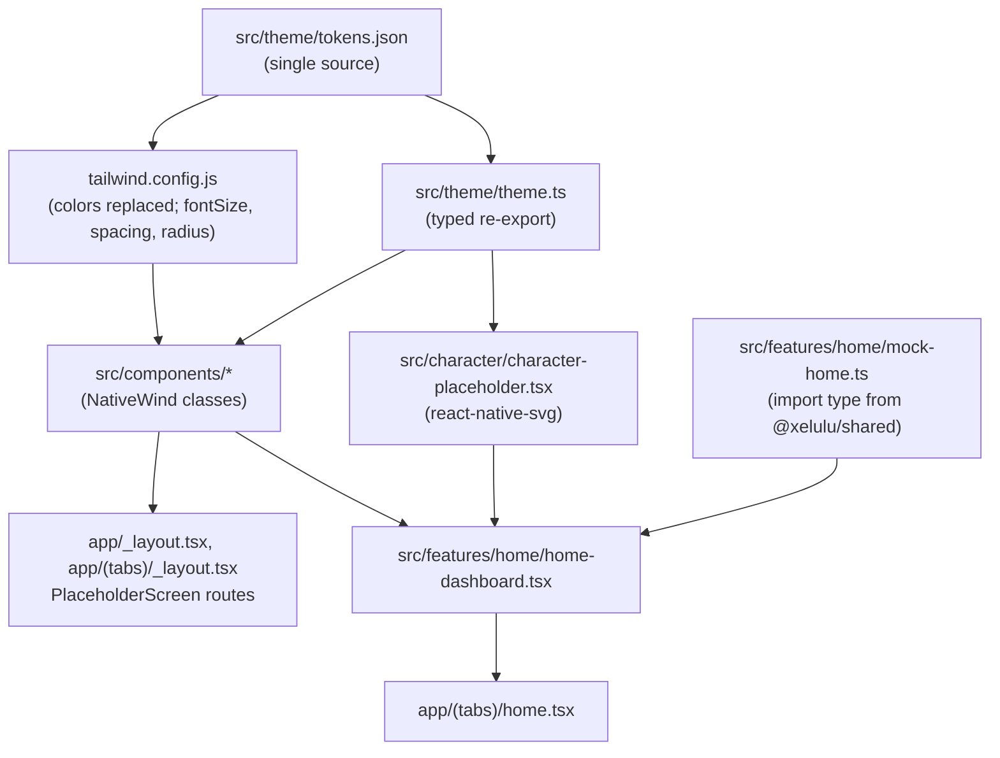

# Design Document: Phase 2.1 Parent App Shell

## Overview

Four pieces, all inside `apps/parent-app`, plus small updates to the repo checks:

1. **Tokens:** `src/theme/tokens.json` is the single source. Tailwind and the typed `src/theme/theme.ts` both read it.
2. **Component kit:** `src/components/`, NativeWind classes built from token names only.
3. **Navigation shell:** Expo Router. A root Stack (headers hidden), a `(tabs)` group with the kit's Tab_Bar, an `(onboarding)` group, and five top-level stack routes. Every route except Home renders the shared PlaceholderScreen.
4. **Home Dashboard:** `src/features/home/`, built to screen 6 from Mock_Home_Data and an injectable Clock.

Tests are Jest (jest-expo + React Native Testing Library) in `apps/parent-app/test/`, appended to the root `pnpm test`. Code examples are TypeScript. Choices C1 to C19, the FLAGs and the superseded items are in `requirements.md`.

## Architecture



Route tree (Expo Router, file → URL):

| File | URL | Renders |
|---|---|---|
| `app/_layout.tsx` | — | `Stack`, `screenOptions={{ headerShown: false }}`, `StatusBar style="dark"` |
| `app/index.tsx` | `/` | `<Redirect href="/home" />` |
| `app/(tabs)/_layout.tsx` | — | `Tabs` with `tabBar={(p) => <TabBarAdapter {...p} />}`, headers hidden |
| `app/(tabs)/home.tsx` | `/home` | `<HomeDashboard />` |
| `app/(tabs)/play.tsx`, `grow.tsx`, `routines.tsx`, `family.tsx` | `/play` … | `<PlaceholderScreen route="play" />` … |
| `app/(onboarding)/onboarding.tsx`, `auth.tsx`, `pair-device.tsx`, `child-profile.tsx` | `/onboarding` … | PlaceholderScreen with back |
| `app/settings.tsx`, `device.tsx`, `privacy.tsx`, `notifications.tsx`, `voice-call.tsx` | `/settings` … | PlaceholderScreen with back |

`app/(onboarding)/` has no `_layout.tsx`; its routes sit in the root Stack. Typed routes stay off. Hrefs come from one typed table instead (below).

## Components and Interfaces

### Tokens: `src/theme/tokens.json` and `src/theme/theme.ts`

`tokens.json` holds `color`, `typography`, `spacing`, `radius`, `shadow`, `size`, `fontScale` and `contrastPairs` (values under Data Models). `theme.ts`:

```ts
import raw from "./tokens.json";

export type ColorToken = keyof typeof raw.color;
export type TypographyToken = keyof typeof raw.typography;

export type TypeStyle = Readonly<{ size: number; lineHeight: number; weight: "400" | "500" | "600" | "700" }>;
export type ContrastPair = Readonly<{ fg: ColorToken; bg: ColorToken; min: 3 | 4.5; use: string }>;

export type Tokens = Readonly<{
  color: Readonly<Record<ColorToken, string>>;
  typography: Readonly<Record<TypographyToken, TypeStyle>>;
  spacing: Readonly<Record<string, number>>;
  radius: Readonly<Record<"sm" | "md" | "lg" | "xl" | "pill", number>>;
  shadow: Readonly<{ color: string; opacity: number; radius: number; offsetY: number; elevation: number }>;
  size: Readonly<{ touchMin: number; iconSm: number; icon: number; iconLg: number; tabBarHeight: number }>;
  fontScale: Readonly<{ denseMax: number }>;
  contrastPairs: readonly ContrastPair[];
}>;

/** Typed view of tokens.json; a shape mismatch fails `tsc --noEmit`. */
export const tokens = raw as Tokens;
export const color = tokens.color;
/** RN shadow style from the one shadow token. */
export const cardShadow = { shadowColor: tokens.shadow.color, /* … */ } as const;
```

`tailwind.config.js` (CommonJS, `content: ["./app/**/*.{ts,tsx}", "./src/**/*.{ts,tsx}"]`):

- `theme.colors`: replaced (not extended) with the token colours plus `transparent`, so `bg-white` or `text-gray-500` do not exist.
- `theme.fontSize`: each typography token as `[px, { lineHeight: px, fontWeight }]`, so `text-body` sets size, line height and weight together.
- `theme.spacing` and `theme.borderRadius`: px values from tokens. Replacing `spacing` matters, because NativeWind's default rem is 14 px, so `p-4` would not be 16 px.

### Component kit (`src/components/`)

Each file holds one component. Every component takes optional `testID`. Pressables use `Pressable` with a `style`/class switch on `pressed`, with no `Animated` (C15).

> **Superseded 2026-10-13 (Phase 2 styling-correctness pass).** The `style`-callback half of that sentence was wrong. NativeWind claims the `style` prop of any element that also carries a `className`, so a `Pressable`'s style-as-function is never invoked and nothing expressed inside it ever renders on device (nativewind issue 1105; verified empirically against the pinned nativewind 4.2.7 / react-native-css-interop 0.2.7). A **static** `style` object is still merged, and wins on inline specificity. The rule now is: press feedback is an `active:` variant class, a disabled state is a conditional `opacity-*` class, and fills, shadows and sizing are classes — only React Native shadow props and values that depend on a measured inset stay inline, as static objects. The requirement this paragraph serves is unchanged; see `apps/parent-app/docs/design-system.md`, "Pressed states are classes, not `style` functions", and the guard in `tooling/test/style-props.test.ts`.

| Component (file) | Props | Use |
|---|---|---|
| `AppText` (`app-text.tsx`) | `variant: TypographyToken`, `tone?: "primary" \| "secondary" \| "muted" \| "brand" \| "info" \| "on-brand"`, `header?: boolean`, `dense?: boolean`, `children` | All text. `header` sets `accessibilityRole="header"`. `dense` sets `maxFontSizeMultiplier={tokens.fontScale.denseMax}` and is used only by Dense_Components. |
| `Icon` (`icon.tsx`) | `name: IconName`, `size?: "sm" \| "md" \| "lg"`, `color?: ColorToken`, `decorative?: boolean` | Wraps Ionicons. `IconName` is a union of the names this phase uses. `decorative` hides it from accessibility. |
| `Card` (`card.tsx`) | `onPress?`, `accessibilityLabel?` (required when `onPress`), `children`, `padded?` | White, radius xl, hairline border, `cardShadow`. Pressable with `button` role only when `onPress` is set. |
| `Button` (`button.tsx`) | `label`, `onPress`, `variant?: "primary" \| "secondary"`, `disabled?`, `icon?: IconName`, `accessibilityHint?` | Full width, radius md, min height 48. Primary: brand fill, on-brand text, brand-pressed when pressed. Secondary: beige fill, hairline border, brand text. Disabled: `accessibilityState.disabled` and opacity 0.5. |
| `Toggle` (`toggle.tsx`) | `value`, `onValueChange(next)`, `accessibilityLabel`, `disabled?` | RN `Switch` with `trackColor {false: control-off, true: success}`, `thumbColor` surface, `ios_backgroundColor` control-off. Role `switch` and checked state come from `Switch`. |
| `IconTile` (`icon-tile.tsx`) | `icon: IconName`, `tone?: "beige" \| "surface"` | 40×40 rounded leading tile (radius md) for list rows. |
| `ListRow` (`list-row.tsx`) | `icon?`, `title`, `subtitle?`, `trailing?: "chevron" \| "none" \| { toggle: ToggleProps }`, `onPress?` | Screens 11, 12, 13, 16. Min height 56. With `onPress`: `button` role and label `title`. |
| `StatusPill` (`status-pill.tsx`) | `tone: "success" \| "warning" \| "danger" \| "neutral"`, `label` | A dot plus text, radius pill. The label is always rendered (C8). |
| `SegmentedTabs` (`segmented-tabs.tsx`) | `options: readonly { key: string; label: string }[]`, `value`, `onChange(key)`, `accessibilityLabel` | "All / Games / Stories / Learning" style. Active: brand fill, on-brand text. Each option: role `tab` with `selected`; container role `tablist`. |
| `SectionTitle` (`section-title.tsx`) | `children` | `heading` text with the `header` role. |
| `QuickActionTile` (`quick-action-tile.tsx`) | `icon`, `label`, `onPress` | Square white tile, radius lg, icon over label, `dense`. Role `button`, label = `label`. |
| `StatTile` (`stat-tile.tsx`) | `value: { text: string; tone?: "primary" \| "info" } \| { icon: IconName; color: ColorToken }`, `label` | Not pressable. `dense`. Read as one accessibility element: "<value> <label>". |
| `Screen` (`screen.tsx`) | `children`, `scroll?: boolean` | `SafeAreaView` (top edge) on `page`, horizontal padding spacing 5. |
| `ScreenHeader` (`screen-header.tsx`) | `title`, `back?: boolean` | Back chevron (44×44, label "Back") then the title (`title` variant, `header` role). Back calls `router.back()` when `router.canGoBack()`, else `router.replace("/home")`. |
| `PlaceholderScreen` (`placeholder-screen.tsx`) | `route: ShellRouteKey` | `Screen` + `ScreenHeader` (title from the route table, `back` for Stack_Routes) + the muted line "Coming in a later phase". |
| `TabBar` (`tab-bar.tsx`) | `items: readonly { key: TabKey; label: string; icon: IconName; iconActive: IconName }[]`, `activeKey`, `onSelect(key)` | White bar, top hairline, height `tabBarHeight` + bottom safe-area inset. Each item has role `tab`, `accessibilityState.selected`, label = text label, min 44×44, `dense` label. Active: filled icon and label in brand. Inactive: outline icon and label in muted. |

`app/(tabs)/_layout.tsx` adapts Expo Router's `tabBar` callback to `TabBar`. It takes the props type from `Parameters<NonNullable<React.ComponentProps<typeof Tabs>["tabBar"]>>[0]`, so no `@react-navigation/*` import is needed. `activeKey` is `state.routes[state.index].name`. `onSelect` emits `tabPress` and navigates unless the event is prevented.

### Shell route table: `src/features/shell/routes.ts` and `strings.ts`

```ts
export const TAB_KEYS = ["home", "play", "grow", "routines", "family"] as const;
export type TabKey = (typeof TAB_KEYS)[number];

export const STACK_KEYS = [
  "onboarding", "auth", "pair-device", "child-profile",
  "settings", "device", "privacy", "notifications", "voice-call",
] as const;
export type StackKey = (typeof STACK_KEYS)[number];
export type ShellRouteKey = TabKey | StackKey;

/** URL path per route; the one place hrefs are written. */
export const ROUTE_PATH: Readonly<Record<ShellRouteKey, `/${string}`>>; // "/home", …, "/voice-call"
export function isStackRoute(key: ShellRouteKey): key is StackKey;
```

`strings.ts` holds the C10 titles (`ROUTE_TITLE: Record<ShellRouteKey, string>`), the tab labels, "Coming in a later phase" and "Back". `voice-call.tsx` and `device.tsx` carry a short comment with the C10 notes (audio and status only, no video, no camera; no "Camera (Privacy)" row).

### Character: `src/character/character-placeholder.tsx`

```ts
export type CharacterPlaceholderProps = Readonly<{ size: number; accessibilityLabel?: string }>;
export function CharacterPlaceholder(props: CharacterPlaceholderProps): React.JSX.Element;
```

An `Svg` with `viewBox="0 0 100 100"` scaled to `size`: two rounded ears (`character-ear`, inner `character-body`), a rounded body (`character-body`), a dark rounded face panel (`character-face`), two eye arcs (`Path` strokes in `character-eye`, round caps), and a small smile arc. It is wrapped in a `View` with `accessible`, `accessibilityRole="image"` and the label (default "Xelulu robot"). The licence comment at the top of the file reads "Original work, Xelulu-owned. No third-party art." Rive replaces the body later behind the same props.

### Home: `src/features/home/`

| File | Role |
|---|---|
| `mock-home.ts` | `HomeData` type and `MOCK_HOME` |
| `greeting.ts` | `greetingFor(date)`: pure |
| `strings.ts` | Every Home string and string builder |
| `story-thumbnail.tsx` | Original SVG thumbnail (sky, hill, a simple round elephant), fills from tokens, licence comment, decorative (hidden; the card text says the activity) |
| `home-dashboard.tsx` | The screen |

```ts
import type { ChildProfile, Device, User } from "@xelulu/shared";

export type HomeData = Readonly<{
  parent: Pick<User, "display_name">;
  child: Pick<ChildProfile, "child_id" | "display_name">;
  device: Pick<Device, "device_id" | "display_name"> & Readonly<{ online: boolean; battery_pct: number }>;
  today: Readonly<{ activities: number; play_minutes: number; mood_label: string }>; // C13: static label only
  last_activity: Readonly<{ title: string; subtitle: string; time_label: string }>;
}>;

export const MOCK_HOME: HomeData = {
  parent: { display_name: "Mom" },
  child: { child_id: "child_mock_1", display_name: "Aarav" },
  device: { device_id: "xlu_mock_1", display_name: "Xelulu", online: true, battery_pct: 78 },
  today: { activities: 3, play_minutes: 25, mood_label: "Great Mood" },
  last_activity: { title: "Story Time", subtitle: "The Brave Elephant", time_label: "10:30 AM" },
};
```

```ts
export type Greeting = Readonly<{ text: "Good morning" | "Good afternoon" | "Good evening"; icon: "sunny" | "partly-sunny" | "moon" }>;
/** Local hours: 5–11 morning, 12–16 afternoon, otherwise evening. */
export function greetingFor(date: Date): Greeting;

export type HomeDashboardProps = Readonly<{ now?: () => Date; data?: HomeData }>;
export function HomeDashboard({ now = () => new Date(), data = MOCK_HOME }: HomeDashboardProps): React.JSX.Element;
```

The battery pill tone is `success` from 20 %, `warning` from 10 % to 19 %, and `danger` below 10 % (C05's thresholds; minor addition). The text is always "Battery <n>%".

Layout for screen 6, top to bottom, inside `Screen scroll` (page padding spacing 5 = 20):

| Block | Layout |
|---|---|
| Header | Row: left column with `title` "Good morning, Mom" plus `Icon sunny` in `sun` (decorative), and below it `label`/muted "Aarav is playing with Xelulu". Right: a 44×44 round `surface` button with hairline border and `settings-outline` in `text-primary`, label "Settings". Margin top spacing 2. |
| Robot card | `Card onPress` (label "Xelulu, Online, Battery 78%. Open device"), margin top spacing 5, padding spacing 3. Row: a beige well (radius lg, 104×88) holding `CharacterPlaceholder size 80`; a column with `heading` "Xelulu", `label`/muted "Online", and `StatusPill success "Battery 78%"`; `chevron-forward` in muted at the right edge. |
| Quick actions | Row of 4 `QuickActionTile` (equal flex, gap spacing 3, min height 76): `game-controller-outline` Play, `calendar-outline` Routines, `call-outline` Voice Call, `settings-outline` Settings, icons in brand. |
| Today | `SectionTitle` "Today with Xelulu" (margin top spacing 6), then 3 `StatTile`s (equal flex, gap spacing 3, min height 84): `{ text: "3", tone: "info" }` "Activities"; `{ text: "25 min" }` "Play time"; `{ icon: "happy-outline", color: "sun" }` "Great Mood". |
| Last Activity | `SectionTitle` "Last Activity", then a non-pressable `Card`: `StoryThumbnail` 56×56 (radius md); a column with `heading` "Story Time", `label`/secondary "The Brave Elephant", `caption`/muted "10:30 AM". |
| Tab bar | From `(tabs)/_layout.tsx`; Home selected. |

Navigation uses `router.push(ROUTE_PATH.settings)` and so on. For the Play and Routines quick actions it uses `router.navigate(ROUTE_PATH.play)`, which switches tab.

## Data Models

### Colour tokens and contrast

| Token | Hex | Use |
|---|---|---|
| `page` | `#F7F1E8` | Page background (cream) |
| `surface` | `#FFFFFF` | Cards, tiles, tab bar, toggle thumb |
| `surface-beige` | `#F1E6D6` | Image wells, secondary button, icon tiles |
| `hairline` | `#E6D9C6` | Card and bar borders (decorative; cards are identified by their content) |
| `text-primary` | `#2E2620` | Titles, body |
| `text-secondary` | `#5C5047` | Subtitles |
| `text-muted` | `#6B6057` | Muted lines, inactive tab icon and label, chevrons (darkened from the Reference, C8) |
| `brand` | `#6B4A35` | Primary fill, active tab, quick-action icons, secondary-button text |
| `brand-pressed` | `#553A29` | Primary pressed |
| `on-brand` | `#FFFFFF` | Text on brand or danger |
| `success` | `#2E7D32` | Online/battery dot, toggle on |
| `warning` | `#A15C00` | Low battery dot |
| `danger` | `#C62828` | End Call (later), critical battery dot |
| `info` | `#2F6BC9` | "3" activities numeral |
| `sun` | `#B87A00` | Greeting and mood glyphs |
| `control-off` | `#8A7E72` | Toggle off track |
| `character-body` `character-ear` `character-face` `character-eye` | `#FFF8EE` `#F3E3CB` `#2A2420` `#F4B860` | Character_Placeholder fills (graphic, no text) |
| `illustration-sky` `illustration-hill` `illustration-figure` | `#F6E7CF` `#8DB580` `#9AA3AD` | Story thumbnail fills (decorative) |
| `shadow.color` | `#6B4A35` at 0.08, radius 8, offset y 2, elevation 2 | The one card shadow |

Contrast_Pairs (WCAG 2.x ratios, computed with `tooling/checks/contrast.ts`):

| Foreground | Background | Ratio | Min | Use |
|---|---|---|---|---|
| text-primary | page / surface / surface-beige | 13.22 / 14.85 / 12.04 | 4.5 | Text |
| text-secondary | page / surface | 6.94 / 7.80 | 4.5 | Text |
| text-muted | page / surface / surface-beige | 5.44 / 6.11 / 4.96 | 4.5 | Text, inactive tab |
| brand | page / surface / surface-beige | 7.04 / 7.91 / 6.41 | 4.5 | Active tab label, secondary button text, icons |
| on-brand | brand / brand-pressed / danger | 7.91 / 10.38 / 5.62 | 4.5 | Button text |
| info | surface | 5.16 | 4.5 | Stat numeral (22 pt at weight 600 is treated as normal text) |
| success | surface | 5.13 | 3 | Dot, toggle on track |
| warning / danger | surface | 5.19 / 5.62 | 3 | Dots |
| sun | page / surface | 3.21 / 3.61 | 3 | Glyphs |
| control-off | surface | 3.96 | 3 | Toggle off track |

### Other tokens

- **Typography** (size / line height / weight, pt): `display` 28/34/700, `title` 22/28/700, `heading` 17/22/600, `stat` 22/28/600, `body` 15/20/400, `label` 13/18/500, `caption` 12/16/400. Minimum 12 (Req 1.5).
- **Spacing** (pt): `0` 0, `1` 4, `2` 8, `3` 12, `4` 16, `5` 20, `6` 24, `8` 32, `10` 40, `12` 48.
- **Radius** (pt): `sm` 8, `md` 12 (buttons), `lg` 14 (tiles), `xl` 16 (cards), `pill` 999.
- **Size** (pt): `touchMin` 44, `iconSm` 18, `icon` 22, `iconLg` 24, `tabBarHeight` 64.
- **fontScale**: `denseMax` 1.5.

## Error Handling

| Situation | Behaviour |
|---|---|
| Unknown URL (for example a mistyped deep link) | Expo Router's default unmatched screen. No custom `+not-found` route this phase, because the file name would break the kebab-case rule. |
| Back on a deep-linked Stack_Route with no history | `router.replace("/home")` |
| Font scale above the cap in a Dense_Component | Text is capped at 1.5×. Elsewhere it grows and wraps. Tiles have min heights, not fixed heights. |
| `tokens.json` shape changes | `tsc --noEmit` fails through the `Tokens` type, and the contrast Repo_Check fails on a missing pair token |
| Battery below 20 % or 10 % in mock data | Pill tone warning or danger, and the text still says the percentage |

## Security and Privacy Notes

- No network, no env, no secrets (C14). Mock data holds a display name and a child's first name only, both placeholders, in source.
- The mood tile is static (C13). The s.9 legal review stays open for the real data source.
- No camera or video anywhere (`product.md` v1 facts).

## Correctness Properties

*A property is a characteristic or behavior that should hold true across all valid executions of a system: a formal statement about what the system should do. Properties bridge human-readable specifications and machine-verifiable correctness guarantees.*

Per C16, each property is checked by example-based tests or by exhaustive scans over a finite set (every file, every pair, every route), not by fast-check.

### Property 1: Single token source

For any file under `apps/parent-app/app` or `apps/parent-app/src`, and any parent-app config file, other than `src/theme/tokens.json`, the file contains no colour literal, no `dark:` class and no `text-[Npx]` class.

**Validates: Requirements 1.2, 1.4, 1.7**

### Property 2: Every listed pair meets its minimum

For every Contrast_Pair in the Token_Source, both tokens exist and the WCAG ratio is at least the pair's minimum. For every typography token, the size is at least 12.

**Validates: Requirements 1.5, 1.6**

### Property 3: Controls report state and call handlers once

For any kit control (Button, Toggle, ListRow, SegmentedTabs option, QuickActionTile, Tab_Bar item), one press of an enabled control calls its handler exactly once with the expected argument, a disabled control calls nothing, and the exposed accessibility state (disabled, checked, selected) matches the props.

**Validates: Requirements 2.2, 2.3, 2.4, 2.6, 2.7, 3.1, 3.3**

### Property 4: Status is never colour alone

For any StatusPill tone and label, the rendered output contains the label text.

**Validates: Requirements 2.5**

### Property 5: Font scaling stays on outside Dense_Components

For any parent-app source file, `allowFontScaling` does not appear, and `maxFontSizeMultiplier` (or the `dense` prop) appears only in `app-text.tsx` and the three Dense_Component files.

**Validates: Requirements 3.4**

### Property 6: Exactly one tab is selected, and it matches the route

For any Tab_Route shown, exactly one Tab_Bar item has `selected` true, and it is the item for that route.

**Validates: Requirements 4.3, 4.4, 4.5**

### Property 7: Every route opens with its title

For every key in `TAB_KEYS` and `STACK_KEYS`, rendering the router at `ROUTE_PATH[key]` shows a `header`-role text equal to that route's title (Home shows the greeting header instead), and the Tab_Bar is present exactly when the key is a Tab_Route.

**Validates: Requirements 4.1, 4.2, 4.6, 4.8**

### Property 8: Home shows the data it is given

For the Mock_Home_Data and a fixed Clock, every value in Requirement 5.2–5.6 appears on the Home_Dashboard, built by the Home string builders.

**Validates: Requirements 5.1, 5.2, 5.3, 5.4, 5.5, 5.6, 5.7**

### Property 9: Greeting partitions the day

For any local time, `greetingFor` returns exactly one of the three greetings, with boundaries at 05:00, 12:00 and 17:00, checked at 04:59, 05:00, 11:59, 12:00, 16:59 and 17:00.

**Validates: Requirements 6.1, 6.2, 6.3**

### Property 10: Home controls reach their routes

For each Home control in Requirement 6.4–6.6, one press leaves the router at that control's `ROUTE_PATH`.

**Validates: Requirements 6.4, 6.5, 6.6**

## Testing Strategy

Smoke and key-interaction tests only, all example-based (C16).

**Jest setup (`apps/parent-app`):**
- `jest.config.js`: `preset: "jest-expo"`, `testMatch: ["<rootDir>/test/**/*.test.{ts,tsx}"]`.
- `package.json`: `"test": "jest"`. Root `package.json` `test`: `pnpm build && tsc -p tsconfig.test.json && vitest run && pnpm --filter @xelulu/parent-app test`.
- Tests import `describe`, `it`, `expect` and `jest` from `@jest/globals` (no ambient globals). `tsc --noEmit` already covers `test/` through the app's `**/*.tsx` include.
- Router tests use `renderRouter` from `expo-router/testing-library` (present in expo-router 57.0.25) with the real `app` directory, and assert with `screen.getPathname()` (or the `toHavePathname` matcher).
- Risk: NativeWind's babel transform under Jest. Class names do not need to compute styles for these tests. If the transform fails, the fallback is a Jest-only babel override that drops `jsxImportSource: "nativewind"`, documented in `jest.config.js`.

**App tests (`apps/parent-app/test/`):**
- `components.test.tsx`: Button press and disabled; Toggle flip and checked; StatusPill text; ListRow press; SegmentedTabs `onChange` and the selected state (Properties 3, 4).
- `greeting.test.ts`: the six boundary times (Property 9).
- `home-dashboard.test.tsx`: `HomeDashboard` with `now` fixed at 09:00 and `MOCK_HOME`: "Good morning, Mom", "Aarav is playing with Xelulu", "Xelulu", "Online", "Battery 78%", the 4 quick-action labels, "3", "Activities", "25 min", "Play time", "Great Mood", "Story Time", "The Brave Elephant", "10:30 AM"; the character's `image` role; and the today tiles and last-activity card have no `button` role (Property 8, Req 5.8).
- `navigation.test.tsx`: `/` redirects to `/home`; 5 tabs with Home selected; pressing Play shows "Play" with Play selected (Property 6); every route renders its title, with the Tab_Bar only on tabs (Property 7); back on `/privacy` opened directly goes to `/home`; each Home control reaches its route (Property 10).

**Repo checks (`tooling/test/`):**
- `layout.test.ts`: the C10 route file list exactly (sorted, recursive under `app/`).
- `placeholder.test.ts`, "parent app" block, replaced: Property 1 scan; Property 5 scan; no `Animated` / `react-native-reanimated` / `moti` / `animate-` / `transition` classes (kept from Phase 0); the C14 network scan (`fetch(`, `XMLHttpRequest`, `WebSocket`, `EventSource`, imports of `@supabase/`, `mqtt`, `ws`); zero env reads, using `findEnvReads` from `tooling/checks/env-reads.ts` (Req 8.2); every `@xelulu/shared` import is `import type`; no `expo-camera`, `expo-video` or `expo-av` import and no `<Camera` element or `"Camera` string literal (the C10 notes live in comments). The admin and boundary blocks are unchanged.
- `contrast.test.ts`: the parent-app part reads `tokens.json` and checks Property 2. It also checks non-vacuity (at least 20 pairs, every `text-*` colour appears as a foreground). The admin light/dark part is unchanged.
- `readme.test.ts`: the start:app row contains "expo go" and "home dashboard"; the README contains `/--/`.
- `manifests.test.ts`: the edge list adds `@xelulu/parent-app -> @xelulu/shared`.
- `env-reads.test.ts`: unchanged. It still guards the `EXPO_PUBLIC_` rule, and its walk still finds `app/index.tsx` and `app/_layout.tsx`.

**Manual phone checklist** (Omar, Expo Go; not run by the agent):

1. `pnpm start:app`, scan with Expo Go (SDK 57). The app opens on Home with no red or yellow box.
2. Put Home next to screen 6: header (greeting, sun, subtitle, gear), robot card (character well, Xelulu, Online, Battery 78 %, chevron), 4 quick actions, 3 today tiles, last activity, tab bar with Home selected.
3. Tap each tab: the label and icon switch to selected, and the placeholder title matches.
4. Tap the gear, the robot card and each quick action: each opens its screen, and back returns to Home.
5. Open each of `/onboarding`, `/auth`, `/pair-device`, `/child-profile`, `/privacy` and `/notifications` by deep link (README); back goes to Home.
6. Set the phone's text size to the largest setting: text grows, nothing is cut off on Home, and dense tiles cap.
7. Confirm that nothing moves or flashes anywhere.
