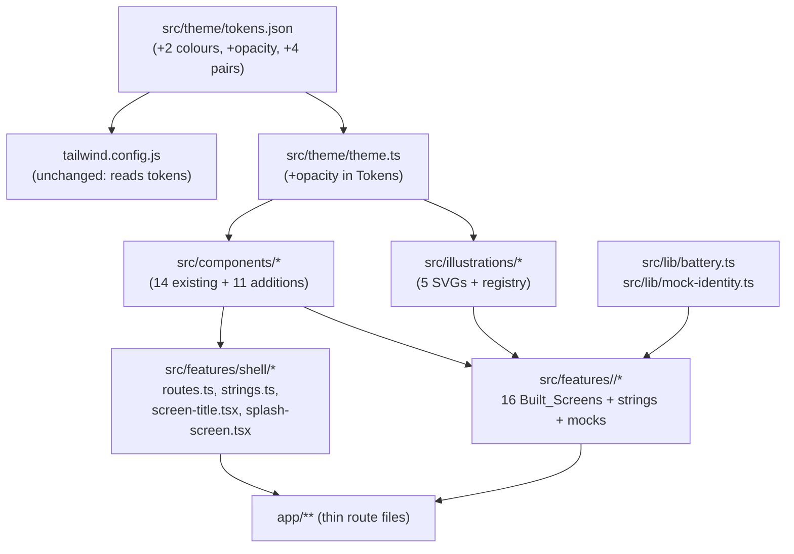

# Design Document: Phase 2.2 Parent App Screens

## Overview

Phase 2.2 replaces every remaining placeholder in `apps/parent-app` with a built screen, traced
to the frozen Reference (`docs/design/Xelulu Parent App UX Flow-4.png`). Nothing in the Phase 2.1
design system is recreated or restyled: the Token_Source, the Component_Kit, the Route_Table and
the Home Dashboard stay as they are, extended only where `requirements.md` allows (the three
additive `ListRow` props of D21, the eleven Kit_Additions, new tokens, two new route files).

Five pieces:

1. **Shell changes.** `app/index.tsx` becomes the Splash screen (D1), `app/reports.tsx` and
   `app/grandma-mode.tsx` are added (D2), the Route_Table gains the two keys, `PlaceholderScreen`
   and `PLACEHOLDER_LINE` are deleted, and a shell-level `ScreenTitle` carries each screen's
   accessible header name while the Reference's wording stays visible.
2. **Kit_Additions and tokens.** Eleven new components in `src/components/`, three additive
   `ListRow` props, two new colour tokens, one new `opacity` token, seven new Contrast_Pairs, and
   a wider `IconName` union.
3. **Illustrations.** Five original SVGs in `src/illustrations/` plus a name-to-component registry.
4. **Sixteen built screens** in `src/features/<area>/`, each with its own `strings.ts` and typed
   `mock-*.ts`, rendered by a thin route file.
5. **Tests and checks.** Smoke and key-interaction Jest tests in `apps/parent-app/test/`, and
   edits to exactly two Repo_Checks (`tooling/test/layout.test.ts`,
   `tooling/test/placeholder.test.ts`).

Stack, locked by this design: TypeScript strict, Expo SDK 57 with Expo Router, NativeWind 4 with
Tailwind classes built from token names, `react-native-svg` for illustrations, React Native's own
`Modal`, `Switch`, `ScrollView`, `FlatList`, `TextInput` and `Pressable`. Jest (`jest-expo`) with
React Native Testing Library for the app, Vitest for the Repo_Checks. **No new runtime dependency**
(D7): no slider, no date picker, no gesture library, no animation library, no media picker, no
camera or video module, no Rive, no Lottie, no `expo-dev-client`. The app stays Expo Go compatible.

Choices D1 to D23, the FLAGs and the superseded Phase 2.1 items are in `requirements.md`. Every
further decision this design makes is stated inline and listed again in "Decisions this design
makes".

## Architecture



Dependency rules this phase keeps: the app imports `@xelulu/shared` with `import type` only, never
imports from `apps/admin` or `services/*`, and no feature imports another feature. Cross-feature
values live in `src/lib/` (`battery.ts`, `mock-identity.ts`) or `src/features/shell/`.

### Route tree after this phase

| File | URL | Renders | Header-role name |
|---|---|---|---|
| `app/_layout.tsx` | — | root `Stack`, headers hidden (unchanged) | — |
| `app/index.tsx` | `/` | `<SplashScreen />` (D1) | "Xelulu" |
| `app/(tabs)/_layout.tsx` | — | `Tabs` + kit `TabBar` (unchanged) | — |
| `app/(tabs)/home.tsx` | `/home` | `<HomeDashboard />` (unchanged) | the greeting line |
| `app/(tabs)/play.tsx` | `/play` | `<PlayScreen />` | "Play with Xelulu" |
| `app/(tabs)/grow.tsx` | `/grow` | `<GrowScreen />` | "Growing Together" |
| `app/(tabs)/routines.tsx` | `/routines` | `<RoutinesScreen />` | "Daily Routines" |
| `app/(tabs)/family.tsx` | `/family` | `<FamilyScreen />` | "Our Family" |
| `app/(onboarding)/onboarding.tsx` | `/onboarding` | `<OnboardingScreen />` | "Welcome" |
| `app/(onboarding)/auth.tsx` | `/auth` | `<AccountScreen />` | "Create account" |
| `app/(onboarding)/pair-device.tsx` | `/pair-device` | `<PairScreen />` | "Pair Xelulu" |
| `app/(onboarding)/child-profile.tsx` | `/child-profile` | `<ChildProfileScreen />` | "Child profile" |
| `app/settings.tsx` | `/settings` | `<SettingsScreen />` | "Settings" |
| `app/device.tsx` | `/device` | `<DeviceScreen />` | "Xelulu device" |
| `app/privacy.tsx` | `/privacy` | `<PrivacyScreen />` | "Privacy & Memory" |
| `app/notifications.tsx` | `/notifications` | `<NotificationsScreen />` | "Notifications" |
| `app/voice-call.tsx` | `/voice-call` | `<LiveCallScreen />` | "Live with Xelulu" |
| `app/reports.tsx` | `/reports` | `<ReportsScreen />` | "This Week with Xelulu" |
| `app/grandma-mode.tsx` | `/grandma-mode` | `<GrandmaModeScreen />` | "Grandma Mode" |

Nineteen route files: the seventeen Phase 2.1 files plus `reports.tsx` and `grandma-mode.tsx`.

**"Three new routes" (the step brief) reconciled with D2's "two new routes":** the two new route
*files* are `reports.tsx` and `grandma-mode.tsx`; the third new route *screen* is `/` itself, which
stops being a redirect and becomes the Splash screen. All three are covered below in "Shell wiring".

### Feature folders

| Folder | Screens | Files |
|---|---|---|
| `src/features/shell/` | Splash (screen 1) | `routes.ts`*, `strings.ts`*, `screen-title.tsx`, `go-back.ts`, `splash-screen.tsx` |
| `src/features/setup/` | 2, 3, 4, 5 | `onboarding-screen.tsx`, `account-screen.tsx`, `pair-screen.tsx`, `child-profile-screen.tsx`, `age-stage.ts`, `mock-setup.ts`, `strings.ts` |
| `src/features/home/` | 6 | unchanged except the `batteryTone` import (see `src/lib/battery.ts`) |
| `src/features/talk/` | 7 | `live-call-screen.tsx`, `mock-call.ts`, `strings.ts` |
| `src/features/play/` | 8 | `play-screen.tsx`, `mock-play.ts`, `strings.ts` |
| `src/features/grow/` | 9 | `grow-screen.tsx`, `mock-grow.ts`, `strings.ts` |
| `src/features/routines/` | 10 | `routines-screen.tsx`, `mock-routines.ts`, `strings.ts` |
| `src/features/device/` | 11 | `device-screen.tsx`, `mock-device.ts`, `strings.ts` |
| `src/features/family/` | 12 | `family-screen.tsx`, `mock-family.ts`, `strings.ts` |
| `src/features/grandma/` | 13 | `grandma-mode-screen.tsx`, `mock-grandma.ts`, `strings.ts` |
| `src/features/privacy/` | 14 | `privacy-screen.tsx`, `mock-privacy.ts`, `strings.ts` |
| `src/features/reports/` | 15 | `reports-screen.tsx`, `mock-reports.ts`, `strings.ts` |
| `src/features/notifications/` | 16a | `notifications-screen.tsx`, `mock-notifications.ts`, `strings.ts` |
| `src/features/settings/` | 16b | `settings-screen.tsx`, `strings.ts` |

\* extended, not rewritten.

`structure.md` names the feature areas setup, controls, grandma, reports, talk, content, privacy
and support. Phase 2.1 already added `home` and `shell`. **Choice:** feature folders are named
after the screen area they build (`play`, `grow`, `routines`, `device`, `family`, `notifications`,
`settings`), keeping `setup`, `talk`, `grandma`, `privacy` and `reports` from `structure.md`'s
list. One folder per screen area beats one folder per abstract area, because a screen's layout,
strings and mock data then live together and Phase 3 can swap one mock module at a time.

**Choice: route files stay thin (D22).** Each holds the import, the default export and, for
`device.tsx` and `voice-call.tsx`, a one-line pointer. The longer safety notes move into the
feature modules next to the code they constrain.

One of those two pointers is **rewritten, not kept**. `app/device.tsx` says today:

```tsx
// C10 note, for whoever builds this screen: v1 has no camera, so this screen carries no
// Camera (Privacy) row and no video view of any kind (product.md v1 facts, safety.md).
```

After this phase that is false: D3 and Req 14.4 build a static "Camera / Not included on this
model" row. A stale comment on the camera-and-safety facts is the worst place to leave one, so
task 4.2 replaces it with:

```tsx
// Route pointer: the Camera row is static text, "Not included on this model" — v1 has no camera
// and no video view (product.md v1 facts, D3). Screen: src/features/device/device-screen.tsx.
```

`app/voice-call.tsx`'s note (the live session is audio and status only, no video and no camera in
v1) stays **exactly as it is**: it is still true, and task 4.2 confirms that rather than touching
it (review round 2, finding 6).

## Components and Interfaces

### Reused without change

Every one of these is used as it stands, with its current appearance, props, roles and labels:
`AppText`, `Icon`, `Card`, `Button`, `Toggle`, `IconTile`, `StatusPill`, `SegmentedTabs`,
`SectionTitle`, `QuickActionTile`, `StatTile`, `Screen`, `ScreenHeader`, `TabBar`,
`CharacterPlaceholder`, `StoryThumbnail` (home), `greetingFor`, the Token_Source, the
Theme_Module, `tailwind.config.js` (it derives classes from the tokens, so new colour tokens need
no edit) and the Route_Table's existing keys.

Two files are deleted, because no route uses them after this phase (Req 1.6): 
`src/components/placeholder-screen.tsx` and the `PLACEHOLDER_LINE` export in
`src/features/shell/strings.ts`.

### The one extension to an existing kit component

`ListRow` gains three optional, additive props (D21). Its default rendering is byte-for-byte the
same when they are absent.

```ts
export type ListRowProps = Readonly<{
  title: string;
  subtitle?: string;
  icon?: IconName;
  /** Replaces the leading IconTile (an Avatar, usually). Ignored when `icon` is set. */
  leading?: ReactNode;
  /** Text shown before the trailing chevron or Toggle: a time, a value, "Later phase". */
  trailingText?: string;
  /** `danger` tints the title and `trailingText`. The leading slot is unchanged. */
  tone?: "default" | "danger";
  trailing?: ListRowTrailing;
  onPress?: () => void;
  testID?: string;
}>;
```

- `leading` renders in the slot `icon` would use, with the same 12 pt right margin.
- `trailingText` renders to the left of the trailing element as `label`/`text-muted`, or in the
  danger tone when `tone="danger"`. **Its accessibility rule, in full, once:** `trailingText` is
  appended to the row's accessibility label as `"<title>, <trailingText>"` **only when `onPress`
  is set**, because only the `Pressable` branch of `list-row.tsx` carries an `accessible` wrapper
  and an `accessibilityLabel`. On a non-pressable row it renders as its own `AppText` and is
  announced in document order; the row adds no `accessible` wrapper, so the title, the subtitle and
  the trailing text stay three separate announcements. Every `trailingText` consumer in this phase
  except Routines is non-pressable (the five Notifications rows, the memory rows, Settings' four
  "Later phase" rows, Grandma's Festival row), so the non-pressable half is the common case and the
  one tested first (review round 2, finding 5).
- `tone="danger"` tints the **title and `trailingText`** with the `danger` token. It changes no
  background, no border and **not the leading slot**: `ListRow` draws its `icon` through
  `IconTile`, whose glyph colour follows its own `tone` and never the row's. (`IconTile` now
  exposes `tone?: IconTileTone` — `beige | surface | rose | sky | amber | mint | lavender`, beige
  the default — since the Phase 2 cleanup pass superseded Req 1.3's bar on editing
  `icon-tile.tsx`; the tones are category colours, not row states, so the conclusion here is
  unchanged.) A row that wants a coloured glyph passes one through the
  new `leading` prop instead — `leading={<Icon name="trash-outline" color="danger" decorative />}`
  — which is exactly what the prop is for (review round 2, finding 2).

**Danger-toned text, without editing `AppText`.** `AppText`'s `TextTone` union is
`primary | secondary | muted | brand | info | on-brand` and holds no `danger` member, and Req 1.3
allows no change to it. So every piece of danger-toned text in this phase — `ListRow`'s
`tone="danger"` title and `trailingText`, and the Privacy screen's delete-or-export label — is
rendered through `AppText`'s existing `className` escape hatch with the token-derived class:

```tsx
<AppText variant="heading" className="text-danger">{title}</AppText>
```

`text-danger` exists because `tailwind.config.js` builds `colors` from `tokens.color`, so the class
carries no colour literal and Property 1's scan stays green. This is the **only** mechanism for
danger text in the phase; `AppText` is not edited and no fourth kit change is taken (review round 2,
finding 1). The two `danger` text Contrast_Pairs added in task 1.1 (`danger`/`surface` and
`danger`/`page`, both min 4.5) cover exactly these renderings.

### Kit_Additions (`src/components/`, exactly the eleven of D21)

Conventions every addition follows, copied from the existing kit: one component per kebab-case
file; `Readonly<{...}>` prop type exported next to it; optional `testID`; raw values only from
`theme.ts`; classes only from token names; `Pressable` with a colour or opacity switch on
`pressed` and no animation; a 44 pt minimum touch area; an explicit accessibility role and label;
default labels in `src/components/strings.ts`.

> **Superseded 2026-10-13 (Phase 2 styling-correctness pass).** "A colour or opacity switch on
> `pressed`" now means an `active:` variant class and a conditional `opacity-*` class, not a
> `style={({ pressed }) => …}` callback. NativeWind claims the `style` prop of any element that
> also carries a `className`, so such a callback is never invoked and nothing inside it renders
> (nativewind issue 1105; verified against the pinned nativewind 4.2.7 /
> react-native-css-interop 0.2.7). A **static** `style` object is still merged. The 44 pt minimum
> touch area and every other convention in the list are unchanged. See
> `apps/parent-app/docs/design-system.md`, "Pressed states are classes, not `style` functions".

| Component (file) | Why a new component is needed |
|---|---|
| `TextField` (`text-field.tsx`) | Screens 3, 5, 10, 12, 13 need a text input. The kit has none. |
| `Chip` (`chip.tsx`) | Screen 5's gender, language and interest pills; screen 9's interest labels. Not a Button (pill radius, content width, selected state). |
| `Avatar` (`avatar.tsx`) | Screens 5 and 12 need a round person token. D8 forbids a photo, so it renders an Illustration or the name's initial. |
| `StepList` (`step-list.tsx`) | Screen 4's four-step checklist, with done/current/pending glyphs and state in the accessibility label. |
| `PageDots` (`page-dots.tsx`) | Screens 1, 2 and 7. With `onSelect` the dots are `tab`-role controls; without it they are decorative and hidden from accessibility. |
| `Stepper` (`stepper.tsx`) | The D7/D19 Volume control, built from two `Pressable`s because no slider dependency is allowed. |
| `MediaCard` (`media-card.tsx`) | Screen 8's content cards: an illustration well above a title, subtitle and chevron. `Card` holds no media well. |
| `MetricRow` (`metric-row.tsx`) | Screen 9's four Overview rows: a trailing numeral, not a chevron or toggle, and not pressable. |
| `MetricTile` (`metric-tile.tsx`) | Screen 15's four summary rows. Differs from `StatTile` (which is a square, equal-flex, icon-or-value tile) by showing icon, value and label together in a row. |
| `CircleButton` (`circle-button.tsx`) | Screen 7's Mute / End Call / Speaker controls, and screen 5's "add photo" badge. |
| `ConfirmDialog` (`confirm-dialog.tsx`) | Screen 14's DPDP confirmation. Nothing in the kit presents a modal. |

Every prop type in full, so no signature is left to the implementer:

```ts
// text-field.tsx
export type TextFieldProps = Readonly<{
  value: string;
  onChangeText: (next: string) => void;
  label?: string;
  placeholder?: string;
  /** Leading glyph inside the field. */
  icon?: IconName;
  /** Decorative trailing glyph inside the field, at its right edge. Never pressable.
   *  Ignored when `secure` is set, because the reveal control owns that slot. */
  trailingIcon?: IconName;
  secure?: boolean;
  keyboardType?: "default" | "email-address" | "numeric";
  autoCapitalize?: "none" | "sentences" | "words";
  autoCorrect?: boolean;
  maxLength?: number;
  errorText?: string;
  editable?: boolean;
  testID?: string;
}>;

// chip.tsx
export type ChipProps = Readonly<{
  label: string;
  selected?: boolean;
  onPress?: () => void;
  trailing?: "none" | "remove" | "add";
  accessibilityLabel?: string;
  testID?: string;
}>;

// avatar.tsx
export type AvatarProps = Readonly<{
  name: string;
  illustration?: IllustrationName;
  size?: "sm" | "lg";
  accessibilityLabel?: string;
  testID?: string;
}>;

// step-list.tsx
export type Step = Readonly<{ key: string; title: string; icon: IconName }>;
export type StepListProps = Readonly<{
  steps: readonly Step[];
  /** Zero-based index of the current step. Steps before it are done, after it pending. */
  currentIndex: number;
  testID?: string;
}>;

// page-dots.tsx
export type PageDotsProps = Readonly<{
  count: number;
  /** Zero-based current page. */
  index: number;
  /** Omit to leave the dots decorative and hidden from accessibility. */
  onSelect?: (next: number) => void;
  accessibilityLabel?: string;
  testID?: string;
}>;

// stepper.tsx
export type StepperProps = Readonly<{
  value: number;
  min: number;
  max: number;
  step: number;
  onChange: (next: number) => void;
  /** The accessible name of the whole control, e.g. "Volume". */
  label: string;
  /** Renders the visible value and `accessibilityValue.text`, e.g. (n) => `${n}%`. */
  format: (value: number) => string;
  testID?: string;
}>;

// media-card.tsx
export type MediaCardProps = Readonly<{
  title: string;
  subtitle: string;
  illustration: IllustrationName;
  onPress: () => void;
  testID?: string;
}>;

// metric-row.tsx
export type MetricRowProps = Readonly<{
  icon: IconName;
  title: string;
  subtitle: string;
  /** Already-formatted display value, e.g. "+12". Never computed here. */
  value: string;
  tone?: "info" | "primary";
  testID?: string;
}>;

// metric-tile.tsx
export type MetricTileProps = Readonly<{
  icon: IconName;
  value: string;
  label: string;
  testID?: string;
}>;

// circle-button.tsx
const DISC: Readonly<Record<"badge" | "lg", number>> = { badge: 40, lg: 64 };

type CircleButtonBase = Readonly<{
  icon: IconName;
  stateText?: string;
  size?: "badge" | "lg"; // default "lg"
  tone?: "neutral" | "danger";
  onPress: () => void;
  testID?: string;
}>;

export type CircleButtonProps =
  /** Labelled: the visible label is the accessible name unless overridden. */
  | (CircleButtonBase & Readonly<{ label: string; accessibilityLabel?: string }>)
  /** Unlabelled (the badge): `accessibilityLabel` is required and carries the name. */
  | (CircleButtonBase & Readonly<{ label?: undefined; accessibilityLabel: string }>);

// confirm-dialog.tsx
export type ConfirmAction = Readonly<{
  key: string;
  label: string;
  tone?: "neutral" | "danger";
}>;
export type ConfirmDialogProps = Readonly<{
  visible: boolean;
  title: string;
  body: string;
  cancelLabel: string;
  actions: readonly ConfirmAction[];
  onCancel: () => void;
  onAction: (key: string) => void;
  testID?: string;
}>;
```

Notes that pin the ambiguous parts:

- **`TextField`.** A `View` (surface fill, hairline border, radius md, min height 48) holding an
  optional leading `Icon`, a `TextInput`, and in the trailing slot either the reveal `Pressable`
  (when `secure` is set: 44×44, `eye-outline` / `eye-off-outline`, label "Show password" / "Hide
  password" from `KIT_STRINGS`) or the decorative `trailingIcon` glyph. `trailingIcon` renders
  **inside** the field box at its right edge, in `text-muted`, inside a wrapper hidden from
  accessibility, and is never pressable; it exists so screen 5's calendar glyph sits where the
  Reference draws it instead of outside the field (review finding 4). When `secure` is set,
  `trailingIcon` is ignored. The `TextInput` carries `accessibilityLabel = label ?? placeholder`. A `label`
  prop also renders above the field as `label`/`text-secondary`. `errorText` renders below as
  `caption`/`text-muted` **and** is passed to the input as `accessibilityHint` (Req 21.7).
  `placeholderTextColor` is `text-muted`. No animation, no floating label.
- **`Chip`.** Pill radius, min height 44, horizontal padding spacing 4. Selected: `brand` fill,
  `on-brand` label, `accessibilityState.selected` true. Unselected: `surface` fill, hairline
  border, `text-primary` label. `trailing="remove"` adds a `close` glyph and the whole chip is one
  `Pressable` whose accessibility label defaults to `"Remove <label>"`; `trailing="add"` adds an
  `add` glyph before the label.
- **`Avatar`.** `sm` 40, `lg` 96. Disc of `surface-beige` with a hairline border; renders the
  Illustration clipped to the disc when given, otherwise the first character of `name` as
  `title`/`brand`. `accessibilityRole="image"`, label defaults to `name`.
- **`StepList`.** Each step is a row: a 28 pt circle, then the title as `heading`. Done: `brand`
  fill with an `on-brand` `checkmark`. Current: `brand` 2 pt ring holding the step's own `icon` in
  `brand`. Pending: `control-off` ring holding the step's own `icon` in `control-off`. So the three
  states differ by glyph shape as well as by colour, and the step's icon (`power-outline`,
  `bluetooth-outline`, `wifi-outline`, `checkmark-circle`) has a defined home. A 2 pt `hairline`
  connector runs between circles. The state
  is in the row's accessibility label ("Power on Xelulu, done" / ", current step" / ", not
  started", from `KIT_STRINGS`) and in the glyph's shape, so it is never colour alone (Req 2.5).
  Rows are not pressable; the screen's button drives `currentIndex`.
- **`PageDots`.** The visible dot is always 8 pt, `brand` when current, `control-off` otherwise.
  The two modes space themselves differently, and this is deliberate:
  - **Decorative** (`onSelect` omitted — screens 1 and 7): the dots sit in a row at gap spacing 2
    (8 pt apart), exactly as the Reference draws them, and the container carries
    `importantForAccessibility="no-hide-descendants"` plus `accessible={false}`. Nothing is
    pressable, so there is no hit area to size.
  - **Interactive** (`onSelect` given — screen 2): each 8 pt dot is centred inside its own
    **44×44 pt `Pressable`** container, the containers sit edge-to-edge with **no `hitSlop` and no
    gap**, and each container carries role `tab`, `accessibilityState.selected` and the label
    "Page N of M". Three dots therefore occupy 132 pt, which fits the narrowest phone width this
    phase targets.

  The interactive mode does **not** use `hitSlop` on tightly spaced dots. An 8 pt dot at 8 pt
  spacing with 18 pt of slop per side overlaps both neighbours' centres, so which dot a tap
  selects would depend on z-order rather than position — and Jest would never see it, because
  `fireEvent.press` targets an element directly (review round-3 finding 16). The cost is that the
  interactive dots on screen 2 sit further apart than the Reference draws them; that is recorded
  as deviation D24g and reported by task 7.2. The decorative dots on screens 1 and 7 keep the
  Reference's spacing exactly, because they need no touch target.
- **`Stepper`.** Row: a minus `Pressable` (44×44, `remove` glyph), the formatted value as `heading`
  text, a plus `Pressable` (44×44, `add` glyph). The container carries
  `accessibilityRole="adjustable"`, `accessibilityLabel={label}` and
  `accessibilityValue={{ min, max, now: value, text: format(value) }}`. At a bound the matching
  control is `disabled` with `accessibilityState.disabled` and calls nothing. `onChange` receives
  the clamped next value. The value is always visible as text (Req 2.7).
- **`MediaCard`.** A `Card` with `padded={false}` and `onPress`: an `Illustration` well (full
  width, 112 pt, radius lg, clipped) above a row of title (`heading`), subtitle
  (`label`/`text-secondary`) and a `chevron-forward`. The Illustration is decorative; the card's
  accessibility label is `"<title>, <subtitle>"`.
- **`MetricRow` / `MetricTile`.** Both are non-pressable rows, each placed inside its **own**
  caller-supplied `Card` with `mt-3` between the cards. Neither draws nor expects a divider: the
  Reference draws screen 9's four metric rows and screen 15's four metric tiles as separate white
  rounded cards with a visible gap, not as one grouped card with hairlines (review round-3
  finding 7). `MetricRow`: `IconTile`, then title
  (`heading`) over subtitle (`label`/`text-secondary`), then the value as `heading` in `info` or
  `text-primary`. `MetricTile`: `IconTile`, then the value as `stat` over the label
  (`label`/`text-muted`). Each is one accessibility element labelled `"<value> <title/label>"`.
- **`CircleButton`.** A disc of `DISC[size]` pt: `lg` 64 (the default, screen 7's call controls),
  `badge` 40 (screen 5's photo badge, which the Reference draws small and tucked into the avatar's
  corner). `neutral`: `surface` fill, hairline border, `brand` glyph. `danger`: `danger` fill,
  `on-brand` glyph. Below the disc, the `label` as `label`/`text-primary` and, when given,
  `stateText` as `caption`/`text-muted`. `label` is optional **in the second arm of the
  discriminated union only**: omitting it draws no text under the disc (the badge case, where the
  Reference draws none) and makes `accessibilityLabel` required, so `tsc` rejects a `CircleButton`
  with neither. The union above is the whole signature; there is no flat variant. The
  accessibility name resolves in this order: `accessibilityLabel` when given; else
  `"<label>, <stateText>"` when `stateText` is set; else `label`. The whole control (disc plus
  text) is one `Pressable`, and its touch slop is

  ```ts
  const slop = Math.max(0, (tokens.size.touchMin - DISC[size]) / 2); // badge 2, lg 0
  ```

  so a `badge` clears the 44×44 pt minimum of Req 21.1 (2 pt of slop on each edge) while drawing
  at 40 pt, and the `lg` default — which already draws at 64 pt, wider than the minimum — gets
  **no** slop. The `Math.max(0, …)` clamp is load-bearing: the unclamped expression is −10 for
  `lg`, and a negative `hitSlop` in React Native *shrinks* the touch box, which would shrink the
  label's hit area too because the disc, label and `stateText` are one `Pressable` (review round-3
  finding 3). A `components.test.tsx` case asserts the slop is `0` or absent for `lg` and `2` for
  `badge`, and the rule is stated once in the Design_System_Doc.
- **`ConfirmDialog`.** React Native `Modal` with `transparent`, `animationType="none"` (D11) and
  `onRequestClose={onCancel}`. Inside: a scrim `View` (`scrim` colour at `opacity.scrim`, not
  pressable, hidden from accessibility) and a `Card` with `accessibilityViewIsModal`,
  `accessibilityRole="alert"`, the title (`heading`), the body (`body`/`text-secondary`), then the
  action `Button`s and finally the cancel `Button` (`secondary`). Actions with `tone: "danger"`
  render as a `Button` whose label is prefixed by no glyph and whose press calls `onAction(key)`
  exactly once. On open, focus is moved into the dialog by this exact mechanism:

  ```tsx
  const titleRef = useRef<View>(null);
  useEffect(() => {
    if (!visible) return;
    const handle = findNodeHandle(titleRef.current); // react-native
    if (typeof handle === "number") AccessibilityInfo.setAccessibilityFocus(handle);
  }, [visible]);
  ```

  `findNodeHandle` is deprecated in RN 0.86 but present and is the only public way to get a
  handle for `setAccessibilityFocus`; the `typeof handle === "number"` guard means a `null` or
  `undefined` handle is a silent no-op, with the `alert` role plus `accessibilityViewIsModal` as
  the documented fallback (Req 21.8). Focus movement itself is **not** asserted in Jest — the
  Jest environment has no accessibility service — so Property 14 covers Req 21.8 only partially
  (the role and the modal flag); the movement is manual-checklist item 19.

### `IconName` extension

`src/components/icon.tsx` keeps its implementation; only the `IconName` union grows. Adding a
member to a closed union is additive and changes no rendering, so it is not a restyle. Every name
below is an Ionicons 7 glyph shipped with `@expo/vector-icons` 15.1.1.

| Use | Names added |
|---|---|
| Form fields | `person-outline`, `mail-outline`, `lock-closed-outline`, `eye-outline`, `eye-off-outline` |
| Mock providers | `logo-google`, `logo-apple` |
| Steps and state | `checkmark`, `checkmark-circle`, `close`, `add`, `remove` |
| Pairing | `power-outline`, `bluetooth-outline`, `wifi-outline` |
| Call controls | `mic-outline`, `mic-off-outline`, `call`, `volume-high`, `volume-mute`, `volume-high-outline` |
| Device rows | `walk-outline`, `moon-outline`, `camera-outline`, `bed-outline`, `shield-checkmark-outline`, `battery-charging-outline` |
| Routines | `sunny-outline`, `brush-outline`, `restaurant-outline`, `leaf-outline`, `time-outline` |
| Grow and reports | `heart-outline`, `book-outline`, `bulb-outline`, `barbell-outline`, `help-circle-outline`, `stats-chart-outline` |
| Grandma | `sparkles-outline`, used by screen 13's "Festival Special" row. The other three screen-13 rows use `book-outline` and `time-outline` (added above) and `call-outline` (already in the union). `musical-notes-outline` was listed in round 2 with no row to render it and is **dropped**: an unused member is one more name to keep true (review round-3 finding 10). |
| Privacy | `trash-outline` (`lock-closed-outline` is already listed under "Form fields" and is **not** repeated: the union must hold each name exactly once) |
| Notifications and settings | `notifications-outline`, `cloud-download-outline`, `language-outline`, `information-circle-outline`, `person-circle-outline`, `hardware-chip-outline`, `chatbubble-ellipses-outline` |

**Every added name has a row that renders it (review round-4 finding 9).** Decision 40 dropped
`musical-notes-outline` for being unused, and the same rule now removes six more names that no
screen cell renders: `ellipse` (the `StepList`'s pending circle holds the step's own icon, not an
ellipse), `download-outline` (the Confirm_Dialog's "Export data" action is a `Button` with no
glyph), `image-outline` (named only as the stricter alternative to screen 5's `camera-outline`),
`paw-outline` and `planet-outline` (the interest tiles draw Illustrations, not glyphs) and
`trophy-outline` (the milestone rows use `checkmark-circle`). The whole "Interests" row therefore
disappears from the table. The counterpart of the rule is that the two sets of row glyphs the spec
had left unpinned are now pinned in their screen tables: screen 9's four Grow metric icons
(`heart-outline` Language, `book-outline` Reading, `bulb-outline` Curiosity, `barbell-outline`
Physical Play) and screen 11's Movement row (`walk-outline`).

If a name turns out not to exist in the installed Ionicons version (`tsc` fails on the Ionicons
glyph type), the implementation swaps it for the nearest listed alternative in the same row and
names the swap in the Done-when report. No new icon dependency is added.

### `ScreenTitle` (shell, not a Kit_Addition)

Req 3.4 fixes each Stack_Route's **accessible** header name to its `ROUTE_TITLE`, while the
Reference's visible heading often differs ("Let's set up your Xelulu" for `/pair-device`). Req 21.6
allows exactly one `header`-role element per screen, and Req 1.3 forbids adding props to
`ScreenHeader`. So a small composition helper lives in the shell feature, not in the kit (Req 2.1
closes the kit at eleven additions):

```ts
export type ScreenTitleProps = Readonly<{
  /** The accessible name: ROUTE_TITLE[key], or the Reference text for the Req 3.4 exceptions. */
  name: string;
  back?: boolean;
  /** Optional trailing control, e.g. the Live View gear. */
  right?: ReactNode;
  /** Title alignment inside the header row. "start" (the default) for screens 7, 9, 11, 12 and
   *  every other left-aligned heading; "center" for screens 1–5, where the Reference centres the
   *  heading (review round-4 finding 4). */
  align?: "start" | "center";
  /** The visible title line(s) only. Subtitles are rendered by the screen as siblings. */
  children: ReactNode;
}>;
```

It renders a row: an optional back `Pressable` (44×44, `chevron-back`, label `BACK_LABEL`, press
calls `goBack()` from `src/features/shell/go-back.ts`), then a `View` with `accessible`,
`accessibilityRole="header"` and `accessibilityLabel={name}` wrapping the children, then `right`.
Only the title line sits inside the accessible wrapper, so a screen's subtitle is still announced
as its own text.

**Alignment is a prop, not a per-screen wrapper (review round-4 finding 4).** The header wrapper
is `flex-1` and takes `items-start` or `items-center` from `align`, so a centred heading is
`align="center"` and nothing else:

```tsx
<View
  accessible
  accessibilityRole="header"
  accessibilityLabel={name}
  className={align === "center" ? "flex-1 items-center" : "flex-1 items-start"}
>
  {children}
</View>
```

Screens 1, 2, 3, 4 and 5 pass `align="center"`; every other screen takes the `start` default. The
rule is documented once in the Design_System_Doc (task 6.3). One consequence is recorded as a
Reference deviation: on screens 2, 3 and 5 the Reference draws **no** back control, so the centred
title sits about 22 pt left of the Reference's optical centre once Req 3.5's back control takes its
44 pt slot. Task 7.2 reports it.

`go-back.ts` holds the Phase 2.1 behaviour (`router.back()` when `router.canGoBack()`, else
`router.replace(ROUTE_PATH.home)`). `screen-header.tsx` keeps its own copy untouched, because
Req 1.3 bars edits to it; the duplication is one four-line function and is noted in the
Design_System_Doc.

Screens use `ScreenHeader` when the Reference's visible title equals the accessible name and
nothing trails it (`/play`, `/settings`, `/notifications`), and `ScreenTitle` otherwise.

**The header literal is written in exactly one place (review round-3 finding 12).** Req 3.4 makes
`SCREEN_HEADER_NAME` the single source of a screen's accessible header name, and Req 22.8 puts
every user-facing string in its feature's `strings.ts`. Where the two would hold the same text,
`SCREEN_HEADER_NAME` wins:

- **Visible title equals the accessible name** — `/play`, `/grow`, `/routines`, `/family`,
  `/reports`, `/settings`, `/notifications`, `/privacy`, `/grandma-mode`, `/voice-call`: the screen
  renders `SCREEN_HEADER_NAME[key]` directly (as `ScreenHeader title` or as `ScreenTitle name` and
  children), and the feature's `strings.ts` holds **no `header` entry**. Its subtitle, which is not
  a header, still lives in the feature strings as `subheader`.
- **Visible wording differs from the accessible name** — screens 1 (`/`), 3 (`/auth`), 4
  (`/pair-device`), 5 (`/child-profile`) and 11 (`/device`): the feature's `strings.ts` keeps its
  own `heading` string for the visible line, and `ScreenTitle name` still takes
  `SCREEN_HEADER_NAME[key]` for the accessible name. These five are the only features with a title
  string of their own.

Two copies of one literal would otherwise drift by a character and turn the generic per-route
header assertion red with a confusing message. Every layout table below that shows `Str header`
in its Data column is read as `SCREEN_HEADER_NAME[key]` under this rule; the `Str subheader`
entries are unaffected.

### New tokens

Added to `src/theme/tokens.json`; nothing existing is changed.

| Token | Value | Use |
|---|---|---|
| `color.illustration-night` | `#2B3A55` | Night-sky fill in the story and space Illustrations (graphic only, no text on it) |
| `color.scrim` | `#2E2620` | The Confirm_Dialog scrim, drawn at `opacity.scrim` |
| `opacity.scrim` | `0.4` | The scrim's opacity, so no `rgba()` literal is needed anywhere |

`theme.ts` gains `opacity: Readonly<Record<"scrim", number>>` in the `Tokens` type. No other colour
token was needed in this phase, which is why the list is this short: the Reference's pastel icon
tiles shipped as the beige `IconTile`, because Req 1.3 barred restyling it. **The Phase 2 cleanup
pass superseded that bar** and added the five pastel tones — `tile-rose`, `tile-sky`, `tile-amber`,
`tile-mint`, `tile-lavender` with a matching `glyph-*` each, ten tokens and five Contrast_Pairs at
the 3:1 graphic minimum — so `IconTile` now draws the per-category pastels through
`tone?: IconTileTone`, beige remaining the default. On the Grow numerals, the Reference
draws `+12` in blue and the other three in red; **all four** render in the `info` tone, because
`danger` means "a problem" in this token set and a word count is not a problem (review round-3
finding 8).

**Seven** new Contrast_Pairs, with ratios computed by `tooling/checks/contrast.ts`:

| Foreground | Background | Ratio | Min | Use |
|---|---|---|---|---|
| `danger` | `surface` | 5.62 | 4.5 | Danger-tone row title, `trailingText` and the Privacy delete-or-export label, on a card (text, 4.5:1) |
| `danger` | `page` | 5.01 | 4.5 | The same danger-tone text on the page background (text, 4.5:1) |
| `control-off` | `page` | 3.52 | 3 | Pending step ring and inactive page dot on the page |
| `text-secondary` | `surface-beige` | 6.32 | 4.5 | Subtitle text inside a beige well or on a secondary control |
| `success` | `hairline` | 3.69 | 3 | Battery bar fill on its track |
| `warning` | `hairline` | 3.73 | 3 | Battery bar fill on its track, low |
| `danger` | `hairline` | 4.04 | 3 | Battery bar fill on its track, critical |

All seven ratios above are the values `tooling/checks/contrast.ts`'s formula returns for the
Token_Source's hex values, rounded to two places (review round 2, finding 11 corrected
`warning`/`hairline` from 3.70 to **3.73** and `danger`/`hairline` from 4.05 to **4.04**; the
check compares against `min`, not against these figures, and all seven clear their minimum).

**The `hairline` border is decorative.** `TextField`, an unselected `Chip` and a neutral
`CircleButton` draw a 1 pt `hairline` border, which is 1.39:1 on `surface` and 1.24:1 on `page`.
No Contrast_Pair is listed for it, deliberately: a control's boundary here is carried by its fill,
its label and its 44 pt touch target, and the border is a soft edge rather than the thing that
makes the control findable. Phase 2.1 already draws secondary buttons, cards, status pills,
segmented tabs and the tab bar with the same border, so this is the established pattern and not a
new regression. WCAG 1.4.11 (non-text contrast) on these controls therefore stays a
**manual-checklist** item: full validation needs testing with assistive technology and expert
accessibility review, which this phase does not claim to have done (review round 2, finding 17).

The last three close the gap the design review found: the Device screen's battery bar draws a
tone-coloured fill on a `hairline` track (see Screen 11), which is three foreground/background
combinations that existed nowhere before, and `contrast.test.ts` only checks the pairs that are
listed. The track **stays** `hairline` rather than moving to `surface-beige`, because `hairline` is
already what the kit draws dividers and inactive tracks with, and all three fills clear 3:1 on it.

The existing `danger`/`surface` pair stays as it is (min 3); task 1.1 rewrites only its `use`
string to `"Critical-battery dot (graphic, 3:1)"` so a reader can see at a glance why a second
`danger`/`surface` pair at min 4.5 sits beside it rather than replacing it. Changing a `use` string
changes no colour and no minimum, so Req 1.3's no-restyle rule is untouched.
`tooling/test/contrast.test.ts` already iterates every pair in the Token_Source, so **no Repo_Check
edit is needed** for the new pairs (Req 25.6 is satisfied by the existing test), and the phase ends
with 28 pairs against the check's non-vacuity floor of 20.

No new typography, spacing, radius, shadow, size or `fontScale` token. Component-local dimensions
(the 28 pt step circle, the 64 pt CircleButton, the 40/96 pt Avatar, the 8 pt battery bar, the
112 pt media well) are `const`s at the top of their component file, which is the pattern the
existing kit already uses (`MIN_HEIGHT` in `list-row.tsx`, `TILE` in `icon-tile.tsx`).

No new Dense_Component: nothing added here caps font scaling, so the allow-list in
`placeholder.test.ts` stays exactly as Phase 2.1 left it (Req 25.5 — the Done-when report states
"not extended"). Where three CircleButtons or four MetricTiles sit in a row, the row wraps and the
tiles grow, because every one has a minimum height, not a fixed height.

### Illustrations (`src/illustrations/`)

Five original SVGs plus a registry, all drawn with `react-native-svg`, fills from `theme.ts` only,
each file opening with the comment `// Original work, Xelulu-owned. No third-party art.` (D9,
Req 20.1–20.3). None animates (Req 20.5).

| File | Component | What it draws | Used by |
|---|---|---|---|
| `play-scene.tsx` | `PlayScene` | Sky band, two hills, a winding path, three leaf shapes | Play cards (Animal Adventure, Treasure Hunt, Dance), onboarding hero well |
| `story-scene.tsx` | `StoryScene` | Night sky (`illustration-night`), a moon crescent, an open book | Play (Story Time, Rhyme Time), Privacy memory rows |
| `person-figure.tsx` | `PersonFigure` | A simple seated adult figure: head, shoulders, shawl arc | Grandma Mode hero, Family avatars, onboarding hero |
| `space-scene.tsx` | `SpaceScene` | A globe with a ring and four stars on `illustration-night` | Grow/Reports "Space" interest, Play (Our World) |
| `dino-scene.tsx` | `DinoScene` | A rounded dinosaur silhouette on a hill | Grow/Reports "Dinosaurs" interest, Reports interests card |
| `illustration.tsx` | `Illustration` | The registry: `name` → component (no art of its own) | `MediaCard`, `Avatar`, mock modules |

```ts
export const ILLUSTRATION_NAMES = [
  "play-scene", "story-scene", "person-figure", "space-scene", "dino-scene",
] as const;
export type IllustrationName = (typeof ILLUSTRATION_NAMES)[number];

export type IllustrationProps = Readonly<{
  name: IllustrationName;
  width: number;
  height: number;
  /** Omit to leave the art decorative (the default); the adjacent text names it. */
  accessibilityLabel?: string;
}>;
```

Every illustration component takes `{ width, height }`, draws into a fixed `viewBox` and scales.
Without `accessibilityLabel` the wrapper is hidden from accessibility
(`importantForAccessibility="no-hide-descendants"`, `accessibilityElementsHidden`); with one it
carries `accessibilityRole="image"` (Req 20.4).

**Choice:** the Phase 2.1 `StoryThumbnail` stays in `src/features/home/`. Moving it would edit a
built Phase 2.1 screen for no behavioural gain; it is listed in the Design_System_Doc's asset list
as a Phase 2.1 asset, and `src/illustrations/` is the home for everything added from now on.

### Shared app modules (`src/lib/`)

```ts
// src/lib/battery.ts — the one place the C05 thresholds live.
import type { StatusTone } from "../components/status-pill";
/** 20 % and up success, 10–19 % warning, under 10 % danger (C05, D15). Never throws. */
export function batteryTone(batteryPct: number): StatusTone;
```

`home-dashboard.tsx` loses its local `batteryTone` and imports this one; the Device screen imports
the same function. That is the only edit to the Home feature, it changes no pixel, and it is what
keeps Req 26.10's two surfaces from drifting apart.

```ts
// src/lib/mock-identity.ts — the names every Mock_Module shares (Req 19.6).
export const MOCK_IDENTITY = {
  parent: "Mom",
  otherParent: "Dad",
  child: "Aarav",
  secondChild: "Diya",
  grandparent: "Grandma",
  caregiver: "Meera",
  device: "Xelulu",
  room: "Living Room",
  childId: "child_mock_1",
  secondChildId: "child_mock_2",
  deviceId: "xlu_mock_1",
} as const;
```

No `householdId`: no Mock_Module in this phase renders or carries a household id, and an unused
constant is one more thing to keep true. Phase 3 adds it when a real row needs it.

`mock-home.ts` is updated to read `MOCK_IDENTITY` for its three names and two ids (same values, so
Home renders identically). Every new Mock_Module reads its names from here, which is how Req 19.6
is enforced rather than hoped for.

### Screen prop signatures, all sixteen

Req 19.1 gives each screen that renders mock values an injectable Mock_Module prop. Three screens
render none, so they take no data prop. This is the complete list; no screen takes a prop that is
not here.

| Screen | Component | Props |
|---|---|---|
| 1 | `SplashScreen` | `Readonly<{ delayMs?: number }>` — injectable only so a unit test can avoid a 1,200 ms wait; defaults to `SPLASH_DELAY_MS` |
| 2 | `OnboardingScreen` | `Readonly<{ data?: OnboardingData }>` |
| 3 | `AccountScreen` | `Readonly<Record<string, never>>` — strings only (Req 19.1) |
| 4 | `PairScreen` | `Readonly<{ steps?: readonly Step[] }>` |
| 5 | `ChildProfileScreen` | `Readonly<{ data?: ChildDraft; now?: () => Date }>` |
| 6 | `HomeDashboard` | `Readonly<{ data?: HomeData }>` (Phase 2.1, unchanged) |
| 7 | `LiveCallScreen` | `Readonly<{ data?: CallData }>` |
| 8 | `PlayScreen` | `Readonly<{ data?: PlayData }>` |
| 9 | `GrowScreen` | `Readonly<{ data?: GrowData }>` |
| 10 | `RoutinesScreen` | `Readonly<{ data?: RoutinesData }>` |
| 11 | `DeviceScreen` | `Readonly<{ data?: DeviceData }>` |
| 12 | `FamilyScreen` | `Readonly<{ data?: FamilyData }>` |
| 13 | `GrandmaModeScreen` | `Readonly<{ data?: GrandmaData }>` |
| 14 | `PrivacyScreen` | `Readonly<{ data?: PrivacyData }>` |
| 15 | `ReportsScreen` | `Readonly<{ data?: ReportsData }>` |
| 16a | `NotificationsScreen` | `Readonly<{ data?: NotificationsData }>` |
| 16b | `SettingsScreen` | `Readonly<Record<string, never>>` — its nine rows are the Route_Table plus strings |

Every `data` prop defaults to its feature's frozen `MOCK_*` value, so a route file renders the
screen with no props at all and stays thin (D22).

## Screen layouts, traced to the Reference

Every screen is `Screen` (cream page, top safe-area edge, horizontal padding spacing 5), with
`scroll` where the content can exceed the viewport. Rows are listed top to bottom, exactly as the
Reference draws them. "Str" means the string lives in that feature's `strings.ts` (Req 22.8).

Three deviations apply to every screen and are not repeated below:

- **The Reference's phone status bar** (9:41, signal, battery) is the device's own and is not
  drawn.
- **The tab bar** appears on Tab_Routes only (Req 3.5). Verified against the Reference: it draws a
  tab bar on screens 6, 8, 9, 10, 11, 12, 14, 15 and 16, and none on 7 or 13. Screens 11, 14, 15
  and 16 are Stack_Routes here (`/device`, `/privacy`, `/reports`, `/notifications` and
  `/settings`), so those four carry a back control instead of a tab bar. Screens 9, 10 and 12 keep
  theirs. The Reference draws none on 7 and 13, and none is added.
- **A leading `+` in a Reference control** is rendered as the `add` glyph, so the control's visible
  text and accessible name are the words alone ("Add Routine", "Add Child", "Invite Caregiver",
  "Add", "Add more").

**Every `SegmentedTabs` is named (review round-4 finding 13).** `SegmentedTabsProps.accessibilityLabel`
is required, and Req 22.8 puts every user-facing string in its feature's `strings.ts`, so each
segmented screen carries a `segmentsLabel` string. It is the accessible name of the `tablist`
container, which is also what every segment assertion scopes itself to (see "Counting tabs"
under the testing strategy):

| Screen | Feature string | Value |
|---|---|---|
| 8 Play | `PLAY_STRINGS.segmentsLabel` | "Play categories" |
| 9 Grow | `GROW_STRINGS.segmentsLabel` | "Growth sections" |
| 12 Family | `FAMILY_STRINGS.segmentsLabel` | "Family groups" |
| 14 Privacy | `PRIVACY_STRINGS.segmentsLabel` | "Privacy sections" |
| 15 Reports | `REPORTS_STRINGS.segmentsLabel` | "Report period" |
| 16a Notifications | `NOTIFICATION_STRINGS.segmentsLabel` | "Notification kinds" |

None of these six strings is a header and none duplicates a `SCREEN_HEADER_NAME` value, so the
single-source rule above is untouched.

### Screen 1 — Splash / Brand (`/`, `src/features/shell/splash-screen.tsx`)

| Reference cell | Built element | Component | Data / string | Interaction |
|---|---|---|---|---|
| Full-bleed room photo | Cream page, no photo (D9: no raster art) | `Screen` | — | — |
| "Xelulu" wordmark | `display`/`brand`, centred, inside the header wrapper | `ScreenTitle align="center" name={SHELL_STRINGS.wordmark}` | Str `wordmark` = "Xelulu" | — |
| "A little companion / for a brighter childhood." | Two centred `body`/`text-secondary` lines | `AppText` | Str `tagline` | — |
| Robot photo | Character art, 200 pt, centred | `CharacterPlaceholder` | — | `image` role, label "Xelulu robot" |
| Three dots | Decorative dots, index 0 | `PageDots count=3 index=0` (no `onSelect`) | — | Hidden from accessibility |
| "Play • Learn • Grow • Together" | Centred `label`/`text-muted` footer row | `AppText` | Str `footer` | — |
| (implicit) | 1,200 ms timer | `useEffect` + `setTimeout` | — | `router.replace(ROUTE_PATH.home)`; cleared on unmount (Req 4.3) |

Screen 1 is the one screen with no `SCREEN_HEADER_NAME` entry: `/` is neither a Tab_Route nor a
Stack_Route (the glossary's `STACK_KEYS` list does not include it), so Req 3.4 does not reach it
and the shell's own `wordmark` string is both the visible line and the accessible header name.

Deviations: no photographic background; the back control is absent because `/` is not a
Stack_Route. **The page indicator differs in shape (D24f):** the Reference draws the current dot as
an elongated pill, while `PageDots` draws three equal 8 pt dots and recolours the current one. This
is accepted rather than fixed — the shape carries no state that the label and
`accessibilityState.selected` do not already carry, and widening the current dot would add a second
geometry to a component screens 2 and 7 also use. Listed in the Done-when report (review round 2,
finding 18). The dots here are the decorative mode, so they keep the Reference's 8 pt spacing.

The footer separator is pinned by **decision**: `Play • Learn • Grow • Together` uses **U+2022
BULLET** with single spaces, not U+00B7 MIDDLE DOT. This is a choice, not a traced reading of the
Reference — see the Reference-reading caveat under "Decisions this design makes" — and U+2022 is
chosen because it is the conventional separator for a word row like this and it is what the kit
would use anywhere else. The shell `strings.ts` entry carries a comment saying which codepoint it
is, because the two characters are hard to tell apart in a diff.

### Screen 2 — Onboarding / Value (`/onboarding`, `src/features/setup/onboarding-screen.tsx`)

| Reference cell | Built element | Component | Data / string | Interaction |
|---|---|---|---|---|
| (no back control) | Back control, added by Req 3.5 | `ScreenTitle back align="center" name={SCREEN_HEADER_NAME.onboarding}` | `SCREEN_HEADER_NAME.onboarding` = "Welcome" | `goBack()` |
| "A friend to play, learn and grow with." | Centred `title` line inside the header wrapper | `ScreenTitle` children | Str `heading` | — |
| Photo of child hugging the robot | Beige well (radius xl, 180 pt) holding `PersonFigure` 120 and `CharacterPlaceholder` 110, overlapping | `Illustration` + `CharacterPlaceholder` | — | `PersonFigure` decorative (no `accessibilityLabel`, so hidden); `CharacterPlaceholder` keeps its `image` role and its default label "Xelulu robot" |
| Three value rows with round beige icon tiles | A 3-page horizontal carousel; page *n* renders value row *n* as `IconTile` + `heading` title, centred in a 150 pt viewport, each page exactly `PAGE_WIDTH` wide | `ScrollView horizontal pagingEnabled` + `IconTile` + `AppText` | `MOCK_ONBOARDING.pages` | Swipe pages; `onMomentumScrollEnd` derives the index from `contentOffset.x / PAGE_WIDTH` |
| Three dots, first active | Tappable dots | `PageDots count=3 onSelect` | index state | Press scrolls to that page (`scrollTo({ x: next * PAGE_WIDTH, animated: false })`) |
| "Get Started" primary button | Primary button | `Button` | Str `getStarted` | `router.push(ROUTE_PATH.auth)` |

Value rows (Str, in order): "Plays and moves around your home" (`walk-outline`), "Understands and
talks" (`chatbubble-ellipses-outline`), "Teaches, explores and grows with your child"
(`school-outline`).

**The page width, pinned (review round-4 finding 5).** `pagingEnabled` only pages correctly when
each child is exactly the scroll view's width, `scrollTo` needs an `x` offset and the
`onMomentumScrollEnd` index needs the same number, so the width is a stated decision rather than
something the implementer invents. It comes from `useWindowDimensions` — already in
`react-native`, so D7 holds — and the carousel stays **inside** the `Screen`'s horizontal padding
(spacing 5 = 20 pt each side) rather than being rendered edge-to-edge, because an edge-to-edge
child would need a negative margin that nothing else in the app uses:

```tsx
const { width } = useWindowDimensions();              // react-native, no new dependency
const PAGE_WIDTH = width - 2 * tokens.spacing["5"];   // the Screen's padding, 20 pt each side

const onDotPress = (next: number): void => {
  setIndex(next);
  ref.current?.scrollTo({ x: next * PAGE_WIDTH, y: 0, animated: false }); // D11: no animation
};

const onMomentumScrollEnd = (e: NativeSyntheticEvent<NativeScrollEvent>): void =>
  setIndex(Math.round(e.nativeEvent.contentOffset.x / PAGE_WIDTH));
```

Each page is `<View style={{ width: PAGE_WIDTH }} className="items-center justify-center">`, and
`PAGE_WIDTH` is a local `const` derived per render, not a token.

Deviations, both named in the Done-when report: **one value row per page instead of the Reference's
three stacked rows.** The Reference stacks all three rows at once *and* draws three dots; the brief
calls screen 2 "Onboarding (value carousel)" and Req 5.2 requires a 3-page carousel, so the three
rows become the three pages and only one is visible at a time. All three stay mounted in the
`ScrollView` (so all three strings are in the tree and Req 5.1's content is complete), but this is
a visible layout change to a frozen screen and is listed as such (D24e). `scrollTo` is called with
`animated: false` because D11 allows no animation. **The dots sit further apart than the Reference
draws them (D24g):** these are `PageDots`' interactive mode, so each 8 pt dot is centred in its own
44×44 pt `Pressable` with no `hitSlop`, which keeps Req 5.3's "presses a dot" working without
overlapping hit areas (review round-3 finding 16).

### Screen 3 — Parent Account (`/auth`, `src/features/setup/account-screen.tsx`)

| Reference cell | Built element | Component | Data / string | Interaction |
|---|---|---|---|---|
| (no back control) | Back control, added by Req 3.5 | `ScreenTitle back align="center" name={SCREEN_HEADER_NAME.auth}` | `SCREEN_HEADER_NAME.auth` = "Create account" | `goBack()` |
| "Welcome to" / "Xelulu" | `heading`/`text-secondary` then `display`/`brand`, centred, inside the header wrapper | `ScreenTitle` children | Str `welcomeTo`, `wordmark` | — |
| "Create your account" | Centred `body`/`text-secondary` sibling line | `AppText` | Str `createYourAccount` | — |
| "Parent's name" field with person glyph | Placeholder-only field | `TextField icon="person-outline" maxLength=40` | `name` state | `onChangeText` |
| "Email address" field with envelope glyph | Placeholder-only field, `keyboardType="email-address"`, `autoCapitalize="none"` | `TextField icon="mail-outline" maxLength=80` | `email` state | `onChangeText` |
| "Password" field with lock and eye glyphs | Masked field with reveal | `TextField icon="lock-closed-outline" secure maxLength=64` | `password` state | `onChangeText`; reveal toggles masking |
| "Create Account" button | Primary button, disabled while any field is blank | `Button disabled` | Str `createAccount` | `router.push(ROUTE_PATH["pair-device"])` |
| (implicit) | One notice slot: the fill-in line or the provider line, by the precedence rule below | `AppText caption/muted` | Str `fillAllFields`, `providerUnavailable(name)` | — |
| "or continue with" | Centred `caption`/`text-muted` between two hairline rules | `View` + `AppText` | Str `orContinueWith` | — |
| Google and Apple buttons | Two equal-flex mock controls: `logo-google` / `logo-apple` glyph plus label, `surface` fill, hairline border, min height 48 | `Pressable` + `Icon` + `AppText` | Str `google`, `apple`, `providerA11y(name)` | Press shows the muted not-available line; no navigation, no SDK, no URL (Req 6.5, 6.6) |
| "By continuing, you agree to our / Terms & Privacy Policy." | Two centred `caption`/`text-muted` lines, no press handler | `AppText` | Str `terms` | none (Req 6.7) |

**One notice slot, with a precedence rule (review round-4 finding 12).** The screen renders at most
one muted line, and which one shows is decided once:

- Pressing Google or Apple sets `notice = providerUnavailable(name)`, and that line **replaces** the
  fill-in line until any field changes; the next `onChangeText` clears it.
- With no provider pressed and any of the three fields blank, the line is `fillAllFields`.
- With no provider pressed and all three fields filled, no line shows.

So the state is one `notice: string | null` plus the field values, never two competing lines, and
Req 6.3 and Req 6.5 can both be asserted. Task 2.6 carries the assertion (press a provider with
blank fields: only the provider line is on screen; then type into a field: the fill-in line is
back).

Deviations: the provider buttons are inert mocks (D17); the terms line is static text, since no URL
literal is allowed (Req 22.7). The centred heading (`align="center"`) sits about 22 pt left of the
Reference's optical centre, because Req 3.5 adds a back control the Reference does not draw; task
7.2 reports it.

### Screen 4 — Pair Xelulu (`/pair-device`, `src/features/setup/pair-screen.tsx`)

| Reference cell | Built element | Component | Data / string | Interaction |
|---|---|---|---|---|
| Back chevron | Back control | `ScreenTitle back align="center" name={SCREEN_HEADER_NAME["pair-device"]}` | `SCREEN_HEADER_NAME["pair-device"]` = "Pair Xelulu" | `goBack()` |
| "Let's set up your Xelulu" | Centred `title` inside the header wrapper | `ScreenTitle` children | Str `heading` | — |
| "Connect via Bluetooth and Wi-Fi" | Centred `body`/`text-secondary` sibling | `AppText` | Str `subheading` | — |
| Large robot photo over a leaf pattern | Beige well (radius xl, 200 pt) holding `CharacterPlaceholder` 150 | `View` + `CharacterPlaceholder` | — | `image` role, label "Xelulu robot" (the component's default) |
| Four-step checklist with connector line | Step list, step 1 done, step 2 current | `StepList currentIndex=1` | `MOCK_PAIR_STEPS` | not pressable |
| "Start Pairing" button | Primary button | `Button` | Str `startPairing` | Not last step: `currentIndex + 1`. Last step: `router.push(ROUTE_PATH["child-profile"])` (Req 7.3, 7.4) |

Steps (Str): "Power on Xelulu" (`power-outline`), "Connect via Bluetooth" (`bluetooth-outline`),
"Join your Wi-Fi network" (`wifi-outline`), "Complete setup" (`checkmark-circle`).

Deviations: none in layout. No radio, network or permission API is touched (Req 7.5); the steps are
a local counter.

### Screen 5 — Child Profile (`/child-profile`, `src/features/setup/child-profile-screen.tsx`)

| Reference cell | Built element | Component | Data / string | Interaction |
|---|---|---|---|---|
| (no back control) | Back control, added by Req 3.5 | `ScreenTitle back align="center" name={SCREEN_HEADER_NAME["child-profile"]}` | `SCREEN_HEADER_NAME["child-profile"]` = "Child profile" | `goBack()` |
| "Tell us about your child" | Centred `title` inside the header wrapper | `ScreenTitle` children | Str `heading` | — |
| Round child photo with camera badge | `Avatar size="lg"` (initial letter of "Aarav" on a beige disc) with the badge `CircleButton` bottom-right: a 40 pt disc, 2 pt `hitSlop` on every edge so the touch area is 44×44 (Req 21.1), and **no** visible label, because the Reference draws none under the avatar | `Avatar` + `CircleButton size="badge" icon="camera-outline" accessibilityLabel={addPhotoA11y}` | `MOCK_CHILD_DRAFT.display_name` | Press shows Str `photoUnavailable`; label Str `addPhotoA11y` says a photo cannot be added in this build (Req 8.2) |

Two of screen 5's strings are **pinned verbatim**, because the live `"Camera` ban is
`/["'`]Camera/` and a string *beginning* with "Camera" would trip it from a file that is not
allow-listed (review round-3 finding 17). The wording below cannot collide, and the shared rule
in the tasks is that **no string outside the device feature may begin with the word "Camera"**:

```ts
photoUnavailable: "Adding a photo is not available in this build.",
addPhotoA11y: "Add photo. Not available in this build.",
```
| "Child's name" label + "Aarav" field | Labelled field | `TextField label maxLength=40` | `name` state, initial `MOCK_IDENTITY.child` | `onChangeText` |
| "Date of birth" label + "15 Mar 2020" field with calendar glyph | Labelled field holding `2020-03-15`, with the calendar glyph **inside** the field at its right edge, decorative and not pressable, exactly where the Reference draws it | `TextField label trailingIcon="calendar-outline"` (no leading icon) | `dob` state, initial `"2020-03-15"` | `onChangeText`; `maxLength=10`, `autoCapitalize="none"`, `autoCorrect={false}` |
| (implicit) | Caption below the field: the derived stage, or the invalid-date line | `AppText caption` | Str `ageStageLine(stage)` = "Age stage: little", Str `dobFormat` = "Enter the date of birth as YYYY-MM-DD" | — |
| "Gender" label + Boy / Girl / Prefer not to say chips | Single-select chip row, **"Boy" selected initially** from `MOCK_CHILD_DRAFT.gender_label`, as the Reference draws it | `Chip selected` | `gender` state, initial `MOCK_CHILD_DRAFT.gender_label` | Press selects exactly one; feeds nothing (Req 8.3) |
| "Languages" label + English / Hindi / + Add | Chip row, removable chips plus an add chip. **The primary-language chip renders `selected`** (brand fill), which is how the Reference draws "English" beside an outlined "Hindi" | `Chip trailing="remove" selected={label === primaryLanguage}` / `trailing="add"` | `languageLabels` state, initial `MOCK_CHILD_DRAFT.language_labels` = `["English", "Hindi"]`; `primaryLanguage` state, initial `MOCK_CHILD_DRAFT.primary_language` = `"English"` | Add opens an inline `TextField` + confirm; confirm appends; a chip press removes it, and removing the primary moves `primaryLanguage` to the first remaining label (or `""` when the list empties) |
| "Interests (optional)" + Animals / Space / Dinosaurs / + Add more | Same pattern, **all chips unselected**: an interest has no primary, so none is filled | `Chip trailing="remove"` / `trailing="add"` | `interests` state, initial `MOCK_CHILD_DRAFT.interest_labels` | as above, with no primary to move |
| "Continue" button | Primary button, disabled while the name is blank or the date invalid | `Button disabled` | Str `continue` | `router.replace(ROUTE_PATH.home)` (Req 8.11) |

Deviations, all listed in the Done-when report:

- The photo is an `Avatar` initial, not a photograph (D8).
- The date is an ISO text field rather than the Reference's "15 Mar 2020" presentation (D16).
- **The language and interest chips carry a `close` remove glyph, which the Reference's chips do
  not draw.** Req 8.4 requires a remove control and a chip with no affordance would be an invisible
  one, so the glyph is requirement-driven rather than Reference-driven.
- **The interest chips all render unselected.** The language row has a primary and the Reference
  fills that chip, so `primary_language` drives one filled chip there. An interest has no primary,
  so none is filled. Whether the Reference fills one of Animals / Space / Dinosaurs cannot be
  settled from the asset at its resolution (see the Reference-reading caveat under "Decisions this
  design makes"), so this is a decision rather than a traced reading, and it is reported as
  deviation D24h.
- **The photo badge keeps the Reference's `camera-outline` glyph.** `product.md` says to remove
  every camera affordance, and the judgement here is that this control is not one: it is inert, it
  opens nothing, it imports no media module (D8), and its accessibility label says a photo cannot
  be added in this build. Keeping the Reference's glyph means the frozen screen still reads as
  drawn. If Omar prefers the stricter reading, the change is `icon="image-outline"` plus adding
  that one name back to the `IconName` union — round-4 finding 9 removed it as unrendered — and
  nothing else moves.
- The Reference shows a superscript artefact after "Languages" which is not reproduced.
- **The initial gender selection is "Boy"**, which is what the Reference draws, carried by
  `MOCK_CHILD_DRAFT.gender_label`. It is the initial chip selection and nothing else: no
  derivation, no label elsewhere, no mock payload reads it (Req 8.3). This is not a deviation; it
  is the Reference's state, now written down (review round 2, finding 13).

**Age stage (D6).** `src/features/setup/age-stage.ts`:

```ts
import type { AgeStage } from "@xelulu/shared"; // import type only (Req 8.9, 22.3)

/** Named `AgeStageLookup`, not `AgeStageResult`: `packages/shared` already exports an
 *  `AgeStageResult` with a different shape ({ ok, value } | { ok, error: { kind } }), and two
 *  types with one name would confuse Phase 3's deletion of this file. */
export type AgeStageLookup =
  | Readonly<{ ok: true; stage: AgeStage }>
  | Readonly<{ ok: false; reason: "invalid" | "future" }>;

/** Completed years on `reference`: 0–2 tiny, 3–5 little, 6–8 explorer, 9+ maker. Never throws. */
export function ageStageFor(dateOfBirth: string, reference: string): AgeStageLookup;
```

Both arguments are `YYYY-MM-DD`. The function parses with an anchored
`/^(\d{4})-(\d{2})-(\d{2})$/`, rejects impossible days (month length, leap years), returns
`{ ok: false, reason: "invalid" }` for anything unparseable and `"future"` when the birth day is
after the reference day, and counts a 29 February birthday as reached on 1 March in a common year.
The screen passes `reference` from an injected `now?: () => Date` prop, defaulting to
`new Date()`, formatted to `YYYY-MM-DD` by a local `isoDay(date)` helper.

**Why this duplicates `deriveAgeStage` in `packages/shared`.** The shared package already has an
identical pure function, but Req 22.3 and the `placeholder.test.ts` Repo_Check allow the app to
import `@xelulu/shared` **as types only**, so the app cannot call it. The app function therefore
mirrors `deriveAgeStage`'s semantics exactly (same boundaries, same leap-day rule) and takes the
`AgeStage` union by `import type`. A comment in `age-stage.ts` names
`packages/shared/src/domain/age-stage.ts` as the authority, so Phase 3 can delete the app copy the
moment value imports are allowed.

### Screen 6 — Home Dashboard (`/home`)

Built in Phase 2.1 and unchanged, except that `batteryTone` now comes from `src/lib/battery.ts` and
`MOCK_HOME`'s names come from `MOCK_IDENTITY`. Both edits are behaviour- and pixel-neutral. Home's
status pill is re-tested at 20, 19, 10 and 9 percent (Req 26.10) by injecting `data`.

### Screen 7 — Live View & Voice Call (`/voice-call`, `src/features/talk/live-call-screen.tsx`)

| Reference cell | Built element | Component | Data / string | Interaction |
|---|---|---|---|---|
| Back chevron, "Live with Xelulu", gear | Header row with a trailing gear control | `ScreenTitle back name={SCREEN_HEADER_NAME["voice-call"]} right={gear}` ("Live with Xelulu") | — | Back: `goBack()`. Gear: `router.push(ROUTE_PATH.settings)` |
| (implicit) | Status as text plus a dot | `StatusPill tone="success"` | `MOCK_CALL.status_label` = "Connected" | — (Req 9.6) |
| (implicit) | Static duration label, centred | `AppText label/muted` | `MOCK_CALL.duration_label` = "0:42" | none; no timer (D18) |
| Full-bleed room photo with the robot | Beige scene well (radius xl, 360 pt) holding `CharacterPlaceholder` 200 | `View` + `CharacterPlaceholder` | — | `image` role, label "Xelulu robot" (the component's default) |
| Three dots | Decorative dots, index 1 | `PageDots count=3 index=1` | — | hidden from accessibility |
| Mute control | `CircleButton` neutral, `mic-outline` / `mic-off-outline` | `CircleButton` | `muted` state | Flips; label "Mute", `stateText` "Mic on"/"Mic off" |
| Red End Call control | `CircleButton` danger, `call` glyph | `CircleButton tone="danger"` | — | `goBack()` (Req 9.5) |
| "Rotate" control | **"Speaker"** control: `volume-high` / `volume-mute` | `CircleButton` | `speakerOn` state | Flips; label "Speaker", `stateText` "Speaker on"/"Speaker off" |

Deviations: **D4** replaces "Rotate" with "Speaker", because Rotate is a camera control and v1 has
no camera. No photographic background. **The "Connected" status pill (Req 9.6) and the static
"0:42" duration label (D18) are additions — the Reference draws neither.** The pill exists because
Req 9.6 requires the connection state as text rather than as colour alone, and the duration exists
because a call screen with no elapsed time reads as broken; both are named in the Done-when report.
The feature module opens with the note that this screen is
audio and status only, with no video, no camera, no capture and no playback (Req 9.8); `app/voice-call.tsx`
keeps its one-line C10 pointer.

### Screen 8 — Play & Adventure (`/play`, `src/features/play/play-screen.tsx`)

| Reference cell | Built element | Component | Data / string | Interaction |
|---|---|---|---|---|
| Back chevron + "Play with Xelulu" | Header with back | `ScreenHeader title back` | `SCREEN_HEADER_NAME.play` (no `header` string in the play feature) | `goBack()` |
| All / Games / Stories / Learning pills | Segmented control | `SegmentedTabs accessibilityLabel={PLAY_STRINGS.segmentsLabel}` | `category` state, default `all`; Str `segmentsLabel` = "Play categories" | Filters the card list (Req 10.3) |
| (implicit) | One muted notice line under the tabs | `AppText caption/muted` | Str `startsFromRobot` | Set when a card is pressed (Req 10.5) |
| Four media cards with art wells, title, subtitle, chevron | `MediaCard` list in a `FlatList`-free column (the page already scrolls) | `MediaCard` | `MOCK_PLAY.items` | Press sets the notice; never navigates |
| (implicit) | Empty line when a segment has no card | `AppText body/muted` | Str `nothingHere` | — (Req 10.4) |
| Tab bar, Play selected | From `(tabs)/_layout.tsx` | `TabBar` | — | — |

`MOCK_PLAY.items` (title / subtitle / category / `kind` / illustration). `kind` is the shared
`ContentKind` union, which is `story | song | rhyme | lullaby | game` and has no "learning" member,
so the three learning cards take `"game"`: they are played, not read or sung. The value is pinned
per item here so the implementation neither invents a union member nor reaches for a cast (review
round 2, finding 16). `kind` is carried for Phase 3's content fetch and is **not** rendered.

| Title | Subtitle | Category | `kind` | Illustration |
|---|---|---|---|---|
| Animal Adventure | Go on a quest | games | `game` | play-scene |
| Treasure Hunt | Find, explore, learn | games | `game` | play-scene |
| Dance with Xelulu | Move and groove | games | `song` | play-scene |
| Story Time | Bedtime tales together | stories | `story` | story-scene |
| Rhyme Time | Songs and rhymes | stories | `rhyme` | story-scene |
| Counting Fun | Numbers and shapes | learning | `game` | play-scene |
| Our World | Places and people | learning | `game` | space-scene |
| Feelings & Breathing | Calm together | learning | `game` | story-scene |

The four the Reference draws come first, in its order (Req 10.2). Every segment holds at least two
cards, so no segment reads "coming later" (D20); the empty-state line is still implemented and is
tested by injecting an empty Mock_Module.

Deviations: the Reference's "HD" badges on the first card are camera artefacts and are not drawn.
Card art is our own illustration set, not photographs.

### Screen 9 — Grow / Learning Insights (`/grow`, `src/features/grow/grow-screen.tsx`)

| Reference cell | Built element | Component | Data / string | Interaction |
|---|---|---|---|---|
| "Growing Together" | Header wrapper | `ScreenTitle name={SCREEN_HEADER_NAME.grow}` with the same value as its child line | `SCREEN_HEADER_NAME.grow` (no `header` string in the grow feature) | — |
| "Everyday learning, naturally." | `body`/`text-secondary` sibling | `AppText` | Str `subheader` | — |
| Overview / Interests / Milestones pills | Segmented control | `SegmentedTabs accessibilityLabel={GROW_STRINGS.segmentsLabel}` | `segment` state; Str `segmentsLabel` = "Growth sections" | Swaps the panel (Req 11.4) |
| Four rows: Language +12, Reading 4, Curiosity 8, Physical Play 5 | **One `Card` per row**, each holding one `MetricRow`, with `mt-3` between the cards — which is how the Reference draws them: four separate white rounded cards with a visible gap, not one grouped card with hairline dividers (review round-3 finding 7) | `Card` + `MetricRow tone="info"` | `MOCK_GROW.overview`, with the four icons pinned: Language `heart-outline`, Reading `book-outline`, Curiosity `bulb-outline`, Physical Play `barbell-outline` (review round-4 finding 9) | not pressable |
| "Current Interests" heading | Section heading | `SectionTitle` | Str `currentInterests` | — |
| Three art tiles: Dinosaurs, Animals, Space | Equal-flex row of three `Card`s, each an `Illustration` well (72 pt) over a `label` | `Card` + `Illustration` + `AppText` | `MOCK_GROW.interests` | not pressable |
| (implicit) | Reports entry, below the panel on every segment | `ListRow icon="stats-chart-outline" trailing="chevron"` | Str `reportsRow` = "This Week with Xelulu" / "Reports and summaries" | `router.push(ROUTE_PATH.reports)` (Req 11.5) |
| Tab bar, Grow selected | From the tabs layout | `TabBar` | — | — |

Segment panels: **Overview** as drawn. **Interests** — the same three interests as full-width
`Card`s with a detail line ("Dinosaurs · 6 stories, 12 questions this week"). **Milestones** —
`ListRow`s with `checkmark-circle` tiles and `trailingText` times: "First full sentence / Language /
2 weeks ago", "Counts to twenty / Numbers / last week", "Says please and thank you / Manners /
3 days ago". Every value is a static label in `mock-grow.ts`; no code computes, scores, ranks or
infers anything (Req 11.6, D14).

Deviations: on the tiles, none — the metric rows carry the Reference's pastels through
`iconTone` since the Phase 2 cleanup pass (they shipped beige in Phase 2.2, when Req 1.3 barred
restyling `IconTile`). On the numerals, the
Reference draws **`+12` in blue and the other three in red**; all four render in the `info` tone,
because `danger` means a problem in this token set and a word count is not one (see "New tokens").
The interest art is our own: `dino-scene` for Dinosaurs, `play-scene` for Animals, `space-scene`
for Space. **The reports entry row is an addition the Reference does not draw** (D24c): Req 11.5
and D2 make Grow the entry point to `/reports`, and without a row on this screen the new route
would be reachable only by deep link (review round 2, finding 14).

### Screen 10 — Routines (`/routines`, `src/features/routines/routines-screen.tsx`)

| Reference cell | Built element | Component | Data / string | Interaction |
|---|---|---|---|---|
| "Daily Routines" | Header wrapper | `ScreenTitle name={SCREEN_HEADER_NAME.routines}` with the same value as its child line | `SCREEN_HEADER_NAME.routines` (no `header` string in the routines feature) | — |
| "Set a routine, Xelulu makes it special." | Sibling line | `AppText` | Str `subheader` | — |
| Six rows: icon, name, subtitle, time, green switch | **One `Card` holding all six `ListRow`s**, with a `hairline` divider between rows and no gap — magnified, the Reference draws screen 10 as one grouped near-white card whose rounded corners enclose Morning through Bedtime, unlike screens 9, 11 and 15 (review round-4 finding 2) | `ListRow` + `Toggle` | `MOCK_ROUTINES` | Each toggle flips that row only (Req 13.3) |
| "+ Add Routine" button | Primary button with the `add` glyph | `Button icon="add"` | Str `addRoutine` | Opens the inline add form |
| (implicit) | Inline add form: "Routine name" and "Time" fields, "Add" and "Cancel" | `TextField` ×2 + `Button` ×2 | local state | Confirm appends a row, switched on; disabled while the name is blank (Req 13.4, 13.5) |
| Tab bar, Routines selected | From the tabs layout | `TabBar` | — | — |

Rows, in the Reference's order: Morning / Wake up and greet / 7:00 AM / `sunny-outline`; Brushing /
Make it fun / 8:00 AM / `brush-outline`; Meals / Gentle reminders / 12:30 PM /
`restaurant-outline`; Play Time / Games & exploration / 5:00 PM / `game-controller-outline`; Wind
Down / Calm activities / 8:00 PM / `leaf-outline`; Bedtime / Stories & good night / 8:30 PM /
`moon-outline`. All six start on.

**Choice:** an empty Time field appends the row with the time text "Not set", because Req 13.5
disables the confirm control on a blank name only. Both fields are `maxLength` 40 and 10.

Deviations: **none.** "+ Add Routine" needs no deviation note: the Reference draws it as a filled,
full-width, rounded control sitting below the routines card, which is exactly what the kit's
primary `Button` draws. Round 2 recorded a borderless-centred-row deviation here; that reading was
wrong and is withdrawn (review round-3 finding 4). The borderless centred in-card controls are
screen 12's, not screen 10's.

### Screen 11 — Device page (`/device`, `src/features/device/device-screen.tsx`)

| Reference cell | Built element | Component | Data / string | Interaction |
|---|---|---|---|---|
| Back chevron, "Xelulu", "Living Room" | Header: back, the device name inside the wrapper, the room as a sibling | `ScreenTitle back name={SCREEN_HEADER_NAME.device}` ("Xelulu device") | `MOCK_DEVICE.display_name`, `.room_label` | `goBack()` |
| Robot photo tile | Beige well (radius xl, 150×130) with `CharacterPlaceholder` 110 | `View` + `CharacterPlaceholder` | — | `image` role, label "Xelulu robot" (the component's default) |
| "Online" with a green dot, "78%", a green bar | `Card`: `StatusPill` with the online label, then "Battery 78%" as `heading`, then an 8 pt bar — `hairline` track, fill at `battery_pct` % in the `batteryTone` colour. The three fill-on-track combinations are declared as Contrast_Pairs (`success`/`warning`/`danger` on `hairline`, min 3; see "New tokens") | `Card` + `StatusPill` + `View` | `MOCK_DEVICE.online`, `.battery_pct` | — |
| Movement / Enabled, chevron | Row with a `Toggle`; the subtitle is the state word. **The Reference draws a chevron here and puts its switch on the Camera (Privacy) row**; the step brief specifies a movement toggle, so the switch moves to Movement and the camera row loses it (D24a, D3) | `ListRow icon="walk-outline" trailing={{ toggle }}` (the glyph is pinned here, review round-4 finding 9) | `movement` state | Flips; subtitle becomes "Enabled" / "Disabled" (Req 14.2) |
| Volume / 60% with a slider | `Card` row: `IconTile volume-high-outline`, "Volume", then the stepper, which prints the percentage once (the row subtitle that repeated it was removed in the Phase 2 cleanup pass; the Reference prints it once too, as the subtitle) | `Stepper min=0 max=100 step=5` | `volume` state, initial 60 | ±5, clamped, `accessibilityValue` (D19) |
| Quiet Hours / 10:00 PM - 7:00 AM, chevron | Row, pressable | `ListRow icon="moon-outline"` | `MOCK_DEVICE.quiet_hours_label` | Opens the inline panel |
| Camera (Privacy) / Disabled (no recording) with a switch | **Static row**: `IconTile camera-outline`, title "Camera", subtitle "Not included on this model", `trailing="none"`, no `onPress` | `ListRow` | Str `cameraRow` | none — not a control (Req 14.4, D3) |
| Sleep / Wake / Put Xelulu to sleep, chevron | Row, pressable | `ListRow icon="bed-outline"` | Str | Opens the inline panel |
| Software & Health / Up to date • All good, chevron | Row, pressable | `ListRow icon="shield-checkmark-outline"` | `MOCK_DEVICE.software_label` | Opens the inline panel |
| (implicit) | One inline detail `Card` under the pressed row: two or three mock lines plus a secondary "Close" button | `Card` + `AppText` + `Button` | `MOCK_DEVICE.panels` | One panel open at a time: `openPanel: "quiet-hours" \| "sleep-wake" \| "software" \| null` |
| Tab bar | From the tabs layout — **the Reference draws one, but `/device` is a Stack_Route**, so there is none | — | — | — |

**Row grouping.** The six setting rows are **one `Card` each**, with `mt-3` between the cards. The
Reference draws them as separate white rounded cards with a visible gap, not as one grouped card
with hairline dividers (review round-3 finding 7).

Deviations: **the Movement row carries a `Toggle` where the Reference draws a chevron** (D24a) —
the step brief specifies a movement toggle, and the Reference's one switch, which sits on the
Camera (Privacy) row, is removed with that row's control; the camera row loses its toggle and its
"Disabled (no recording)" subtitle, because v1 has no camera at all (D3); the Volume slider becomes
a stepper (D7); the tab bar is absent.

The screen file opens with the comment: the robot's firmware decides what is physically safe and
the app cannot override it (`safety.md` §5), and this screen sends no command of any kind
(Req 14.9). Battery tone comes from `src/lib/battery.ts`; the text always reads "Battery <n>%"
(Req 14.7). `DeviceScreenProps` takes an optional `data?: DeviceData`, so the tones are testable at
20, 19, 10 and 9 percent (Req 14.8).

### Screen 12 — Family (`/family`, `src/features/family/family-screen.tsx`)

| Reference cell | Built element | Component | Data / string | Interaction |
|---|---|---|---|---|
| "Our Family" | Header wrapper | `ScreenTitle name={SCREEN_HEADER_NAME.family}` with the same value as its child line | `SCREEN_HEADER_NAME.family` (no `header` string in the family feature) | — |
| "People who share Xelulu" | Sibling line | `AppText` | Str `subheader` | — |
| Children / Caregivers / Grandparents pills | Segmented control | `SegmentedTabs accessibilityLabel={FAMILY_STRINGS.segmentsLabel}` | `segment` state; Str `segmentsLabel` = "Family groups" | Swaps the panel |
| "Aarav / 4 years • English, Hindi" with a round photo and chevron | `ListRow leading={<Avatar size="sm" />}` | `ListRow` | `MOCK_FAMILY.children[0]` | `router.push(ROUTE_PATH["child-profile"])` (Req 15.6) |
| "Diya / 7 years • English" | Same | `ListRow` | `MOCK_FAMILY.children[1]` | same |
| "+ Add Child" | Secondary button with the `add` glyph, inside the card | `Button variant="secondary" icon="add"` | Str `addChild` | Opens the inline name field |
| "Grandparents & Caregivers" heading | Section heading | `SectionTitle` | Str `grandparentsAndCaregivers` | — |
| "Grandma / Storyteller" with chevron | `ListRow` with an `Avatar` leading | `ListRow` | `MOCK_FAMILY.grandparents[0]` | `router.push(ROUTE_PATH["grandma-mode"])` (Req 15.5) |
| "Dad / Parent" with chevron | `ListRow` with an `Avatar` leading, **`trailing="none"`** — the Reference's chevron is dropped, because this phase has no caregiver detail screen (D24b) | `ListRow` | `MOCK_FAMILY.caregivers[0]`, which is Dad: `role: "parent"`, `role_label: "Parent"` | not pressable |
| "+ Invite Caregiver" | Secondary button with the `add` glyph | `Button variant="secondary" icon="add"` | Str `inviteCaregiver` | Opens the inline name field |
| Tab bar, Family selected | From the tabs layout | `TabBar` | — | — |

Segment panels: **Children** as drawn (child rows, add control, then the grandparents-and-caregivers
section). **Caregivers** — a `Card` per member of `MOCK_FAMILY.caregivers` composed in the screen:
`Avatar`, the name as `heading`, `role_label` as `label`/`text-secondary`, and **that member's own
`permission_line`** as `caption`/`text-muted`. **Grandparents** — the Grandma `ListRow` (pressable,
opens `/grandma-mode`) plus her `permission_line` "Can record stories and make calls only."
(Req 15.4).

**The permission line is per member, not per panel (review round-4 finding 3).** The earlier draft
rendered one hard-coded caregiver line for every member of `caregivers`, and `caregivers[0]` is Dad
with the role label "Parent" — so the screen would have told the parent that a parent cannot see
reports, contradicting `product.md` ("Parent: full control of the household, devices, children,
reports and privacy") and Req 15.3. `FamilyMember` already carries `permission_line`, so the fix is
to pin the array and render the field:

```ts
caregivers: [
  { user_id: "user_mock_dad",   display_name: MOCK_IDENTITY.otherParent, role: "parent",
    role_label: "Parent",    permission_line: FAMILY_STRINGS.parentPermission },
  { user_id: "user_mock_meera", display_name: MOCK_IDENTITY.caregiver,  role: "caregiver",
    role_label: "Caregiver", permission_line: FAMILY_STRINGS.caregiverPermission },
],
```

with the two lines in `src/features/family/strings.ts`:

- `parentPermission`: "Full access to devices, children, reports and privacy."
- `caregiverPermission`: "Can start games and routines, and see the battery. Cannot see reports or
  change controls." (the Req 15.3 wording, `product.md` roles)

The Children segment still renders `caregivers[0]` — Dad — under "Grandparents & Caregivers" as the
Reference draws it, and the Caregivers segment renders **both** cards, each with its own line, so
Req 15.3's caregiver wording has a row of its own (Meera's) and Req 15.2's "Dad / Parent" row keeps
the Reference's label. This also gives `MOCK_IDENTITY.caregiver` ("Meera") its first renderer:
before this it was an unused constant, exactly the objection design decision 25 used to drop
`householdId`. The two-member version is chosen over the alternative (drop Meera, make Dad's line
the parent line) because that alternative leaves Req 15.3's caregiver wording with nowhere to live.

Mock rows carry a display name, a role enum (`parent | caregiver | grandma`, by `import type`
`UserRole`), a role label, a permission line, an age label and a language label. **No email address,
phone number or URL appears anywhere** (Req 15.8).

Deviations, both listed in the Done-when report (review round 2, finding 4 and finding 14):

- **The Dad row loses the Reference's chevron (D24b).** The Reference draws a chevron on all four rows —
  Aarav, Diya, Grandma and Dad — but there is no caregiver detail screen in this phase, and a
  chevron that opens nothing is a dead control. The three rows that lead somewhere keep theirs.
- **"+ Add Child" and "+ Invite Caregiver" are drawn as borderless centred rows inside their
  card**, while `Button variant="secondary"` is a beige-filled, hairline-bordered full-width
  control. The kit may not be restyled (Req 1.3) and a bare `Pressable` with no fill would be a
  third button style in the app, so the `Button` is used as it stands. This is the only screen
  with in-card add controls; screen 10's "+ Add Routine" is a filled full-width button in the
  Reference and needs no deviation.

**Known mock inconsistency, deliberate:** Family shows "4 years" for Aarav as a static Reference
string, while Child Profile derives the age stage live from the typed date against today's date.
Req 15.2 fixes the Family label and Req 8.6 fixes the derivation, so both are implemented as
specified; the Design_System_Doc records that Phase 3 replaces both with one real value.

### Screen 13 — Grandma Mode (`/grandma-mode`, `src/features/grandma/grandma-mode-screen.tsx`)

| Reference cell | Built element | Component | Data / string | Interaction |
|---|---|---|---|---|
| "Grandma Mode" | Header wrapper, with back (Req 3.5) | `ScreenTitle back name={SCREEN_HEADER_NAME["grandma-mode"]}` with the same value as its child line | `SCREEN_HEADER_NAME["grandma-mode"]` (no `header` string in the grandma feature) | `goBack()` |
| "Stories, calls and special moments." | Sibling line | `AppText` | Str `subheader` | — |
| Photo of a grandmother with the robot | Beige well (radius xl, 190 pt) holding `PersonFigure` 130 and `CharacterPlaceholder` 110 | `Illustration` + `CharacterPlaceholder` | — | `PersonFigure` decorative (no `accessibilityLabel`, so hidden); `CharacterPlaceholder` keeps its `image` role and its default label "Xelulu robot" |
| "Video Call with Xelulu / Talk and see together" | **"Voice Call with Xelulu / Talk and listen together"**, no chevron | `ListRow icon="call-outline" trailing="none"` | Str `voiceCallRow` | `router.push(ROUTE_PATH["voice-call"])` (D5, Req 16.2, 16.3) |
| "Grandma's Stories / Cultural stories & rhymes" | Row, no chevron | `ListRow icon="book-outline" trailing="none"` | Str `storiesRow` | Opens the inline record panel |
| "Festival Special / Diwali, Eid, Christmas & more" | Row, not pressable, `trailingText` "Later phase" | `ListRow icon="sparkles-outline" trailing="none"` | Str `festivalRow` | none (G08 is P1) |
| "Schedule a Story / Set time for a daily story" | Row, no chevron | `ListRow icon="time-outline" trailing="none"` | Str `scheduleRow` | Opens the inline schedule panel |

**All four rows pass `trailing="none"`.** The Reference draws no trailing chevron on any screen-13
row: each is an icon tile, a title and a subtitle, nothing more. `ListRow`'s default is
`trailing="chevron"`, so leaving the prop off would **add** three chevrons the frozen screen does
not draw. The three live rows keep their `onPress` — a pressable row without a chevron is exactly
what the Reference draws here (review round 2, finding 4). Req 16.1 is corrected to match.
| (implicit) | Record panel: a `CircleButton` "Record" (`mic-outline`) plus the line "Recording arrives with the real audio pipeline in a later phase." | `Card` + `CircleButton` + `AppText` | Str `recordLater` | Captures nothing, imports no audio module (Req 16.5) |
| (implicit) | Schedule panel: a time `TextField` prefilled "7:30 PM" and a "Set time" button | `Card` + `TextField` + `Button` | local state | Confirm shows Str `scheduleMock(time)`: "The mock set a daily story at 7:30 PM. Nothing was saved." (Req 16.4) |
| (implicit) | Consent note | `Card` + `AppText body/secondary` | Str `consentNote` | — |
| "Call Grandma Mode" button | Primary button | `Button` | Str `callGrandmaMode` | `router.push(ROUTE_PATH["voice-call"])` |

`consentNote` (Req 16.6): "A grandparent's recording is adult-provided content. It is stored only
with a recorded consent statement, and it is never child audio."

Deviations: **D5** renames the first row and drops "see together"; no video, camera or
clone-voice control exists anywhere on the screen (Req 16.7); the hero is our illustration, not a
photograph. **The "Festival Special" row gains the trailing text "Later phase" and stays
non-pressable** (Req 16.1), because G08 (festivals) is a P1 feature in `product.md`. The chevron
is not a deviation on any of the four rows: the Reference draws none.

### Screen 14 — Privacy & Memory (`/privacy`, `src/features/privacy/privacy-screen.tsx`)

| Reference cell | Built element | Component | Data / string | Interaction |
|---|---|---|---|---|
| "Privacy & Memory" | Header wrapper, with back | `ScreenTitle back name={SCREEN_HEADER_NAME.privacy}` with the same value as its child line | `SCREEN_HEADER_NAME.privacy` (no `header` string in the privacy feature) | `goBack()` |
| "You are in control." | Sibling line | `AppText` | Str `subheader` | — |
| Memory / Recordings / Settings pills | Segmented control | `SegmentedTabs accessibilityLabel={PRIVACY_STRINGS.segmentsLabel}` | `segment` state; Str `segmentsLabel` = "Privacy sections" | Swaps the panel |
| "What Xelulu Remembers / 15 items • View and manage" with chevron | Row | `ListRow icon="bulb-outline"` | `MOCK_PRIVACY.memories.length` in Str `remembersRow(count)` | Expands the full list, same as "View All Memories" |
| "Recent Memories" heading | Section heading | `SectionTitle` | Str `recentMemories` | — |
| Three memory rows with art, label, "N days ago", chevron | `ListRow leading={<Illustration/>}` with `trailingText` = the age label, `trailing="none"` | `ListRow` | `MOCK_PRIVACY.memories[0..2]` | not pressable |
| "View All Memories" primary button | Primary button | `Button` | Str `viewAll` / `showLess` | Expands to all 15 rows in place, and back (Req 17.3) |
| "Delete or Export Data" in red | A **centred** danger row inside a `Card`, below the panel on every segment — see `DangerRow` below | screen-local `Pressable` + `Icon` + `AppText` | Str `deleteOrExport` | Opens the Confirm_Dialog (Req 17.6) |
| Tab bar | **Absent**: `/privacy` is a Stack_Route | — | — | — |

Segment panels: **Memory** as drawn. **Recordings** — one `Card` per adult-provided grandparent
recording: title, kind and language as text, the consent statement as its own line ("Consent
recorded by Mom, 12 Jan 2026, notice v1"), plus the standing line "No child audio is ever stored."
(Req 17.4). **Settings** — four mock `ListRow` toggles (Transcripts, Cry alerts, Weekly reports,
Memory), then the retention line "Transcripts are text only and are deleted after 30 days by
default." and the withdrawal line "Withdrawing consent is as easy as giving it. In the shipped
product, withdrawal deletes the data it covered." (Req 17.5, 17.10).

The 15 memory labels are short parent-facing summaries only, never transcripts or audio: "Aarav
loves dinosaurs", "Prefers Hindi bedtime stories", "Gets excited about space", "Counts to twenty",
"Favourite story: the brave elephant", "Likes the morning greeting", "Asks about the moon", "Calls
Xelulu 'Lulu'", "Enjoys freeze dance", "Shares toys with Diya", "Knows five animal names", "Likes
rhymes in Hindi", "Brushing goes better with a song", "Waves goodbye at bedtime", "Curious about
rain". The first three are the Reference's and keep its order and age labels (Req 17.2).

**`DangerRow`, drawn as the Reference draws it (review round 2, finding 3).** Magnified, the
Reference's "Delete or Export Data" row is a single **centred** red line with a small inline red
glyph inside a pale card: no 40 pt icon tile, no subtitle, no chevron. `ListRow` cannot draw that —
with `icon` set it draws a left-aligned 40 pt beige `IconTile` and a left-aligned title — so the
row is **not** a `ListRow`. It is a screen-local composition in `privacy-screen.tsx`, not a
twelfth kit component (Req 2.1 closes the kit at eleven, and nothing else in the app needs this
shape):

```tsx
<Pressable
  accessibilityRole="button"
  accessibilityLabel={PRIVACY_STRINGS.deleteOrExport}
  onPress={openDialog}
  className="min-h-row flex-row items-center justify-center gap-2 px-4 active:bg-surface-beige"
>
  <Icon name="trash-outline" size="md" color="danger" decorative />
  <AppText variant="heading" className="text-danger">
    {PRIVACY_STRINGS.deleteOrExport}
  </AppText>
</Pressable>
```

It sits inside a `Card`, so its text is `danger` on `surface` — the min-4.5 Contrast_Pair added in
task 1.1. The glyph is decorative because the label says the same thing, the label is text (never
colour alone), and the pressed state is a colour switch with no animation. This is the one place in
the phase where a screen composes a row by hand rather than using `ListRow`, and the reason is
written here so it is not copied elsewhere.

> **Superseded 2026-10-13 (Phase 2 styling-correctness pass).** The snippet above originally put the
> 56 pt minimum height and the press tint inside `style={({ pressed }) => […]}`. That form never
> rendered: NativeWind claims the `style` prop of any element that also carries a `className`, so the
> callback is never invoked (nativewind issue 1105; verified against the pinned nativewind 4.2.7 /
> react-native-css-interop 0.2.7). The snippet now shows the built form — `min-h-row` for
> `size.rowMin` and `active:bg-surface-beige` for the tint, both classes. A **static** `style` object
> is still merged and still wins on inline specificity; only the function form is dropped. Nothing
> about the row's shape, contrast, touch area or requirement changed. See
> `apps/parent-app/docs/design-system.md`, "Pressed states are classes, not `style` functions".

**The DPDP surface (Req 17.6–17.10, D14).** Pressing the danger row opens the Confirm_Dialog:

- Title: "Delete or export your data".
- Body: "This build is a mock. Nothing is deleted, exported or sent anywhere."
- Cancel: "Cancel" → closes, changes nothing (Req 17.7).
- Actions: "Delete everything" (`danger` tone) and "Export data" (neutral).
- Either action closes the dialog and shows one line: "This build is a mock. Nothing was deleted,
  exported or sent." The mock data is untouched (Req 17.8), and no copy anywhere claims that a
  deletion or an export happened (Req 17.9).

`mock-privacy.ts` holds display labels, counts, enum values, ages and consent statements only: no
transcript text, no storage path, no audio reference, no raw sensor value (Req 17.9, D13). The
`GrandmaAsset` domain type is reused by `import type` with `Pick<GrandmaAsset, "asset_id" | "kind"
| "title" | "lang">` — deliberately **not** `recording_storage_path`.

### Screen 15 — Reports (`/reports`, `src/features/reports/reports-screen.tsx`)

| Reference cell | Built element | Component | Data / string | Interaction |
|---|---|---|---|---|
| "This Week with Xelulu" | Header wrapper, with back | `ScreenTitle back name={SCREEN_HEADER_NAME.reports}` with the same value as its child line | `SCREEN_HEADER_NAME.reports` (no `header` string in the reports feature) | `goBack()` |
| "Beautiful moments together." | Sibling line | `AppText` | Str `subheader` | — |
| Week / Month pills | Segmented control | `SegmentedTabs accessibilityLabel={REPORTS_STRINGS.segmentsLabel}` | `period` state, default `week`; Str `segmentsLabel` = "Report period" | Swaps the Mock_Module (Req 12.2) |
| "5 / Stories heard" with a pink book tile | **One `Card` per tile**, each holding one `MetricTile`, with `mt-3` between the cards — the Reference draws four separate white rounded cards with a visible gap, not one grouped card with hairline dividers (review round-3 finding 7) | `Card` + `MetricTile icon="book-outline"` | `MOCK_REPORTS.week` | not pressable |
| "12 / New words" | Same | `Card` + `MetricTile icon="chatbubble-ellipses-outline"` | — | — |
| "8 / Questions asked" | Same | `Card` + `MetricTile icon="help-circle-outline"` | — | — |
| "6 / Play sessions" | Same | `Card` + `MetricTile icon="game-controller-outline"` | — | — |
| "Aarav's Interests / Dinosaurs, Space, Animals" with art | `Card`: heading + `body`/`text-secondary` line on the left, `DinoScene` 80×72 on the right | `Card` + `Illustration` | `MOCK_REPORTS.interests_label` | not pressable |
| (implicit) | Purpose line | `AppText caption/muted` | Str `purposeNote` | — (Req 12.3) |
| Tab bar | **Absent**: `/reports` is a Stack_Route | — | — | — |

Week values are the Reference's (5, 12, 8, 6). Month values: 18 stories, 44 new words, 31 questions,
22 play sessions, same interests. Both sets carry `period: "weekly"`, because the shared
`ReportPeriod` union is `daily | weekly` and has no monthly member; the Month set is a mock
aggregate of weekly summaries and the field is not rendered (review round 2, finding 16).
`purposeNote`: "Reports are summaries you ask for. Xelulu does not profile your child, and nothing
here is used for advertising." Nothing on this screen computes, infers, scores or ranks
(Req 12.4, D14).

Deviation: **the "Aarav's Interests" block is drawn on the page without a card** (D24d), while this
design wraps it in a `Card` so the heading, the line and the illustration read as one group and the
`text-secondary`-on-`surface` pairing already in the Token_Source applies. Listed in the Done-when
report (review round 2, finding 14).

### Screen 16a — Notifications (`/notifications`, `src/features/notifications/notifications-screen.tsx`)

| Reference cell | Built element | Component | Data / string | Interaction |
|---|---|---|---|---|
| "Notifications" | Header with back | `ScreenHeader title back` | `SCREEN_HEADER_NAME.notifications` (no `header` string in the notifications feature) | `goBack()` |
| All / Device / Activity pills | Segmented control | `SegmentedTabs accessibilityLabel={NOTIFICATION_STRINGS.segmentsLabel}` | `kind` state; Str `segmentsLabel` = "Notification kinds" | Filters the rows (Req 18.3) |
| Five rows: coloured tile, title, detail, relative time, chevron | `Card` holding `ListRow`s: `icon`, `iconTone`, `title`, `subtitle` = detail, `trailingText` = relative time, `trailing="none"` — **no chevron**, because the row is not pressable | `ListRow` | `MOCK_NOTIFICATIONS` | not pressable |
| (implicit) | Empty line when a filter matches nothing | `AppText body/muted` | Str `nothingHere` | — |
| Tab bar | **Absent**: `/notifications` is a Stack_Route | — | — | — |

Rows, in the Reference's order (title / detail / time / kind / icon): "Xelulu is charging" /
"Battery at 20%" / "10 min ago" / device / `battery-charging-outline`; "Play time completed" /
"Today's play time reached" / "1 hour ago" / activity / `time-outline`; "New memory saved" / "Aarav
loves space" / "2 hours ago" / activity / `bulb-outline`; "Bedtime routine starting" / "Story time
in 10 minutes" / "Today, 8:20 PM" / activity / `moon-outline`; "Software update available" / "New
features for Xelulu" / "1 day ago" / device / `cloud-download-outline`.

Deviations: **the relative time moves from under the detail line to the row's trailing slot**, which
is what `ListRow.trailingText` provides (D21) — a visible change to a frozen screen, so it is on
task 7.2's deviation list (review round-4 finding 14); the rows are not pressable, because there is
nothing to open yet and a dead control is worse than none. **The chevron is dropped here too**:
magnified, the Reference does draw one at the right of each screen-16a row, and the built row
leaves it out for the same reason as screen 14's memory rows — a chevron that opens nothing is a
dead control (corrected in the Phase 2 cleanup pass; round-4 finding 14 read the Reference as
drawing none).

### Screen 16b — Settings (`/settings`, `src/features/settings/settings-screen.tsx`)

| Reference cell | Built element | Component | Data / string | Interaction |
|---|---|---|---|---|
| "Settings" | Header with back | `ScreenHeader title back` | `SCREEN_HEADER_NAME.settings` (no `header` string in the settings feature) | `goBack()` |
| Account | Row, not pressable, `trailingText` "Later phase" | `ListRow icon="person-circle-outline" trailing="none"` | Str | none |
| Child profiles | Pressable row with chevron | `ListRow icon="people-outline"` | Str | `/child-profile` |
| Devices | Pressable row | `ListRow icon="hardware-chip-outline"` | Str | `/device` |
| Routines | Pressable row | `ListRow icon="calendar-outline"` | Str | `/routines` |
| Privacy | Pressable row | `ListRow icon="lock-closed-outline"` | Str | `/privacy` |
| Notifications | Pressable row | `ListRow icon="notifications-outline"` | Str | `/notifications` |
| Language | Row, not pressable, "Later phase" | `ListRow icon="language-outline" trailing="none"` | Str | none |
| Help | Row, not pressable, "Later phase" | `ListRow icon="help-circle-outline" trailing="none"` | Str | none |
| About | Row, not pressable, "Later phase" | `ListRow icon="information-circle-outline" trailing="none"` | Str | none |

Order is exactly Req 18.4's. **`SettingsRouteKey` is defined, not assumed (review round-4
finding 6).** The Route_Table exports `TabKey`, `StackKey`, `ShellRouteKey`, `ROUTE_PATH` and
`isStackRoute` and no such name, so the type is declared beside the row table in
`src/features/settings/strings.ts`:

```ts
import type { ShellRouteKey } from "../shell/routes"; // import type only

/** The five settings rows that open a route. The other four rows carry no `route`. */
export type SettingsRouteKey = Extract<
  ShellRouteKey,
  "child-profile" | "device" | "routines" | "privacy" | "notifications"
>;

export type SettingsRow = Readonly<{
  key: string;
  icon: IconName;
  title: string;
  route?: SettingsRouteKey;
}>;
```

Typing the row table's `route` as `SettingsRouteKey` rather than `ShellRouteKey` is what makes the
`open` helper type-check — `isStackRoute` takes a `ShellRouteKey`, which `SettingsRouteKey` widens
to — and it is also how the five route rows and the four inert rows are distinguished: by the
presence of `route`, with no second flag.

Navigation **keeps the Phase 2.1 split between tab routes and stack routes**:

```ts
// Tab routes are reached with navigate so the tabs group is not pushed twice; stack routes push.
const open = (key: SettingsRouteKey): void =>
  isStackRoute(key) ? router.push(ROUTE_PATH[key]) : router.navigate(ROUTE_PATH[key]);
```

Of the five route rows, `/routines` is the only tab route; `/child-profile`, `/device`, `/privacy`
and `/notifications` are stack routes. The predicate is `isStackRoute` from the Route_Table, which
Phase 2.1 already exports and which the tabs layout already uses, rather than a cast over
`TAB_KEYS`: one typed helper, no `as readonly string[]`. This matters behaviourally, not just
stylistically:
`app/_layout.tsx` is a root `Stack` with `(tabs)` as one of its screens and `/settings` as a
sibling, so `router.push("/routines")` from `/settings` would push a **second** `(tabs)` instance
and leave a back stack of `(tabs) → /settings → (tabs)`, while `router.navigate` resolves to the
existing group. Round 2 chose one unconditional `router.push` on the claim that Phase 2.1's Home
reaches tab routes that way; the code does the opposite — `home-dashboard.tsx` calls
`router.navigate(ROUTE_PATH.play)` and `router.navigate(ROUTE_PATH.routines)` for its two tab
quick actions and `router.push` only for `/voice-call` and `/settings`, and `(tabs)/_layout.tsx`
calls `navigation.navigate` on a tab press. That claim is withdrawn (review round-3 finding 5). The
navigation test asserts the resulting pathname only, so it would pass either way; the comment above
is what keeps the choice from being re-broken.

No secret, token, key name, endpoint or environment value appears (Req 18.7); the screen reads
nothing from the environment at all.

## Data models (mock only)

Every Mock_Module is a typed `mock-*.ts` in its feature folder, exporting the type and one frozen
value, and every screen accepts it as an optional prop so a test can inject its own (Req 19.1).
Domain types come from `@xelulu/shared` by `import type`, narrowed with `Pick` (Req 19.2). Nothing
holds child audio, a transcript, a raw sensor value, a contact detail, a price or a URL: display
names, identifiers, counts, enum values, labels and times only (Req 19.5, D13).

**Field naming.** Mock_Module payload fields are snake_case throughout — `time_label`, `age_label`,
`battery_pct`, `item_id` — whether or not that exact field exists in `packages/shared` today. Req
22.10 now says this outright: the payload is shaped like the row Phase 3 will fetch, so swapping a
mock for a real Supabase row is a type change and not a rename sweep. Phase 2.1's `HomeData`
already follows it (`battery_pct`, `play_minutes`, `mood_label`, `time_label`). Every other
identifier — props, locals, functions — stays camelCase.

```ts
// src/features/setup/mock-setup.ts
import type { ChildProfile } from "@xelulu/shared";

export type ValuePage = Readonly<{ key: string; icon: IconName; title: string }>;
export type OnboardingData = Readonly<{ pages: readonly ValuePage[] }>;
export type ChildDraft = Pick<ChildProfile, "display_name" | "date_of_birth"> &
  Readonly<{
    /** Display labels for the language chips, app-local on purpose. `ChildProfile.languages` is
     *  documented in `packages/shared` as BCP-47-like language *tags*, so a real Phase 3 row
     *  holds ["en","hi"] and would render as two two-letter chips. Phase 3 maps tags to labels;
     *  until then the labels are their own field. Family's `languages_label` does the same. */
    language_labels: readonly string[];
    /** The chip that renders `selected`, as the Reference draws "English" filled beside an
     *  outlined "Hindi". Must be one of `language_labels`. */
    primary_language: string;
    interest_labels: readonly string[];
    /** The initially selected gender chip, "Boy" as the Reference draws it. Display only:
     *  nothing derives from it and no other payload reads it (Req 8.3). */
    gender_label: string;
  }>;

export const MOCK_ONBOARDING: OnboardingData;
/** `Step` is the kit type from `step-list.tsx`; the mock does not declare a second shape. */
export const MOCK_PAIR_STEPS: readonly Step[];
// "Aarav", "2020-03-15", language_labels ["English","Hindi"], primary_language "English",
// interest_labels ["Animals","Space","Dinosaurs"], gender_label "Boy"
export const MOCK_CHILD_DRAFT: ChildDraft;
```

```ts
// src/features/talk/mock-call.ts
export type CallData = Readonly<{ status_label: string; duration_label: string }>;
export const MOCK_CALL: CallData = { status_label: "Connected", duration_label: "0:42" };
```

```ts
// src/features/play/mock-play.ts
import type { ContentKind } from "@xelulu/shared";

export type PlayCategory = "games" | "stories" | "learning";
export type PlayItem = Readonly<{
  item_id: string;
  title: string;
  subtitle: string;
  category: PlayCategory;
  /** `story | song | rhyme | lullaby | game`. Pinned per item in the Screen 8 table; the three
   *  learning cards take `"game"`, because the union has no learning member. Not rendered. */
  kind: ContentKind;
  illustration: IllustrationName;
}>;
export type PlayData = Readonly<{ items: readonly PlayItem[] }>;
```

```ts
// src/features/grow/mock-grow.ts
export type GrowMetric = Readonly<{ key: string; icon: IconName; title: string; subtitle: string; value: string }>;
export type GrowInterest = Readonly<{ key: string; label: string; detail: string; illustration: IllustrationName }>;
export type GrowMilestone = Readonly<{ key: string; title: string; subtitle: string; time_label: string }>;
export type GrowData = Readonly<{
  overview: readonly GrowMetric[];
  interests: readonly GrowInterest[];
  milestones: readonly GrowMilestone[];
}>;
```

```ts
// src/features/reports/mock-reports.ts
import type { ReportPeriod } from "@xelulu/shared";

export type ReportPeriodKey = "week" | "month"; // the screen's two segments
export type ReportTile = Readonly<{ key: string; icon: IconName; value: string; label: string }>;
export type ReportSet = Readonly<{
  /** `daily | weekly`. **`"weekly"` for both sets**: the union has no monthly member, so the
   *  Month segment is a mock aggregate of weekly summaries. Not rendered, and never cast. */
  period: ReportPeriod;
  tiles: readonly ReportTile[];
  interests_label: string;
}>;
export type ReportsData = Readonly<Record<ReportPeriodKey, ReportSet>>;
```

```ts
// src/features/routines/mock-routines.ts
export type RoutineRow = Readonly<{
  routine_id: string; icon: IconName; title: string; subtitle: string; time_label: string; enabled: boolean;
}>;
export type RoutinesData = Readonly<{ rows: readonly RoutineRow[] }>;
```

```ts
// src/features/device/mock-device.ts
import type { Device } from "@xelulu/shared";

export type DevicePanelKey = "quiet-hours" | "sleep-wake" | "software";
export type DeviceData = Pick<Device, "device_id" | "display_name"> &
  Readonly<{
    room_label: string;
    online: boolean;
    battery_pct: number;      // 78 by default; tests inject 20, 19, 10, 9
    movement_enabled: boolean;
    volume_pct: number;       // 60
    quiet_hours_label: string; // "10:00 PM - 7:00 AM"
    software_label: string;    // "Up to date • All good"
    panels: Readonly<Record<DevicePanelKey, readonly string[]>>;
  }>;
```

```ts
// src/features/family/mock-family.ts
import type { UserRole } from "@xelulu/shared";

export type FamilyChild = Readonly<{ child_id: string; display_name: string; age_label: string; languages_label: string }>;
export type FamilyMember = Readonly<{
  user_id: string; display_name: string; role: UserRole; role_label: string;
  /** Rendered as this member's own line, never a per-panel constant: `caregivers` holds a parent
   *  (Dad) and a caregiver (Meera), and the two roles may do different things (round-4 finding 3). */
  permission_line: string;
}>;
export type FamilyData = Readonly<{
  children: readonly FamilyChild[];
  /** Exactly two members, in this order: Dad (role "parent") and Meera (role "caregiver"). */
  caregivers: readonly FamilyMember[];
  grandparents: readonly FamilyMember[];
}>;
```

```ts
// src/features/grandma/mock-grandma.ts
import type { GrandmaAssetKind } from "@xelulu/shared";

export type GrandmaRow = Readonly<{ key: string; icon: IconName; title: string; subtitle: string }>;
export type GrandmaData = Readonly<{
  rows: readonly GrandmaRow[];
  default_story_time: string; // "7:30 PM"
  story_kinds: readonly GrandmaAssetKind[];
}>;
```

```ts
// src/features/privacy/mock-privacy.ts
import type { GrandmaAsset } from "@xelulu/shared";

export type Memory = Readonly<{ memory_id: string; label: string; age_label: string; illustration: IllustrationName }>;
/** Adult-provided content only. `recording_storage_path` is deliberately not picked (Req 17.9). */
export type RecordingRow = Pick<GrandmaAsset, "asset_id" | "kind" | "title" | "lang"> &
  Readonly<{ recorded_label: string; consent_statement: string }>;
export type PrivacyToggle = Readonly<{ key: string; title: string; subtitle: string; enabled: boolean }>;
export type PrivacyData = Readonly<{
  memories: readonly Memory[];     // exactly 15, so "15 items" is true
  recent_count: number;            // 3
  recordings: readonly RecordingRow[];
  toggles: readonly PrivacyToggle[];
}>;
```

```ts
// src/features/notifications/mock-notifications.ts
export type NotificationKind = "device" | "activity";
export type NotificationRow = Readonly<{
  notification_id: string; icon: IconName; title: string; detail: string; time_label: string; kind: NotificationKind;
}>;
export type NotificationsData = Readonly<{ rows: readonly NotificationRow[] }>;
```

**Three screens have no Mock_Module**, which Req 19.1 now states explicitly: Splash and Parent
Account render strings only, and Settings' nine rows are navigation, not data — a typed `const` row
table in `src/features/settings/strings.ts` typed `SettingsRow`
(`{ key, icon, title, route?: SettingsRouteKey }`, defined in the Screen 16b section). All
three take no data prop; see the prop-signature table above.

**Local state only (D10, Req 19.3, 19.4).** Every interactive value is `useState` in its screen,
seeded from the Mock_Module, and resets on reload. No `AsyncStorage`, `expo-secure-store`,
`expo-file-system` or `localStorage` is imported or called, and a Repo_Check bans those imports.

## Shell wiring

### Route_Table additions (D2)

```ts
export const STACK_KEYS = [
  "onboarding", "auth", "pair-device", "child-profile",
  "settings", "device", "privacy", "notifications", "voice-call",
  "reports", "grandma-mode",
] as const;
```

`ROUTE_PATH` gains `reports: "/reports"` and `"grandma-mode": "/grandma-mode"`; `ROUTE_TITLE` gains
`reports: "Reports"` and `"grandma-mode": "Grandma Mode"` (Req 3.2). `PLACEHOLDER_LINE` is deleted.
A new export records each screen's accessible header name, so the navigation test and the screens
read the same table instead of repeating strings:

```ts
/** The accessible `header`-role name per route (Req 3.4, 21.6). Home is the greeting, so it is
 *  excluded and special-cased by the test. */
export const SCREEN_HEADER_NAME: Readonly<Record<Exclude<ShellRouteKey, "home">, string>>;
```

Its values are `ROUTE_TITLE[key]` for every Stack_Route except the four Req 3.4 exceptions
(`voice-call` "Live with Xelulu", `privacy` "Privacy & Memory", `grandma-mode` "Grandma Mode",
`reports` "This Week with Xelulu" — only the last differs from its `ROUTE_TITLE`), and the
Reference's heading for the four non-Home tabs ("Play with Xelulu", "Growing Together", "Daily
Routines", "Our Family"). No Built_Screen holds a route string literal; every href is
`ROUTE_PATH[...]` (Req 1.5), and a Repo_Check scans for stray route literals.

### Splash and first run (D1)

`app/index.tsx` renders `<SplashScreen />`. The screen:

```ts
useEffect(() => {
  const timer = setTimeout(() => router.replace(ROUTE_PATH.home), SPLASH_DELAY_MS); // 1200
  return () => clearTimeout(timer);
}, []);
```

`SPLASH_DELAY_MS = 1200` is a `const` in `splash-screen.tsx`, overridable by the optional `delayMs`
prop. The cleanup makes Req 4.3 hold: an unmount before 1,200 ms clears the timer and navigates
nowhere. Nothing auto-enters the Setup_Flow, because no first-run flag is persisted (Req 4.4, D10).

**What this does to the existing navigation tests (round 1 finding 1, counts corrected in round 2
finding 7).** `/` stops being Home. `apps/parent-app/test/navigation.test.tsx` opens the app at
`"/"` at **five call sites covering nine test cases**: one is replaced and eight are migrated in
task 1.9. Req 26.16 pins the rule:

| Existing case | Change |
|---|---|
| `redirects / to /home (Req 4.2)` | Replaced by the three splash cases below |
| `shows 5 tabs … with Home selected` | `openApp("/")` → `openApp(ROUTE_PATH.home)`; the two role counts read off `tabBarTabs()` instead of `queryAllByRole("tab")` (see "Counting tabs"), which is a no-op at `/home` and keeps the case true once segmented screens exist |
| `opens the Play tab …` | `openApp("/")` → `openApp(ROUTE_PATH.home)`; its header assertion moves from `ROUTE_TITLE.play` to `SCREEN_HEADER_NAME.play` in task 3.5, and its selected-count assertion becomes `getByRole("tab", { name: TAB_LABEL.play })).toBeSelected()` plus `tabBarTabs().filter(isSelected)` of length 1 — a whole-screen count sees two selected tabs on `/play`, because the "All" segment is selected too (round-4 finding 1) |
| `Home controls` `it.each` (4 cases) | `openApp("/")` → `openApp(ROUTE_PATH.home)`; assertions unchanged |
| `pressing settings control %i` (2 cases) | `openApp("/")` → `openApp(ROUTE_PATH.home)`; assertions unchanged |

The three new splash cases, with `jest.useFakeTimers()`: `/` renders the Splash (the wordmark and
the footer row are on screen and the pathname is still `/`); `act(() => jest.advanceTimersByTime(1200))`
leaves the router at `/home`; unmounting before advancing leaves the pathname unchanged. The
`advanceTimersByTime` call is wrapped in `act` so the `router.replace` it triggers is flushed
inside React's batch. If `renderRouter` turns out not to cooperate with fake timers, the documented
fallback is to keep the router test to "`/` renders the Splash" and to assert the timing by
rendering `<SplashScreen delayMs={0} />` directly with a mocked `router`; task 1.9 records which
path was taken in the Done-when report.

The Setup_Flow chains `/onboarding` → `/auth` → `/pair-device` → `/child-profile` → `/home`
(`router.push` for each step, `router.replace` for the final hop to Home so Continue does not leave
the profile screen on the stack). Each of the four is also reachable by deep link on its own and
carries a back control that falls back to `/home`.

## Repo_Checks: the camera relaxation and its compensating assertions (D3)

`tooling/test/placeholder.test.ts`, parent-app block. Everything Phase 2.1 asserts stays, except
the one narrowing below; four assertions are added.

**Narrowed.** The `"Camera` string-literal ban becomes allow-listed to the device feature:

```ts
/** D3: the only two files allowed to hold the "Camera" label, as static non-pressable text. */
const CAMERA_LABEL_FILES: ReadonlySet<string> = new Set([
  "apps/parent-app/src/features/device/strings.ts",
  "apps/parent-app/src/features/device/device-screen.tsx",
]);
```

The scan skips the `"Camera` check for those two paths and keeps it everywhere else. The module-import
ban and the `<Camera` element ban stay global and are **widened**, not narrowed.

**Compensating assertions, all new:**

1. **Non-vacuity and containment.** `apps/parent-app/src/features/device/strings.ts` contains the
   literal `"Camera"`, it contains `"Not included on this model"`, and the total number of files in
   the app holding a `"Camera` literal is at most two. (In practice the implementation puts the
   label only in `strings.ts`; the allow-list keeps the screen file legal per Req 25.2.)

   The at-most-two cap only holds if no other string in the app **begins** with "Camera", because
   the live scan is `not.toMatch(/["'`]Camera/)` and so trips on any such string. The two
   candidates most at risk are screen 5's photo-badge strings, which are therefore pinned verbatim
   in the Screen 5 section (`"Adding a photo is not available in this build."` and `"Add photo.
   Not available in this build."`), and the rule is stated once in the tasks' shared rules: **no
   string outside the device feature may begin with the word "Camera"** (review round-3
   finding 17).
2. **The row is not a control.** The `cameraRow` entry in `device/strings.ts` has no `action`,
   `route` or `onPress` key; `device-screen.tsx` contains no `<Switch` element and no
   `accessibilityRole="switch"` literal; and the camera row in `device-screen.tsx` is built as

   ```tsx
   <ListRow
     icon="camera-outline"
     title={DEVICE_STRINGS.cameraRow.title}
     subtitle={DEVICE_STRINGS.cameraRow.subtitle}
     trailing="none"
   />
   ```

   with no `onPress` and no `trailing={{ toggle`. A bare substring scan for `Toggle` is **not**
   used, because Req 14.2's Movement row renders a `Toggle` through `ListRow`'s trailing object
   form and so legitimately names the type — the earlier draft's scan would have failed a correct
   implementation (design review finding 7). The behavioural half lives in Jest (Req 26.11):
   exactly **one** element with the `switch` role renders on the screen, it is the one labelled
   "Movement", and the camera row shows "Not included on this model" with no `switch` role, no
   `button` role and no press handler.
3. **Wider media ban.** No source file imports `expo-camera`, `expo-video`, `expo-av`,
   `expo-image-picker`, `expo-media-library`, `react-native-vision-camera`,
   `@react-native-async-storage/async-storage`, `expo-secure-store` or `expo-file-system`
   (Req 25.4, D8, Req 19.4), and none contains `<Camera`, `<Video`, `VideoView` or a `"Video`
   string literal (which also enforces the D5 rename).
4. **Route literals.** No file under `app/` or `src/` other than `src/features/shell/routes.ts`
   contains a string literal matching `^/(home|play|grow|routines|family|onboarding|auth|pair-device|child-profile|settings|device|privacy|notifications|voice-call|reports|grandma-mode)$`
   (Req 1.5).
5. **Mock payloads stay clean.** No `mock-*.ts` file contains `transcript`, `audio`,
   `storage_path`, `confidence`, `duration_s`, `.mp3`, `.wav`, `.opus`, `@` in a string, a digit
   run that looks like a phone number (`\d{10}`) or a currency symbol (Req 19.5, D13). The scan
   asserts it found at least ten `mock-*.ts` files, so it cannot pass vacuously.
6. **Illustrations are original, and no raster art enters the app.** Req 20.2 and Req 20.3 were
   the one pair of SHALLs in the phase with no property, no test and no scan (review round-3
   finding 15); these two scans close that gap, in the same block:

   ```ts
   // every illustration carries the licence line
   const art = sourceFiles("apps/parent-app/src/illustrations");
   expect(art.length).toBeGreaterThanOrEqual(5);
   for (const abs of art) expect(read(toRepoPath(abs))).toContain("Original work, Xelulu-owned");

   // no raster or third-party art anywhere in the app
   const RASTER = /\.(?:png|jpe?g|gif|webp|bmp|riv|lottie)$/i;
   expect(walk(join(ROOT, "apps/parent-app")).map(toRepoPath).filter((p) => RASTER.test(p)))
     .toEqual([]);
   ```

   The `>= 5` guard is the non-vacuity floor: the Illustration set is the five of D9, so a scan
   that finds fewer has walked the wrong directory. Property 15 names both requirements.

`tooling/test/layout.test.ts`: the route-file list gains `reports.tsx` and `grandma-mode.tsx` and
nothing else (Req 25.1). `tooling/test/contrast.test.ts` needs **no change** (it already iterates
every Contrast_Pair). `tooling/test/readme.test.ts` needs no change; the README gains one additive
line and keeps its `pnpm start:app` wording and `/--/` note (Req 24.5, 25.7). Every other
Repo_Check — `env-reads`, `url-scan`, `secret-check`, `file-names`, `tsconfig`, `manifests`,
`no-cross-package-import`, `lint-format`, `gitignore` — must pass untouched (Req 23.3).

## Error handling

This phase performs no I/O: no network, no filesystem, no environment read, no persistence, no
permissions. The failure surface is therefore keyboard input, navigation state, mock-data shape and
accessibility APIs. Each case below says what fails, whether it is recoverable, what the caller or
user gets, and whether anything is logged. **Nothing is logged at all**: the app has no logger, and
`safety.md` §7 keeps names and content out of logs, so a silent, visible-in-UI failure is the
correct behaviour everywhere here.

| Operation | Failure condition | Recoverable? | What the caller/user gets | Logged? |
|---|---|---|---|---|
| Date-of-birth parse (`ageStageFor`) | Text is not `YYYY-MM-DD`, or not a real calendar day | Yes | `{ ok: false, reason: "invalid" }`; the screen shows one muted line "Enter the date of birth as YYYY-MM-DD", hides the stage line and disables Continue | No |
| Date-of-birth range | A valid day after the reference day | Yes | `{ ok: false, reason: "future" }`; same muted line, Continue disabled | No |
| Required-field submit (`Create Account`, `Continue`, inline Add forms) | A required field is blank after trimming | Yes | The control is `disabled` with `accessibilityState.disabled`, and one muted line names what is missing | No |
| Provider sign-in (Google / Apple) | Always unavailable in this build | Yes (by design) | One muted line "Sign in with Google is not available in this build", no navigation, no SDK call | No |
| `Stepper` at a bound | `value === min` or `value === max` | Yes | The matching control is disabled and calls nothing; `accessibilityValue` is unchanged | No |
| Segment filter | No mock row matches the selected segment | Yes | One muted line "Nothing here yet" in place of the list | No |
| Splash timer | Unmount or navigation before 1,200 ms | Yes | `clearTimeout` in the effect cleanup; no navigation happens | No |
| Back control | No previous screen (deep link) | Yes | `router.replace(ROUTE_PATH.home)` — the Phase 2.1 behaviour, now in `go-back.ts` | No |
| Deep link to an unknown path | A mistyped `/--/` route | Yes | Expo Router's built-in unmatched screen; no custom `+not-found` route, because its file name would break the kebab-case Repo_Check | No |
| `Illustration` registry lookup | An unknown name | **Cannot occur** | `IllustrationName` is a closed union and the registry is exhaustive, so `tsc --noEmit` rejects it at build time | — |
| Mock_Module injection in a test | A shape mismatch | **Cannot occur** | The prop is typed; `tsc` fails the test file | — |
| `AccessibilityInfo.setAccessibilityFocus` | The node handle resolves to `null` | Yes | The dialog still carries `accessibilityRole="alert"` and `accessibilityViewIsModal`, which is the documented fallback; nothing throws (the call is guarded by a `typeof handle === "number"` check) | No |
| Font scale at maximum | Text outgrows its row | Yes | Rows and tiles have minimum heights, so text wraps and the row grows; nothing is clipped | No |
| Very long typed input | A user pastes a long string | Yes | `maxLength` caps it at the field's limit (below), so layout cannot break | No |

### Input validation (every external input in this phase is typed text)

| Field | Required | Type | Limits | On failure |
|---|---|---|---|---|
| Parent's name | Yes | free text | `maxLength` 40 | Create Account disabled + muted line |
| Email address | Yes | free text, `keyboardType="email-address"`, `autoCapitalize="none"` | `maxLength` 80 | Create Account disabled + muted line. **No format check**: this is a mock and no account is created (D17) |
| Password | Yes | free text, `secureTextEntry` | `maxLength` 64 | Create Account disabled + muted line. No strength rule, because nothing is stored |
| Child's name | Yes | free text | `maxLength` 40 | Continue disabled |
| Date of birth | Yes | `YYYY-MM-DD`, `autoCapitalize="none"`, `autoCorrect={false}` | `maxLength` 10 | Muted format line, no stage shown, Continue disabled |
| Language / interest chip | Yes (to append) | free text | `maxLength` 24 | Confirm disabled while blank |
| Routine name | Yes | free text | `maxLength` 40 | Confirm disabled while blank |
| Routine time | No | free text | `maxLength` 10 | Blank appends with the label "Not set" |
| Child / caregiver name (Family) | Yes | free text | `maxLength` 40 | Confirm disabled while blank |
| Story time (Grandma) | Yes | free text, prefilled "7:30 PM" | `maxLength` 10 | Confirm disabled while blank |

"Blank" means `value.trim().length === 0` everywhere, in one shared helper
`isBlank(value: string): boolean` in `src/lib/text.ts`, so the rule cannot drift between screens.
No field is parsed into a domain object, because nothing is submitted anywhere.

### Invariants and the layer that owns each

| Invariant | Owner | Why that layer |
|---|---|---|
| One token source; no colour literal outside it | `tokens.json` + the `placeholder.test.ts` scan | A static scan is the only way to catch a hex typed into a screen, and it covers files a unit test never renders |
| Contrast minimums | `tokens.json` pairs + `contrast.test.ts` | The pair list is data, so the check is data-driven and new pairs are covered automatically |
| No network, env read, persistence, media module, camera or video | `placeholder.test.ts` | Compile-time types cannot forbid an import; a source scan can |
| Route paths written once | `src/features/shell/routes.ts` + the route-literal scan | One table keeps deep links, tests and screens in step |
| Accessible header name per route | `SCREEN_HEADER_NAME` + `navigation.test.tsx` | Only a render test can prove the role and the name reach the tree |
| Battery tone thresholds | `src/lib/battery.ts` | One pure function, two call sites (Home and Device), tested at the boundaries |
| Age-stage boundaries | `src/features/setup/age-stage.ts` | Pure, injected reference date, unit-tested; the screen only formats the result |
| "Blank" means trimmed-empty | `src/lib/text.ts` | One helper, so every disabled-control rule behaves the same |
| Mock data holds no audio, transcript or raw value | `placeholder.test.ts` mock scan + review | A field name scan catches the mistake the moment it is typed |
| Exactly one `header`-role element **named `SCREEN_HEADER_NAME[key]`** per screen | each screen + `navigation.test.tsx` | Composition decides it; a render test proves it. `SectionTitle` also carries the `header` role, so a screen with section headings exposes several header-role elements; the invariant is about the **screen title**, which must appear exactly once (review round-3 finding 1) |
| Nothing animates or flashes | `placeholder.test.ts` (Phase 2.1 scan, unchanged) | `safety.md` §6 is absolute, so it stays a static ban |
| The robot, not the app, decides physical safety | the Device screen's comment + the absence of any command path | There is no transport in this phase; the comment keeps the rule visible for Phase 3 |

## Correctness properties

*A property is a characteristic or behavior that should hold true across all valid executions of a
system: a formal statement about what the system should do. Properties bridge human-readable
specifications and machine-verifiable correctness guarantees.*

Per Req 26.1 every property is checked by example-based tests or by an exhaustive scan over a
finite set (every file, every pair, every route, every segment). **No fast-check in the app.**

### Property 1: Single token source

For any file under `apps/parent-app/app` or `apps/parent-app/src`, and any parent-app config file,
other than `src/theme/tokens.json`, the file contains no colour literal, no `dark:` class and no
`text-[Npx]` class.

**Validates: Requirements 1.2, 1.4**

### Property 2: Every listed pair meets its minimum

For every Contrast_Pair in the Token_Source, including the seven added here, both tokens exist and
the WCAG ratio is at least the pair's minimum.

**Validates: Requirements 1.4, 21.4, 25.6**

### Property 3: Kit_Additions report state and call handlers once

For every Kit_Addition and for `ListRow`'s three new props, one press of an enabled control calls
its handler exactly once with the expected argument, a disabled or bound-clamped control calls
nothing, and the exposed accessibility state (disabled, selected, checked, `accessibilityValue`)
matches the props.

For `trailingText` the property has two halves, because `ListRow` has two branches: on a
**pressable** row the accessibility label is `"<title>, <trailingText>"`; on a **non-pressable**
row the trailing text is on screen as its own element and the row exposes no accessibility label at
all. Both halves are asserted (review round 2, finding 5).

**Validates: Requirements 2.2, 2.3, 2.6, 2.7, 2.8, 2.10, 2.11, 2.12, 21.1**

### Property 4: State is never colour alone

For any `StatusPill`, `StepList` step, battery readout, Movement row, Mute or Speaker control, the
rendered output contains the state as text or as that element's accessibility label.

**Validates: Requirements 2.5, 9.4, 9.6, 14.2, 14.7, 21.3**

### Property 5: Font scaling stays on outside Dense_Components

For any parent-app source file, `allowFontScaling` does not appear, and `maxFontSizeMultiplier` or
the `dense` prop appears only in `app-text.tsx` and the three Phase 2.1 Dense_Components. The
allow-list is unchanged by this phase.

**Validates: Requirements 21.5, 25.5**

### Property 6: Every route renders its Built_Screen, its header name and the right chrome

For every key in `TAB_KEYS` and `STACK_KEYS`, rendering the router at `ROUTE_PATH[key]` leaves the
pathname at that path, shows **exactly one** `header`-role element named `SCREEN_HEADER_NAME[key]`
(Home: the greeting line), and shows **exactly the five Tab_Bar tabs, identified by `TAB_LABEL`,
exactly when the key is a Tab_Route** — and none of them otherwise.

Two scoping rules, both load-bearing:

- The header assertion is `getAllByRole("header").filter(byName(SCREEN_HEADER_NAME[key])).length === 1`,
  **not** `getAllByRole("header").length === 1`. `SectionTitle` carries the `header` role, so
  screens 9, 12 and 14 legitimately expose two or more header-role elements and Home already
  exposes three; the invariant is that the **screen title** appears once (review round-3 finding 1).
- The tab assertion counts **Tab_Bar tabs by name**, not every element with the `tab` role.
  `tab-bar.tsx` and `segmented-tabs.tsx` both render `accessibilityRole="tab"`, so a whole-screen
  count is arithmetically false on every segmented screen (`/play` 9, `/grow` 8, `/family` 8,
  `/privacy` 3, `/notifications` 3, `/reports` 2 against an expected 5, 5, 5, 0, 0, 0, plus
  `/onboarding` 3 from `PageDots`' interactive dots). See
  "Counting tabs: Tab_Bar versus SegmentedTabs" in the testing strategy for the exact helper
  (review round-4 finding 1).

**Validates: Requirements 3.1, 3.3, 3.4, 3.5, 3.6, 21.6, 26.2**

### Property 7: The splash leaves for Home once, and never after unmount

With fake timers, `/` renders the Splash screen; advancing 1,200 ms leaves the router at `/home`;
unmounting first and then advancing leaves the pathname unchanged.

**Validates: Requirements 4.1, 4.2, 4.3, 4.6, 26.3**

### Property 8: The Setup_Flow chain reaches Home

Pressing "Get Started" opens `/auth`; filling all three fields and pressing "Create Account" opens
`/pair-device`; pressing "Start Pairing" advances the StepList and, on the last step, opens
`/child-profile`; pressing "Continue" opens `/home`. Pressing Google or Apple leaves the pathname
unchanged and shows the not-available line.

**Validates: Requirements 4.5, 5.4, 6.3, 6.4, 6.5, 7.3, 7.4, 8.10, 8.11, 26.4, 26.5**

### Property 9: The age stage partitions the completed years

For any valid date of birth and reference date, `ageStageFor` returns exactly one stage, with
boundaries at 3, 6 and 9 completed years, checked the day before and the day of each birthday, and
it never throws on any string input.

**Validates: Requirements 8.6, 8.7, 8.8, 8.9, 26.6**

### Property 10: A segmented control filters or swaps, with exactly one option selected per `tablist`

For each of Play, Grow, Reports, Family, Privacy and Notifications, selecting a segment renders
that segment's content, hides the others' exclusive content, and leaves exactly one option with
`accessibilityState.selected` **inside that screen's segment `tablist`**.

The count is per `tablist`, never per screen: the Tab_Bar's five tabs carry the same `tab` role and
one of them is always selected, so a whole-screen "exactly one selected" assertion sees two on
`/play`, `/grow` and `/family`. Every assertion is therefore scoped

```ts
within(screen.getByLabelText(segmentsLabel, { exact: true })).getAllByRole("tab", { selected: true })
```

with `segmentsLabel` the feature's `segmentsLabel` string from the table under "Screen layouts"
(review round-4 findings 1 and 13). The scope is resolved by label and not by
`getByRole("tablist", { name })`, because RNTL's role query matches only elements whose
`accessible` prop is set, and `segmented-tabs.tsx` deliberately leaves the container's unset so
each option stays an accessibility element of its own; the label is the same string either way.

**Validates: Requirements 10.3, 11.4, 12.2, 15.1, 17.1, 18.3, 21.2, 26.8**

### Property 11: A local change touches exactly one row

Pressing one Routines toggle flips that row's checked state and no other; confirming an inline add
form appends exactly one row with the typed values; cancelling appends none; a chip's remove
control drops exactly that chip.

**Validates: Requirements 8.4, 13.3, 13.4, 13.6, 15.7, 19.3, 26.9**

### Property 12: The battery tone follows the 20 % and 10 % thresholds, with the percentage in the text

For 100, 20, 19, 10, 9 and 0 percent, `batteryTone` returns success, success, warning, warning,
danger, danger, and both the Device readout and Home's status pill render text containing that
percentage.

**Validates: Requirements 14.7, 14.8, 26.10, D15**

### Property 13: The camera row is static text and no control

On the Device screen the camera row renders "Not included on this model", exposes no `switch` role,
no `button` role and no press handler, and the app's source holds no camera or video module import
and no `<Camera`, `<Video` or `"Video` literal.

**Validates: Requirements 14.4, 22.6, 25.2, 25.3, 26.11**

### Property 14: The DPDP surface changes nothing and claims nothing

Opening the Confirm_Dialog exposes the `alert` role and `accessibilityViewIsModal`; cancelling
closes it and leaves every rendered mock value identical; confirming either action closes it, shows
the mock line, leaves every rendered mock value identical, and renders no text claiming that data
was deleted or exported.

**Validates: Requirements 17.6, 17.7, 17.8, 17.9, 26.12, and 21.8 partially** — the `alert` role
and the modal flag only. Focus movement into the dialog is not assertable in Jest (no accessibility
service), so it is manual-checklist item 19.

### Property 15: The boundaries hold, statically

For any parent-app source file: no `fetch(`, `XMLHttpRequest`, `WebSocket` or `EventSource`; no
import of `@supabase/*`, `mqtt`, `ws`, a persistence module, a media picker or a camera or video
module; zero environment reads; every `@xelulu/shared` import is `import type`; no route string
literal outside the Route_Table; no `mock-*.ts` field or value that looks like audio, a transcript,
an email address, a phone number or a price. For the Illustration set: at least five files under
`src/illustrations`, every one of them containing the licence line "Original work, Xelulu-owned",
and no file anywhere under `apps/parent-app` with a raster or third-party art extension
(`.png`, `.jpg`, `.jpeg`, `.gif`, `.webp`, `.bmp`, `.riv`, `.lottie`).

**Validates: Requirements 19.4, 19.5, 20.2, 20.3, 22.1, 22.2, 22.3, 22.5, 22.7, 22.9, 25.4, 1.5**

### Property 16: The mock world is one world

Every screen that names the parent, the child, the second child, the device, the room, the
grandparent, the other parent or the caregiver renders the value from `MOCK_IDENTITY`, so Home,
Family, Privacy, Reports, Notifications and Device agree. Every key in `MOCK_IDENTITY` has at least
one renderer — `caregiver` ("Meera") gained one with the two-member `MOCK_FAMILY.caregivers` array
(review round-4 finding 3), which is the same rule decision 25 used to drop `householdId`.

**Validates: Requirements 19.6**

### Property 17: Every route file is thin and the placeholder is gone

`apps/parent-app/app` holds exactly the nineteen route files. Every file **other than
`app/_layout.tsx` and `app/(tabs)/_layout.tsx`** contains exactly one JSX element — its screen
component — plus its import, its default export and, for `device.tsx` and `voice-call.tsx`, its
one-line pointer (`device.tsx`'s is rewritten in task 4.2 so it no longer contradicts D3;
`voice-call.tsx`'s is unchanged). The two layout files are excluded because they are layouts, not
routes: `_layout.tsx` renders `<StatusBar/>` and `<Stack …/>`, and `(tabs)/_layout.tsx` renders
`<Tabs>` with a `tabBar` render prop, both of them Phase 2.1 code this phase does not touch.
`placeholder-screen.tsx` and `PLACEHOLDER_LINE` do not exist.

Both halves are **test-enforced**: the file list by `tooling/test/layout.test.ts`, and the thinness
by a scan added to `tooling/test/placeholder.test.ts` in task 6.1 that counts `<[A-Z]` occurrences
per file under `app/` and allow-lists exactly the two layouts.

**Validates: Requirements 1.6, 3.1, 25.1, D22**

## Testing strategy

Smoke and key-interaction only, example-based, no fast-check in the app (Req 26.1). Jest config,
the `.css` mapping to `test/style-stub.ts` and the NativeWind-under-Jest note stay as Phase 2.1 left
them; no Jest or Babel change is expected. Tests import `describe`, `it`, `expect` and `jest` from
`@jest/globals`, wrap the router in `SafeAreaProvider` with fixed metrics (the Phase 2.1 helper in
`navigation.test.tsx`), and use `renderRouter` from `expo-router/testing-library` against the real
`app` directory.

### Counting tabs: Tab_Bar versus SegmentedTabs (review round-4 finding 1)

This is the one test mechanic the implementer cannot improvise, because the existing suite is green
today and goes red the moment the first segmented screen lands.

**The facts, verified in the code.** `src/components/tab-bar.tsx` renders every tab item with
`accessibilityRole="tab"` and `accessibilityState={{ selected }}`. `src/components/segmented-tabs.tsx`
renders every *segment* with `accessibilityRole="tab"` and `accessibilityState={{ selected }}`, with
the container as the `tablist`. `test/navigation.test.tsx` asserts
`screen.queryAllByRole("tab")).toHaveLength(isTab ? TAB_KEYS.length : 0)` for **every** route and
`getAllByRole("tab", { selected: true })).toHaveLength(1)` after pressing the Play tab. Once this
phase builds the segmented screens, those two assertions are arithmetically false:

| Route | Tab_Bar tabs | Segment tabs | Whole-screen `tab` count | What the old assertion expects |
|---|---|---|---|---|
| `/play` | 5 | 4 (All/Games/Stories/Learning) | 9 | 5 |
| `/grow` | 5 | 3 | 8 | 5 |
| `/family` | 5 | 3 | 8 | 5 |
| `/privacy` | 0 | 3 | 3 | 0 |
| `/notifications` | 0 | 3 | 3 | 0 |
| `/reports` | 0 | 2 | 2 | 0 |

and the Play-tab case sees **two** selected tabs — the Play tab plus the "All" segment — not one.

One more route joins that table for the same reason, and the name filter covers it too:
`PageDots`' **interactive** mode gives each dot the `tab` role, so `/onboarding` exposes three
`tab`-role elements labelled "Page 1 of 3", "Page 2 of 3" and "Page 3 of 3" against an expected 0.
No page label collides with a tab label either, so `tabBarTabs()` is the single mechanism for all
of it; the dot assertions in `setup-flow.test.tsx` target the dots by their own labels and are
unaffected.

**The mechanism, stated once.** Tab_Bar presence is counted **by name**, exactly the way Property
6's header assertion was scoped in round 3. In `navigation.test.tsx`:

```ts
const TAB_LABELS: ReadonlySet<string> = new Set(TAB_KEYS.map((k) => TAB_LABEL[k]));
const isSelected = (t: { props: { accessibilityState?: { selected?: boolean } } }): boolean =>
  t.props.accessibilityState?.selected === true;
const tabBarTabs = (): unknown[] =>
  screen.queryAllByRole("tab").filter((t) => TAB_LABELS.has(String(t.props.accessibilityLabel)));

expect(tabBarTabs()).toHaveLength(isTab ? TAB_KEYS.length : 0);
```

The filter is exact, because no segment label collides with a tab label: the tab labels are Home,
Play, Grow, Routines and Family, and the segment labels in this phase are All, Games, Stories,
Learning, Overview, Interests, Milestones, Children, Caregivers, Grandparents, Memory, Recordings,
Settings, Device, Activity, Week and Month. A future screen that adds a segment named after a tab
would break the filter, so the rule travels with the helper as a comment.

The three consequences, which tasks 1.9, 3.5, 4.5 and 5.6 own:

1. **The generic per-route case** uses `tabBarTabs()` instead of `queryAllByRole("tab")`.
2. **The Play-tab case** asserts the tab, not a whole-screen count:
   `expect(screen.getByRole("tab", { name: TAB_LABEL.play })).toBeSelected()` plus
   `expect(tabBarTabs().filter(isSelected)).toHaveLength(1)`. The tab-bar ordering case keeps its
   `toEqual(TAB_KEYS.map(...))` assertion but reads it off `tabBarTabs()` too, so it cannot break
   later; at `/home` the filter is a no-op, because Home renders no `SegmentedTabs`.
3. **Every segment assertion** — in `segments.test.tsx` and in any screen test that touches a
   segmented control — is scoped inside
   `within(screen.getByLabelText(<segmentsLabel>, { exact: true }))`, using the feature's
   `segmentsLabel` string (see Property 10 for why the label query and not the `tablist` role
   query). Inside that scope, "exactly one option selected" is true and is asserted.

Req 26.16's "the migrated assertions are unchanged" carries this one exception: the eight migrated
Phase 2.1 cases keep their **intent**, and the tab-count and selected-count assertions in two of
them are rescoped as above. Req 21.2 and Req 26.2 are worded to match.

**Unit-testable in isolation** (pure, no render): `ageStageFor`, `batteryTone`, `isBlank`,
`SCREEN_HEADER_NAME`'s completeness, the Mock_Module shapes.
**Component-level** (render, no router): every Kit_Addition, `ListRow`'s new props, and each screen
rendered directly with an injected Mock_Module.
**Integration-level** (router): splash timing, the Setup_Flow chain, per-route headers and chrome,
Grow → Reports, Family → Grandma Mode, Settings rows, back-to-Home from a deep link.
**Not testable here, on the manual checklist instead**: the look against the Reference on a phone,
screen-reader focus movement into the dialog, font-scaling at the largest system setting, and that
nothing moves or flashes.

| Test file (`apps/parent-app/test/`) | Covers | Properties |
|---|---|---|
| `components.test.tsx` (extended) | The Phase 2.1 cases, unchanged, plus: TextField typing, masking and reveal; Chip press and selected state; Avatar initial and `image` role; StepList done/current/pending labels; PageDots press and selected dot; Stepper ±, clamping and `accessibilityValue`; MediaCard press and label; MetricRow and MetricTile as single accessibility elements; CircleButton press, danger tone, `stateText` and its `hitSlop` by size (0 for `lg`, 2 for `badge`); ConfirmDialog `alert` role, cancel and one-call-per-action; ListRow `leading`, `trailingText` and `tone` | 3, 4 |
| `navigation.test.tsx` (extended) | `/` renders Splash and replaces to `/home` after 1,200 ms with fake timers; unmount-before-delay navigates nowhere; every route renders its Built_Screen with `SCREEN_HEADER_NAME` and the five `TAB_LABEL`-named Tab_Bar tabs only on tabs, counted through the `tabBarTabs()` helper above; back from a deep-linked Stack_Route reaches `/home`; the eight migrated Phase 2.1 cases (tab bar, Play tab, four Home controls, two settings controls) now opened at `ROUTE_PATH.home` per Req 26.16, with the tab-count and selected-count assertions rescoped; Grow's reports row opens `/reports`; Family's Grandma row opens `/grandma-mode`; the five Settings rows open their routes | 6, 7, 17 |
| `setup-flow.test.tsx` (new) | Onboarding paging and dots; Account validation, disabled button, provider mock lines and no navigation; Pair stepping to `/child-profile`; Child Profile name and date typing, chip add and remove, gender single-select, the stage line, the invalid-date line, Continue to `/home` | 8, 11 |
| `age-stage.test.ts` (new) | `ageStageFor` at the day before and the day of the 3rd, 6th and 9th birthday; a leap-day birthday in a common year; `"not-a-date"`, `"2020-13-01"`, `"2020-02-30"`, `""` and a future date | 9 |
| `device-screen.test.tsx` (new) | Battery tones and text at 20, 19, 10 and 9 percent; the camera row's text and absence of control roles; Movement toggle text flip; Volume stepper ±5 and clamping; one inline panel at a time | 4, 12, 13 |
| `home-dashboard.test.tsx` (extended) | The Phase 2.1 cases plus Home's status pill at 20, 19, 10 and 9 percent | 12 |
| `segments.test.tsx` (new) | Play filtering per segment, the empty line with an injected empty module, and the press notice; Grow's three panels; Reports week/month swap; Family's three panels (including Meera's caregiver line and Dad's parent line); Privacy's three panels; Notifications filtering; exactly one selected option inside each screen's `within(getByLabelText(segmentsLabel))` scope | 10 |
| `routines-screen.test.tsx` (new) | One toggle flips one row only; add-routine appends with the typed name and time; blank name disables confirm; blank time appends "Not set" | 11 |
| `privacy-screen.test.tsx` (new) | Dialog opens with the `alert` role; cancel changes nothing; each action shows the mock line and claims nothing; View All expands to 15 rows and collapses; the recordings consent lines and the no-child-audio line | 14 |
| `talk-screen.test.tsx` (new) | Mute and Speaker flip and expose their state in text and label; End Call leaves the screen; the duration label is static; "Connected" is text | 4 |
| `grandma-screen.test.tsx` (new) | The row reads "Voice Call with Xelulu"; it and the primary button open `/voice-call`; the schedule panel's confirm line; the record notice; the consent note | — |
| `mock-consistency.test.ts` (new) | Every Mock_Module's names resolve to `MOCK_IDENTITY` values; `MOCK_PRIVACY.memories.length === 15`; every Play category has at least one item; `SCREEN_HEADER_NAME` has an entry for every non-Home route key | 16 |

Repo_Check tests (Vitest, `tooling/test/`): `placeholder.test.ts` (Properties 1, 5, 13, 15, the D3
compensating assertions, and the route-file thinness half of Property 17), `layout.test.ts` (the
route-file-list half of Property 17), `contrast.test.ts` (Property 2, unchanged file).

### Manual phone checklist (Omar, Expo Go; the agent does not run it)

1. `pnpm start:app`, scan with Expo Go (SDK 57). The app opens on the splash, then Home, with no
   red or yellow box.
2. **Screen 1:** the wordmark, the tagline, the character, the dots and "Play • Learn • Grow •
   Together" appear for about a second before Home.
3. **Screen 2** (`/--/onboarding`): swipe the value carousel through three pages and tap the dots;
   "Get Started" opens the account screen.
4. **Screen 3:** the three fields, the eye reveal, the disabled "Create Account" until all three
   are filled, the Google and Apple buttons showing the not-available line, the static terms line.
5. **Screen 4:** "Start Pairing" walks the four steps, then opens the child profile.
6. **Screen 5:** type a name, change the date, watch the stage line change and the format line
   appear for a bad date; add and remove a language and an interest chip; "Continue" opens Home.
7. **Screen 6:** unchanged from Phase 2.1; compare with the Reference once more.
8. **Screen 7** (`/--/voice-call`): Mute and Speaker flip with their state text; End Call returns.
9. **Screen 8:** each segment shows cards; tapping a card shows the later-phase line.
10. **Screen 9:** the three segments; the reports row opens screen 15.
11. **Screen 10:** flip two toggles; add a routine and see it appear switched on.
12. **Screen 11:** the camera row reads "Not included on this model" and cannot be tapped; Movement
    flips; Volume steps by 5; the three detail panels open one at a time.
13. **Screen 12:** three segments; a child card opens the profile; the Grandma row opens screen 13;
    add a child and invite a caregiver.
14. **Screen 13:** the first row reads "Voice Call with Xelulu" and opens the call; schedule a
    story; the record control shows the later-phase line; the consent note is readable.
15. **Screen 14:** View All expands to fifteen memories; "Delete or Export Data" opens the dialog;
    cancel changes nothing; each action shows the mock line.
16. **Screen 15:** Week and Month swap the four numbers; the interests card shows the illustration.
17. **Screen 16:** Notifications filters by Device and Activity; Settings opens its five routes and
    shows "Later phase" on the other four.
18. Set the phone's text size to the largest setting: text grows and wraps, nothing is clipped, and
    the three Phase 2.1 Dense_Components cap their scaling as they already did.
19. Turn on the screen reader and open screen 14's dialog: it is announced and focus lands inside.
20. Confirm nothing moves, fades or flashes anywhere in the app.
21. Look at the form controls in daylight and at low brightness: a text field, an unselected chip
    and a neutral circle button are findable by their fill, label and size, not by their hairline
    border. WCAG 1.4.11 on these controls needs testing with assistive technology and expert
    accessibility review; this checklist item is a sanity look, not a compliance claim.

## Decisions this design makes

Each is a choice `requirements.md` left to the design. None contradicts a requirement, a steering
rule or the Reference beyond the deviations already approved there.

1. **`ScreenTitle` in the shell**, not a twelfth kit component, so Req 2.1's closed kit list and
   Req 1.3's ban on editing `ScreenHeader` both hold while the Reference's wording stays visible and
   Req 3.4's accessible names are exact.
2. **`go-back.ts`** holds the back behaviour for `ScreenTitle`; `screen-header.tsx` keeps its own
   copy, because Req 1.3 bars edits to it.
3. **`SCREEN_HEADER_NAME`** in the shell strings is the one table of accessible header names.
4. **Feature folders are named after screen areas**, extending `structure.md`'s illustrative list.
5. **`src/lib/`** gains `battery.ts` (the C05 thresholds, shared by Home and Device), `text.ts`
   (`isBlank`) and `mock-identity.ts` (the shared names). Home is edited only to import
   `batteryTone` and `MOCK_IDENTITY`; no pixel changes.
6. **The Phase 2.1 `StoryThumbnail` stays in the home feature**; `src/illustrations/` is the home
   for all new art.
6a. **`src/illustrations/` is a new top-level app folder**, a sibling of `src/character/` rather
   than files under `assets/`. `structure.md`'s tree lists `assets/` for "fonts, .riv, .json" —
   asset *files* the bundler loads — and these are not files: they are React components that draw
   with `react-native-svg` and take their fills from `theme.ts`, so they must live under `src/` to
   be type-checked, linted and token-scanned like any other component. `src/character/` already
   sets the precedent for art-as-component in its own folder; `src/components/` is the kit, which
   Req 2.1 closes at eleven additions. Five art files plus a registry is too many to scatter
   through feature folders when four features share the same set.
7. **Onboarding's three Reference rows become the carousel's three pages** (all three stay
   mounted, one visible at a time), because Req 5.2 requires a 3-page carousel. This is a visible
   deviation from the frozen screen and is reported as one.
8. **Per-category pastel `IconTile` tones, beige by default.** Phase 2.2 shipped beige everywhere,
   because Req 1.3 barred restyling `IconTile`; the Phase 2 cleanup pass superseded that bar and
   added `tone?: IconTileTone` with the Reference's five pastels, so screens 9, 10, 11, 15 and 16a
   now draw the tiles the Reference draws and this deviation is closed. On the Grow numerals the
   Reference draws `+12` in blue and the other three in
   red; **all four** render in the `info` tone, because `danger` means a problem in this token set
   and a word count is not one.
9. **Notification and memory rows are not pressable.** Both the **memory** rows and the
   **notification** rows drop the Reference's chevrons, because a chevron that opens nothing is a
   dead control. Round-4 finding 14 read screen 16a as carrying no chevron to drop; magnified, the
   Reference draws one on those rows too, so the two row kinds are the same case (corrected in the
   Phase 2 cleanup pass). The notification time uses
   `ListRow.trailingText`, which moves it from under the detail line into the row's trailing slot;
   that relocation is a visible change to a frozen screen and is on task 7.2's deviation list.
10. **The Privacy danger row and the Grow reports row sit below their segment panels**, so they are
    reachable from every segment.
11. **An empty routine time appends "Not set"**; only a blank name disables the confirm control.
12. **`maxLength` caps on every field** (table above), so a paste cannot break a layout.
13. **The mock memory set has exactly 15 entries**, so the Reference's "15 items" line is true.
14. **Family's "4 years" stays a static Reference label** while Child Profile derives the stage
    live; the inconsistency is documented, and Phase 3 replaces both with one real value.
15. **`ageStageFor` duplicates `deriveAgeStage`** because the app may only import types from
    `@xelulu/shared`; the app copy names the shared function as the authority.
16. **No new Dense_Component**, so the font-cap allow-list is unchanged.
17. **`react-native` `Modal` with `animationType="none"`** for the Confirm_Dialog; no dialog
    dependency, no animation.
18. **The scrim is a token colour at a token opacity**, so no `rgba()` literal exists anywhere.
19. **A leading `+` is the `add` glyph**, so control text and accessible names are words only.
20. **The route-literal scan, the mock-payload scan and the route-file thinness scan** are added to
    `placeholder.test.ts`, the first two as the compensating half of the D3 relaxation and the
    third so Property 17 is enforced rather than reviewed.
21. **`CircleButton` gains a `size` variant (`badge` 40 / `lg` 64), and its prop type is a
    discriminated union** on `label` versus `accessibilityLabel`, so screen 5's photo badge renders
    as the Reference draws it — small, unlabelled, tucked into the avatar — and `tsc` rejects a
    control with no accessible name. The slop is `Math.max(0, (touchMin - DISC[size]) / 2)`: 2 pt
    for the badge, **0 for `lg`**, because the unclamped expression is −10 for `lg` and a negative
    `hitSlop` shrinks the touch box.
22. **`TextField` gains a decorative `trailingIcon`**, so screen 5's calendar glyph sits inside the
    field at its right edge as drawn, rather than as a sibling outside the field box. It is
    additive, never pressable, and ignored when `secure` owns the trailing slot.
23. **The battery bar's track stays `hairline`**, with three new Contrast_Pairs declared for the
    success, warning and danger fills on it, rather than restyling the track to `surface-beige`.
24. **The app's age-stage result type is named `AgeStageLookup`**, not `AgeStageResult`, because
    `packages/shared` already exports that name with a different shape.
25. **`MOCK_IDENTITY` carries no `householdId`**: nothing in this phase renders one.
26. **Danger-toned text is `AppText` plus `className="text-danger"`**, not a new `TextTone`
    member and not an edit to `app-text.tsx`, so Req 1.3's three-additive-props limit holds.
27. **`ListRow tone="danger"` does not tint the leading glyph.** A coloured glyph goes through the
    new `leading` prop, because `IconTile` hard-codes `color="brand"` and may not be edited.
    *(Phase 2 cleanup pass correction: `IconTile`'s glyph is no longer hard-coded — it follows the
    tile's own `tone` — and Req 1.3's bar on editing it has been superseded. The decision stands:
    the tones are category colours, so a row's `tone="danger"` still does not reach the tile.)*
28. **Screen 14's delete-or-export row is a screen-local centred `Pressable`**, not a `ListRow`,
    because the Reference draws a centred line with an inline glyph and no icon tile. It is not a
    twelfth kit component: nothing else needs the shape.
29. **All four Grandma Mode rows pass `trailing="none"`**, and screen 12's Dad row keeps
    `trailing="none"`, so the app draws the chevrons the Reference draws and no others.
30. **Settings keeps Phase 2.1's navigation split**: `router.navigate` for `/routines` (the one tab
    route among its rows) and `router.push` for the four stack routes, so pushing a second `(tabs)`
    instance on top of `/settings` cannot happen. Round 2's single-`push` rule rested on a false
    reading of `home-dashboard.tsx` and is withdrawn.
31. **The `hairline` control border is decorative**, with no Contrast_Pair; the boundary is carried
    by fill, label and the 44 pt target, and WCAG 1.4.11 stays a manual-checklist item.
32. **Screen 5's gender chip starts on "Boy"**, from `MOCK_CHILD_DRAFT.gender_label`, matching the
    Reference. The value feeds nothing.
33. **`ContentKind` and `ReportPeriod` values are pinned per mock item** (learning cards `"game"`,
    both report sets `"weekly"`), so no union member is invented and no cast is written.
34. **`MetricRow`s, `MetricTile`s and the Device screen's setting rows each get their own `Card`**,
    with `mt-3` between them and no hairline divider, because that is how the Reference draws
    screens 9, 11 and 15. **Screen 10 is the named exception**: magnified, the Reference draws the
    six routine rows inside **one** grouped near-white card whose rounded corners enclose Morning
    through Bedtime, with thin hairline dividers between rows and no cream gaps — so Routines is a
    grouped list, not six cards (review round-4 finding 2). Round 3's per-row finding was right for
    9, 11 and 15 and was over-applied to 10; this sentence exists so the next reader cannot
    re-break it. Either way screen 10 matches the Reference, so nothing goes on task 7.2's
    deviation list for it.
35. **`PageDots` has two spacings, not one.** Decorative dots (screens 1 and 7) keep the
    Reference's 8 pt spacing; interactive dots (screen 2) are each centred in a 44×44 `Pressable`
    with no `hitSlop`, so hit areas cannot overlap and a tap selects the dot it landed on.
36. **The header literal lives in `SCREEN_HEADER_NAME` alone** where the visible title equals the
    accessible name; only screens 1, 3, 4, 5 and 11 keep a title string of their own.
37. **Screen 5's language chips show the primary language `selected`**, from
    `MOCK_CHILD_DRAFT.primary_language`, matching the Reference's filled "English" beside an
    outlined "Hindi". Interest chips have no primary and none is filled.
38. **`ChildDraft` carries app-local `language_labels` and `interest_labels`** rather than reusing
    `ChildProfile["languages"]`, which `packages/shared` documents as BCP-47-like *tags*; Phase 3
    maps tags to labels, as Family's `languages_label` already anticipates.
39. **Screen 5's photo strings are pinned verbatim** so no string outside the device feature begins
    with the word "Camera" and the at-most-two-files assertion stays true.
40. **`musical-notes-outline` is not added to `IconName`.** Round 2 listed it with no row to render
    it, and an unused union member is one more name to keep true. Round 4 applied the same rule to
    six more names (`ellipse`, `download-outline`, `image-outline`, `paw-outline`,
    `planet-outline`, `trophy-outline`) and pinned the five row glyphs that were left unnamed.
41. **Tab chrome is counted by `TAB_LABEL` name, and segment state per `tablist`.** The `tab` role
    is shared by `tab-bar.tsx` and `segmented-tabs.tsx`, so a whole-screen role count cannot
    express either invariant. The helper and the three affected cases are in "Counting tabs:
    Tab_Bar versus SegmentedTabs".
42. **`ScreenTitle` gains `align?: "start" | "center"`** (default `start`), with a `flex-1` header
    wrapper, rather than a per-screen wrapper or a `className` escape hatch. Screens 1–5 pass
    `align="center"`; the ~22 pt optical shift the added back control causes on screens 2, 3 and 5
    is reported rather than compensated for.
43. **The onboarding carousel's page width is `width - 2 * tokens.spacing["5"]`** from
    `useWindowDimensions`, with the carousel inside the `Screen`'s padding rather than
    edge-to-edge, because an edge-to-edge child would need a negative margin nothing else in the
    app uses. `scrollTo` and the `onMomentumScrollEnd` index both read the same `const`.
44. **`SettingsRouteKey` is declared in `src/features/settings/strings.ts`** as an `Extract` over
    `ShellRouteKey`, and the row table's `route` is typed with it, so the five route rows and the
    four inert rows differ by the presence of `route` and the `open` helper type-checks.
45. **Family's permission line is a per-member field**, not a per-panel constant: `caregivers`
    holds Dad (`role: "parent"`) and Meera (`role: "caregiver"`), each with its own
    `permission_line`, so the screen never states a caregiver's limits over a parent's name.
46. **Screen 3 has one notice slot with a stated precedence**: a provider press replaces the
    fill-in line until a field changes.
47. **`CharacterPlaceholder` is never called decorative.** It always exposes
    `accessibilityRole="image"` with its default label "Xelulu robot" and offers no way to hide
    itself, so screens 2, 4, 7 and 11 document that announcement instead of claiming the well is
    hidden. Only the `Illustration` beside it is decorative, which it achieves by taking no
    `accessibilityLabel`.

### How a claim about the Reference is read in this document

The Reference asset is one 1536×1024 PNG holding all sixteen mockups, so a single phone is about
175 px wide and a glyph such as a bullet separator is two or three pixels. Claims about **layout,
row order, copy, control shape and the presence or absence of a control** are traced readings and
are stated as such. Claims that would need sub-pixel detail — which exact separator codepoint is
drawn, a one-step colour difference, whether a particular chip is filled — **cannot** be settled
from the asset, and this document states them as decisions rather than as readings. Where round 2
wrote "what the Reference draws under magnification" about such a detail, the wording has been
corrected (review round-3 finding 13). The screen-1 footer separator (U+2022) and screen 5's
unselected interest chips are the two cases this affects.

## Open items carried forward (Req 27)

- **DPDP s.9 legal review** of reports and cry alerts is still pending (`safety.md`). Until it
  completes, Reports, Grow and Notifications are static mock summaries and nothing profiles,
  tracks, scores or infers anything about a child.
- **The Reference's "Rotate" control and "Video Call with Xelulu" row are deliberately not built**
  (D4, D5): v1 has no camera, so the third call control is Speaker and the Grandma row is a voice
  call.
- **The D6 age-stage ranges (0–2, 3–5, 6–8, 9+) are the app's assumption.** `product.md` names the
  stages only. They match `packages/shared`'s `deriveAgeStage`, and both change together if the
  product docs later name different ranges.
- **Real consent capture, real deletion and real export arrive with Supabase in a later phase.**
  This phase builds the surface, with a real confirmation step and copy that never claims an action
  took place.
- **Rive, the dev build, i18n, dark mode and persistence** remain out (Phase 2.1 C18, D11, D10);
  the character stays the static SVG placeholder behind the same props.

## Responses to the design review, round 1

`design-review.md` round 1 returned CHANGES_REQUESTED with 1 HIGH, 11 MEDIUM and 14 NIT findings. **All 26
are addressed; none is backlogged and none is ignored.** Where a finding named a `requirements.md`
clause, that clause was edited too, because leaving a design and its requirements in contradiction
is how a coder loses a day.

| # | Severity | Resolution |
|---|---|---|
| 1 | HIGH | Addressed. `design.md` → "Splash and first run (D1)" now carries the full migration table for all six `openApp("/")` cases; `tasks.md` task 1.9 rewritten to migrate them and to add the three fake-timer splash cases, with the per-component fallback named; `requirements.md` adds Phase 2.1 Req 11.2 and 11.5 to "Superseded prior items" and adds **Req 26.16** (Home-control, settings-control, tab-bar and Play-tab assertions open at `ROUTE_PATH.home`). |
| 2 | MEDIUM | Addressed. The global tab-bar bullet is restated to the verified truth (Reference draws one on 6, 8, 9, 10, 11, 12, 14, 15, 16; none on 7 and 13; screens 11, 14, 15 and 16 are Stack_Routes here). Task 7.2's deviation list now reads "no tab bar on screens 11, 14, 15 and 16". |
| 3 | MEDIUM | Addressed as recommended. `CircleButton` gains `size?: "badge" \| "lg"` (40/64), an optional `label` with a then-required `accessibilityLabel`, and `hitSlop` so the badge clears 44 pt. Screen 5's cell, the prop block, Design_System_Doc task 6.3 and design decision 21 all record it. |
| 4 | MEDIUM | Addressed by the recommended additive prop, not by the deviation alternative. `TextField` gains `trailingIcon?: IconName` (decorative, never pressable, ignored when `secure`); the Screen 5 cell is `TextField label trailingIcon="calendar-outline"`, and task 6.3 documents it. The invalid `icon?=none` notation is gone. |
| 5 | MEDIUM | Addressed. Req 19.1 reworded to cover screens that render mock values and to name Splash, Parent Account and Settings as the exceptions; the design adds a prop-signature table for all sixteen screens. |
| 6 | MEDIUM | Addressed by the first option: three `*/hairline` pairs at min 3, so the track stays `hairline`. Ratios recomputed (success 3.69, warning 3.70, danger 4.05 — **round 2 finding 11 corrected the last two to 3.73 and 4.04**, which is what the tables now carry). The design's count now reads "seven new pairs" and task 1.1 lists all seven, keeping design and task in sync. |
| 7 | MEDIUM | Addressed with the reviewer's wording. The `Toggle`-substring scan is gone; the static half asserts no `<Switch`, no `accessibilityRole="switch"` literal and the exact camera-row JSX with `trailing="none"` and no `onPress`, and the behavioural half asserts exactly one `switch`-role element, labelled "Movement". |
| 8 | MEDIUM | Addressed. Req 22.10 reworded to kebab-case files, PascalCase types, snake_case Mock_Module payload fields, camelCase everything else; the design's "Data models" section states the rule and cites Phase 2.1's `HomeData` as the precedent. |
| 9 | MEDIUM | Addressed both ways the reviewer allowed: Property 17 now excludes `_layout.tsx` and `(tabs)/_layout.tsx`, **and** task 6.1 adds the `<[A-Z]`-counting scan with those two allow-listed, so thinness is test-enforced rather than review-only. Task 5.5 restated to match. |
| 10 | MEDIUM | Addressed with the reviewer's wording. Req 5.1 now says "one per carousel page"; Req 5.2 keeps the mechanism; the Screen 2 deviations and task 7.2 both name "one value row per page instead of the Reference's three stacked rows" as a visible change to a frozen screen. |
| 11 | MEDIUM | Addressed. Tasks 3.1, 3.2, 4.1 and 4.3 each gain the `SCREEN_HEADER_NAME` bullet ("Play with Xelulu", "Growing Together", "Daily Routines", "Our Family"), and task 1.8's delegation note now lists which task owns which entry. |
| 12 | MEDIUM | Addressed. Req 24.5 and task 6.4 now specify the exact README surgery: keep the `start:app` row wording and the `/--/` substring, rewrite the "opens on the Home dashboard" sentence, **delete** the "titled placeholder" sentence, add the two new deep-link routes. |
| 13 | NIT | Addressed. The Glossary's Reference entry records the duplicate "13." and missing "14.", and fixes screen 13 = Grandma Mode, screen 14 = Privacy & Memory for the whole spec. |
| 14 | NIT | Addressed. The Introduction and Req 18.4 both say the nine-row settings list is founder-directed from the brief and has no Reference cell. |
| 15 | NIT | Addressed. The Screen 7 deviations and task 7.2 both list the "Connected" pill (Req 9.6) and the static "0:42" duration (D18) as additions the Reference does not draw. |
| 16 | NIT | Addressed. Req 4.1 and the Screen 1 notes pin U+2022 BULLET with single spaces, and the shell `strings.ts` entry carries a comment saying so. |
| 17 | NIT | Addressed. The Privacy row of the `IconName` table drops `lock-closed-outline` and says why. |
| 18 | NIT | Addressed. Every Kit_Addition now has a full `Readonly<{…}>` block, including `format: (value: number) => string`, `currentIndex: number`, `count`/`index`, `value: string` and `onPress: () => void`. The table keeps only the justification column. |
| 19 | NIT | Addressed. The focus mechanism is given as code (`titleRef` + `findNodeHandle`, guarded by `typeof handle === "number"`), and Property 14's validates-line now covers Req 21.8 partially, pointing focus movement at manual-checklist item 19. |
| 20 | NIT | Addressed. Design decision 6a explains why illustrations are components under `src/` beside `src/character/` rather than asset files under `assets/`. |
| 21 | NIT | Addressed. The app type is renamed `AgeStageLookup`, with a comment naming the shared `AgeStageResult` it deliberately does not shadow. Task 2.1 carries the name. |
| 22 | NIT | Addressed. The Screen 5 deviations list the `close` remove glyph as requirement-driven (Req 8.4), not Reference-driven. |
| 23 | NIT | Addressed with a stated choice: `camera-outline` is kept because the control is inert, imports nothing and is labelled unavailable, with the alternative (`image-outline`) written down should Omar prefer the stricter reading. Round 4 removed `image-outline` from the union as unrendered, so taking that alternative now also adds the one name back (round-4 finding 9). |
| 24 | NIT | Addressed. Req 16.1 now specifies the static "Later phase" Festival row, and the Screen 13 deviations say why (G08 is P1, and a chevron that opens nothing is a dead control). |
| 25 | NIT | Addressed. `householdId` is dropped from `MOCK_IDENTITY`, with a line saying Phase 3 adds it when a row needs it. |
| 26 | NIT | Addressed. The existing pair's `use` becomes "Critical-battery dot (graphic, 3:1)" and the new text pairs say "(text, 4.5:1)", so the two `danger`/`surface` entries read as deliberate. |

On round 1's unverified items: the `renderRouter`-plus-fake-timers question (#6) now has a
written fallback in "Splash and first run"; the `setAccessibilityFocus` mechanism (#7) is named and
guarded; the illustration-night-behind-text worry (#9) is answered by the token's `use` string,
which states it is a graphic fill with no text on it, and by the rule that any title landing on it
requires a new Contrast_Pair first. The remaining unverified items (#8: Reference fidelity,
screen-reader focus, largest font scale, nothing moving) stay manual-checklist items 2 to 21, and
task 7.2 repeats in the Done-when report that the agent did not run them.

## Responses to the design review, round 2

Round 2 returned CHANGES_REQUESTED with 0 HIGH, 6 MEDIUM and 12 NIT findings, and confirmed all 26
round-1 findings as genuinely resolved. **All 18 round-2 findings are addressed; none is backlogged
and none is ignored.** Five of the six MEDIUMs were the same species — a rendering the Phase 2.1
kit cannot express without an edit Req 1.3 forbids, or a claim about the frozen Reference that
magnification contradicts — and all five are fixed by using the kit as it is and by correcting the
claim. Each of the three `requirements.md` findings was fixed in `requirements.md` too, because a
design that disagrees with its own requirements costs the implementer a day.

Every claim the review made about existing code was re-verified here before editing:
`app-text.tsx`'s `TextTone` union (no `danger`), `icon-tile.tsx` (`color="brand"` hard-coded,
`tone?: "beige" | "surface"`), `list-row.tsx` (the non-pressable branch is a bare `View` with no
`accessible` and no `accessibilityLabel`), `app/device.tsx`'s stale camera comment,
`navigation.test.tsx` (five `openApp("/")` call sites, nine cases: 1 redirect + 1 tab bar + 1 Play
tab + 4 `Home controls` + 2 settings controls), `placeholder.test.ts`'s font-cap scan
(`/\bmaxFontSizeMultiplier\b|\bdense\b/`), `tailwind.config.js` (colours built from `tokens.color`,
so `text-danger` exists), and the two contrast ratios recomputed with
`tooling/checks/contrast.ts`'s formula (`warning`/`hairline` **3.7331**, `danger`/`hairline`
**4.0439**).

| # | Severity | Resolution |
|---|---|---|
| 1 | MEDIUM | Addressed by the reviewer's preferred option. A new subsection, "Danger-toned text, without editing `AppText`", states the one mechanism for the whole phase: `<AppText variant="…" className="text-danger">`. `AppText` is not edited, `TextTone` gains no member, and the fourth additive change is not taken, so Req 1.3 stands. The `danger`/`surface` Contrast_Pair's `use` string is reworded to name exactly what it covers (row title, `trailingText`, the Privacy label) and no longer claims the End Call label, which is `text-primary` under a danger-filled disc. Task 1.5 and task 1.10 carry the mechanism. |
| 2 | MEDIUM | Addressed with the reviewer's wording. `ListRow`'s `tone` doc comment and prose now read "tints the title and `trailingText`; the leading slot is unchanged", and the note explains why (`IconTile` hard-codes `color="brand"` and Req 1.3 bars editing it) and points the one red-glyph row at the new `leading` prop. Design decision 27 records it; Req 2.1's D21 wording is corrected to match. |
| 3 | MEDIUM | Addressed by specifying the row as the Reference draws it. Screen 14's delete-or-export row is **no longer a `ListRow`**: it is a screen-local centred `Pressable` (`justify-center`, min height 56, `trash-outline` in `danger`, danger-toned label, pressed-state colour switch), given as code in the Screen 14 section with the reason it is not a kit component. Design decision 28, task 5.2 and task 7.2 all carry it. |
| 4 | MEDIUM | Addressed both ways the reviewer asked. **Screen 13:** all four rows now pass `trailing="none"`, with the three live rows keeping `onPress`, and the design states that the Reference draws no chevron on any screen-13 row; `requirements.md` Req 16.1's "the Reference draws it with a chevron" is deleted and replaced. **Screen 12:** Dad keeps `trailing="none"`, and "the Dad row loses the Reference's chevron, because this phase has no caregiver detail screen" is now a listed Screen 12 deviation and a task 7.2 line. Design decision 29. |
| 5 | MEDIUM | Addressed with the reviewer's wording, stated once. `trailingText` is appended to the accessibility label **only when `onPress` is set**; on a non-pressable row it renders as its own `AppText`, is announced in document order, and the row adds no `accessible` wrapper. Property 3 now carries both halves, and task 1.10's ListRow case tests both (pressable: the label contains `"<title>, <trailingText>"`; non-pressable: the text is on screen and the row exposes no label). |
| 6 | MEDIUM | Addressed. The "route files stay thin" choice now quotes `app/device.tsx`'s current false comment and gives the exact replacement text; task 4.2 owns the rewrite and also confirms, in the same task, that `app/voice-call.tsx`'s audio-and-status-only note is still true and is left untouched. Property 17's wording no longer implies the device pointer is kept as it stands. |
| 7 | NIT | Corrected to the verified numbers: **five `openApp("/")` call sites covering nine cases — one replaced, eight migrated** — in the design's "Splash and first run", in the testing-strategy row, in task 1.9 and in the tasks' Notes block. Task 1.9's "at least eight failures" was already the consistent figure and is unchanged. |
| 8 | NIT | Addressed in `requirements.md`. Req 26.2 now says "with its `SCREEN_HEADER_NAME` value", and Req 3.4 names `SCREEN_HEADER_NAME` as the single source of accessible header names for every Tab_Route and Stack_Route. |
| 9 | NIT | Addressed in `requirements.md`. Req 3.2 now puts `STACK_KEYS` and `ROUTE_PATH` in the Route_Table and `ROUTE_TITLE` in the shell strings, which is where the code has it. Tasks 3.3 and 5.1 already said so and are unchanged. |
| 10 | NIT | Addressed, then **reversed in round 3**. Round 2 chose `router.push` for all five Settings route rows on the claim that Phase 2.1's Home reaches tab routes that way; `home-dashboard.tsx` in fact uses `router.navigate` for `/play` and `/routines`, and pushing a tab route from `/settings` would push a second `(tabs)` instance. The Phase 2.1 split is restored — `navigate` for the tab route, `push` for the four stack routes — in Screen 16b, design decision 30 and task 5.4 (review round-3 finding 5). |
| 11 | NIT | Corrected at source: `warning`/`hairline` **3.73** and `danger`/`hairline` **4.04**, in the design's New-tokens table and in task 1.1, before task 6.3 copies them into the Design_System_Doc. A line now states that these are the two-place roundings of the repo formula's output and that the check compares against `min`. |
| 12 | NIT | Addressed. The tasks' shared rules gain the line: the word `dense` must not appear in any parent-app source file outside the four font-cap files, **including in comments**, and the design's prose that discussed "dense tiles" is reworded. |
| 13 | NIT | Addressed by keeping the Reference's look: `MOCK_CHILD_DRAFT` gains `gender_label: "Boy"`, the Screen 5 cell starts with that chip selected, and the note says the value is the initial selection and nothing else. Not a deviation. Design decision 32. |
| 14 | NIT | Addressed, with one part **corrected in round 3**. Screen 9's reports entry row (D24c) and screen 15's `Card`-wrapped "Aarav's Interests" block (D24d) are listed in their screen's deviations and in task 7.2. The third part over-reached: screen 12's in-card "+ Add Child" and "+ Invite Caregiver" controls genuinely are `Button`s where the Reference draws borderless centred rows, but **screen 10's "+ Add Routine" is a filled full-width button in the Reference**, so it is not a deviation at all. The screen-10 deviation paragraph is deleted and task 7.2's line is narrowed to screen 12 (review round-3 finding 4). |
| 15 | NIT | Addressed in `requirements.md`: a new **D23 FLAG** covers both `structure.md` extensions — the new top-level `src/illustrations/` folder and the seven feature folders outside `structure.md`'s named list — and points at design decisions 4 and 6a for the reasoning. |
| 16 | NIT | Addressed. The Screen 8 mock table gains a `kind` column with the value pinned per item (the three learning cards take `"game"`, because `ContentKind` has no learning member), and both report sets carry `"weekly"` with the reason in the type comment. Neither field is rendered and neither is cast. Design decision 33. |
| 17 | NIT | Addressed. A paragraph in "New tokens" states that the `hairline` control border is decorative, that a control's boundary is carried by its fill, its label and its 44 pt target, that Phase 2.1 set the precedent, and that WCAG 1.4.11 on these controls needs assistive-technology testing and expert review — so it stays manual-checklist item 21, newly added. Design decision 31. |
| 18 | NIT | Accepted with a stated deviation, as the reviewer allowed. The Screen 1 notes record that the Reference's current dot is an elongated pill while `PageDots` recolours an equal 8 pt dot, and say why it is not fixed (the shape carries no state the `tab` role and `selected` state do not, and screens 2 and 7 share the component). Task 7.2 lists it. |

On round 2's unverified items, nothing changes: the `renderRouter`-plus-fake-timers question keeps
its written fallback and task 1.9 still records which path was taken; the Ionicons glyph-existence
question keeps the swap-and-report rule; `setAccessibilityFocus` stays out of the Jest properties
and on manual-checklist item 19; Reference pixel fidelity, the largest font scale and
"nothing moves or flashes" stay manual-checklist items 2 to 21; the NativeWind-under-Jest question
stays a Done-when report line; and the `info`-instead-of-red judgement on the Grow numerals stays a
stated choice for Omar rather than a guess.

## Responses to the design review, round 3

Round 3 returned CHANGES_REQUESTED with 0 HIGH, 6 MEDIUM and 11 NIT findings, and confirmed
coverage as complete: all sixteen screens traced, the Phase 2.1 system reused rather than
recreated, D1–D23 carried by EARS criteria, the camera and video prohibition holding end to end,
the DPDP surface honest, the waves independently verifiable, and the tests example-based with no
`fast-check` in the app. **All 17 findings are addressed; none is backlogged and none is ignored.**

Three of the six MEDIUMs were claims that turned out to be false — one about the frozen Reference
(screen 10's add control), one about existing code (`home-dashboard.tsx`'s navigation), one about
the kit (`SectionTitle` carries the `header` role) — and all three are corrected at source rather
than worked around. Two were under-specified or arithmetically wrong component details, and one was
a FLAG-coverage gap. Where a finding named a `requirements.md` clause, that clause was edited too:
leaving a design and its requirements in contradiction is how a coder loses a day.

| # | Severity | Resolution |
|---|---|---|
| 1 | MEDIUM | Addressed with the reviewer's wording. `requirements.md` Req 21.6 now reads "exactly one element with the `header` accessibility role **whose accessible name is that route's `SCREEN_HEADER_NAME` value**, as its screen title", and states that `SectionTitle` headings also carry the role and are additional headings. The invariant row is reworded to "exactly one `header`-role element named `SCREEN_HEADER_NAME[key]`", and Property 6 now spells out the assertion as `getAllByRole("header").filter(byName(...)).length === 1`, not `getAllByRole("header").length === 1`. No kit file is edited, so Req 1.3 holds. |
| 2 | MEDIUM | Addressed with the reviewer's exact type. The `circle-button.tsx` block is now `CircleButtonBase` plus a two-arm discriminated union (`label: string` with optional `accessibilityLabel`, or `label?: undefined` with required `accessibilityLabel`). The prose no longer describes a different signature, and task 1.3 carries the union verbatim. |
| 3 | MEDIUM | Addressed with the reviewer's clamp. `const slop = Math.max(0, (tokens.size.touchMin - DISC[size]) / 2); // badge 2, lg 0`, with a note that the unclamped expression is −10 for `lg` and that a negative `hitSlop` shrinks the touch box — including the label's, because the control is one `Pressable`. A `components.test.tsx` case asserts 0-or-absent for `lg` and 2 for `badge` (task 1.3), and task 6.3 states the rule in the Design_System_Doc. |
| 4 | MEDIUM | Addressed. The screen-10 deviation paragraph is deleted and replaced with "Deviations: none", naming the withdrawn round-2 reading. Task 4.1's "record the difference" bullet is gone, and task 7.2's shared line is narrowed to screen 12 with the explicit sentence that screen 10 needs no deviation because the kit `Button` matches what the Reference draws. The round-2 response row 14 records the correction. |
| 5 | MEDIUM | Addressed with the reviewer's mechanism, through the Route_Table's own predicate. Screen 16b now carries an `open` helper that branches on `isStackRoute(key)` — Phase 2.1 already exports it and the tabs layout already uses it, so no `as readonly string[]` cast over `TAB_KEYS` is needed — with the reviewer's comment, plus the back-stack reasoning (`(tabs) → /settings → (tabs)`), the verified truth about `home-dashboard.tsx` and `(tabs)/_layout.tsx`, and the note that the pathname-only test would pass either way. Design decision 30, round-2 response row 10 and task 5.4 are all corrected; the false claim about Home is withdrawn. |
| 6 | MEDIUM | Addressed with the reviewer's wording, extended by two. `requirements.md` gains **D24. FLAG: eight further deviations from the frozen Reference** — (a) screen 11's Movement toggle, (b) screen 12's dropped Dad chevron, (c) screen 9's reports row, (d) screen 15's interests `Card`, (e) screen 2's one value row per page, (f) screen 1's equal page dot, plus the two this round introduced: (g) screen 2's wider interactive dot spacing (finding 16) and (h) screen 5's unselected interest chips (finding 9). "(D24a)" is appended to Req 14.2, "(D24b)" to Req 15.2, "(D24c)" to Req 11.5 and "(D24d)" to Req 12.1. The Movement line is added to the design's Screen 11 deviations and to task 7.2, which now lists all eight. |
| 7 | NIT | Addressed by the first option: the Reference's layout wins. Screens 9, 11 and 15 draw **one `Card` per row** with `mt-3` between them, the `MetricRow`/`MetricTile` note no longer asks the caller for a hairline divider, and design decision 34 records it. No deviation is needed, because this now matches the Reference. |
| 8 | NIT | Addressed with the reviewer's wording, in all three places: design decision 8, the New-tokens paragraph and the Screen 9 deviations now say the Reference draws `+12` in blue and the other three in red, and that all four render in the `info` tone because `danger` means a problem and a word count is not one. |
| 9 | NIT | Addressed by the second option, so the Reference's look is kept. `MOCK_CHILD_DRAFT` gains `primary_language: "English"`, the Screen 5 languages cell renders `selected={label === primaryLanguage}`, and removing the primary chip moves the primary to the first remaining label. Interest chips have no primary and render unselected; that is stated as a decision (D24h, design decision 37) rather than a traced reading, under the new Reference-reading caveat. |
| 10 | NIT | Addressed both ways. Screen 13's Festival row is pinned `icon="sparkles-outline"` in its layout cell and in task 5.1, and `musical-notes-outline` is **dropped** from the `IconName` additions, with the row saying which glyph carries each of the four screen-13 rows (`call-outline` is already in the union). Design decision 40. |
| 11 | NIT | Addressed with the reviewer's fix. `ChildDraft`'s `Pick` is now `"display_name" \| "date_of_birth"` only, and the app-local `language_labels: readonly string[]` and `interest_labels: readonly string[]` carry the display labels, with a comment that `ChildProfile.languages` holds BCP-47-like tags and that Phase 3 maps tags to labels. Design decision 38. |
| 12 | NIT | Addressed with the reviewer's rule, stated once in the `ScreenTitle` section: where the visible title equals the accessible name (`/play`, `/grow`, `/routines`, `/family`, `/reports`, `/settings`, `/notifications`, `/privacy`, `/grandma-mode`, `/voice-call`) the screen renders `SCREEN_HEADER_NAME[key]` and the feature's `strings.ts` holds no `header` entry; only screens 1, 3, 4, 5 and 11 keep a title string. Every affected layout table's Data cell now names `SCREEN_HEADER_NAME`, and design decision 36 records it. Screen 1 is called out as the one screen with no entry, because `/` is neither a Tab_Route nor a Stack_Route. |
| 13 | NIT | Addressed. U+2022 is kept and restated as a **decision**, not a reading, and a new subsection — "How a claim about the Reference is read in this document" — draws the line between traced readings (layout, order, copy, control shape, presence or absence) and sub-pixel details that the asset cannot settle. The two affected cases, the screen-1 separator and screen 5's interest chips, are named there. |
| 14 | NIT | Addressed in `requirements.md`. Req 23.1's protected list now reads "`docs/**` **at the repo root**", with the note that `apps/parent-app/docs/design-system.md` is in scope for Requirement 24. Task 7.1's check line says "repo-root `docs/`". |
| 15 | NIT | Addressed with the reviewer's two scans, added as compensating assertion 6 in the Repo_Checks section and to task 6.1: at least five files under `src/illustrations`, each containing "Original work, Xelulu-owned", and no `.png`/`.jpg`/`.jpeg`/`.gif`/`.webp`/`.bmp`/`.riv`/`.lottie` file anywhere under `apps/parent-app`. Property 15's statement and validates-line now cover Req 20.2 and 20.3. |
| 16 | NIT | Addressed by the reviewer's option (a), which keeps Req 5.3 intact. `PageDots` now has two modes written down: decorative dots (screens 1 and 7) keep the Reference's 8 pt spacing and are hidden from accessibility; interactive dots (screen 2) are each centred in a 44×44 `Pressable` with **no `hitSlop`**, sitting edge-to-edge, so 132 pt of dots cannot overlap. The wider spacing is deviation D24g and a task 7.2 line. Design decision 35. |
| 17 | NIT | Addressed with the reviewer's wording. `photoUnavailable: "Adding a photo is not available in this build."` and `addPhotoA11y: "Add photo. Not available in this build."` are pinned in the Screen 5 section and in task 2.1, and the tasks' shared rules gain the line that **no string outside the device feature may begin with the word "Camera"**, with the reason (the live scan is `/["'`]Camera/`) spelled out next to compensating assertion 1. |

On round 3's unverified items, nothing changes: the `renderRouter`-plus-fake-timers question keeps
its written fallback and task 1.9 still records which path was taken; the Ionicons glyph-existence
question keeps the swap-and-report rule, now over one fewer name; `setAccessibilityFocus` stays out
of the Jest properties and on manual-checklist item 19; Reference pixel fidelity, the largest font
scale, screen-reader behaviour and "nothing moves or flashes" stay manual-checklist items 2 to 21;
WCAG 1.4.11 on the hairline-bordered controls stays manual-checklist item 21 and an honestly stated
judgement rather than a verified pass; the NativeWind-under-Jest question stays a Done-when report
line; and DPDP s.9 and the D6 age-stage ranges stay open items for Omar.

## Responses to the design review, round 4

Round 4 returned CHANGES_REQUESTED with **1 HIGH, 6 MEDIUM and 7 NIT** findings, confirmed coverage
as complete, and confirmed every round-1, round-2 and round-3 finding as genuinely resolved. **All
14 round-4 findings are addressed; none is backlogged and none is ignored.** This is the last
design round: implementation starts from this document, so each fix is written where the
implementer will trip over it rather than only in this table.

The HIGH was a test mechanic none of the three earlier rounds caught — the `tab` accessibility role
is shared by the Tab_Bar and every `SegmentedTabs` option, so two existing assertions become
arithmetically false the moment a segmented screen lands. One MEDIUM was this document and
`tasks.md` giving opposite instructions for the same six rows, which the Reference settles against
the task. The other four MEDIUMs were under-specified details that each hid an unrecorded decision
(an alignment mechanism, a page width, a missing type, a word used for two things).

| # | Severity | Resolution |
|---|---|---|
| 1 | HIGH | Addressed with the reviewer's mechanism, stated once in a new subsection, "Counting tabs: Tab_Bar versus SegmentedTabs", with the verified facts, the breakage table (`/play` 9, `/grow` 8, `/family` 8, `/privacy` 3, `/notifications` 3, `/reports` 2 — plus `/onboarding` 3, which the finding's table omits: `PageDots`' interactive dots carry the `tab` role too, and the same name filter excludes them) and the exact helper: `TAB_LABELS` from `TAB_KEYS.map(k => TAB_LABEL[k])`, `tabBarTabs()` filtering `queryAllByRole("tab")` by `accessibilityLabel` membership, and `isSelected`. The generic per-route case counts `tabBarTabs()`; the Play-tab case becomes `getByRole("tab", { name: TAB_LABEL.play })).toBeSelected()` plus a filtered selected count; every segment assertion is scoped inside `within(screen.getByRole("tablist", { name: segmentsLabel }))`. Property 6 is reworded ("exactly the five Tab_Bar tabs, identified by `TAB_LABEL`"), Property 10 is per `tablist`, the "Splash and first run" migration table now says what changes in the two affected migrated cases, and the testing-strategy rows for `navigation.test.tsx` and `segments.test.tsx` name the helper and the scope. `requirements.md` Req 21.2 and Req 26.2 are reworded and Req 26.16 carries the rescoping exception. `tasks.md` gains a fourth shared-rules trap and owns the change in tasks 1.9, 3.5, 4.5 and 5.6. |
| 2 | MEDIUM | Addressed as the Reference settles it. `design.md`'s Screen 10 table stands and is made explicit — **one** `Card` holding all six `ListRow`s with a `hairline` divider between rows and no gaps — and `tasks.md` task 4.1's "one `Card` each" bullet is replaced with the grouped-card instruction plus the contrast to screens 9, 11 and 15. `4.1` is removed from the round-3 Notes line, and design decision 34 now names screen 10 as the grouped-list exception with the reason, so the next reader cannot re-break it. Nothing is added to task 7.2: screen 10 matches the Reference either way, once the two documents agree. |
| 3 | MEDIUM | Addressed by pinning the array and rendering the field. `MOCK_FAMILY.caregivers` holds exactly two members — Dad (`role: "parent"`, `role_label: "Parent"`, `permission_line: FAMILY_STRINGS.parentPermission` = "Full access to devices, children, reports and privacy.") and Meera (`role: "caregiver"`, `role_label: "Caregiver"`, `permission_line: FAMILY_STRINGS.caregiverPermission` = the Req 15.3 wording) — and the Caregivers panel renders **each member's own** `permission_line` instead of one hard-coded caregiver line. The Children segment keeps rendering `caregivers[0]` (Dad) under "Grandparents & Caregivers" as the Reference draws it, `MOCK_IDENTITY.caregiver` finally has a renderer, and Req 15.3 gains the sentence that the line shown is the member's own. Design decision 45; `FamilyMember.permission_line` and `FamilyData.caregivers` carry the rule as doc comments; task 4.3 and the `segments.test.tsx` row assert both lines. |
| 4 | MEDIUM | Addressed with the reviewer's exact signature. `ScreenTitleProps` gains `align?: "start" \| "center"` (default `"start"`), the header wrapper is given as `flex-1` with `items-start` or `items-center`, and the Screen 1, 2, 3, 4 and 5 tables all pass `align="center"`. Task 1.8 builds it, task 6.3 documents it, and task 7.2 reports that the added back control leaves the centred title ~22 pt left of the Reference's optical centre on screens 2, 3 and 5. Design decision 42. |
| 5 | MEDIUM | Addressed with the reviewer's code and the open question answered. `const { width } = useWindowDimensions();` and `const PAGE_WIDTH = width - 2 * tokens.spacing["5"];` — the carousel stays **inside** the `Screen`'s 20 pt horizontal padding rather than edge-to-edge, because edge-to-edge would need a negative margin nothing else in the app uses. Each page is `style={{ width: PAGE_WIDTH }}`, the dot press is `scrollTo({ x: next * PAGE_WIDTH, y: 0, animated: false })` and the index is `Math.round(contentOffset.x / PAGE_WIDTH)`. In the Screen 2 section, in task 2.2 and in `requirements.md` Req 5.2. Design decision 43. |
| 6 | MEDIUM | Addressed with the reviewer's type, declared where the row table lives: `export type SettingsRouteKey = Extract<ShellRouteKey, "child-profile" \| "device" \| "routines" \| "privacy" \| "notifications">;` in `src/features/settings/strings.ts`, with `SettingsRow` typed `{ key; icon; title; route?: SettingsRouteKey }` so the five route rows and the four inert rows differ by the presence of `route` and `isStackRoute(key)` type-checks. The "three screens have no Mock_Module" paragraph is corrected to match, and task 5.4 carries the declaration. Design decision 44. |
| 7 | MEDIUM | Addressed with the reviewer's wording. The dependency-graph JSON key is renamed `"batches"` with batch ids, and the Overview's claim is replaced: the seven verification points are tasks 1.11, 2.7, 3.6, 4.6, 5.7, 6.5 and 7.1, and the batches are execution order only — the suite may be red between them, in particular between 3.1/3.3 and 3.5 (the generic header assertion still compares `ROUTE_TITLE` while `SCREEN_HEADER_NAME.play` is "Play with Xelulu") and between 4.3 and 5.1 (Family's Grandma row is deliberately unwired). |
| 8 | NIT | Addressed. Property 2 now says "the **seven** added here", matching the New-tokens table, task 1.1 and task 6.3. |
| 9 | NIT | Addressed both ways, applying decision 40 consistently. Six unrendered names are deleted from the `IconName` additions table (`ellipse`, `download-outline`, `image-outline`, `paw-outline`, `planet-outline`, `trophy-outline` — the whole "Interests" row goes), and the five row glyphs that were never pinned now are: `heart-outline` (Language), `book-outline` (Reading), `bulb-outline` (Curiosity), `barbell-outline` (Physical Play) in the Screen 9 table, and `walk-outline` on the Screen 11 Movement row. Screen 5's stricter-reading note says the `image-outline` alternative would have to add the name back. Tasks 1.2, 3.2 and 4.2 match. |
| 10 | NIT | Addressed by the first option, stated as a choice: "decorative" is replaced with "`image` role, label 'Xelulu robot' (the component's default)" on screens 2, 4, 7 and 11 — and on **screen 13**, whose hero cell carried the same wording and which the finding did not list; the fix is applied consistently rather than to four of the five. No wrapper is added and `character-placeholder.tsx` is not edited (Req 1.3) — it exposes the role unconditionally, so the honest description is the announcement, not a claim of hiding. On screen 2 the `PersonFigure` beside it stays decorative, which an `Illustration` achieves by taking no `accessibilityLabel`. Design decision 47. |
| 11 | NIT | Addressed in `requirements.md` with the reviewer's wording: Req 21.6 now carries "…except the Splash screen at `/`, which is neither a Tab_Route nor a Stack_Route; its header name is the shell's `wordmark` string." The design's Screen 1 note already said it and is unchanged. |
| 12 | NIT | Addressed with the reviewer's rule, written into the Screen 3 section as a three-line precedence list and into `requirements.md` Req 6.5: a provider press sets the provider line and it replaces the fill-in line until a field changes; with all three fields blank and no provider pressed, the fill-in line shows; with all three filled and no provider pressed, no line shows. The state is one `notice: string \| null`. Task 2.6 asserts the sequence. Design decision 46. |
| 13 | NIT | Addressed with the reviewer's six strings, as a table under "Screen layouts" plus the `Data` cell of each of the six screen tables: `segmentsLabel` = "Play categories", "Growth sections", "Family groups", "Privacy sections", "Report period", "Notification kinds". They live in their feature's `strings.ts` per Req 22.8, and they are what finding 1's `within(getByRole("tablist", { name }))` scope resolves against — so findings 1 and 13 are satisfied by the same strings. |
| 14 | NIT | Addressed. Task 7.2's deviation list gains "screen 16a's relative time moves from under the detail line to the row's trailing slot (`ListRow.trailingText`)", and design decision 9 is narrowed: the **memory** rows drop the Reference's chevrons, the **notification** rows have none to drop, because the Reference draws chevrons on screen 14's memory rows and none on screen 16's. |

### Where two findings interact

- **Findings 1 and 13.** Finding 1's segment scope needs a name for each `tablist`; finding 13 asks
  for that name as a feature string. Both are satisfied by the one `segmentsLabel` table under
  "Screen layouts": the string is the `SegmentedTabs accessibilityLabel` in each screen table, and
  the same string resolves every segment scope in Property 10, the testing-strategy rows and tasks
  3.5, 4.5 and 5.6 — as `within(screen.getByLabelText(segmentsLabel, { exact: true }))`, the query
  the tests use (see Property 10). No second constant and no test-only literal is introduced.
- **Findings 2 and 14 versus task 7.2.** Finding 2 removes nothing from the deviation list (screen
  10 matches the Reference once the two documents agree) while finding 14 adds one line to it, so
  the list grows by exactly one entry and keeps its "not a deviation" closing note about screens 9,
  11, 15 and screen 10's add control.
- **Findings 4 and 10 on the same screens.** Screens 2 and 4 are touched by both: the header row
  gains `align="center"` and the hero well's Interaction cell gains the `image`-role wording. The
  two edits are in different cells of the same table and do not interact further.
- **Findings 9 and the screen-5 camera note.** Deleting `image-outline` from the union would have
  made the recorded one-word alternative uncompilable, so that note now says the swap also adds the
  name back. Decision 40's rule and the recorded alternative both stay true.

On round 4's unverified items, nothing changes: the Ionicons glyph-existence question keeps the
swap-and-report rule, now over six fewer names, with `logo-google`, `logo-apple`, `call` and
`volume-mute` the ones worth checking first (`ellipse` is gone); the
`renderRouter`-plus-fake-timers question keeps its written fallback and task 1.9 still records
which path was taken; `setAccessibilityFocus` stays out of the Jest properties and on
manual-checklist item 19; and Reference pixel fidelity, the largest font scale, screen-reader
behaviour, "nothing moves or flashes" and WCAG 1.4.11 on the hairline-bordered controls stay
manual-checklist items 2 to 21.


