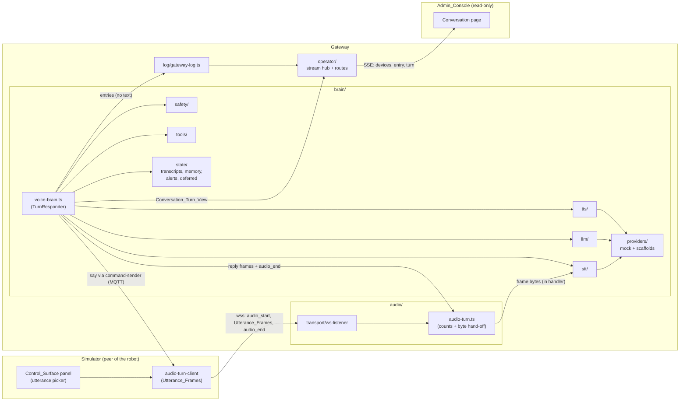

# Design Document: Phase 3 Voice Brain

## Overview

Five changes, each behind an existing seam:

1. **Gateway brain**: a `Voice_Brain` `TurnResponder` replaces the Fake_Reply behind the unchanged `TurnResponder` interface, wrapping STT → Input_Guard → LLM + Tool_Router → Output_Guard → TTS, with the Filler on the slow path.
2. **Audio plane**: the inbound binary frame now carries its bytes to the turn's Stt_Session, inside the transport's handler. Nothing else about the Audio_Server or barge-in changes.
3. **Shared**: `GATEWAY_LOG_VERSION` goes to 2 with six additive kinds, `OPERATOR_STREAM_EVENTS` gains `turn`, and a new `mock-audio` folder holds the codec the Simulator and the Mock_Stt share.
4. **Simulator**: the audio-turn request takes an optional `utterance`; the upload carries that utterance's text as Utterance_Frames.
5. **Admin console**: one read-only Conversation page fed by the new `turn` stream event.

Document B v2 does not change. `proto_ver` stays 2, no field is added, no enum renamed. Multilingual needs no bump: `primitives.ts` defines `LANG_RE = /^[a-z]{2,3}(?:-[A-Z][a-z]{3})?(?:-(?:[A-Z]{2}|[0-9]{3}))?$/` and `SayCmdMessageSchema`'s `lang` uses it, so `en-IN`, `hi-IN` and `hi-Deva-IN` all validate today. Verified in the contract source, not inferred.

Code is TypeScript (the repo's only language), strict mode, kebab-case files, PascalCase types, snake_case wire and log fields. Choices C1–C26, the open rulings F1–F5 and the superseded list are in `requirements.md`.

## Architecture



One turn, in order:

```text
audio_end (device)                                    t0
  -> Stt_Session.finish()            -> Transcript (text + lang)
  -> Input_Guard                     -> allow | defer | comfort | refuse
  -> [allow only] Llm.reply(...)     -> reply text + tool requests
       -> Tool_Router (<= 3 calls, allow-list only)
  -> Output_Guard                    -> allow | refuse -> Safe_Redirect
  -> Tts.synthesise(text, lang)      -> frame stream
  -> first frame about to go out: publish the turn's one `say`
  -> frames ... -> ReplyTarget.finish() -> audio_end, close 1000

if no reply frame by t0 + 600 ms: publish `say`, stream the Filler,
  stop it at a frame boundary when the reply's first frame is ready
```

## Components and Interfaces

### Shared: `packages/shared/src/gateway-log/constants.ts` (changed)

```ts
/** Numbers the Gateway_Log shape (G43). Bump by 1 whenever a kind or field changes. */
export const GATEWAY_LOG_VERSION = 2 as const;

export const GATEWAY_LOG_KINDS = Object.freeze([
  // The Phase 1.2 ten, unchanged and in the same order.
  "gateway", "message_in", "message_out", "message_rejected", "auth",
  "presence", "event_accepted", "event_duplicate", "ack_result", "audio_turn",
  // Phase 3, additive (C3).
  "brain_turn", "safety_decision", "tool_call", "provider_check",
  "parent_alert", "transcript_retention",
] as const);

export const BRAIN_TURN_PHASES = Object.freeze([
  "started", "transcribed", "replied", "speaking", "filler", "done", "failed", "aborted",
] as const);
export type BrainTurnPhase = (typeof BRAIN_TURN_PHASES)[number];

/** Why a pipeline failed or stopped. Log values, not wire values. */
export const BRAIN_TURN_CAUSES = Object.freeze([
  "stt_failed", "llm_failed", "tts_failed", "provider_refused", "tool_failed",
  "interrupted", "client_closed", "replaced", "device_offline", "broker_disconnected",
  "gateway_stopping",
] as const);
export type BrainTurnCause = (typeof BRAIN_TURN_CAUSES)[number];

export const SAFETY_STAGES = Object.freeze(["input", "output"] as const);
export type SafetyStage = (typeof SAFETY_STAGES)[number];
export const SAFETY_DECISIONS = Object.freeze(["allow", "defer", "comfort", "refuse"] as const);
export type SafetyDecisionName = (typeof SAFETY_DECISIONS)[number];

export const SAFETY_RULES = Object.freeze([
  // input
  "blocked_category", "defer_topic", "distress", "harm_disclosure",
  "unsupported_language", "too_long",
  // output
  "url", "contact_detail", "price", "brand", "romantic", "frightening",
  "medical", "legal", "financial", "length",
  // either
  "uncertain", "none",
] as const);
export type SafetyRule = (typeof SAFETY_RULES)[number];

/** Parent-added topics are logged as `parent_added`, so no parent text is logged (Req 7.5). */
export const DEFERRAL_TOPICS = Object.freeze([
  "death", "body", "violence", "religion", "family_conflict", "parent_added",
] as const);
export type DeferralTopic = (typeof DEFERRAL_TOPICS)[number];

export const ALLOW_LISTED_TOOLS = Object.freeze([
  "content_lookup", "routine_lookup", "memory_read", "memory_write", "device_action",
] as const);
export type AllowListedTool = (typeof ALLOW_LISTED_TOOLS)[number];

export const TOOL_OUTCOMES = Object.freeze(["ok", "denied", "error"] as const);
export type ToolOutcome = (typeof TOOL_OUTCOMES)[number];
export const TOOL_DENIED_REASONS = Object.freeze(["not_allow_listed", "policy", "too_many"] as const);
export type ToolDeniedReason = (typeof TOOL_DENIED_REASONS)[number];

export const PROVIDER_CAPABILITIES = Object.freeze(["stt", "llm", "tts"] as const);
export type ProviderCapability = (typeof PROVIDER_CAPABILITIES)[number];

/** Every adapter id that may ever appear in a log entry. Closed list, so no vendor string leaks. */
export const PROVIDER_IDS = Object.freeze([
  "mock", "sarvam", "elevenlabs", "faster_whisper", "indic_parler", "indic_f5", "hosted_llm",
] as const);
export type ProviderId = (typeof PROVIDER_IDS)[number];

export const PARENT_ALERT_KINDS = Object.freeze([
  "cry", "distress", "harm_disclosure", "deferred_question",
] as const);
export type ParentAlertKind = (typeof PARENT_ALERT_KINDS)[number];

export const TRANSCRIPT_RETENTION_ACTIONS = Object.freeze(["expired", "deleted_all"] as const);
export type TranscriptRetentionAction = (typeof TRANSCRIPT_RETENTION_ACTIONS)[number];
```

No existing kind or field changes, so an entry built against version 1 differs only in `log_ver` (Req 17.2).

### Shared: `packages/shared/src/domain/language.ts` (new)

```ts
/** The language tags Phase 3 supports end to end (C13). Each satisfies the contract's LANG_RE. */
export const SUPPORTED_LANGS = Object.freeze(["en-IN", "hi-IN"] as const);
export type SupportedLang = (typeof SUPPORTED_LANGS)[number];
```

### Shared: `packages/shared/src/gateway-log/entries.ts` (added types)

```ts
export type BrainTurnLogEntry = LogEntryBase<"brain_turn"> & {
  readonly device_id: string;
  readonly turn_id: string | null;
  readonly phase: BrainTurnPhase;
  readonly lang: SupportedLang;
  readonly age_stage: AgeStage;
  /** Milliseconds since the device's audio_end; null before it. */
  readonly since_audio_end_ms: number | null;
  readonly frames_out: number;
  readonly cause: BrainTurnCause | null;
};

export type SafetyDecisionLogEntry = LogEntryBase<"safety_decision"> & {
  readonly device_id: string;
  readonly turn_id: string | null;
  readonly stage: SafetyStage;
  readonly decision: SafetyDecisionName;
  readonly rule: SafetyRule;
  readonly topic: DeferralTopic | null;
};

export type ToolCallLogEntry = LogEntryBase<"tool_call"> & {
  readonly device_id: string;
  readonly turn_id: string;
  /** null when the requested name was not allow-listed: the name itself is never logged. */
  readonly tool: AllowListedTool | null;
  readonly outcome: ToolOutcome;
  readonly denied_reason: ToolDeniedReason | null;
};

export type ProviderCheckLogEntry = LogEntryBase<"provider_check"> & {
  readonly capability: ProviderCapability;
  readonly provider: ProviderId;
  readonly retains: boolean;
  readonly trains: boolean;
  readonly outcome: "accepted" | "refused";
};

export type ParentAlertLogEntry = LogEntryBase<"parent_alert"> & {
  readonly device_id: string;
  readonly turn_id: string | null;
  readonly alert_id: string;
  readonly alert: ParentAlertKind;
  /** cry only: the event's own values (safety.md §1). */
  readonly confidence: number | null;
  readonly duration_s: number | null;
  /** deferred_question only. */
  readonly topic: DeferralTopic | null;
};

export type TranscriptRetentionLogEntry = LogEntryBase<"transcript_retention"> & {
  readonly action: TranscriptRetentionAction;
  readonly turns_removed: number;
  readonly turns_held: number;
};
```

Each joins the `GatewayLogEntry` union. None has a field for a transcript, a reply, a tool argument, `active_child_id`, a name, audio bytes, an `auth` value or a token (Req 17.3).

### Shared: `packages/shared/src/mock-audio/` (new folder, C6)

Not the contract, not covered by `proto_ver`, versioned by its own constant, deleted when a real codec arrives.

```ts
/** Bump when the frame layout changes. Independent of proto_ver and GATEWAY_LOG_VERSION. */
export const MOCK_AUDIO_VERSION = 1 as const;

/** Well under the contract's 1,500-byte frame cap, so a frame is always contract-valid. */
export const MOCK_FRAME_MAX_BYTES = 512;

export type UtteranceFrames = Readonly<{ lang: SupportedLang; frames: readonly Uint8Array[] }>;

/**
 * Splits `text` into frames: `MA1\0<lang>\0<index>\0<total>\0<utf8 chunk>`. Each frame is
 * self-describing, so a decoder needs no side channel and a lost frame is detectable.
 * Throws on an empty text or an over-long one (more than 64 frames).
 */
export function encodeUtteranceFrames(text: string, lang: SupportedLang): UtteranceFrames;

export type DecodedUtterance =
  | { readonly ok: true; readonly text: string; readonly lang: SupportedLang }
  | { readonly ok: false; readonly reason: "not_mock_audio" | "incomplete" | "bad_frame" };

/** Decodes frames in arrival order. `not_mock_audio` for Phase 1.2 synthetic frames. */
export function decodeUtteranceFrames(frames: readonly Uint8Array[]): DecodedUtterance;
```

### Shared: `packages/shared/src/gateway-log/stream.ts` (changed)

```ts
export const OPERATOR_STREAM_EVENTS = Object.freeze(["devices", "entry", "turn"] as const);

export type ConversationTurnState =
  | "listening" | "thinking" | "speaking" | "done" | "interrupted" | "failed";

/** The data of a `turn` event (C4). Not a Log_Entry; never written to stdout. */
export type ConversationTurnView = Readonly<{
  turn_id: string;
  device_id: string;
  at: string;
  state: ConversationTurnState;
  lang: SupportedLang;
  age_stage: AgeStage;
  input_decision: SafetyDecisionName | null;
  input_rule: SafetyRule | null;
  input_topic: DeferralTopic | null;
  output_decision: SafetyDecisionName | null;
  output_rule: SafetyRule | null;
  tools: readonly Readonly<{ tool: AllowListedTool | null; outcome: ToolOutcome }>[];
  latency_ms: number | null;
  filler_spoken: boolean;
  frames_out: number;
  /** Code-point counts, always present. */
  transcript_len: number;
  reply_len: number;
  /** Text, only with the Transcripts_Argument in Local_Mode (Req 18.4, 18.5). */
  transcript_text: string | null;
  reply_text: string | null;
}>;
```

`packages/shared/test/exports.test.ts`: `EXPECTED_RUNTIME_EXPORTS` gains 18 names — `BRAIN_TURN_PHASES`, `BRAIN_TURN_CAUSES`, `SAFETY_STAGES`, `SAFETY_DECISIONS`, `SAFETY_RULES`, `DEFERRAL_TOPICS`, `ALLOW_LISTED_TOOLS`, `TOOL_OUTCOMES`, `TOOL_DENIED_REASONS`, `PROVIDER_CAPABILITIES`, `PROVIDER_IDS`, `PARENT_ALERT_KINDS`, `TRANSCRIPT_RETENTION_ACTIONS`, `SUPPORTED_LANGS`, `MOCK_AUDIO_VERSION`, `MOCK_FRAME_MAX_BYTES`, `encodeUtteranceFrames`, `decodeUtteranceFrames` — so 158 → 176, plus the new types in the `import type` list and a `GATEWAY_LOG_VERSION === 2` assertion. `OPERATOR_STREAM_EVENTS` and `GATEWAY_LOG_KINDS` change contents, not names.

### Gateway: `src/audio/audio-transport.ts` (changed, C2)

```ts
export type AudioInbound =
  | { readonly kind: "text"; readonly text: string; readonly byteLength: number }
  /**
   * The frame's bytes, valid only for the duration of the handler. The core passes them to the
   * turn's Stt_Session inside that handler and keeps no reference of its own (Req 14.2).
   */
  | { readonly kind: "binary"; readonly bytes: Uint8Array; readonly byteLength: number }
  | { readonly kind: "too_large" }
  | { readonly kind: "closed" };
```

The `ws` listener in `audio/transport/` already receives a `Buffer`; it passes it straight through. The comment that says frame bytes never reach the core is rewritten to describe the hand-off and its single consumer.

### Gateway: `src/audio/audio-turn.ts` (changed)

`AudioTurnDeps` gains one field and `handleBinary` gains one line:

```ts
export type AudioTurnDeps = Readonly<{
  /* ...unchanged... */
  /** The turn's speech-to-text sink. Called only inside the inbound handler. */
  stt: SttSession;
}>;
```

```ts
function handleBinary(bytes: Uint8Array, byteLength: number): void {
  // ...every existing guard and abort unchanged...
  framesIn += 1;
  bytesIn += byteLength;
  deps.stt.pushFrame(bytes); // in-handler hand-off; no reference kept here (Req 14.2)
}
```

`closeTurn()` additionally calls `deps.stt.release()`, so every terminal path (client close, abort, replaced, barge-in, finish, dispose) frees the buffer exactly once. Reply-stage frames are still released without counting and are not pushed.

### Gateway: `src/brain/` layout

```text
src/brain/
├─ voice-brain.ts              the TurnResponder; owns one pipeline per turn
├─ turn-pipeline.ts            the ordered run; no I/O of its own
├─ turn-latency.ts             Turn_Latency arithmetic over the Clock
├─ filler.ts                   pre-rendered Filler frames per language
├─ providers/
│  ├─ provider-declaration.ts  unchanged from Phase 1.2
│  ├─ stt-provider.ts          SttProvider + SttSession (input/result types filled in)
│  ├─ llm-provider.ts          LlmProvider (reply + tool requests)
│  ├─ tts-provider.ts          TtsProvider (text -> frame stream)
│  ├─ mock-stt.ts              Mock_Stt over the Mock_Audio_Codec
│  ├─ mock-llm.ts              Mock_Llm rule table
│  ├─ mock-tts.ts              Mock_Tts synthetic frames
│  ├─ adapter-sarvam-stt.ts    declaration-only scaffold
│  ├─ adapter-sarvam-tts.ts    declaration-only scaffold
│  ├─ adapter-elevenlabs-tts.ts declaration-only scaffold
│  ├─ adapter-hosted-llm.ts    declaration-only scaffold (vendor-neutral, F1)
│  └─ provider-gate.ts         the Safety_Layer's accept/refuse decision
├─ safety/
│  ├─ input-guard.ts           Transcript -> Safety_Decision
│  ├─ output-guard.ts          reply text -> Safety_Decision
│  ├─ forbidden-spans.ts       URL, phone, price, brand detectors
│  ├─ age-shape.ts             sentence and word limits per Age_Stage
│  └─ safe-text.ts             Safe_Redirect, Deferral, Comfort, Filler constants
├─ tools/
│  ├─ tool-router.ts           the only path to a tool
│  ├─ content-library.ts       in-process fixture
│  ├─ routines.ts              in-process fixture
│  └─ device-action.ts         policy gate + command sender
└─ state/
   ├─ child-context.ts         Child_Context table (C9)
   ├─ transcript-store.ts      Transcript_Store + sweep (C11)
   ├─ memory-store.ts          Memory_Store (C12)
   ├─ alerts.ts                Parent_Alerts + Deferred_Questions
   └─ conversation-view.ts     builds the Conversation_Turn_View
```

`src/brain/fake-reply.ts` and `src/brain/stub-providers.ts` are deleted (C1, C21). No file under `brain/` imports a network module, calls `fetch` or names a vendor package, so `brain/` needs no `transport/` folder and the Phase 1.2 network Repo_Check is unchanged.

#### `providers/stt-provider.ts`

```ts
export type SttFrameSink = { pushFrame(frame: Uint8Array): void; release(): void };

export type Transcript = Readonly<{
  text: string;
  /** The detected tag, which may be unsupported; the pipeline falls back (Req 11.3). */
  lang: string;
}>;

export type SttResult =
  | { readonly ok: true; readonly transcript: Transcript }
  | { readonly ok: false; readonly reason: "no_speech" | "decode_failed" | "provider_error" };

/** One session per Audio_Turn. `pushFrame` runs inside the transport handler. */
export interface SttSession extends SttFrameSink {
  readonly turnId: string;
  /** Called once, after the device's audio_end. */
  finish(): Promise<SttResult>;
  /** Bytes currently held. Used by tests to prove release (Req 14.3). */
  bytesHeld(): number;
}

export interface SttProvider {
  readonly id: ProviderId;
  readonly dataHandling: DataHandlingDeclaration;
  open(turn: Readonly<{ deviceId: string; turnId: string }>): SttSession;
}
```

#### `providers/llm-provider.ts`

```ts
export type ToolRequest = Readonly<{ name: string; args: Readonly<Record<string, unknown>> }>;

export type LlmTurnInput = Readonly<{
  deviceId: string;
  turnId: string;
  transcript: string;
  lang: SupportedLang;
  ageStage: AgeStage;
  allowedCategories: readonly string[];
  deferTopics: readonly string[];
  /** Exactly ALLOW_LISTED_TOOLS; the catalogue the provider may ask for (Req 9). */
  tools: readonly AllowListedTool[];
  /** Results of the tool calls already made this turn, in order. */
  toolResults: readonly Readonly<{ name: string; text: string }>[];
}>;

export type LlmReply =
  | { readonly ok: true; readonly text: string; readonly toolRequests: readonly ToolRequest[] }
  | { readonly ok: false; readonly reason: "provider_error" | "refused" };

export interface LlmProvider {
  readonly id: ProviderId;
  readonly dataHandling: DataHandlingDeclaration;
  reply(input: LlmTurnInput): Promise<LlmReply>;
}
```

`ToolRequest.name` is a plain string on purpose: a provider may ask for anything, and the Tool_Router is what refuses it (Property 7).

#### `providers/tts-provider.ts`

```ts
export type TtsInput = Readonly<{ deviceId: string; turnId: string; text: string; lang: SupportedLang }>;

export interface TtsProvider {
  readonly id: ProviderId;
  readonly dataHandling: DataHandlingDeclaration;
  /** Frames in play order. The pipeline stops pulling when the turn stops. */
  synthesise(input: TtsInput): AsyncIterable<Uint8Array>;
}
```

#### `providers/provider-gate.ts`

```ts
export type GateResult =
  | { readonly ok: true }
  | { readonly ok: false; readonly capability: ProviderCapability; readonly provider: ProviderId };

/** Accepts exactly a declaration of no retention and no training (safety.md §1, Req 1.3). */
export function checkProvider(
  capability: ProviderCapability,
  provider: Readonly<{ id: ProviderId; dataHandling: DataHandlingDeclaration }>,
): GateResult;

/** Checks all three and logs one `provider_check` entry each. */
export function checkProviders(
  deps: Readonly<{ log: Pick<GatewayLog, "add"> }>,
  providers: Readonly<{ stt: SttProvider; llm: LlmProvider; tts: TtsProvider }>,
): GateResult;
```

`index.ts` calls `checkProviders` before `start()`; on a refusal it writes one line through the existing config-error writer naming the capability and provider id and exits non-zero (Req 1.4), the same shape as the Phase 1.2 config and listen failures.

#### `providers/mock-llm.ts`

```ts
export type MockLlmRule = Readonly<{
  /** Lowercase substrings; all must appear in the transcript. */
  match: readonly string[];
  lang: SupportedLang;
  reply: string;
  toolRequests: readonly ToolRequest[];
  /** Scheduled on Deadlines, never a real sleep (Req 2.4). */
  delayMs: number;
}>;

export const MOCK_LLM_RULES: readonly MockLlmRule[];
export const MOCK_LLM_DEFAULT_SEED = 1;

export function createMockLlm(
  deps: Readonly<{ clock: Clock; deadlines: Deadlines; seed?: number }>,
): LlmProvider;
```

The table covers a plain question, a `death` question, an unsafe request, a distress disclosure, a story request using `content_lookup`, a Hindi utterance, a code-mixed utterance, and one rule with `delayMs` 1,200 (above the 600 ms Filler_Deadline) for the Filler path. No rule's reply contains a URL, a number that looks like a phone number, a price or a brand; the Output_Guard still checks every one.

#### `safety/input-guard.ts` and `safety/output-guard.ts`

```ts
export type SafetyDecisionName = (typeof SAFETY_DECISIONS)[number];

export type SafetyVerdict = Readonly<{
  decision: SafetyDecisionName;
  rule: SafetyRule;
  topic: DeferralTopic | null;
}>;

export type GuardContext = Readonly<{
  ageStage: AgeStage;
  lang: SupportedLang;
  allowedCategories: readonly string[];
  deferTopics: readonly string[];
}>;

/**
 * Exactly one verdict for any text (Property 5). Precedence, highest first:
 * harm disclosure, distress, Defer_Topic, blocked category, over-long, uncertain, allow.
 */
export function checkInput(text: string, ctx: GuardContext): SafetyVerdict;

/**
 * Exactly one verdict for any reply text (Property 6). Precedence, highest first:
 * url, contact_detail, price, brand, romantic, frightening, medical, legal, financial,
 * length, uncertain, allow.
 */
export function checkOutput(text: string, ctx: GuardContext): SafetyVerdict;
```

Both are pure, synchronous and provider-independent (safety.md §4). Classification is keyword and pattern based over a word list fixed in source. There is no model in the loop, so the guard cannot be talked out of a decision.

`uncertain` means different things on the two sides, and the difference is deliberate (Omar's ruling, group-5 review pass 4, finding 4):

- **The Input_Guard's `uncertain` covers unreadable or garbled text only** — blank, carrying no letter of either supported script, or carrying a character outside the readable set. It does **not** fail closed on ordinary conversation. A readable utterance that matches no Defer_Topic and no gated content category is allowed through to the model, because refusing every topic no word list names would refuse a child's normal chat, make the `none -> allow` step dead, and be its own harm. The line that holds regardless is the Output_Guard: whatever the model answers, every reply runs the twelve-rule `checkOutput` before a single frame is synthesised, so an unrecognised topic still cannot produce an unsafe spoken reply.
- **The Output_Guard's `uncertain` is biased toward fail-closed.** A reply the guard cannot read is refused and the Safe_Redirect is spoken. Hardening that bias further — so that a reply the detectors cannot place is also refused rather than allowed — is deferred to the **Safety Hardening** gate (F6, `safety.md`), because with the mock providers every reply is a fixed in-source constant and the path is unreachable in this phase.

#### `safety/forbidden-spans.ts`

```ts
export type ForbiddenKind = "url" | "contact_detail" | "price" | "brand";

/** The first forbidden span's kind, or null. Never returns the span's text (Req 6.2, C19). */
export function firstForbidden(text: string): ForbiddenKind | null;
```

URL detection covers a scheme-and-authority form and a bare `host.tld` form; `contact_detail` covers digit runs of 7 or more, with separators, and an `@`-address shape; `price` covers a currency symbol or code next to digits and the words for money in both languages; `brand` covers a frozen blocked list. A refusal replaces the whole reply (C19): nothing is redacted, so no half of a forbidden thing is ever spoken.

#### `safety/age-shape.ts` and `safety/safe-text.ts`

```ts
export const AGE_SENTENCE_LIMITS: Readonly<Record<AgeStage, number>> =
  Object.freeze({ tiny: 1, little: 2, explorer: 3, maker: 3 });
export const AGE_WORD_LIMITS: Readonly<Record<AgeStage, number>> =
  Object.freeze({ tiny: 8, little: 20, explorer: 40, maker: 60 });

export function sentenceCount(text: string): number;
export function wordCount(text: string): number;
export function withinAgeShape(text: string, stage: AgeStage): boolean;

/** Every spoken constant, per language and stage. Each passes checkOutput (Property 4). */
export const SAFE_REDIRECT: Readonly<Record<SupportedLang, Readonly<Record<AgeStage, string>>>>;
export const DEFERRAL_REPLY: Readonly<Record<SupportedLang, Readonly<Record<AgeStage, string>>>>;
export const COMFORT_REPLY: Readonly<Record<SupportedLang, Readonly<Record<AgeStage, string>>>>;
export const FILLER_TEXT: Readonly<Record<SupportedLang, string>>;
```

#### `tools/tool-router.ts`

```ts
export type ToolResult =
  | { readonly ok: true; readonly tool: AllowListedTool; readonly text: string }
  | {
      readonly ok: false;
      readonly tool: AllowListedTool | null;
      readonly outcome: "denied" | "error";
      readonly reason: ToolDeniedReason | null;
    };

export const MAX_TOOL_CALLS_PER_TURN = 3;

export interface ToolRouter {
  /** Runs allow-listed names only; everything else is denied `not_allow_listed` (Property 7). */
  run(turn: Readonly<{ deviceId: string; turnId: string }>, request: ToolRequest): ToolResult;
  /** Calls made for a turn, so the pipeline can enforce MAX_TOOL_CALLS_PER_TURN. */
  callCount(turnId: string): number;
}

export function createToolRouter(deps: Readonly<{
  log: Pick<GatewayLog, "add">;
  content: ContentLibrary;
  routines: Routines;
  memory: MemoryStore;
  device: DeviceActions;
  context: ChildContextTable;
}>): ToolRouter;
```

`run` looks the name up in `ALLOW_LISTED_TOOLS` with an exact match before anything else happens, so an unknown name never reaches a handler. The `tool_call` entry carries the resolved tool or null, never the requested string and never an argument (Req 9.8).

#### `tools/device-action.ts`

```ts
export type DeviceActionRequest = Readonly<{ action: CmdAction; data: Record<string, unknown> }>;

/** Only these five, and only through this gate (Req 9.5). */
export const DEVICE_ACTION_ALLOWED: readonly CmdAction[] =
  Object.freeze(["say", "animate", "gesture", "led", "play"]);

export interface DeviceActions {
  /** Denied with `policy` under quiet hours, a reached play limit, or movement off. */
  request(deviceId: string, req: DeviceActionRequest): ToolResult;
}
```

A `rejected` or `failed` ack is final: the Phase 1.2 ack tracker already records it and publishes nothing further (Requirement 8.7), and the pipeline never mentions a `reason` in speech (Req 9.6).

#### `state/child-context.ts`

```ts
export type DevicePolicy = Readonly<{
  quietHours: Readonly<{ start: string; end: string }> | null;
  playLimitMinutes: number | null;
  movementOn: boolean;
}>;

export type ChildContext = Readonly<{
  ageStage: AgeStage;
  langs: readonly SupportedLang[];
  allowedCategories: readonly string[];
  deferTopics: readonly string[];
  policy: DevicePolicy;
}>;

/** age_stage tiny, en-IN, no extra categories, movement off: used for a null or unknown id. */
export const MOST_RESTRICTIVE_CONTEXT: ChildContext;

export interface ChildContextTable {
  /** From the device's latest accepted status (Req 10.1). */
  setActiveChild(deviceId: string, activeChildId: string | null): void;
  forDevice(deviceId: string): ChildContext;
}
```

`handleInbound` calls `setActiveChild` for a classified `status`, beside the existing `statusMemory.record`. The id is used as a lookup key and is never logged.

#### `state/transcript-store.ts`

```ts
export const TRANSCRIPT_SWEEP_INTERVAL_MS = 3_600_000;
export const TRANSCRIPT_MAX_TURNS_PER_DEVICE = 200;
export const TRANSCRIPT_MAX_TURNS_TOTAL = 1_000;

export type StoredTurn = Readonly<{
  device_id: string;
  turn_id: string;
  speaker: TranscriptSpeaker;
  text: string;
  at: string;
  expires_at_ms: number;
}>;

export interface TranscriptStore {
  add(turn: Omit<StoredTurn, "expires_at_ms">): void;
  /** Removes expired turns and logs `transcript_retention` `expired` when any went. */
  sweep(nowMs: number): number;
  deleteAll(): number;
  counts(): Readonly<{ total: number; byDevice: Readonly<Record<string, number>> }>;
  /** Only with the Transcripts_Argument; otherwise the pipeline never calls it. */
  textFor(turnId: string): readonly StoredTurn[];
}

export function createTranscriptStore(deps: Readonly<{
  clock: Clock;
  deadlines: Deadlines;
  log: Pick<GatewayLog, "add">;
  retentionDays?: number;
}>): TranscriptStore;
```

The sweep re-schedules itself on `Deadlines` with the key `transcripts:sweep` (Req 15.7), so the 30-day policy is executed code and tests drive it with fake timers.

#### `voice-brain.ts` and `turn-pipeline.ts`

```ts
export type VoiceBrainDeps = Readonly<{
  clock: Clock;
  deadlines: Deadlines;
  log: Pick<GatewayLog, "add">;
  sendCommand: (request: CommandRequest) => CommandResult;
  stt: SttProvider;
  llm: LlmProvider;
  tts: TtsProvider;
  tools: ToolRouter;
  context: ChildContextTable;
  transcripts: TranscriptStore;
  alerts: Alerts;
  filler: FillerAudio;
  /** Local_Mode plus the Transcripts_Argument (Req 18.4). */
  includeTranscriptText: boolean;
  /** Called on every Conversation_Turn_View change (Req 18.2). */
  onTurnView: (view: ConversationTurnView) => void;
}>;

export interface VoiceBrain extends TurnResponder {
  /** One Stt_Session per Audio_Turn, handed to the Audio_Turn at open time. */
  openStt(deviceId: string, turnId: string): SttSession;
  /** Cancels every pipeline deadline and releases every buffer (Req 13.5). */
  stop(): void;
}

export function createVoiceBrain(deps: VoiceBrainDeps): VoiceBrain;
```

`respond(target)` is `void`, as the existing seam requires. It starts an async run and, before every send, checks `target.signal.stopped`; `target.signal.onStop` cancels the pipeline's deadlines, abandons the pending work and releases the session. Every provider delay is scheduled on `Deadlines`, so one `await` resolves on a microtask after the test advances the clock.

Frame sending is one scheduled chain, exactly like the Fake_Reply's: frame 1 as soon as it is available, frame n + 1 at `t0 + 20 ms × n`, anchored so there is no drift. The first `sendFrame` call is preceded by the turn's single `say` publish; `sendFrame` is what triggers the Audio_Turn's `reply_started` entry, unchanged.

### Gateway: `src/operator/` (changed)

- `operator-stream.ts`: the hub gains a `turn` event. `createOperatorStreams` takes an extra `views: () => readonly ConversationTurnView[]` for the backlog and the gateway pushes later views through a `publishTurn(view)` method. On open the order becomes `devices`, then the retained `entry` backlog, then one `turn` per retained view, then live events. The 4-stream cap, the 1 MiB pending cap, the 15 s keep-alive and the idempotent close are unchanged.
- `operator-routes.ts`: three new routes, each behind the unchanged request guard —
  - `GET /v1/conversation` → `{ ok: true, turns: ConversationTurnView[] }`
  - `GET /v1/brain` → `{ ok: true, transcripts: {...counts}, alerts: [...], deferred: [...], providers: [...] }`
  - `POST /v1/transcripts/delete-all` → `{ ok: true, removed }`

  The POST is state-changing, so the existing guard already requires a JSON content type, a loopback `Host` and no `Origin`. It is reachable from `docker compose exec gateway` through the operator CLI, which gains the three operations. The Admin_Console cannot reach it: its Dev_Proxy forwards `GET /v1/stream` only (Phase 1.3 C5), and the console sends no other request.
- `src/listen-host.ts`: gains the second argument.

```ts
export const TRANSCRIPTS_ARGUMENT = "--operator-transcripts";

/** Transcript text on the operator channel: Local_Mode plus the argument, nothing else. */
export function operatorTranscriptsEnabled(localMode: boolean, argv: readonly string[]): boolean;
```

### Simulator (changed)

- `src/audio/test-utterances.ts` (new): the Test_Utterance table, owned by the Simulator. The Gateway has no copy, because a real STT would receive arbitrary speech.

```ts
export type TestUtterance = Readonly<{ name: string; lang: SupportedLang; text: string }>;
export const TEST_UTTERANCES: readonly TestUtterance[];
export const TEST_UTTERANCE_NAMES: readonly string[];
```

  Names: `hello`, `story`, `where-did-grandpa-go` (Defer_Topic), `scary-request` (refusal), `sad` (distress), `hindi-hello`, `mixed-hindi-english`, `slow-thinker` (Filler path).

- `src/audio/audio-turn-client.ts`: `request(utterance?: string)` and, when given, `encodeUtteranceFrames(...)` supplies the upload frames instead of `syntheticFrame()`. The 20 ms cadence, the anchored deadlines, the reply counting, the latency measurement and every failure cause are unchanged.
- `src/control/control-routes.ts`: `POST /api/audio-turn` accepts an optional string `utterance`; an unknown name gives `400 invalid_fields` with `{ path: ["utterance"], kind: "invalid_value" }` and echoes nothing.
- `src/control/panel-assets.ts`: a `<label>` plus `<select>` of the utterance names beside the existing audio-turn button. No animation, no external resource.

### Admin console (changed)

| File | Change |
|---|---|
| `src/stream/stream-client.ts` | one more named listener, `turn`, with the same shape guard and `JSON.parse` in `try` |
| `src/stream/console-state.ts` | `turns: readonly ConversationTurnView[] \| null`, a `turn` action that replaces by `turn_id` and keeps the newest `CONVERSATION_CAP` (50), cleared by `reset` |
| `src/log/entry-label.ts` | six new `switch` cases; the `never` default makes this a compile error until they exist |
| `src/components/conversation-list.tsx` | new: `<ol>` of turns, each a labelled definition list of the Req 20.2 fields |
| `src/pages/conversation-page.tsx` | new: the page heading, the list, and the "text is off" note |
| `src/routing/use-hash-page.ts` | `#/conversation` added |
| `src/app.tsx` | one more `nav` link with `aria-current` |
| `src/styles.css` | layout classes only; no animation, transition or keyframes |

### Compose and tooling

- `docker-compose.yml`: the gateway's `command` becomes `["node", "dist/index.js", "--listen-all-interfaces", "--operator-transcripts"]`. Ports, `env_file`, `depends_on` and `restart` are unchanged; the simulator service is unchanged.
- `tooling/checks/audio-retention.ts` (new):

```ts
export type AudioFinding = { path: string; lineNo: number; rule: string };

/** The only modules allowed to name a byte-typed audio value (Req 14.4). */
export const AUDIO_BYTE_MODULES: readonly string[] = Object.freeze([
  "services/gateway/src/audio/transport/",
  "services/gateway/src/audio/audio-turn.ts",
  "services/gateway/src/audio/audio-transport.ts",
  "services/gateway/src/audio/synthetic-frame.ts",
  "services/gateway/src/brain/providers/stt-provider.ts",
  "services/gateway/src/brain/providers/mock-stt.ts",
  "services/gateway/src/brain/providers/mock-tts.ts",
  "services/gateway/src/brain/providers/tts-provider.ts",
  "services/gateway/src/brain/filler.ts",
  "services/gateway/src/brain/turn-responder.ts",
  "services/gateway/src/brain/turn-pipeline.ts",
  "services/simulator/src/audio/",
]);

/** `Uint8Array`, `Buffer` and `ArrayBuffer` mentions, and byte-ish accumulation calls. */
export function findAudioByteUse(path: string, text: string): AudioFinding[];
```

  `tooling/test/audio-retention.test.ts` runs it over both service trees, re-runs the existing `findFileWrites` over them, and self-tests the detector against a banned and a clean fixture, exactly as `gateway-boundaries.test.ts` does.
- `tooling/checks/service-sources.ts`: `PROVIDER_STUB_NAMES` becomes the provider implementation names (`MockSttProvider`, `MockLlmProvider`, `MockTtsProvider`, and the four adapter factories), `STUB_MODULE_RE` becomes `src/brain/providers/`, and the two boundary fixtures change with them. `findProviderStubUse` keeps its name, its signature and its rule codes.
- `tooling/compose/compose-acceptance.ts`: one new criterion, `conversation`, after `stream`.

## Data Models

The `turn` event on the wire, with transcripts on:

```text
event: turn
data: {"turn_id":"t_9f","device_id":"xlu_000123","at":"2026-10-20T10:00:04.100Z","state":"done","lang":"en-IN","age_stage":"little","input_decision":"allow","input_rule":"none","input_topic":null,"output_decision":"allow","output_rule":"none","tools":[{"tool":"content_lookup","outcome":"ok"}],"latency_ms":320,"filler_spoken":false,"frames_out":44,"transcript_len":27,"reply_len":58,"transcript_text":"tell me a story about a lion","reply_text":"I know a lion story! Shall we start it together?"}
```

The same turn's Gateway_Log entries, which carry no text at all:

```text
{"log_ver":2,"seq":51,"at":"...","kind":"brain_turn","device_id":"xlu_000123","turn_id":"t_9f","phase":"transcribed","lang":"en-IN","age_stage":"little","since_audio_end_ms":40,"frames_out":0,"cause":null}
{"log_ver":2,"seq":52,"at":"...","kind":"safety_decision","device_id":"xlu_000123","turn_id":"t_9f","stage":"input","decision":"allow","rule":"none","topic":null}
{"log_ver":2,"seq":53,"at":"...","kind":"tool_call","device_id":"xlu_000123","turn_id":"t_9f","tool":"content_lookup","outcome":"ok","denied_reason":null}
{"log_ver":2,"seq":54,"at":"...","kind":"safety_decision","device_id":"xlu_000123","turn_id":"t_9f","stage":"output","decision":"allow","rule":"none","topic":null}
{"log_ver":2,"seq":55,"at":"...","kind":"message_out","transport":"mqtt","device_id":"xlu_000123","variant":"say","cmd_id":"c_12","turn_id":null}
{"log_ver":2,"seq":58,"at":"...","kind":"brain_turn","device_id":"xlu_000123","turn_id":"t_9f","phase":"done","lang":"en-IN","age_stage":"little","since_audio_end_ms":1200,"frames_out":44,"cause":null}
```

An Utterance_Frame, as the Simulator builds it:

```text
"MA1\0en-IN\0001\0002\0tell me a story "   (UTF-8, <= 512 bytes, <= the contract's 1,500)
```

## Error Handling

| Situation | Behaviour |
|---|---|
| A provider declares retention or training, at start-up | One stderr line naming capability and provider id, no listener, non-zero exit within 5 s (Req 1.4) |
| The same, discovered per call | No provider call, Safe_Redirect spoken, `provider_check` `refused` (Req 1.6) |
| Frames decode to no text | `brain_turn` `failed` cause `stt_failed`, Safe_Redirect spoken |
| Frames are Phase 1.2 synthetic frames (no `utterance`) | Mock_Stt returns `no_speech`; the turn speaks a Safe_Redirect, so the Phase 1.2 flow still answers |
| LLM throws or refuses | `brain_turn` `failed` cause `llm_failed`, Safe_Redirect spoken |
| TTS throws mid-stream | If no frame was sent, Safe_Redirect; if frames were sent, `finish()` the turn; `brain_turn` `failed` cause `tts_failed` |
| A tool is not allow-listed | Nothing runs, `tool_call` `denied` `not_allow_listed`, the LLM is told, the turn continues |
| A fourth tool request | `tool_call` `denied` `too_many` |
| `device_action` under quiet hours, a play limit, or movement off | Nothing sent, `tool_call` `denied` `policy` |
| A `rejected` or `failed` ack for a `device_action` | Final: no replacement command, no reason text spoken (Req 9.6) |
| Output_Guard refuses | The whole reply is dropped, the Safe_Redirect is spoken (C19) |
| Input_Guard cannot classify | `refuse` with rule `uncertain`, Safe_Redirect spoken (safety.md §4) |
| `say` refused `device_offline` / `broker_disconnected` | No frame, no `audio_end`, `target.abort(cause)`, `brain_turn` `aborted` with that cause |
| Barge-in, client close, replaced, gateway stop | No further frame or `audio_end`, deadlines cancelled, buffers released, one `brain_turn` `aborted` |
| Unsupported language from STT | Child_Context's first language used, `safety_decision` rule `unsupported_language` |
| Transcript_Store at capacity | Oldest turn dropped first; the sweep still runs |
| `POST /v1/transcripts/delete-all` with an `Origin`, a foreign `Host` or no JSON content type | Refused by the unchanged guard; nothing deleted |
| Unknown `utterance` name at the Control_Surface | `400 invalid_fields`, no value echoed, no socket opened |
| A `turn` event the console cannot parse | Ignored by the shape guard, like `entry` and `devices` |

## Security and Privacy Notes

- **No raw child audio, by construction.** Frame bytes exist in exactly three places: the `ws` handler, the Audio_Turn's counters, and the turn's Stt_Session buffer. The buffer is bounded at `MAX_UPLOAD_FRAMES × MAX_FRAME_BYTES` (3,000 × 1,500 = 4.5 MB worst case) and released on every terminal path. No file-writing API exists in either service (Phase 1.2 Requirement 21.1, enforced). The new `audio-retention` Repo_Check proves byte-typed values appear nowhere else, and a runtime property proves no frame byte and no utterance text reaches a Log_Entry, a stdout line or a response.
- **Transcripts are text, bounded, and expire.** In memory only, 30-day TTL with an executed sweep, capacity caps, a real delete-all, and nothing on disk. They are lost on restart, which is a Phase 3 limitation, not a design goal (C10).
- **The log stays ID-only.** Every new kind carries closed enums, IDs, counts and times. `active_child_id`, child names, tool arguments, transcripts and reply text appear in no entry. `age_stage` does appear: four buckets, naming nobody.
- **Transcript text has exactly one route out**, the operator-only `turn` event and the `GET /v1/conversation` route, both Local_Mode only, both behind the unchanged loopback `Host` and no-`Origin` guard, both off unless the Gateway was started with `--operator-transcripts`. In this phase every utterance is a Simulator constant, so no real child speech exists in the system at all.
- **No open internet for the child.** The gateway's dependencies stay `@xelulu/shared`, `mqtt`, `ws`; no `fetch`; no network import outside the three transport folders; `brain/` has none. The LLM gets exactly five tool names and no fetch, search or execution of any kind. Replies containing a URL, a phone-like number, a price or a brand are refused whole.
- **Physical safety stays with the device.** `device_action` is gated on quiet hours, the play limit and the movement toggle before anything is sent, and every ack `reason` is final. No LED `effect` is requested outside `solid` (no flash rate is ever requested; firmware enforces the 3–30 Hz rule anyway, safety.md §6).
- **FLAG, carried forward:** the Operator_Surface, the Control_Surface and the admin dev server are still unauthenticated (Phase 1.2 G24/G46). Mitigations are unchanged: Local_Mode only, host loopback publishing, the `Host`/`Origin` guards, CORS off, and now the extra rule that transcript text needs an explicit argument. Residual risk: any process on the developer's machine can read the stream; in this phase that stream carries synthetic utterances.
- **No secret anywhere.** No new Panel_Key, no key read, no `KEY=value` line in tracked source, no non-loopback URL literal, no vendor credential. `.env.example` and `tooling/fixtures/approved-panel.txt` are untouched.

## Correctness Properties

*A property is a characteristic or behavior that should hold true across all valid executions of a system: a formal statement about what the system should do. Properties bridge human-readable specifications and machine-verifiable correctness guarantees.*

Properties 1–11 are fast-check runs of at least 100 iterations (C25); the remaining acceptance criteria are covered by example-based tests listed in the testing strategy.

### Property 1: Provider acceptance equals no retention and no training

For any provider id and any pair of retention and training booleans, `checkProvider` returns `ok` exactly when both booleans are false, and the `provider_check` entry it logs carries those same two booleans and the matching outcome.

**Validates: Requirements 1.3, 1.5, 2.4**

### Property 2: Mock audio round trip

For any non-empty text within the codec's frame budget and any supported language, decoding the frames produced by `encodeUtteranceFrames` returns that same text and language, and every frame is at most `MOCK_FRAME_MAX_BYTES` and at most the contract's 1,500-byte frame cap.

**Validates: Requirements 2.1, 19.2, 11.2**

### Property 3: Mock providers are deterministic

For any transcript, Child_Context and seed, two calls to the Mock_Llm return deeply equal replies, tool requests and delays, and the Mock_Tts returns the same frame count for the same text; neither reads an environment variable nor opens a socket.

**Validates: Requirements 2.2, 2.3, 2.4, 2.6**

### Property 4: Every spoken text fits the age stage and passes the output guard

For any Age_Stage, any supported language and any text the pipeline would speak, including every Safe_Redirect, Deferral, Comfort and Filler constant, the text is within that stage's sentence and word limits and `checkOutput` returns `allow` for it.

**Validates: Requirements 6.7, 10.2, 11.6, 8.3**

### Property 5: The input guard is total and ordered

For any text and any Child_Context, `checkInput` returns exactly one decision from `SAFETY_DECISIONS` with exactly one rule from `SAFETY_RULES`, a topic only when the rule is `defer_topic`, and never a lower-precedence class than the highest class the text matches.

**Validates: Requirements 5.1, 5.2, 5.3, 5.4, 5.5, 5.7**

### Property 6: No forbidden span is ever spoken

For any reply text with a URL, a phone-like number, a price or a brand name injected at any position, `checkOutput` returns `refuse` with the matching rule, the pipeline speaks the Safe_Redirect instead, and no substring of the injected span appears in any frame's text, any Log_Entry or any Conversation_Turn_View.

**Validates: Requirements 6.1, 6.2, 6.3, 6.5**

### Property 7: Only allow-listed tools run

For any sequence of tool requests with arbitrary names and arguments, the set of tools the Tool_Router executes is a subset of `ALLOW_LISTED_TOOLS`, at most `MAX_TOOL_CALLS_PER_TURN` run per turn, every other request is denied with `not_allow_listed` or `too_many`, and no `tool_call` entry contains a requested name or an argument value.

**Validates: Requirements 9.1, 9.2, 9.3, 9.7, 9.8**

### Property 8: Device policy gates before sending

For any combination of quiet hours, play-limit state, movement toggle and requested action, `device_action` sends a command exactly when the action is one of the five allowed and no gate applies, and otherwise sends nothing and is denied with `policy`.

**Validates: Requirements 9.4, 9.5**

### Property 9: Exactly one say per spoken turn, and nothing after the turn stops

For any pipeline scenario, that is any provider delays, any stop point (during STT, the LLM, a tool, TTS, the Filler, or at any frame index) and any `say` refusal, the turn publishes exactly one `say` when at least one frame is sent and none when no frame is sent, sends no frame or `audio_end` after it stops, records exactly one terminal `brain_turn` entry, and holds zero bytes in its Stt_Session afterwards.

**Validates: Requirements 4.2, 4.4, 12.6, 13.1, 13.3, 14.3**

### Property 10: Retention removes exactly the expired turns

For any set of stored turns and any sweep time, after the sweep the held turns are exactly those whose expiry is after that time, subject to the capacity caps, the logged removed and held counts match, and `deleteAll` leaves nothing held.

**Validates: Requirements 15.1, 15.3, 15.4, 15.5**

### Property 11: Nothing leaks without the transcripts argument

For any turn run with the Transcripts_Argument off, no Log_Entry, no stdout line, no Operator_Surface response body and no Conversation_Turn_View contains the turn's transcript text, its reply text or any byte of its frames, and the view's `transcript_len` and `reply_len` still equal the real code-point counts.

**Validates: Requirements 14.6, 18.3, 18.5, 18.6, 17.3**

## Testing Strategy

All tests run under the root `pnpm test` (Vitest), offline, with no key. Property tests use fast-check at 100 runs or more (C25); everything else is example-based. Latency, filler and retention tests use the existing Clock and Deadlines with Vitest fake timers; no test waits on wall-clock time.

**Shared** (`packages/shared/test/`)
- `mock-audio.test.ts`: Property 2, plus `not_mock_audio` for a Phase 1.2 synthetic frame, `incomplete` for a missing frame, and `bad_frame` for a corrupted header.
- `gateway-log.test.ts` additions: the six new kinds round-trip as JSON, every existing kind keeps exactly its Phase 1.2 field set, and `GATEWAY_LOG_VERSION` is 2.
- `exports.test.ts`: the 18 new runtime names (158 → 176), the new types, and the version assertion.

**Gateway** (`services/gateway/test/`)
- `support/no-remote-sockets.ts` (new): wraps the socket constructors and fails on a non-loopback address; imported by every brain test (Req 22.8).
- `provider-gate.test.ts`: Property 1; the mocks' declarations; the start-up refusal example (one stderr line naming capability and provider id, non-zero exit, no listener).
- `mock-providers.test.ts`: Property 3; the Mock_Llm table's coverage of all eight required rules.
- `input-guard.test.ts`: Property 5; one example per Defer_Topic, per distress phrase and per blocked category.
- `output-guard.test.ts`: Properties 4 and 6; one example per forbidden kind and per refused content class.
- `tool-router.test.ts`: Properties 7 and 8; examples for each of the five tools, the memory cap (Req 16.3), and a `rejected` ack producing no replacement command.
- `turn-pipeline.test.ts`: Property 9; the full happy path; the Deferral path (gentle reply, Deferred_Question, `parent_alert`); the refusal path (Safe_Redirect, nothing harmful in any frame or entry); the comfort path; the unsupported-language fallback; the code-mixed utterance.
- `filler.test.ts`: the 600 ms boundary at 599, 600 and 601 ms; one `say` only; the reply continuing on the same turn; no Filler frame after a reply frame; a barge-in during the Filler.
- `latency.test.ts`: for every Mock_Llm rule, the first frame within 1,600 ms, and within 1,000 ms for every rule whose delay is below the Filler_Deadline (Req 12.2, 12.3).
- `transcript-store.test.ts`: Property 10; the sweep firing on Deadlines; the delete-all route.
- `no-audio-retention.test.ts`: Property 11; `bytesHeld()` zero after every terminal path; sentinel utterance text absent from the whole log and every response.
- `conversation-view.test.ts`: the view's fields per phase; text present with the argument and absent without it.
- `operator-stream.test.ts` additions: a `turn` event after a view change, the backlog order (`devices`, `entry`s, `turn`s), and the three new routes behind the unchanged guard (403 foreign `Host`, 403 any `Origin`, 405 wrong method).
- Rewritten Phase 1.2 tests (C1): `audio-server.test.ts`, `barge-in.test.ts`, `brain.test.ts`, `done-when.test.ts`, `stream-done-when.test.ts` now drive the mock pipeline instead of the Fake_Reply; `fake-reply.test.ts` is deleted.
- `done-when.test.ts`: the end-to-end turn of Requirement 22.1, with the fake device and fake timers.

**Simulator** (`services/simulator/test/`)
- `test-utterances.test.ts`: every name encodes to contract-valid frames; the table covers all eight required cases.
- `audio-turn-client.test.ts` additions: an `utterance` upload sends that utterance's frames and then `audio_end`; no `utterance` keeps the Phase 1.2 synthetic frames; latency reporting is unchanged.
- `control-routes.test.ts` additions: an unknown `utterance` gives `400 invalid_fields` with no echoed value; the panel HTML carries a `<label>` bound to the utterance `<select>`.

**Admin** (`apps/admin/test/`, `// @vitest-environment jsdom` for DOM files)
- `conversation-page.test.tsx`: a `turn` event renders its row with decisions, tools, latency and state; text shown when present; the "text is off" note with lengths when absent; the 50-turn cap; `reset` clearing the list.
- `entry-label.test.ts` additions: one label per new kind.
- `stream-client.test.ts` additions: a malformed `turn` payload is ignored.

**Repo checks** (`tooling/test/`)
- `audio-retention.test.ts` (new): no byte-typed audio value outside `AUDIO_BYTE_MODULES`, no file-writing API in either service, and the banned/clean fixture self-tests.
- `gateway-boundaries.test.ts`: unchanged tests plus the re-pointed provider-module rule and the new walk-guard path.
- `compose-static.test.ts`: the gateway's new `command` array; every other assertion unchanged.
- `compose-acceptance.test.ts`: the new `conversation` criterion and PASSED line.
- `panel-check.test.ts`, `env-reads.test.ts`, `url-scan.test.ts`, `secret-check.test.ts`, `contract-use.test.ts`, `no-cross-package-import.test.ts`, `manifests.test.ts`, `file-names.test.ts`, `placeholder.test.ts`, `contrast.test.ts`, `style-props.test.ts`, `readme.test.ts`: unchanged rules, passing.

**Compose_Acceptance_Check**: a new `conversation` criterion after `stream`: `POST 127.0.0.1:Q/api/audio-turn` with `{"utterance":"story"}` on the Simulator, then on the Gateway's stream a `brain_turn` `transcribed` entry, `safety_decision` entries for both stages, a `say` `message_out`, an `ack_result` with outcome `done`, and a `turn` event for that `turn_id` whose state reaches `done`. The PASSED line becomes `PASSED 23.1–23.8 + stream + conversation`; every earlier step is unchanged.

## Manual Verification Checklist

Browser steps only; everything else above is automated.

1. Set `GATEWAY_OPERATOR_PORT` and `SIMULATOR_PANEL_PORT` in `.env` as the README describes. Run `docker compose up --build`.
2. Run `pnpm build`, then `pnpm dev:admin`, and open `http://127.0.0.1:5173`. The status reads "Live".
3. Open the Conversation page. It is empty with a note that no turn has run.
4. Open the Simulator panel at `http://127.0.0.1:<SIMULATOR_PANEL_PORT>`. Choose the utterance `story` and start an audio turn.
5. Within about 2 s the Conversation page shows one turn: the child's words, input `allow`, `content_lookup` `ok`, output `allow`, a latency in milliseconds, and Xelulu's 1–3 sentence reply. The Live_Log shows `brain_turn`, `safety_decision`, `tool_call`, `sent say …` and `ack done for say …` rows.
6. Repeat with `where-did-grandpa-go`: the turn shows input `defer` with topic `death`, a gentle reply that invites asking a grown-up, and a `parent_alert` row with kind `deferred_question`.
7. Repeat with `scary-request`: the turn shows output or input `refuse`, and the spoken reply is the Safe_Redirect. Nothing from the request appears in the reply.
8. Repeat with `sad`: the turn shows input `comfort` and a `parent_alert` row with kind `distress`.
9. Repeat with `hindi-hello` and `mixed-hindi-english`: the `say` row's language is as expected and the reply is in the right language.
10. Repeat with `slow-thinker`: the turn shows `filler_spoken` true, one `say` row only, and a single continuous reply.
11. Fire a `cry` event from the panel: a `parent_alert` row with kind `cry` appears, carrying confidence and duration and nothing else.
12. Fire an `interrupt` while a reply is streaming: the turn's state becomes `interrupted`, the frames sent are fewer than the full reply, and `sent stop_audio …` appears.
13. Search the Live_Log text and the browser's view of `/v1/stream` for the `.env` `DEVICE_TOKEN` value: it does not appear. Confirm that no `entry` event, of any kind, contains the utterance text.
14. Stop the gateway container and start it again with the `--operator-transcripts` argument removed from `docker-compose.yml`: the Conversation page shows the same turns' decisions and lengths with no text and the "text is off" note.
