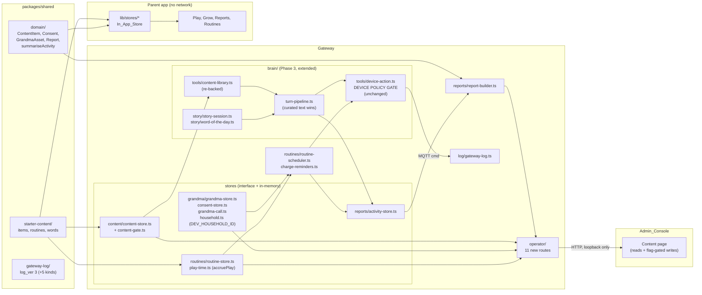

# Design Document: Phase 4 Content, Stories, Grandma, Routines

## Overview

Six changes, each behind an existing seam:

1. **Shared**: the `ContentItem` row model grows `status`, `source`, `steps` and `updated_at`, `ContentKind` gains `learning`, the eight Content_Categories and the Activity kinds become frozen constants, `summariseActivity` arrives as a pure function, and one new folder `src/starter-content/` holds the seeded library, the routine templates and the Word_Of_The_Day entries. `GATEWAY_LOG_VERSION` goes to 3 with five additive kinds.
2. **Gateway stores**: four new folders — `src/content/`, `src/grandma/`, `src/routines/`, `src/reports/` — each a store interface with an in-memory implementation, plus `src/brain/story/` for the Story_Session and the Word_Of_The_Day picker. Two of the new modules are not stores and are named here so they are not mistaken for incidental helpers: `src/grandma/household.ts` is the single source of a `household_id` in a Gateway that has none today (C34), and `src/routines/play-time.ts` is the single writer of the play ledger, the `play` Activity_Record and the Nap_Sequence crossing (C18). Every store is replaced by a Supabase implementation in Phase 5 without touching a caller.
3. **Brain**: `tools/content-library.ts` is re-backed by the Content_Store and its `content_lookup` arguments grow; **`tools/tool-router.ts` gains a `StorySessions` dependency and one changed handler**, because it is the only caller of `ContentLibrary.lookup` and the only module holding both the resolved item and the turn (C40); `turn-pipeline.ts` gains the curated-text rule. The Safety_Layer, the tool allow-list and the Device_Policy_Gate are **not** changed.
4. **Scheduler**: a Routine_Scheduler on the existing Clock and Deadlines fires routines, Grandma schedules, charge reminders and the Nap_Sequence, every one of them through `tools/device-action.ts`.
5. **Operator_Surface**: twelve new routes behind the unchanged request guard — four reads and eight writes — the eight write ones additionally behind the off-by-default `--content-admin` argument. One of them, `POST /v1/grandma/consent`, is what makes a Consent_Record creatable at all, and it records the shape of consent and **not** verifiable parental consent (Req 6.6, 6.7).
6. **Admin console and parent app**: one Content page fed by the new routes; and the Play, Grow, Reports and Routines screens fed by In_App_Stores over the shared Starter_Content — with no network call of any kind from the app.

Document B v2 does not change: `proto_ver` stays 2, no field is added, no enum renamed. Every action used is already in `CMD_ACTIONS`; `play.data` already carries `content_id` and `source`; `led.data.effect` already offers `solid` and `pulse`; `say.data.lang` already accepts both languages. Verified in `packages/shared/src/gateway-contract/commands.ts` and `enums.ts`, not inferred.

Code is TypeScript (the repo's only language), strict mode, kebab-case files, PascalCase types, snake_case wire and log fields. Choices C1–C43, the open rulings F1–F8 and the superseded list are in `requirements.md`.

## Architecture



Two paths carry everything, and neither is new:

```text
A turn:  audio_end -> STT -> Input_Guard
           -> [Story_Session in progress?]  yes: resolve choice -> curated step text
                                            no : LLM + Tool_Router -> content_lookup
                                                   -> [session started?] yes: curated step text
                                                                        no : model reply text
           -> Output_Guard  (always)
           -> TTS -> one `say` -> frames

A scheduled behaviour:  Deadlines fires
           -> Routine_Scheduler picks the behaviour (routine | grandma | battery | play_limit)
           -> narration from a per-language template -> checkOutput
           -> for each action: device-action.ts gate (quiet hours, play limit, movement)
                 refused -> send nothing, log, stop the behaviour
                 allowed -> sendCommand once; the ack is final
```

## Components and Interfaces

### Shared: `packages/shared/src/domain/content-item.ts` (changed)

```ts
export const CONTENT_KINDS = Object.freeze([
  "story", "song", "rhyme", "lullaby", "game", "learning",
] as const);
export type ContentKind = (typeof CONTENT_KINDS)[number];

export const CONTENT_STATUSES = Object.freeze(["draft", "active"] as const);
export type ContentStatus = (typeof CONTENT_STATUSES)[number];

/**
 * The eight categories the whole system shares (C4). These are exactly the keys of the Phase 3
 * Input_Guard's CONTENT_CATEGORY_TERMS and the categories of the Child_Context fixture: a ninth
 * would be a tool call no household's `allowedCategories` can satisfy.
 */
export const CONTENT_CATEGORIES = Object.freeze([
  "stories", "songs", "animals", "maths", "world", "feelings", "manners", "games",
] as const);
export type ContentCategory = (typeof CONTENT_CATEGORIES)[number];

/** The tradition a retelling comes from. Never a translation, an edition or an author (C5). */
export const CONTENT_SOURCES = Object.freeze([
  "panchatantra", "jataka", "tenali_raman", "akbar_birbal", "folk", "original",
] as const);
export type ContentSource = (typeof CONTENT_SOURCES)[number];

/** Spoken text per language. A declared language must have a non-empty entry. */
export type LocalisedText = { [lang: string]: string };

export interface ContentChoice {
  choice_id: string;
  /** What Xelulu offers, per language. Counts toward the step's age shape. */
  prompt: LocalisedText;
  /** Words that select this branch, per language. Matched case-folded; no model involved (C9). */
  match_terms: { [lang: string]: string[] };
  next_step_id: string;
}

export interface ContentStep {
  step_id: string;
  /** 1–3 sentences per language, inside the limits of every Age_Stage the item declares (C6). */
  text: LocalisedText;
  /** Empty for a linear step. */
  choices: ContentChoice[];
  /** null ends the item; ignored when `choices` is non-empty. */
  next_step_id: string | null;
}

export interface ContentItemBase {
  content_id: string;
  kind: ContentKind;
  title: string;
  languages: string[];
  age_stages: AgeStage[];
  categories: string[];
  /** Phase 4 (C3): the spoken content, the editorial state and the provenance. */
  steps: ContentStep[];
  status: ContentStatus;
  licence_note: string;
  source: ContentSource;
  created_at: IsoDateTime;
  updated_at: IsoDateTime;
}
```

`HouseholdContentItem`, `GlobalContentItem`, `ContentItem` and `contentRowClass` keep their shapes. The four new fields are required, so a literal that misses one is a compile error — which is the point: a row with no provenance or no status is not a content row.

Which of the three types each part uses, so no module has to guess: the **Content_Store holds `ContentItem`** (the discriminated union, so `household_id` is always present and is null for every curated row this phase seeds); **`gateItem` takes `ContentItemBase`**, because the gate reads only the spoken fields and the Age_Stages and has no business knowing whose row it is; and the Starter_Content factory returns `GlobalContentItem[]`. `ContentSummary` is `Omit<ContentItem, "steps">` plus `step_count` and `verdict`.

### Shared: `packages/shared/src/domain/activity.ts` (new)

```ts
export const ACTIVITY_KINDS = Object.freeze([
  "turn", "story", "word", "routine", "play", "cry",
] as const);
export type ActivityKind = (typeof ACTIVITY_KINDS)[number];

/** One counted thing. Ids, an enum, a time and a number: no text, ever (Req 14.3). */
export interface ActivityRecord {
  activity_id: string;
  device_id: string;
  kind: ActivityKind;
  at: IsoDateTime;
  /** The content, word, routine or asset id this record points at, or null. */
  ref_id: string | null;
  /** Minutes, for a `play` record; null otherwise. */
  minutes: number | null;
  /** The Content_Categories this record touched. Content metadata, never a child trait (C20). */
  categories: string[];
}

/**
 * The battery thresholds of XL-C05, shared so the Gateway, the console and the app cannot
 * disagree. It lives in `domain/` and NOT in `gateway-log/constants.ts`: it is a product
 * constant the reminder logic reads, not a log value, and putting it among the log kinds,
 * triggers and refusal enums would also make C22's "five additive log kinds" blast radius read
 * wider than it is. It stays on the list of 23 new runtime exports (Req 20.5).
 */
export const CHARGE_THRESHOLDS = Object.freeze([20, 10] as const);
```

### Shared: `packages/shared/src/domain/report-summary.ts` (new)

```ts
export const REPORT_PERIODS = Object.freeze(["daily", "weekly"] as const);

export type ReportWindow = Readonly<{ from: IsoDateTime; to: IsoDateTime }>;

export type ReportSummary = Readonly<{
  window: ReportWindow;
  turns: number;
  play_minutes: number;
  play_sessions: number;
  routines_completed: number;
  stories_heard: number;
  words_learned: number;
  cry_moments: number;
  /**
   * De-duplicated Content_Categories in `CONTENT_CATEGORIES` order — the system's canonical
   * order, so the list is deterministic and its order carries no frequency, weight or rank (C20).
   */
  categories_heard: readonly string[];
}>;

/**
 * Counts the records whose `at` falls in the HALF-OPEN `[window.from, window.to)`, so two
 * adjacent windows count each record once. Pure: no clock, no I/O, no randomness, same input
 * gives the same output, and the record order does not matter (C21, Property 8). There is
 * deliberately no average, no trend, no score and no "favourite": every field is a count or a
 * set. A record whose `at` does not parse is excluded from every count and throws nothing.
 *
 * The eight values, defined once (Req 14.4):
 *   turns              = count of kind `turn`
 *   play_minutes       = sum of `minutes` over kind `play`, a null counted as 0
 *   play_sessions      = count of kind `play`
 *   routines_completed = count of kind `routine`
 *   stories_heard      = count of kind `story`, NOT de-duplicated by ref_id
 *   words_learned      = count of kind `word`, NOT de-duplicated
 *   cry_moments        = count of kind `cry`
 *   categories_heard   = union of every record's `categories`, de-duplicated, ordered by the
 *                        index in CONTENT_CATEGORIES — deterministic, and carrying no frequency
 */
export function summariseActivity(
  records: readonly ActivityRecord[],
  window: ReportWindow,
): ReportSummary;

/**
 * The window for a period ending at `toIso`: exactly 24 h for `daily`, 7 × 24 h for `weekly`.
 * `to` is the requested instant and is exclusive, so a record at `to` belongs to the next window.
 */
export function reportWindow(period: ReportPeriod, toIso: IsoDateTime): ReportWindow;
```

**`ReportPeriod` is not a new type, and this module must not declare it.** `packages/shared/src/domain/report.ts` already declares `export type ReportPeriod = "daily" | "weekly"` and `domain/index.ts` already re-exports it, so a second declaration here plus a second barrel export of the same name would not compile. One value list, one type, the barrel unchanged for that name:

```ts
// domain/report.ts  (changed: two lines, nothing else)
import { REPORT_PERIODS } from "./report-summary.js";
export type ReportPeriod = (typeof REPORT_PERIODS)[number];
```

`REPORT_PERIODS` is the only new name this pair contributes to the export test's runtime list; `ReportPeriod` stays where it is in the type list and is **not** added again.

De-duplicating `stories_heard` or `words_learned` was considered and rejected: a distinct count is a step toward "favourite story", which is the shape of a preference profile, and safety.md §2 forbids profiling. A plain listen count is the more conservative option (safety.md §8).

`summariseActivity` is the single place the arithmetic exists, so the Gateway's `GET /v1/reports`, the console and the parent app cannot drift (C21) and the s.9 posture is tested once.

### Shared: `packages/shared/src/domain/consent.ts` and `grandma-asset.ts` (changed, C36)

Requirements 6.2 and 7.7 ask a store to refuse a value "outside the shared values", and all three of those lists are type-only unions today, which no runtime code can test against. Each gains a frozen array and derives its union from it, so the union stays byte-identical and no existing caller, type annotation or `import type` moves:

```ts
// domain/consent.ts
export const CONSENT_PURPOSES = Object.freeze([
  "child_data_processing", "grandma_recording", "grandma_voice_clone",
] as const);
export type ConsentPurpose = (typeof CONSENT_PURPOSES)[number];

/** DPDP Rules wording: reliable identity details or a virtual token. */
export const VERIFICATION_METHODS = Object.freeze(["identity_details", "virtual_token"] as const);
export type VerificationMethod = (typeof VERIFICATION_METHODS)[number];

// domain/grandma-asset.ts
export const GRANDMA_ASSET_KINDS = Object.freeze([
  "story", "rhyme", "lullaby", "message",
] as const);
export type GrandmaAssetKind = (typeof GRANDMA_ASSET_KINDS)[number];
```

`domain/index.ts` re-exports the three arrays as values beside the existing `export type` lines. Keeping gateway-local copies instead was rejected: a closed domain list restated outside `packages/shared` is a list that can drift from the rows Phase 5's Supabase tables will enforce, and the whole point of C4's category check is that one list exists once.

### Shared: `packages/shared/src/starter-content/` (new folder, C28)

```text
starter-content/
├─ index.ts              the three factories and the id constants
├─ stories-panchatantra.ts   2 original retellings (one branching: explorer+maker, C39)
├─ stories-jataka.ts         2 original retellings
├─ stories-tenali-raman.ts   2 original retellings (one branching: explorer+maker, C39)
├─ stories-akbar-birbal.ts   2 original retellings
├─ songs.ts                  3 original songs, one Hindi
├─ learning.ts               animals, maths, world, feelings, manners, games
├─ words.ts                  7 Word_Of_The_Day entries
└─ routines.ts               the six routine templates and their behaviours
```

**One more file changes with the folder, and it is named here because it is easy to miss**: `packages/shared/src/index.ts`, the root barrel, which today is four `export *` lines (`gateway-contract`, `domain`, `gateway-log`, `mock-audio`). It gains exactly one — `export * from "./starter-content/index.js";` — without which `createStarterContent`, `createStarterRoutines` and `createStarterWords` are not in the namespace the export test compares (`Object.keys(ns).sort()`, Req 20.5) and the parent app's `@xelulu/shared` runtime import (Req 19.7a) cannot resolve them.

```ts
/** A fresh array per call, so two stores cannot mutate each other's copy (Req 1.9). */
export function createStarterContent(): GlobalContentItem[];
export function createStarterRoutines(): RoutineTemplate[];
export function createStarterWords(): WordEntry[];

export type RoutineTemplate = Readonly<{
  routine_id: string;
  name: string;
  /** `HH:MM` local, matching Phase 2.2 Req 13.2's six rows. */
  at: string;
  enabled: boolean;
  behaviour: RoutineBehaviourId;
}>;

export type WordEntry = Readonly<{
  word_id: string;
  lang: SupportedLang;
  word: string;
  meaning: string;
  example: string;
  age_stages: readonly AgeStage[];
}>;
```

**The seeding rules, written out because they are what makes the library safe** (C5, C6):

- Original wording only. Each item's `licence_note` is `"Original retelling written for Xelulu."` (or `"Original song written for Xelulu."`, `"Original activity written for Xelulu."`) and `source` names the tradition only.
- Each step's **text plus its prompts** fits the narrowest Age_Stage the item declares, because that is the single string the child hears and the single string the gate measures as `speech`: `tiny` is 1 sentence and 8 words, `little` 2 and 20, `explorer` and `maker` 3 and 40/60 (`AGE_SENTENCE_LIMITS`, `AGE_WORD_LIMITS`). A story for `little` is therefore eight to twelve short steps, not one paragraph.
- **A branching item declares `explorer` and `maker` only**, and a branching step carries at most two choices, one short sentence of text and one short sentence per prompt (C39). The `tiny` and `little` seeds are linear. Writing a branching step for `little` is not a trade-off to weigh at implementation time: three sentences against a limit of two is a `length` refusal and test 3.6 goes red.
- The item's **title** is gated too, at every declared Age_Stage and language (Req 2.2a), so a title is a handful of words — `"The Monkey and the Drum"` (5 words) passes even `tiny`'s eight-word limit, and a sentence-long title does not.
- No word on the Output_Guard's lists. The ones that catch well-meaning retellings: `bank` (say "the river's edge"), `court` (say "the king's hall" / `दरबार`), `police`, `jail`, `lawyer`, `arrest`; `doctor`, `medicine`, `fever`, `hospital`, `injection`, `tablet`; `monster`, `ghost`, `witch`, `zombie`, `nightmare`, `blood`, `kill`, `murder` (so a jackal outwits a lion, and nothing dies); `kiss`, `marry me`; `price`, `cost`, `buy`, `purchase`, `rupee`, `dollar`, `discount` (gold coins are fine, prices are not); `amazon` (the rainforest is blocked with the shop); and their Hindi counterparts in the same lists.
- **A `games` item carries `games` as its only category** (Req 1.4, 19.3). The Play screen's segment comes from the item's **first** category in `CONTENT_CATEGORIES` order, and `games` is **last** in that order (`stories, songs, animals, maths, world, feelings, manners, games`) — so an item categorised `["games","animals"]` would land in `Learning`, which is deterministic but wrong for the one `games` item Req 1.4 requires. The fix is this seeding rule rather than a second mapping rule keyed on `kind`, because one rule in the seed keeps the map stable for every later item. A test over the Starter_Content asserts it.
- No digits beside a currency symbol, no URL, no phone-like run of seven digits, no brand.
- Choice `match_terms` avoid every term in the Input_Guard's `DISTRESS_FEELING_TERMS`, `HARM_ANCHORS` and `HARM_INJURY_TERMS`, so answering a story can never read as a disclosure (Req 4.8). "Run", "hide", "share", "ask", "climb" are safe; "hit", "hurt", "cry", "scared" are not. They also avoid every `STORY_STOP_WORDS` entry, so no branch can be reached only by a word that ends the story — a test asserts both over every seeded choice.

### Shared: `packages/shared/src/gateway-log/constants.ts` (changed)

```ts
export const GATEWAY_LOG_VERSION = 3 as const;

export const GATEWAY_LOG_KINDS = Object.freeze([
  /* the Phase 1.2 ten and the Phase 3 six, unchanged and in order */
  "routine_fired", "content_gate", "grandma_event", "story_step", "report_built",
] as const);

/** Why a scheduled behaviour ran. */
export const ROUTINE_TRIGGERS = Object.freeze([
  "schedule", "battery", "play_limit", "grandma_schedule", "manual",
] as const);
export type RoutineTrigger = (typeof ROUTINE_TRIGGERS)[number];

/** The policy gate's reasons, moved to shared so a refusal is loggable as a closed enum. */
export const POLICY_REFUSALS = Object.freeze([
  "quiet_hours", "play_limit", "movement_off", "action_not_allowed",
] as const);
export type PolicyRefusal = (typeof POLICY_REFUSALS)[number];

export const CONTENT_GATE_ACTIONS = Object.freeze(["seed", "create", "update", "activate"] as const);
export const CONTENT_GATE_OUTCOMES = Object.freeze(["passed", "refused"] as const);

export const GRANDMA_EVENTS = Object.freeze([
  "recording_added", "recording_refused", "recording_withdrawn",
  "scheduled", "schedule_cancelled", "play_started",
  "call_requested", "call_ringing", "call_accepted", "call_declined", "call_ended",
] as const);
export type GrandmaEvent = (typeof GRANDMA_EVENTS)[number];

export const GRANDMA_REFUSALS = Object.freeze([
  "no_consent", "consent_withdrawn", "consent_wrong_purpose", "other_household",
  "invalid_field", "at_capacity", "invalid_transition", "policy",
  /** The playback narration built from the submitted title fails checkOutput (C41, Req 7.7a). */
  "gate_refused",
] as const);
export type GrandmaRefusal = (typeof GRANDMA_REFUSALS)[number];

export const GRANDMA_CALL_STATES = Object.freeze([
  "idle", "requested", "ringing", "active", "ended", "declined",
] as const);
export type GrandmaCallState = (typeof GRANDMA_CALL_STATES)[number];

export const STORY_STEP_OUTCOMES = Object.freeze([
  "started", "spoken", "ended", "unresolved", "refused",
] as const);
export type StoryStepOutcome = (typeof STORY_STEP_OUTCOMES)[number];
```

### Shared: `packages/shared/src/gateway-log/entries.ts` (added types)

```ts
export type RoutineFiredLogEntry = LogEntryBase<"routine_fired"> & {
  readonly device_id: string;
  readonly trigger: RoutineTrigger;
  /** The routine, asset or nap id; null for a battery trigger. */
  readonly ref_id: string | null;
  /** 20 or 10 for a battery trigger; null otherwise. */
  readonly threshold: number | null;
  readonly battery_pct: number | null;
  readonly actions: number;
  readonly sent: number;
  readonly refused: number;
  readonly refusal: PolicyRefusal | null;
};

export type ContentGateLogEntry = LogEntryBase<"content_gate"> & {
  readonly content_id: string;
  readonly action: (typeof CONTENT_GATE_ACTIONS)[number];
  readonly outcome: (typeof CONTENT_GATE_OUTCOMES)[number];
  /** The refusing rule, stage and language; all null on a pass. Never the text. */
  readonly rule: SafetyRule | null;
  readonly age_stage: AgeStage | null;
  readonly lang: SupportedLang | null;
};

export type GrandmaEventLogEntry = LogEntryBase<"grandma_event"> & {
  readonly device_id: string | null;
  readonly asset_id: string | null;
  readonly call_id: string | null;
  readonly event: GrandmaEvent;
  readonly outcome: "ok" | "refused";
  readonly reason: GrandmaRefusal | null;
  readonly call_state: GrandmaCallState | null;
};

export type StoryStepLogEntry = LogEntryBase<"story_step"> & {
  readonly device_id: string;
  readonly turn_id: string | null;
  readonly content_id: string;
  readonly step_id: string;
  readonly choice_id: string | null;
  readonly outcome: StoryStepOutcome;
};

export type ReportBuiltLogEntry = LogEntryBase<"report_built"> & {
  readonly device_id: string;
  readonly period: ReportPeriod;
  readonly window_days: number;
  readonly turns: number;
  readonly play_minutes: number;
  readonly routines_completed: number;
  readonly stories_heard: number;
  readonly words_learned: number;
  readonly cry_moments: number;
  readonly categories: number;
};
```

No entry has a field for a title, a step text, a choice prompt, a child answer, a Media_Handle, `active_child_id` or a name (Req 15.3). `age_stage` appears as before: four buckets, naming nobody.

**Export count.** `EXPECTED_RUNTIME_EXPORTS` gains exactly **23** names:

1. `CONTENT_KINDS`, 2. `CONTENT_STATUSES`, 3. `CONTENT_CATEGORIES`, 4. `CONTENT_SOURCES`, 5. `ACTIVITY_KINDS`, 6. `REPORT_PERIODS`, 7. `summariseActivity`, 8. `reportWindow`, 9. `createStarterContent`, 10. `createStarterRoutines`, 11. `createStarterWords`, 12. `ROUTINE_TRIGGERS`, 13. `CHARGE_THRESHOLDS`, 14. `POLICY_REFUSALS`, 15. `CONTENT_GATE_ACTIONS`, 16. `CONTENT_GATE_OUTCOMES`, 17. `GRANDMA_EVENTS`, 18. `GRANDMA_REFUSALS`, 19. `GRANDMA_CALL_STATES`, 20. `STORY_STEP_OUTCOMES`, and the three C36 lists 21. `CONSENT_PURPOSES`, 22. `VERIFICATION_METHODS`, 23. `GRANDMA_ASSET_KINDS`.

So **176 → 199**. The new types join the `import type` list and the version assertion becomes 3. Two names are deliberately **not** on either list as additions: `ReportPeriod`, which already exists and is already exported (see the `report-summary.ts` note above), and `PolicyRefusal`, whose type name already exists in `device-action.ts` and is re-pointed at the shared `POLICY_REFUSALS` rather than added twice. (If the measured count differs on the tree, the test's number moves, never its rule.)

### Gateway: `src/content/content-store.ts` and `src/content/content-gate.ts` (new)

```ts
export const CONTENT_MAX_ITEMS = 500;
export const CONTENT_MAX_STEPS_PER_ITEM = 24;
export const CONTENT_MAX_TITLE_CODE_POINTS = 80;
/** Per step, per language. Checked BEFORE the gate, so the guard never scans an unbounded text. */
export const CONTENT_MAX_STEP_CODE_POINTS = 240;
export const CONTENT_MAX_CHOICES_PER_STEP = 3;
export const CONTENT_MAX_PROMPT_CODE_POINTS = 120;
export const CONTENT_MAX_MATCH_TERMS_PER_CHOICE = 8;
export const CONTENT_MAX_MATCH_TERM_CODE_POINTS = 32;
export const CONTENT_MAX_LICENCE_NOTE_CODE_POINTS = 160;
/** A route-submitted draft is smaller than a seeded one: see the body-cap note below. */
export const CONTENT_MAX_DRAFT_STEPS = 6;

export type GateVerdict =
  | { readonly ok: true }
  | {
      readonly ok: false;
      readonly rule: SafetyRule;
      readonly age_stage: AgeStage;
      readonly lang: SupportedLang;
      /**
       * Which step and field refused, so the console can point at it. Never the text.
       * `title` is the item's title (no step: `step_id` is ""), `text` a step's text, `prompt` a
       * choice prompt, and `speech` the assembled `stepSpeech(step, lang)` utterance.
       */
      readonly step_id: string;
      readonly field: "title" | "text" | "prompt" | "speech";
    };

/**
 * The Content_Gate (C7, Req 2.2). For each declared Age_Stage and each declared language — the
 * full cross product, because an item tagged `tiny` and `explorer` promises both shapes — it runs
 * `checkOutput` in this order and returns the FIRST refusal, so a verdict names one cause:
 *
 *   1. the item's `title`                       -> field `title`   (Req 2.2a)
 *   2. each step's `text[lang]`                 -> field `text`
 *   3. each choice's `prompt[lang]`             -> field `prompt`
 *   4. `stepSpeech(step, lang)` for each step   -> field `speech`
 *
 * Fields first so a verdict can name one; the assembled utterance last because it is the thing
 * Req 4.1 actually bounds and three passing fields can still assemble into a refused one. A title
 * carries no terminator, which `sentenceCount` counts as one sentence, so the effective title
 * bound is the narrowest declared stage's word limit.
 */
export function gateItem(item: ContentItemBase): GateVerdict;

export type ContentFilter = Readonly<{
  kind?: ContentKind;
  category?: string;
  status?: ContentStatus;
  lang?: SupportedLang;
  ageStage?: AgeStage;
}>;

export type ContentWriteRefusal = Readonly<{
  /**
   * STORE-level codes. `invalid_field` is deliberately singular here and is mapped by the route
   * onto the one existing wire code `invalid_fields` (Req 16.4a). No new wire code is added for a
   * field refusal, and no route ever answers `invalid_field`.
   */
  code: "invalid_field" | "at_capacity" | "unknown_content" | "gate_refused";
  /** The field path, for `invalid_field`. Never the submitted value. */
  field: string | null;
  verdict: GateVerdict | null;
}>;

/** A whole item without the fields the store owns. `status` is NOT submittable (see below). */
export type ContentDraft = Readonly<
  Omit<ContentItemBase, "status" | "created_at" | "updated_at"> & { household_id?: null }
>;

/**
 * A partial edit. Every key optional; `status` is deliberately ABSENT, so the only route to
 * `active` is `setStatus` and C7's choke point stays one function rather than two.
 */
export type ContentPatch = Readonly<
  Partial<Omit<ContentItemBase, "content_id" | "status" | "created_at" | "updated_at">>
>;

export type ContentWriteResult =
  | { readonly ok: true; readonly item: ContentItem; readonly verdict: GateVerdict }
  | { readonly ok: false; readonly refusal: ContentWriteRefusal };

export interface ContentStore {
  /** Ordered by `created_at` then `content_id`: a total order, stable across calls (Req 2.7). */
  list(filter?: ContentFilter): readonly ContentItem[];
  get(contentId: string): ContentItem | null;
  /** The last Gate_Verdict recorded for an item, so a draft explains itself (Req 2.3). */
  verdict(contentId: string): GateVerdict | null;
  create(draft: ContentDraft): ContentWriteResult;
  update(contentId: string, patch: ContentPatch): ContentWriteResult;
  /** The ONLY way to reach `active`, and it runs the gate first (Req 2.4). */
  setStatus(contentId: string, status: ContentStatus): ContentWriteResult;
}

export function createContentStore(
  deps: Readonly<{ clock: Clock; log: Pick<GatewayLog, "add">; seed?: ContentItem[] }>,
): ContentStore;
```

**The `GuardContext` the gate builds**, stated because `checkOutput(text, ctx)` requires four fields and `gateItem` has neither a child nor a parent's settings:

```ts
checkOutput(text, { ageStage, lang, allowedCategories: [], deferTopics: [] });
```

`ageStage` and `lang` come from the cross product being measured. The two lists are empty for two separate reasons, both deliberate: `checkOutput` reads only `ctx.ageStage` today, so they are inert; and an item is gated **for every household**, so passing one household's parent settings would make an item's activability depend on whoever happened to be active when the operator pressed the button. A per-household content filter is the `content_lookup` gate's job at turn time (Req 3.1), not the Content_Gate's.

`createContentStore` seeds from `createStarterContent()`, runs `gateItem` on each, holds a passing item `active` and a failing one `draft` with its verdict, and logs one `content_gate` entry per item with action `seed` (Req 2.5). An item's own `status` field in the seed is advisory: the gate decides.

Validation (Req 2.8, 2.10), **all before the gate**: `content_id` non-empty and unique; `title` non-empty within `CONTENT_MAX_TITLE_CODE_POINTS`; `languages` ⊆ `SUPPORTED_LANGS`, non-empty; `age_stages` ⊆ `AGE_STAGES`, non-empty; `categories` ⊆ `CONTENT_CATEGORIES`, non-empty; `source` ∈ `CONTENT_SOURCES`; `licence_note` non-empty within its cap; steps non-empty, within `CONTENT_MAX_STEPS_PER_ITEM`, every `next_step_id` resolvable, every step reachable from the first, at least one terminal path, and a non-empty text for every declared language within `CONTENT_MAX_STEP_CODE_POINTS`; choices within `CONTENT_MAX_CHOICES_PER_STEP`, each prompt within `CONTENT_MAX_PROMPT_CODE_POINTS` for every declared language, each `match_terms` list non-empty for every declared language, within `CONTENT_MAX_MATCH_TERMS_PER_CHOICE`, each term within `CONTENT_MAX_MATCH_TERM_CODE_POINTS`. A refusal names the field path (`steps[2].text.hi-IN`) and echoes no value.

Ordering the length checks before the gate is deliberate and is the one mitigation of `safety.md` §9 item 6 available here: `checkOutput` re-folds and re-tokenises whatever it is handed, so the store bounds the text first and the guard then runs on something whose size is known. The guard itself is not changed — hardening it is still the Safety Hardening gate's job (F8).

**The 8 KiB body cap, and why a route draft is smaller.** The Operator_Surface's transport caps a request body at `OPERATOR_BODY_LIMIT_BYTES` (8 KiB) and refuses over it with 413 `body_too_large`, before the route, before the Content_Admin_Argument check and before any field check. That cap is a Phase 1.2 invariant and is **not** raised. A 24-step bilingual item does not fit in 8 KiB — Devanagari costs three UTF-8 bytes a code point — so route-submitted drafts are capped at `CONTENT_MAX_DRAFT_STEPS` (6) by the route, while the seed path, which creates in-process and sends no HTTP, keeps `CONTENT_MAX_STEPS_PER_ITEM` (24). A draft that still exceeds 8 KiB is a 413 the console surfaces as an error telling the operator to use fewer or shorter steps. This is a stated limit of the console editor, not a defect: the console is an internal tool and the real editor arrives with Supabase in Phase 5.

The same reasoning drives `GET /v1/content`'s shape. A list of every item's full steps would be a response of tens of kilobytes carrying the whole library's prose to a page that only lists titles, so the list route returns summaries without step text and `GET /v1/content?id=<content_id>` returns one item in full for the editor (Req 16.5). The request guard already matches on the path without its query, so the query needs no guard change; an unknown id answers 404 `unknown_content`.

### Gateway: `src/brain/tools/content-library.ts` (changed)

The module keeps its name, its `ContentLibrary` interface and its place in the Tool_Router's deps; the fixture array is replaced by the Content_Store and the query grows. The query is a **discriminated union**, because a word-of-the-day request has no `category` to carry (C38 gates it on `world` itself) while a library request must have one:

```ts
export type ContentQuery =
  | Readonly<{
      wordOfTheDay: true;
      lang: SupportedLang;
      ageStage: AgeStage;
      /** `world` is still gated: a closed `world` answers `not_allowed` (Req 5.3a, C38). */
      allowedCategories: readonly string[];
    }>
  | Readonly<{
      wordOfTheDay?: false;
      category: string;
      lang: SupportedLang;
      ageStage: AgeStage;
      allowedCategories: readonly string[];
      /** Resolve the first matching item for telling, rather than listing titles (Req 3.2). */
      start?: boolean;
      /** Resolve this item, when the model names one it was already offered. */
      contentId?: string;
    }>;

export type ContentLookup =
  /** A plain list request: the titles, which the Content_Gate has checked (Req 2.2a). */
  | { readonly ok: true; readonly titles: readonly string[] }
  /** A start request: the RESOLVED item. The library opens no session — see below (C40). */
  | { readonly ok: true; readonly item: ContentItemBase }
  | { readonly ok: true; readonly word: WordEntry }
  | { readonly ok: false; readonly reason: "unknown_category" | "not_allowed" | "no_items" };

export function createContentLibrary(
  deps: Readonly<{
    content: Pick<ContentStore, "list" | "get">;
    words: readonly WordEntry[];
    clock: Clock;
  }>,
): ContentLibrary;
```

`createContentLibrary`'s signature is given here because it is the one existing module this phase re-backs, and its old zero-argument form has **seven** call sites in five files. It takes **no** `StorySessions` dependency: the library resolves, the Tool_Router starts (C40). `clock` is there for `wordForDay`, and `words` for the entries; `content` is narrowed to the two readers the lookup needs, so the library cannot write.

**Blast radius, read on this tree rather than assumed.** `createContentLibrary()` is called with no arguments at **seven call sites in five files** — `src/gateway.ts:281`, `test/support/brain-harness.ts:207`, `test/tool-router.test.ts:117`, `:331`, `:414`, `test/turn-pipeline.test.ts:116` and `test/mock-providers.test.ts:274` — and every one of them moves:

| Site | Change |
|---|---|
| `services/gateway/src/gateway.ts:281` | passes `{ content, words: createStarterWords(), clock }` from the composition root |
| `services/gateway/test/support/brain-harness.ts:207` | same, over a store seeded from the Starter_Content |
| `services/gateway/test/tool-router.test.ts:117, 331, 414` | same (three sites) |
| `services/gateway/test/turn-pipeline.test.ts:116` | same |
| `services/gateway/test/mock-providers.test.ts:274` | stops calling the factory at all: it reads the frozen `CONTENT_CATEGORIES` directly, which is what `categories()` now answers anyway, and it skips tool requests carrying no `category` so the new word-of-the-day rule does not fail an assertion that was never about it (Req 20.4a) |

`CONTENT_FIXTURE` and `ContentFixtureItem` are **deleted** with the fixture array. Read on this tree, no test asserts a fixture title (`"The Brave Elephant"` and the rest appear only in `content-library.ts` itself) and none asserts the Mock_Llm's old story reply, so the only assertions that move are the seven sites above. Task 1.7's mechanical pass covers `log_ver` and the kind count and does **not** cover these; task 3.5 does.

The parent's category gate stays exactly where it was (`allowedCategories` is consulted before the store), and the Age_Stage and language filters are added to it, so a `tiny` child is never offered a `maker` story even if the model asks for one by id. The refusal order is fixed: `unknown_category` → `not_allowed` → `no_items`. A `wordOfTheDay` request runs the same gate against the fixed category `world`, then resolves with `wordForDay`, and answers `no_items` when no entry carries the turn's language.

One change that is easy to miss: `ContentLibrary.categories()` today derives its list from the fixture's contents, so an empty store would turn every lookup into `unknown_category`. It is re-pointed at the frozen `CONTENT_CATEGORIES` instead. A category with no matching item is then `no_items` — the honest answer — and the eight codes the Input_Guard gates stay exactly the eight the tool knows (C4). `MAX_RESULTS` stays 3.

#### The story-start seam (C40, Req 3.2a–3.2c)

`tool-router.ts` is edited, and it is named here because it is the **only** caller of `ContentLibrary.lookup` and the only module holding both the resolved item and the turn. It gains `stories: StorySessions` in its deps and its `content_lookup` handler becomes:

```ts
// tool-router.ts (changed) — the three new args read narrowly, none of them ever logged.
const STORY_START_TOOL_TEXT = "starting a story";      // fixed; never curated prose (C8)
const WORD_OF_THE_DAY_TOOL_TEXT = "word of the day ready";

/**
 * `ToolTurn` gains one read-only field, `lang` (Req 3.2d). Read on this tree it is
 * `{ deviceId, turnId }` and carries no language, so the router could only re-derive one from
 * `ctx.langs[0]` — which was inert in Phase 3, where a lookup returned a joined title list, and
 * in Phase 4 decides which items are eligible, WHICH CURATED TEXT IS SPOKEN, the Word_Of_The_Day
 * entry and its narration, and the `lang` the Story_Session is opened with. `child_mock_1` is
 * bilingual (`["en-IN","hi-IN"]`) and two Simulator utterances reach `content_lookup` in `hi-IN`,
 * so the re-derived form would open a Hindi turn's session with the ENGLISH first step while
 * `turn-pipeline`'s later `advance(deviceId, transcript, lang)` passed `hi-IN`.
 *
 * Blast radius, all of it: this type; `turn-pipeline.ts`'s one tool-loop call site, which already
 * has the resolved `lang` in scope (`resolveLang(detected, turn.context)`, line ~125); and the
 * `ToolTurn` literals in `tool-router.test.ts`. `ctx.langs[0]` stays the source only where there
 * is genuinely no turn: the scheduled behaviours and the call announce (Req 5.4, 9.5).
 */
export type ToolTurn = Readonly<{ deviceId: string; turnId: string; lang: SupportedLang }>;

function contentLookup(turn: ToolTurn, args: Readonly<Record<string, unknown>>): ToolResult {
  const ctx = deps.context.forDevice(turn.deviceId);
  const lang = turn.lang;                 // the turn's resolved language, never ctx.langs[0]
  const base = { lang, ageStage: ctx.ageStage, allowedCategories: ctx.allowedCategories } as const;

  const found = deps.content.lookup(
    args["word_of_the_day"] === true
      ? { wordOfTheDay: true, ...base }
      : {
          category: stringArg(args, "category") ?? "",   // "" -> unknown_category, as today
          ...base,
          start: args["start"] === true,
          contentId: stringArg(args, "content_id") ?? undefined,
        },
  );
  if (!found.ok) { /* unchanged: `not_allowed` -> denied `policy`, the other two -> error */ }

  if ("item" in found) {
    const pending = deps.stories.start({
      deviceId: turn.deviceId, turnId: turn.turnId, item: found.item, lang,
    });
    // A null pending means the item had no speakable first step for this language: an error,
    // never a silent allow, so the model answers in its own words under the Output_Guard.
    return pending === null
      ? { ok: false, tool: "content_lookup", outcome: "error", reason: null }
      : { ok: true, tool: "content_lookup", text: STORY_START_TOOL_TEXT };
  }
  if ("word" in found) {
    deps.stories.putPending(turn.turnId, {
      speak: wordNarration(found.word, lang, ctx.ageStage),
      story: null,
      wordId: found.word.word_id,
    });
    return { ok: true, tool: "content_lookup", text: WORD_OF_THE_DAY_TOOL_TEXT };
  }
  return { ok: true, tool: "content_lookup", text: found.titles.join(", ") };
}
```

Four things this fixes rather than leaves open. **Which language**: the turn's, carried on `ToolTurn` and read once, so the session's language and the pipeline's cannot diverge (Req 3.2d). **Who starts the session**: the router, in one `start(...)` call that both opens the session and registers the turn's pending utterance, so the story path cannot register half of itself. **What the model is told**: a fixed constant for a start and for a word, so no curated prose enters a provider prompt; only a *list* request returns titles, and a title is Content_Gate-checked (Req 2.2a). **How the args are read**: `start` and `word_of_the_day` only on a literal `true`, `content_id` through the existing string-only `stringArg`, and nothing logged or echoed — the existing `record(...)` writes `tool`, `outcome` and `denied_reason` and no argument, unchanged.

`tool-router.ts`'s new dependency and the one added `ToolTurn` field are the only changes to that module: the allow-list, the per-turn budget, the refusal order and the four other handlers are untouched, and `ALLOW_LISTED_TOOLS` stays the Phase 3 five.

### Gateway: `src/brain/story/story-session.ts` and `story/word-of-the-day.ts` (new)

```ts
export const STORY_SESSION_IDLE_MS = 30 * 60_000;
export const STORY_MAX_UNRESOLVED = 2;

/**
 * The words that end a story when a child says them, per language (Req 4.6). Tested BEFORE the
 * choice match terms, so a step may never bind one of these to a branch — a test over every
 * seeded choice asserts no `match_terms` entry collides with this list. Kept short and literal:
 * a child who wants out says so plainly, and a long list would start swallowing branch answers.
 *
 * One known cost, accepted rather than hidden: `बस` also means "bus" and "just", so a child
 * answering a story about a bus ends it. Ending a story early is recoverable in one turn and the
 * alternative — dropping the most natural Hindi word for "enough" — would leave a child with no
 * plain way out. Nothing about it is unsafe. Revisit when real transcripts exist (F8).
 */
export const STORY_STOP_WORDS: Readonly<Record<SupportedLang, readonly string[]>> = Object.freeze({
  "en-IN": Object.freeze(["stop", "no more", "finished", "done", "enough"]),
  "hi-IN": Object.freeze(["बस", "रुको", "बंद करो", "नहीं चाहिए"]),
});

/**
 * A curated utterance held for one turn, which the Turn_Pipeline takes by `turn_id` and speaks
 * verbatim (C8). Two shapes in one type, because both arrive by the same route — a `content_lookup`
 * that started a story, or one that asked for the day's word — and the pipeline treats them
 * identically: curated text in, Output_Guard, out.
 */
export type PendingSpeech = Readonly<{
  speak: string;
  /** Set for a story step; null for a Word_Of_The_Day narration. */
  story: Readonly<{ contentId: string; stepId: string }> | null;
  /** Set for a Word_Of_The_Day; null for a story step. */
  wordId: string | null;
}>;

/** At most one pending per turn, and at most this many turns held: oldest dropped (defensive). */
export const PENDING_SPEECH_MAX_TURNS = 64;

export type StoryAdvance =
  | { readonly kind: "step"; readonly stepId: string; readonly choiceId: string | null; readonly speak: string }
  | { readonly kind: "repeat"; readonly stepId: string; readonly speak: string }
  | { readonly kind: "ended"; readonly stepId: string; readonly speak: string; readonly outcome: StoryStepOutcome };

export interface StorySessions {
  /**
   * Opens a session on the item's first step, replacing any session that device had (Req 3.2),
   * AND registers the turn's PendingSpeech for `takePending(turnId)`. One call does both, so the
   * caller cannot do half of it. Called only by the Tool_Router (C40). Answers null — and opens
   * nothing — when the item has no speakable first step in `lang`.
   */
  start(
    args: Readonly<{
      deviceId: string;
      turnId: string;
      item: ContentItemBase;
      lang: SupportedLang;
    }>,
  ): PendingSpeech | null;
  inProgress(deviceId: string): boolean;
  /** Resolves an allowed transcript against the current step's choices (C9). */
  advance(deviceId: string, transcript: string, lang: SupportedLang): StoryAdvance | null;
  /**
   * The one other door into the pending map, for a curated utterance that is not a story step.
   * Today it has exactly one caller and one use: the Word_Of_The_Day narration (Req 5.3).
   */
  putPending(turnId: string, pending: PendingSpeech): void;
  /** The curated utterance this turn's tool call registered, if any (C8). Deletes it. */
  takePending(turnId: string): PendingSpeech | null;
  end(deviceId: string, outcome: StoryStepOutcome): void;
  /** Called from the pipeline on each turn; ends sessions idle past STORY_SESSION_IDLE_MS. */
  sweep(nowMs: number): void;
}

export function createStorySessions(
  deps: Readonly<{ clock: Clock; log: Pick<GatewayLog, "add">; content: ContentStore }>,
): StorySessions;
```

The pending map is keyed by `turn_id`, holds at most one entry per turn and at most `PENDING_SPEECH_MAX_TURNS` turns, dropping the oldest first. In practice it never grows: a turn that registered a pending always reaches `takePending` in the same turn, because the pipeline's story branch and its tool loop are mutually exclusive (Req 4.2 makes no tool call while a session is in progress). The bound is there so a future caller cannot turn it into a leak.

`advance` folds the transcript (the same `containsTerm` folding the guards use, imported from `safety/forbidden-spans.ts` — one folding implementation, not two), then resolves in this fixed order: `STORY_STOP_WORDS` first, so "stop" always ends the story and can never be captured by a branch; then the current step's choices in declaration order, returning the first match; then unresolved. A step with no choices advances on any allowed transcript that is not a stop word. The spoken text is always `step.text[lang]` plus, when the step has choices, the choice prompts joined by a space — assembled by one function, `stepSpeech(step, lang)`, which is **the same function the Content_Gate measures as the assembled utterance** (Req 2.2, second bullet). The gate also measures each field on its own, so a verdict can name one, but what the child hears and what the gate bounds are byte-identical strings produced by one call.

The arithmetic that follows from this is in C39 and is worth restating where the code is: `AGE_SENTENCE_LIMITS` is 1 / 2 / 3 / 3 and `AGE_WORD_LIMITS` is 8 / 20 / 40 / 60. A step's text is at least one sentence and each choice prompt is at least one, so a two-choice step is three sentences — inside `explorer` and `maker`, over `tiny` and `little`. **A branching Content_Item therefore declares `explorer` and `maker` only**, a spoken step carries at most two choices, and `CONTENT_MAX_CHOICES_PER_STEP` (3) stays a structural ceiling that the age shape never lets a spoken step reach. None of this is enforced by a special rule: the gate's `length` refusal is the enforcement, and `starter-content.test.ts` plus Property 1 are where a mis-tagged item turns red.

```ts
/** Whole local days since the Unix epoch, from a Clock time and the host's local offset. */
export function localDayIndex(nowMs: number): number;
/** The local `YYYY-MM-DD` for a Clock time: the once-per-day key for every scheduled thing. */
export function localDayKey(nowMs: number): string;

/** The day's word, by Local_Day_Index. No per-child state at all (C10). */
export function wordForDay(words: readonly WordEntry[], nowMs: number, lang: SupportedLang): WordEntry | null;

/**
 * The narration the Routine and the turn both speak. It takes the Age_Stage because Property 1
 * measures every narration at every stage the behaviour can meet, including `tiny` under
 * MOST_RESTRICTIVE_CONTEXT — one sentence of eight words — and one string cannot be that short
 * and still be useful at `maker`. `behaviourActions` passes `ctx.ageStage` straight through.
 */
export function wordNarration(entry: WordEntry, lang: SupportedLang, stage: AgeStage): string;
```

The four templates, per language, each inside its stage's `AGE_SENTENCE_LIMITS` and `AGE_WORD_LIMITS` (1/8, 2/20, 3/40, 3/60):

Each template's sentence count is bounded by `AGE_SENTENCE_LIMITS[stage]` (1 / 2 / 3 / 3) and its word count by `AGE_WORD_LIMITS[stage]` (8 / 20 / 40 / 60); the counts in the right-hand column are the measured ones, because Property 1 runs `checkOutput` over exactly these strings and a template one sentence over its limit is a red test rather than a style note.

| Stage | Template | `en-IN` example | Measured |
|---|---|---|---|
| `tiny` | the word alone | `Today's word is paani.` | 1 sentence, 4 words |
| `little` | the word, then the meaning | `Today's word is paani. It means water.` | 2 sentences, 7 words |
| `explorer` | the word, the meaning, then the example | `Today's word is paani. It means water. Amma pours paani in my glass.` | 3 sentences, 14 words |
| `maker` | as `explorer` with the invitation the product principles ask for, **joined into three sentences** | `Today's word is paani. It means water, and Amma pours paani in my glass. Can you use it today?` | 3 sentences, 19 words |

`maker`'s template is three sentences and not four on purpose: `AGE_SENTENCE_LIMITS.maker` is **3**, so the obvious four-sentence form (`… It means water. Amma pours paani in my glass. Can you use it today?`) is refused `length` at the stage it was written for. The meaning and the example are joined with "and" instead, which keeps the invitation and stays inside the limit.

`tiny` speaking the word alone is the point rather than a compromise: a one- or two-year-old gets the sound, and the meaning arrives from the grown-up in the room.

Beside these four sits the Requirement 5.4b fallback — a plain morning greeting per language and per Age_Stage, used when no entry carries the Child_Context's first language or when the parent has not opened `world` (C38). It is a template constant like the rest and Property 1 measures it the same way; `tiny`'s is one short sentence (`Good morning!`), the wider stages add a line.

`localDayIndex(nowMs)` is `Math.floor((nowMs - localOffsetMs(nowMs)) / 86_400_000)`, and the offset's **sign convention is pinned here**, because a silent flip moves every day boundary by twice the offset:

```ts
/** Exactly `Date.prototype.getTimezoneOffset`, in ms: POSITIVE west of UTC, negative east. */
function localOffsetMs(nowMs: number): number {
  return new Date(nowMs).getTimezoneOffset() * 60_000;
}
```

Worked IST example (UTC+05:30, so `getTimezoneOffset()` is `-330` and `localOffsetMs` is `-19_800_000`). At 01:00 IST on 24 Oct, `nowMs` is 2026-10-23T19:30:00Z. Subtracting a negative offset *adds* 5½ hours, giving an instant that reads as 2026-10-24T01:00:00 when divided as if UTC — so `Math.floor` lands on the index of **24 Oct**, the local day, rather than the 23rd the UTC date would give. That is the whole point: the day's word turns over at local midnight, not at 05:30 local.

The offset comes from the same `new Date(nowMs)` the existing `nowMinutes` uses in `gateway.ts` (`d.getHours() * 60 + d.getMinutes()`), so quiet hours, the day key and the day index share one notion of "local" and no two parts of the system can disagree about when a day turned over. Both helpers live in `word-of-the-day.ts` and are imported by the scheduler rather than reimplemented.

The Starter_Content carries **at least two entries in each Supported_Lang** (Req 5.1), so the walk-forward below always has somewhere to land for either language and `wordForDay` answering null is a seeding bug rather than a daily occurrence.

`wordForDay` picks `words[localDayIndex(nowMs) % words.length]`, then walks forward from that index — wrapping once, at most `words.length` steps — to the first entry whose `lang` is `lang`, and returns null when none is (Req 5.5). Walking forward from the day's index rather than filtering by language first keeps the index identical for every child regardless of which language they speak.

**What this does and does not promise, because the two are easy to conflate.** A `WordEntry` carries one `lang`, so the index is shared by every child while the *entry* is shared by every child speaking the same language: on a day whose index lands on a `hi-IN` entry, an English turn walks forward to the next `en-IN` one. That is the honest reading of `wordForDay`, and Requirements 5.2 and 21.6 are written at exactly that strength. Making `word`, `meaning` and `example` `LocalisedText` so one entry served everyone was rejected on product grounds, not implementation ones: XL-G07 is a *mother-tongue* word, and a Hindi word of the day is not the English one translated — turning it into a translated pair would replace the feature with a vocabulary list (C10).

### Gateway: `src/brain/turn-pipeline.ts` (changed)

`decideTurn` gains one branch before the model and one after the tool loop. Nothing else in it moves:

```ts
// 2. The Input_Guard, before any model sees the child's words.   [unchanged]
// 2a. A story in progress answers the turn itself: no LLM call, no tool call (Req 4.2).
let spokenText: string | null = null;
let storyRef: TurnDecision["story"] = null;
if (input.decision === "allow" && deps.stories.inProgress(turn.deviceId)) {
  const advance = deps.stories.advance(turn.deviceId, transcript, lang);
  if (advance !== null) {
    spokenText = advance.speak;                      // curated text; falls through to step 4
    storyRef = { content_id: ..., step_id: advance.stepId, choice_id: ... };
  }
}
if (spokenText === null) {
  // 3. The model, with the allow-listed catalogue and a bounded tool loop.   [unchanged]
  // 3a. A tool call that registered curated text wins over the model's wording (C8).
  const pending = deps.stories.takePending(turn.turnId);   // PendingSpeech | null
  spokenText = pending !== null ? pending.speak : replyText;
  if (pending?.story != null) {
    storyRef = { content_id: pending.story.contentId, step_id: pending.story.stepId, choice_id: null };
  }
  wordRef = pending?.wordId ?? null;   // non-null only for a Word_Of_The_Day narration
}
// 4. The Output_Guard, before any audio exists.   [unchanged, now over spokenText]
//    Reached by BOTH branches, which is the whole point of C8: curated text is not trusted
//    to police itself. A refusal here takes the Req 3.4 path — Safe_Redirect spoken, the
//    Story_Session ended, one `safety_decision` `output` and one `story_step` `refused`.
```

The story branch deliberately **does not return early**. An earlier sketch returned from inside step 2a with a comment claiming the Output_Guard still ran, which was only true if the returning helper ran it — exactly the kind of invisible dependency Requirement 3.3 exists to forbid. Assigning `spokenText` and falling through means there is one `checkOutput` call site in the pipeline and no path around it.

`TurnDecision` gains `curated: boolean`, `story: Readonly<{ content_id: string; step_id: string; choice_id: string | null }> | null` and `word_id: string | null`, so the Voice_Brain can write the `story_step` entry and the two Activity_Records (`story`, `word`) without re-deriving anything. `curated` is true whenever `spokenText` came from a `PendingSpeech` or from `advance`, which is also what tells the Voice_Brain the model's text was discarded. `TurnDecision.transcript` keeps its existing contract: it goes to the Transcript_Store and nowhere else.

### Gateway: `src/grandma/` (new)

```ts
// household.ts  — the ONLY source of a household_id in this phase (C34, Req 7.9)
/**
 * Phase 4 has one registered device and no backend, so the household is a single in-process
 * constant rather than a row. Phase 5 replaces this with the Supabase binding under RLS
 * (tech.md: a device_id is bound to exactly one household_id).
 *
 * Read in the Gateway as it stands today: `Registry` exposes isRegistered / isAuthFailed /
 * checkHello / deviceForToken / helloSeen and holds no household; `createRegistry` takes one
 * `{ deviceId, token }`; nothing under services/gateway/src mentions a household; `.env.example`
 * is frozen at 23 keys, so a Panel_Key is out. Putting a household on the Registry was rejected
 * for blast radius — the interface, createRegistry's argument, registry.test.ts and the
 * composition root — to carry one constant.
 */
export const DEV_HOUSEHOLD_ID = "hh_dev_1";

/**
 * Phase 4 has no user model either, so the user id gets C34's treatment rather than a guess:
 * one in-process constant, resolved here, NEVER read from a request body (Req 7.9a). Every
 * `recorded_by_user_id`, every `requested_by_user_id` and every Consent_Record `user_id` of this
 * phase comes from it, and `GrandmaCalls.apply(deviceId, op, by)` takes its `by` from it, bound
 * in the composition root. A body naming any of the three is refused `unrecognized_keys` on that
 * path, for the same reason a body naming a household is: a loopback write that can name a user
 * can attribute an adult's consent to an arbitrary id. Phase 5 replaces it with the real user
 * under RLS.
 */
export const DEV_USER_ID = "user_dev_1";

/** The household for a device, or null for any device the Registry does not know. Total. */
export function householdForDevice(deviceId: string, registry: Registry): string | null;
```

Every household-scoped call takes its value from this function and **never** from a request body. A write route resolves it from the configured device id before it touches a store; a null answer is a `400 invalid_fields` naming `device_id` with nothing changed (Req 7.9). A body that names a `household_id` at all is refused the same way, because a caller naming a household is a cross-household write surface and the fact that there is only one household today is not a reason to accept one. The same rule and the same refusal apply to `user_id`, `recorded_by_user_id` and `requested_by_user_id`, which come from `DEV_USER_ID` (Req 7.9a).

**Consent is creatable, and what that does and does not mean** (Req 6.6, 6.7). An earlier draft had no consent route among the write routes, no CLI operation and no console control, which made the whole Grandma flow unreachable: Req 7.3 refuses every recording whose `consent_record_id` does not name a live `grandma_recording` record, so the console's add-recording control could only ever answer `no_consent`, the manual checklist's step 7 was not implementable, and the Done-when line "a Grandma story recorded with consent and scheduled" could not be demonstrated. Req 21.4's test calls the store directly, so no automated check would have caught it. The twelfth route, `POST /v1/grandma/consent`, closes that — behind the **unchanged** request guard and the same off-by-default `--content-admin` flag as every other write, with the household and the user resolved server-side.

**And it is not verifiable parental consent.** `safety.md` §2 requires verifiable consent from an identifiable adult parent, a plain-language notice, withdrawal as easy as giving, and erasure on withdrawal. What this route captures is the **shape** of a consent record — who, what, when, version, verification method — against `DEV_USER_ID`, on an unauthenticated loopback surface with no parent, no identity and no notice (F7). Real verifiable consent arrives in Phase 5 with the backend, the role model and the parent app. No requirement, code comment, console label or report sentence in this phase may state or imply that §2 is satisfied by it; the console's add-consent control is labelled as a developer control that records a consent record, and the README says the same (Req 6.7, 20.9).

```ts
// consent-store.ts
export type ConsentInput = Readonly<{
  consent_id?: string;          // generated when absent
  household_id: string;         // from householdForDevice, never from a body
  user_id: string;              // from DEV_USER_ID, never from a body (Req 7.9a)
  purpose: ConsentPurpose;      // must be in CONSENT_PURPOSES (C36)
  version: string;              // non-empty
  verification_method: VerificationMethod;  // must be in VERIFICATION_METHODS (C36)
}>;

export interface ConsentStore {
  list(householdId: string): readonly Consent[];
  get(consentId: string): Consent | null;
  record(input: ConsentInput): { ok: true; consent: Consent } | { ok: false; field: string };
  withdraw(consentId: string, atIso: IsoDateTime): boolean;
  /** True only for an existing, matching, non-withdrawn record (Req 6.5, C14). */
  isLiveFor(consentId: string, householdId: string, purpose: ConsentPurpose): boolean;
}

export const CONSENT_MAX_RECORDS = 200;

export function createConsentStore(
  deps: Readonly<{ clock: Clock; log: Pick<GatewayLog, "add"> }>,
): ConsentStore;

// grandma-store.ts
export const GRANDMA_MAX_RECORDINGS_PER_HOUSEHOLD = 50;
export const GRANDMA_MAX_DURATION_S = 1_800;

export type GrandmaRecording = Readonly<{
  asset_id: string;
  household_id: string;
  recorded_by_user_id: string;
  consent_record_id: string;
  kind: GrandmaAssetKind;
  title: string;
  lang: SupportedLang;
  duration_s: number;
  /** Opaque. Nothing in this repo reads, resolves, decodes or streams it (C11). */
  media_handle: string;
  status: "ready" | "withdrawn";
  schedule: Readonly<{ at: string; enabled: boolean }> | null;
  created_at: IsoDateTime;
}>;

/** Every refusal is the store-level enum; the route maps it onto a wire code (Req 16.4a). */
export type GrandmaResult<T> =
  | { readonly ok: true; readonly value: T }
  | { readonly ok: false; readonly reason: GrandmaRefusal; readonly field: string | null };

export type GrandmaRecordingInput = Readonly<{
  /** Resolved by householdForDevice before the call. A body naming one is refused (Req 7.9). */
  household_id: string;
  /** DEV_USER_ID, bound in the composition root. A body naming one is refused (Req 7.9a). */
  recorded_by_user_id: string;
  consent_record_id: string;
  kind: GrandmaAssetKind;       // must be in GRANDMA_ASSET_KINDS (C36)
  title: string;                // non-empty, within GRANDMA_MAX_TITLE_CODE_POINTS
  lang: SupportedLang;
  duration_s: number;           // > 0 and <= GRANDMA_MAX_DURATION_S
  // NOTE: no media_handle and no asset_id. The store sets both (Req 7.10, C11).
}>;

export const GRANDMA_MAX_TITLE_CODE_POINTS = 80;

export interface GrandmaStore {
  recordings(householdId: string): readonly GrandmaRecording[];
  add(input: GrandmaRecordingInput): GrandmaResult<GrandmaRecording>;
  schedule(assetId: string, at: string, enabled: boolean): GrandmaResult<GrandmaRecording>;
  /** Marks every recording citing a withdrawn consent and cancels its schedule (Req 7.4). */
  onConsentWithdrawn(consentId: string): number;
  dueAt(nowMinutes: number, dayKey: string): readonly GrandmaRecording[];
  markPlayed(assetId: string, dayKey: string): void;
}

export function createGrandmaStore(
  deps: Readonly<{
    clock: Clock;
    log: Pick<GatewayLog, "add">;
    consent: Pick<ConsentStore, "isLiveFor">;
    /** The per-language, per-stage playback narration, for the title gate (Req 7.7a, C41). */
    narration: (title: string, lang: SupportedLang, stage: AgeStage) => string;
  }>,
): GrandmaStore;
```

**Why this row is Gateway-local while `ContentItem` is shared** (C43). `packages/shared/src/domain/grandma-asset.ts` already holds a Grandma row — `asset_id`, `household_id`, `recorded_by_user_id`, `kind`, `title`, `lang`, `recording_storage_path`, `consent_record_id`, `created_at` — and C3 makes the opposite call for `ContentItem`, extending the shared row rather than shadowing it. The asymmetry is deliberate, not an oversight: `recording_storage_path` is a **storage path**, and Req 7.2 forbids one until there is storage to point at (C11), so extending the shared row now would bake into the row Phase 5's Supabase table will hold a field this phase must never populate. `GRANDMA_ASSET_KINDS` stays shared (C36), so the `kind` list cannot drift between the two. **Phase 5 reconciles the two shapes when Supabase Storage exists under RLS, and that reconciliation is expected work rather than zero** — C1's "no rework" promise covers the store interfaces and their callers and does not extend to this row model. `structure.md` keeps listing `GrandmaAsset` as the domain's Grandma row, which is where the reconciled row lands.

`add` checks, in order: the field rules, **the title gate**, the capacity, then `consent.isLiveFor(...)`. There is no second path to the recordings array, so Property 5 is a property of the module and not of its callers. `recordings(householdId)` takes its argument rather than defaulting it, so a caller cannot accidentally list every household's rows.

#### The title gate (C41, Req 7.7a, 7.7b, 8.2a)

A Grandma title is operator-submitted free text that goes straight into spoken narration, and the Content_Gate covers Content_Items only. So `add` builds the playback narration from the submitted title and runs `checkOutput` on it, for **every Age_Stage whose template names the title** and in **both** Supported_Langs — six checks, because the active child's language at playback time is not known at write time and may differ from the recording's own `lang`:

```ts
for (const lang of SUPPORTED_LANGS) {
  for (const stage of TITLE_NAMING_STAGES) {            // ["little", "explorer", "maker"]
    const verdict = checkOutput(deps.narration(input.title, lang, stage),
                                { ageStage: stage, lang, allowedCategories: [], deferTopics: [] });
    if (verdict.decision !== "allow")
      return { ok: false, reason: "gate_refused", field: "title" };   // + rule/stage/lang logged
  }
}
```

`tiny` is excluded because its template names no title at all (Req 8.2a): one sentence of eight words cannot reliably hold a template plus a free-text title, and the alternative — capping a title at four words — would make the feature unusable for the adult writing it. So `tiny` hears a fixed constant (`Grandma has a story for you.` / its Hindi counterpart) which Property 1 measures as a constant like every other narration.

The operative bound on a title follows from `little` (2 sentences, 20 words): the template spends about six, so a title of more than roughly fourteen words is refused `length`. `GRANDMA_MAX_TITLE_CODE_POINTS` (80) stays as a structural ceiling, and the two bounds are stated in that order so nobody reads 80 code points as the usable budget. A title naming a doctor, blood or a brand is refused by the same pass with that rule rather than `length`.

At playback, Requirement 8.3's `checkOutput` still runs on the narration for the **active** Child_Context's Age_Stage, which this write-time gate makes unreachable for a stored title. If it refuses anyway, Requirement 8.3a is the rule: send nothing, one `grandma_event` with outcome `refused` and reason `gate_refused`, mark the occurrence played so it does not retry on the same local day, speak no title and no reason text. That is a belt-and-braces path with a specified behaviour, not an unspecified one.

```ts
// grandma-call.ts
export const CALL_RING_TIMEOUT_MS = 45_000;

export type GrandmaCall = Readonly<{
  call_id: string; device_id: string; household_id: string;
  requested_by_user_id: string; state: GrandmaCallState;
  requested_at: IsoDateTime; ended_at: IsoDateTime | null;
}>;

export type CallOp = "request" | "accept" | "decline" | "end";

export interface GrandmaCalls {
  current(deviceId: string): GrandmaCall | null;
  /** `by` is always DEV_USER_ID, bound in the composition root and never read from a body
   *  (Req 7.9a). The route's accepted body is `{ device_id, op }` and nothing else. */
  apply(deviceId: string, op: CallOp, by: string): GrandmaResult<GrandmaCall>;
}

export function createGrandmaCalls(
  deps: Readonly<{
    clock: Clock;
    deadlines: Deadlines;
    log: Pick<GatewayLog, "add">;
    /** The unchanged Phase 3 gate: the only path to the wire for the ring, announce and end. */
    actions: DeviceActions;
    context: ChildContextTable;
    household: (deviceId: string) => string | null;   // householdForDevice, bound in the root
    behaviours: typeof behaviourActions;
  }>,
): GrandmaCalls;
```

The transition table is a frozen `Record<GrandmaCallState, Partial<Record<CallOp, GrandmaCallState>>>`, so an invalid transition is a missing entry rather than a forgotten `if`, and the ring, announce and end behaviours go through the Device_Policy_Gate (Req 9.3–9.6). No socket, no media, no dependency.

### Gateway: `src/routines/` (new)

```ts
// routine-store.ts
export const ROUTINE_MAX_ACTIONS = 4;

/**
 * `routine_id` is the stable key the route and the log use; `name` is what `routine_lookup` has
 * always matched and what a child hears. The seeded six keep the Phase 3 fixture's names and
 * times exactly — and the fixture itself is DELETED rather than kept as a test default, so there
 * is one source of truth for the six times and not two (Req 10.1a). `ROUTINE_FIXTURE`,
 * `RoutineFixture` and `createRoutines` go from `src/brain/tools/routines.ts`, which keeps only
 * the `Routines` interface and the `RoutineLookup` type; all seven `createRoutines(` call sites
 * move to `createRoutineStore` (task 7.5 names them). Keeping the fixture plus an
 * agreement-assertion was the alternative floor; deleting it is better, because an assertion
 * that two lists agree still leaves production answering from one and the tests from the other.
 * `device-action.ts` is still not edited: `RoutineStore extends Routines`, so one object serves
 * both `routine_lookup` and the gate's `playMinutesUsed` read.
 *
 *
 *   routine_id  name          at      behaviour
 *   morning     "morning"     07:00   morning
 *   brushing    "brushing"    08:00   brushing
 *   meals       "meals"       12:30   meals
 *   play_time   "play time"   17:00   play_time
 *   wind_down   "wind down"   20:00   wind_down
 *   bedtime     "bedtime"     20:30   bedtime
 */
export type Routine = Readonly<{
  routine_id: string; name: string; at: string; enabled: boolean; behaviour: RoutineBehaviourId;
}>;

/**
 * Extends the Phase 3 `Routines` interface rather than replacing it, so one object satisfies both
 * `routine_lookup`'s dependency and the Device_Policy_Gate's `playMinutesUsed` read. Neither of
 * those two members changes shape, which is why `device-action.ts` needs no edit at all (C16) and
 * why `routine_lookup`'s own assertions do not move. `tools/routines.ts` is edited in exactly one
 * way — it loses `ROUTINE_FIXTURE`, `RoutineFixture` and `createRoutines` and keeps the `Routines`
 * interface and `RoutineLookup` — so the six times have one source of truth (Req 10.1a).
 */
export interface RoutineStore extends Routines {
  routines(): readonly Routine[];
  /** By `routine_id`, matched exactly. Display names with spaces are not ids (Req 16.7). */
  byId(routineId: string): Routine | null;
  /** Enabled, not yet fired on `dayKey`, and `at` inside the Catch_Up_Window (Req 10.10). */
  dueAt(nowMinutes: number, dayKey: string): readonly Routine[];
  markFired(routineId: string, dayKey: string): boolean;   // false when already fired today
  /**
   * Records minutes and returns the day's total BEFORE and AFTER, which is what makes the
   * Nap_Sequence crossing detectable without changing the gate (C18, Req 13.2). Called only by
   * `accruePlay`, never directly: see play-time.ts.
   */
  addPlayMinutes(
    deviceId: string, minutes: number, dayKey: string,
  ): Readonly<{ before: number; after: number }>;
  napFired(dayKey: string): boolean;
  markNap(dayKey: string): boolean;   // false when the nap already fired today
  // Inherited from Routines, unchanged: lookup(name), names(), playMinutesUsed(deviceId).
}

export type RoutineSummary = Readonly<{
  routine_id: string;
  name: string;
  at: string;
  enabled: boolean;
  behaviour: RoutineBehaviourId;
  /** How many actions the behaviour has, so the console can show `sent` against a total. */
  actions: number;
  fired_today: boolean;
}>;

/**
 * `seed` defaults to `createStarterRoutines()`. `playMinutes` seeds the day's ledger per device
 * and exists because six of the seven former `createRoutines(` call sites are tests that pass
 * exactly that — `createRoutines(undefined, { [DEVICE]: 30 })` — and Req 10.1a moves them here
 * rather than leaving `ROUTINE_FIXTURE` behind as a second source of truth for the six times.
 */
export function createRoutineStore(
  deps: Readonly<{
    clock: Clock;
    seed?: readonly RoutineTemplate[];
    playMinutes?: Readonly<Record<string, number>>;
  }>,
): RoutineStore;

/** How far back a tick looks. Five minutes absorbs a late or coalesced tick (Req 10.10). */
export const ROUTINE_CATCH_UP_MINUTES = 5;

// routine-behaviours.ts
export type RoutineBehaviourId =
  | "morning" | "brushing" | "meals" | "play_time" | "wind_down" | "bedtime"
  | "nap" | "battery_20" | "battery_10" | "grandma_play" | "call_ring" | "call_announce" | "call_end";

export type BehaviourAction = Readonly<{
  /**
   * The contract's own type, imported — NOT a re-listed union of wire values. `tooling/checks/
   * contract-use.ts`'s `wire_value_list` rule flags any array literal or union of two or more
   * string literals under a service `src` tree whose values all belong to one contract list, and
   * `"say" | "animate" | "gesture" | "led" | "play"` is five members of `CMD_ACTIONS`. This is
   * exactly what `device-action.ts` already goes out of its way to avoid — its comment says so —
   * and the check is not to be relaxed to accommodate a new declaration (Req 20.4).
   * `(typeof DEVICE_ACTION_ALLOWED)[number]` is the equally acceptable form; what is forbidden
   * is writing the values out. The gate narrows it to the five allowed actions at request time.
   */
  action: CmdAction;
  /** The command's `data`, complete. Every contract field present; see the payload table. */
  data: Record<string, unknown>;
  /** The text a `say` speaks, for the Output_Guard. null for a non-say action. */
  narration: string | null;
}>;

/** What firing a behaviour did. Declared here, the leaf module, so `play-time.ts` can use it. */
export type FireResult = Readonly<{
  actions: number; sent: number; refused: number; refusal: PolicyRefusal | null;
}>;

/** The ordered actions of a behaviour, in one language, for one Age_Stage. Pure. */
export function behaviourActions(
  id: RoutineBehaviourId,
  ctx: Readonly<{ lang: SupportedLang; ageStage: AgeStage; refId: string | null; word: WordEntry | null }>,
): readonly BehaviourAction[];
```

Every narration is a template constant per language **and per Age_Stage**, in one module beside `safe-text.ts`'s constants, and **Property 1's test measures them with `checkOutput`** exactly as it measures the library.

The `morning` behaviour's `say` carries the Word_Of_The_Day narration built with `ctx.ageStage` (Req 5.4, 5.4a), and that narration **is** the whole of the `say` at every stage — no greeting precedes it, because `tiny` has room for one sentence of eight words and cannot be both. `ctx.word` being null is the single signal for the Requirement 5.4b fallback and covers both of its causes: no entry carries the Child_Context's first language, or the parent has not opened the `world` category (C38). The scheduler resolves both before it calls `behaviourActions`:

```ts
const word =
  ctx.allowedCategories.includes("world")
    ? wordForDay(deps.words, clock.now(), ctx.langs[0] ?? "en-IN")
    : null;
```

so `behaviourActions` needs no new field and its `word: WordEntry | null` keeps its meaning: an entry to speak, or the greeting. The scheduler appends a `word` Activity_Record beside the `routine` one only when `word` was non-null **and** the `say` was published (Req 5.7).

#### The payload constants

Document B's `data` objects are `z.strictObject`s with **every field required**, so a payload with an invented, missing or extra key fails at the sender rather than on the device. The contract fields are, read from `gateway-contract/commands.ts`: `say { expression, lang, voice, duration_hint_ms }` — and **no text field**, because `say` audio is streamed down the audio WebSocket; `animate { expression, eyes, loop }`; `gesture { name }`; `led { target, color, effect, brightness }`; `play { content_id, source }`.

```ts
/** `say.voice` stays `xelulu` for every behaviour, including Grandma playback (C13). */
export const BEHAVIOUR_SAY_VOICE = "xelulu";

/**
 * `duration_hint_ms` from the narration's word count. The existing Phase 3 `say` uses a flat
 * SAY_DURATION_HINT_MS = 2_000; a scheduled narration varies from three words (`tiny`) to about
 * thirty (`maker`), so a per-word figure is the honest hint. 400 ms a word is ordinary speech.
 */
export const SAY_DURATION_MS_PER_WORD = 400;
export const SAY_MIN_DURATION_HINT_MS = 1_000;
/** Bounded by the Age_Stage word limit (60 at `maker`), so this is a belt, not a brace. */
export const SAY_MAX_DURATION_HINT_MS = 30_000;
export function durationHintMs(narration: string): number;   // clamp(words * PER_WORD)

/**
 * `animate.eyes`: the contract's TWO published values and no others (C42). `enums.ts` publishes
 * `KNOWN_EYES = ["blink","hearts"]`, and although `eyes` is a `nonEmpty` free string in the
 * schema — so `open`, `smile` or `wide` would validate — these are hardware-facing values the
 * Phase 6 firmware has to implement, and product.md makes every hardware-facing choice
 * CTO-decided and final. Inventing four eye names inside a payload table would create a firmware
 * obligation nobody agreed to, for behaviours a child never sees this phase. `KNOWN_EYES` itself
 * is NOT touched.
 */
export const ANIMATE_EYES = Object.freeze({
  blink: "blink", hearts: "hearts",
} as const);

/**
 * The one "dim" LED payload, named once so no behaviour invents a brightness. `effect` is
 * `solid` — never `rainbow`, and never any flash rate (safety.md §6). `color` is the contract's
 * `#RRGGBB` shape. 15 % is visible in a dark room without lighting it.
 */
export const LED_DIM = Object.freeze({
  target: "belly", color: "#3A2A5A", effect: "solid", brightness: 15,
} as const);

/** The call's ring. `pulse` is the only non-solid effect this phase uses, at a soft brightness. */
export const LED_RING = Object.freeze({
  target: "ears", color: "#6AA9FF", effect: "pulse", brightness: 40,
} as const);

/** A warm `solid` for a routine that is not about sleep. */
export const LED_WARM = Object.freeze({
  target: "cheeks", color: "#FFB36A", effect: "solid", brightness: 35,
} as const);
```

#### The payload table (Req 8.2, 9.3, 9.5, 9.6, 10.2, 11.5, 13.3)

One row per `RoutineBehaviourId`, in order, with the exact `data` of each action. `S` marks the `say` whose `narration` is the per-language, per-Age_Stage template of that behaviour; its `data` is always `{ expression, lang: ctx.lang, voice: BEHAVIOUR_SAY_VOICE, duration_hint_ms: durationHintMs(narration) }`.

The four numbered columns are **the behaviour's actions, in order** — not fixed slots — because Req 10.3 fires them in order and stops at the first refusal, so a leading `—` would read as a skipped first action rather than as a two-action behaviour. A behaviour with fewer than four actions leaves its trailing columns empty.

| Behaviour | actions, in order → 1 | 2 | 3 | 4 |
|---|---|---|---|---|
| `morning` | `S` `expression: "happy"` (narration **is** the Word_Of_The_Day narration, or the greeting when `ctx.word` is null) | `animate { expression: "happy", eyes: ANIMATE_EYES.blink, loop: false }` | `gesture { name: "wave" }` | `led { ...LED_WARM }` |
| `brushing` | `S` `expression: "happy"` | `animate { expression: "happy", eyes: ANIMATE_EYES.blink, loop: true }` | — | — |
| `meals` | `S` `expression: "happy"` | `led { ...LED_WARM }` | — | — |
| `play_time` | `S` `expression: "happy"` | `animate { expression: "happy", eyes: ANIMATE_EYES.blink, loop: true }` | `led { ...LED_WARM }` | — |
| `wind_down` | `S` `expression: "sleepy"` | `animate { expression: "sleepy", eyes: ANIMATE_EYES.blink, loop: true }` | `led { ...LED_DIM }` | — |
| `bedtime` | `S` `expression: "sleepy"` | `animate { expression: "sleepy", eyes: ANIMATE_EYES.blink, loop: false }` | `led { ...LED_DIM }` | — |
| `nap` (C18) | `S` `expression: "sleepy"` | `animate { expression: "sleepy", eyes: ANIMATE_EYES.blink, loop: false }` | `led { ...LED_DIM }` | — |
| `battery_20` (C37) | `S` `expression: "happy"` | `gesture { name: "nod" }` | `led { target: "belly", color: "#FFB36A", effect: "solid", brightness: 35 }` | — |
| `battery_10` | `S` `expression: "sleepy"` | `led { target: "belly", color: "#FF8A6A", effect: "solid", brightness: 25 }` | — | — |
| `grandma_play` | `S` `expression: "happy"` (narration names the recording's title at `little`, `explorer` and `maker`; at `tiny` it is a fixed title-free constant, C41 / Req 8.2a) | `led { ...LED_DIM }` | — | — |
| `call_ring` | `animate { expression: "love", eyes: ANIMATE_EYES.hearts, loop: true }` | `led { ...LED_RING }` | — | — |
| `call_announce` | `S` `expression: "happy"` | — | — | — |
| `call_end` | `led { ...LED_DIM }` | — | — | — |

Four rules the table encodes, so none of them is a judgement call at implementation time:

- **Every device-facing value is one the contract already publishes** (C42). `expression` draws only on `KNOWN_EXPRESSIONS` (this phase uses `happy`, `sleepy` and `love`), `eyes` only on `KNOWN_EYES` (`blink`, `hearts`) and `gesture.name` only on `KNOWN_GESTURE_NAMES` (`wave`, `nod`). All four fields are `nonEmpty` free strings in Document B, so an invented value would validate — which is precisely why not inventing one is a decision and not an accident: these are hardware-facing values the Phase 6 firmware must implement, and product.md makes every hardware-facing choice CTO-decided and final. An earlier draft of this table invented seven (`excited`, `calm`, `open`, `sleepy`-as-eyes, `smile`, `wide`, `nudge`); each is replaced above. No `KNOWN_*` list and no contract file is touched, and widening a vocabulary is a Phase 6 conversation with the firmware side.
- **`gesture` appears exactly twice**: `morning` (`wave`) and `battery_20` (`nod`). Those two are what give Requirement 12.7's movement-off case something real to refuse, for a routine and for a charge reminder respectively (C37); the gate's `MOVEMENT_ACTIONS` keys on the **action** and not on the name, so any published gesture name serves. `battery_10` carries none, because a nearly flat robot is never asked to move (Req 11.5).
- **No behaviour sends `play`.** Both `PLAY_SOURCES` values promise audio the Gateway cannot serve this phase (C30), so `play` stays in the gate's allowed set and is used by nothing. `play` is listed in Requirement 10.2's allowed actions for the gate's sake, not as a promise that something uses it.
- **`led.effect` is `solid` or `pulse` only, and no flash rate is ever requested** (safety.md §6, Req 9.8). `rainbow` exists in the contract and is used nowhere.

Every colour above is a `#RRGGBB` literal, which the contract's `hexColor` requires. None is a secret, a URL or an env value, so the URL and secret Repo_Checks are unaffected.

```ts
// routine-scheduler.ts
export const SCHEDULER_TICK_MS = 60_000;

export interface RoutineScheduler {
  start(): void;
  stop(): void;
  /** Fires a named routine now, for `POST /v1/routines/run` (Req 16.7). */
  run(deviceId: string, routineId: string, trigger: RoutineTrigger): FireResult;
  /** Called from the status path, after the Child_Context is updated (Req 11.1). */
  onStatus(deviceId: string, batteryPct: number, charging: boolean): void;
  /**
   * `fireNap` is supplied TO `play-time.ts`, not called back into here. There is deliberately no
   * `onPlayMinutes` member: an earlier draft had one that re-read nothing and decided nothing,
   * which is a member with no specifiable behaviour, so it is gone (Req 13.5a).
   */
  fireNap(deviceId: string): FireResult;
}

/**
 * Declared in `routine-behaviours.ts` and re-exported here, NOT declared here. `play-time.ts`
 * needs the type for its `fireNap` dependency, and `routine-scheduler.ts` imports `play-time.ts`;
 * keeping the type in the leaf module avoids a circular import even a type-only one.
 */
export type { FireResult } from "./routine-behaviours.js";

export function createRoutineScheduler(
  deps: Readonly<{
    clock: Clock;
    deadlines: Deadlines;
    log: Pick<GatewayLog, "add">;
    /** The unchanged Phase 3 gate. The scheduler never calls `sendCommand`. */
    actions: DeviceActions;
    context: ChildContextTable;
    routines: RoutineStore;
    grandma: GrandmaStore;
    reminders: ChargeReminders;
    activity: Pick<ActivityStore, "add">;
    words: readonly WordEntry[];
    /** Scheduler_Devices: bound in the composition root. See "Devices" below (Req 10.13). */
    devices: () => readonly string[];
  }>,
): RoutineScheduler;
```

`start()` schedules one Deadlines key, `routines:tick`, which re-arms itself every `SCHEDULER_TICK_MS` and, on each tick, fires every due Routine and every due Grandma_Schedule. **The Nap_Sequence is fired only by `accruePlay` on the crossing (Req 13.5a)**, never by a tick. A minute tick rather than one deadline per routine is deliberate: routines can be added, re-timed or disabled between firings, and recomputing from the Clock on each tick means there is no stale countdown to invalidate (Req 10.9). `markFired(routineId, dayKey)` gives once-per-day, with `dayKey` from `localDayKey(clock.now())`.

**Due** means all three of: enabled; `markFired` has not been called for this `routine_id` on this `dayKey`; and `atMinutes` is in `[nowMinutes - ROUTINE_CATCH_UP_MINUTES, nowMinutes]`, not wrapping midnight. The window is what makes a late or coalesced tick still fire, and what stops a Routine enabled or re-timed at 14:00 from firing its 07:00 behaviour retroactively (Req 10.10). The cost is the honest one: a process that was down across a routine's window misses that occurrence and does not catch up, which is right for a bedtime song.

**Which child.** A scheduled behaviour has no turn, so the Age_Stage, the languages and the policy all come from the **existing** `ChildContextTable.forDevice(deviceId)` — the same read the Device_Policy_Gate makes, so a routine and a turn cannot disagree (Req 10.11). With no active child that is `MOST_RESTRICTIVE_CONTEXT`: `tiny`, `en-IN`, no category opened, movement off. A `tiny` narration is one sentence of eight words, which is why every template has a `tiny` variant and why Property 1 measures them all. The language is `context.langs[0]`.

**Reading the refusal.** `DeviceActions.request` deliberately returns the opaque `{ outcome: "denied", reason: "policy" }` and must not change — a model may not learn why. The scheduler therefore calls `policyRefusal(deviceId, action)` first, for the enum the `routine_fired` entry needs, and then `request(deviceId, …)` to send. Both are existing exported members of the Phase 3 gate; neither signature moves (Req 10.12). The scheduler never calls `sendCommand`, which `tooling/test/no-direct-send.test.ts` asserts.

**Devices.** The `Registry` on this tree cannot be enumerated: it exposes per-device predicates only (`isRegistered`, `isAuthFailed`, `checkHello`, `deviceForToken`, `helloSeen`) and `createRegistry` takes exactly one `{ deviceId, token }`. So the scheduler takes its list as an injected function, bound once in the composition root:

```ts
createRoutineScheduler({
  clock, deadlines, log, actions, context, routines, grandma, reminders, activity, words,
  /** The devices the scheduler may fire for: the configured device, if registered and seen. */
  devices: () =>
    registry.isRegistered(config.deviceId) && registry.helloSeen(config.deviceId)
      ? [config.deviceId]
      : [],
});
```

That is the configured device because Phase 4 registers exactly one (Req 10.13), and adding a `devices()` member to `Registry` was rejected for blast radius: the interface, `createRegistry`, `registry.test.ts` and the composition root, all to enumerate a set of size one. The scheduler fires nothing and writes no log entry for any device outside the list, and the function is called on every tick rather than cached, so a device that has not yet sent its `hello` starts being scheduled the moment it does.

```ts
// charge-reminders.ts
export const CHARGE_HYSTERESIS_PCT = 5;

export interface ChargeReminders {
  /** Returns the thresholds that became due on this status, in order (C17). */
  onStatus(deviceId: string, batteryPct: number, charging: boolean): readonly number[];
}
```

```ts
export function createChargeReminders(): ChargeReminders;   // state only; no clock, no log
```

Per device, per threshold, one armed flag. A threshold fires when `batteryPct <= threshold` and armed; it re-arms when `batteryPct >= threshold + CHARGE_HYSTERESIS_PCT` or `charging` is true. `battery_20` carries one `gesture` and `battery_10` carries none (C37, Req 11.5), which is what gives Requirement 12.7's movement-off case a charge reminder to refuse.

A reading that is absent or outside 0–100 changes no flag and fires nothing — and that branch is **defensive rather than reachable from the wire**, which Req 11.10 now says in as many words. `packages/shared/src/gateway-contract/status.ts` declares `battery_pct: pct` and `charging: z.boolean()` as required, so an accepted `status` always carries both in range; the branch exists because `onStatus` is a plain function the composition root, a test or a later internal `StatusMemory` read can call with anything, and a total function is cheaper than an argument nobody re-validates. Its test calls `onStatus` directly with `NaN`, `-1` and `101` rather than trying to build an invalid `status` message, which the contract would reject before the reminder ever saw it.

**The initial state is the subtle part** (Req 11.9). A device has no armed flags until its first accepted `status`, and that first status *arms* rather than fires: a threshold is armed only if the reading is at or above `threshold + CHARGE_HYSTERESIS_PCT` or `charging` is true. So a gateway that restarts while the robot sits at 18% says nothing, because it has not seen a crossing — which is exactly Property 7's definition and the conservative reading of "no invented value" (Req 11.8). The alternative, firing on a first low reading, would nag once per gateway restart. A `status` with no `battery_pct`, or one outside 0–100, changes no flag and fires nothing (Req 11.10).

### Gateway: `src/reports/` (new)

```ts
// activity-store.ts
export const ACTIVITY_MAX_RECORDS = 5_000;

export interface ActivityStore {
  add(input: Omit<ActivityRecord, "activity_id">): ActivityRecord;
  records(deviceId?: string): readonly ActivityRecord[];
  /** Capacity drops the oldest first; a report over a long window may therefore be partial. */
  count(): number;
}

export function createActivityStore(deps: Readonly<{ clock: Clock }>): ActivityStore;

// report-builder.ts
export interface Reports {
  /** Computes on request only; logs one `report_built` entry (Req 14.6, 14.7). */
  build(deviceId: string, period: ReportPeriod): ReportSummary;
}

export function createReports(
  deps: Readonly<{ clock: Clock; log: Pick<GatewayLog, "add">; activity: ActivityStore }>,
): Reports;
```

`build` reads the records, calls `reportWindow(period, isoAt(clock.now()))`, calls the shared `summariseActivity` and logs one entry. It holds no cache, because a cached summary per child is the shape of a profile (C20). `GET /v1/reports` calls it twice, once per period, and so writes two `report_built` entries (Req 16.9).

**Where each Activity_Record comes from** (Req 14.1, 13.1), written out so no path is left to the implementer's judgement:

| Kind | Appended by | `ref_id` | `minutes` | `categories` |
|---|---|---|---|---|
| `turn` | the Voice_Brain, on a turn that reached `reply_ended` | null | null | `[]` |
| `story` | the story path on a session ending at a terminal step; and a Grandma playback that sent an action | `content_id` / `asset_id` | null | the item's `categories`; `["stories"]` for a Grandma playback |
| `word` | **two** writers, both named: the Voice_Brain, on a turn whose spoken text was the word narration (`TurnDecision.word_id` non-null); and the Routine_Scheduler, on a `morning` firing whose `say` was published **and** whose narration was the word rather than the Requirement 5.4b greeting | `word_id` | null | `["world"]` (C10) |
| `routine` | the scheduler, on a behaviour that sent at least one action — including the `morning` firing above, which therefore appends **both** a `routine` and a `word` record | `routine_id` | null | `[]` |
| `play` | **`accruePlay` in `src/routines/play-time.ts`, and nothing else** | the accrual's source id, or null for a turn | the minutes accrued | `[]` |
| `cry` | the existing Phase 3 cry-alert path | null | null | `["feelings"]` |

A refused turn, a refused behaviour and a Safe_Redirect append nothing, so neither a report nor the play ledger counts something the robot did not do.

#### `src/routines/play-time.ts` — one owner, one call (Req 13.1, 13.2)

The ledger, the `play` Activity_Record and the Nap_Sequence crossing are three consequences of one event, so they live behind one function rather than three callers agreeing to be consistent:

```ts
/**
 * Named `PlayAccrualSource` and NOT `PlaySource`, because `PlaySource` is a `gateway-contract`
 * export (`enums.ts`, re-exported from `gateway-contract/index.ts` as the `play.data.source`
 * union) and `tooling/checks/contract-use.ts`'s `contract_type_name` rule flags any
 * `type`/`interface`/`enum`/`class` declaration under a service `src` tree named like one — its
 * single exemption covers re-export and import forms, not a declaration followed by `=`. The
 * check is not to be relaxed for this phase (Req 20.4). The three values are this module's own
 * accrual sources and belong to no contract list, so writing them out is fine.
 */
export type PlayAccrualSource = "turn" | "routine" | "grandma";

export interface PlayTime {
  /**
   * The ONLY writer of the play ledger and of the `play` Activity_Record, and the only place
   * the Nap_Sequence crossing is noticed. Order matters and is the whole of C18:
   *   1. read the day's total and the active Child_Context's playLimitMinutes
   *   2. if before < limit && before + minutes >= limit, fire the Nap_Sequence through the
   *      UNCHANGED gate — which allows it, because playMinutesUsed still reports `before`
   *   3. addPlayMinutes(...)  — the ledger closes; every later behaviour is refused play_limit
   *   4. append the `play` Activity_Record
   * Returns what happened, so a test can tell a nap from silence.
   */
  accruePlay(
    deviceId: string, minutes: number, source: PlayAccrualSource, sourceRefId: string | null,
  ): Readonly<{ before: number; after: number; napFired: FireResult | null }>;
}

export function createPlayTime(
  deps: Readonly<{
    clock: Clock;
    routines: RoutineStore;
    context: ChildContextTable;
    activity: Pick<ActivityStore, "add">;
    log: Pick<GatewayLog, "add">;
    /** Fires the `nap` behaviour through the Device_Policy_Gate. Supplied by the scheduler. */
    fireNap: (deviceId: string) => FireResult;
  }>,
): PlayTime;
```

Its three callers, named so none is left to judgement:

- **the Voice_Brain**, once per turn that reached its reply ending, with `Math.max(1, Math.ceil((clock.now() - turn.audioStartMs) / 60_000))` and source `turn`. `turn.audioStartMs` is the C35 field: `ReplyTarget` gains one read-only number, captured in `audio-turn.ts` where the accepted `audio_start` is handled (`messageIn("audio_start")`, with the Clock already in scope) and read nowhere else. Measuring from `audio_start` rather than from the latency record's `audio_end` is deliberate — `startTurnLatency` begins at `audio_end` because that is the interval product.md's target names, and silently narrowing the accrual window to it would under-count a child's play time, which is the less conservative direction.
- **the Routine_Scheduler**, once per behaviour that sent at least one action, with 1 minute and source `routine`.
- **the Routine_Scheduler**, once per Grandma playback that sent at least one action, with `Math.ceil(duration_s / 60)` and source `grandma`.

The dependency runs one way only: the scheduler hands `fireNap(deviceId)` to `createPlayTime`, and `accruePlay` calls it on the crossing. There is **no** notification back into the scheduler and no `onPlayMinutes` member, because `accruePlay` has already decided everything there is to decide. The scheduler's minute tick fires **no** Nap_Sequence of its own (Req 13.5a): a tick can only ever find the limit already reached, where the gate refuses the nap `play_limit`, which is the dead path C18 exists to avoid.

### Gateway: `src/operator/` (changed)

`OPERATOR_ROUTES` gains **twelve** paths — four reads and eight writes; `request-guard.ts` is **not** touched beyond three new error codes in `OperatorErrorCode` (`content_admin_disabled`, `unknown_content`, `invalid_transition`).

**Query handling, specified rather than left to the implementer** (Req 16.1a). The existing surface already refuses a query with a dedicated helper — `noQuery(req)`, applied to the stream route — and `HttpRequestIn` carries `query: Readonly<Record<string, string>>`. So: `/v1/grandma`, `/v1/routines` and `/v1/reports` run that **unchanged** helper and refuse any query key, echoing no value; `/v1/content` accepts the single key `id`, refuses any other key by the same rule, and refuses a **repeated** `id` rather than resolving it to one of its values. The request guard matches on the path without its query (`GuardHead.path` is documented as such), so the optional `?id=` needs no guard change and none is made — the question was only ever which helper refuses the *other* keys.

**One wire code AND one wire shape for every field refusal (Req 16.4a).** `OperatorErrorCode` already carries `invalid_fields`, and no `invalid_field` is added. Crucially, no **new body shape** is added either: read in `services/gateway/src/operator/operator-routes.ts`, the one existing builder is `errorResponse(status, code, issues?)` producing `{ ok:false, error:{ code } }` or `{ ok:false, error:{ code, issues } }`, and every field refusal today goes through `invalidFields(issues)` with `issues: SafeIssue[]` (`{ path, kind }`, capped by `SAFE_ISSUE_LIMITS` and sanitised by `toSafeIssues`). A sibling `field` string would be a second shape for one code — exactly the guesswork Req 16.4a exists to remove. So:

```ts
// Every field refusal on every new route, through the UNCHANGED helpers:
invalidFields([{ path: ["steps", "2", "text", "hi-IN"], kind: "invalid_value" }]);
// -> 400 { ok:false, error:{ code:"invalid_fields", issues:[{ path:[...], kind:"invalid_value" }] } }
```

- The stores' `ContentWriteRefusal.field` and `GrandmaResult.field` are **dotted path strings** — `steps.2.text.hi-IN`, `title`, `at`, `device_id` — with **no bracket notation**, so the route's mapping is exactly `field.split(".")`. (This is a change from an earlier draft's `steps[2].text.hi-IN`; one format, split one way.)
- The `kind` comes from a three-entry map and nothing else: `unrecognized_keys` for a key the route forbids (`household_id`, `media_handle`, `status`), `too_big` for a cap refusal, `invalid_value` for everything else. All three are existing `SafeIssueKind` members (`ContractIssueKind` carries `invalid_value`, `too_big` and `unrecognized_keys`), so no enum moves.
- The Admin_Console reads the field path as `error.issues[0].path.join(".")` and shows it as text (Req 17.6).
- The stores' own `ContentWriteRefusal.code` and `GrandmaResult.reason` keep the singular `invalid_field`, which is a **store-level** enum the route maps onto the wire code; `GRANDMA_REFUSALS` keeps it for the same reason, since it is what a `grandma_event` entry records. The two spellings are two layers, named here once so a test never has to guess which a route answers with.

| Route | Method | Write | Body |
|---|---|---|---|
| `/v1/content` | GET | no | — (the single optional key `?id=<content_id>` for one item in full; any other key and a repeated `id` refused) |
| `/v1/grandma` | GET | no | — (`noQuery`) |
| `/v1/routines` | GET | no | — (`noQuery`) |
| `/v1/reports` | GET | no | — (`noQuery`) |
| `/v1/content/create` | POST | yes | a Content_Item draft |
| `/v1/content/update` | POST | yes | `{ content_id, patch }` |
| `/v1/content/status` | POST | yes | `{ content_id, status }` |
| `/v1/grandma/consent` | POST | yes | `{ purpose: "grandma_recording", version, verification_method }` — and nothing else; `household_id` and `user_id` are resolved server-side and a body naming either is refused (Req 6.6, 7.9, 7.9a) |
| `/v1/grandma/recording` | POST | yes | recording metadata + `consent_record_id` |
| `/v1/grandma/schedule` | POST | yes | `{ asset_id, at, enabled }` |
| `/v1/grandma/call` | POST | yes | `{ device_id, op }` |
| `/v1/routines/run` | POST | yes | `{ device_id, routine }` |

Both of the argument's names live in **`services/gateway/src/listen-host.ts`**, beside `LISTEN_ALL_ARGUMENT` and `TRANSCRIPTS_ARGUMENT`, because that is where the proven pattern already is — not in `src/operator/`:

```ts
// services/gateway/src/listen-host.ts  (two additions)
/** The argument that opens the console's write path. Off by default (C23). */
export const CONTENT_ADMIN_ARGUMENT = "--content-admin";

/** Local_Mode AND the argument, and nothing else — the operatorTranscriptsEnabled pattern. */
export function contentAdminEnabled(localMode: boolean, argv: readonly string[]): boolean;
```

`index.ts` reads it once at start-up and passes the resulting boolean through `GatewayDeps`; no operator module parses `process.argv`.

Every write handler begins with one shared line, `if (!deps.contentAdmin()) return errorResponse(403, "content_admin_disabled");`, placed **before** any body parse, so a disabled surface reads no submitted bytes. The 8 KiB transport cap is earlier still, in `http-listener.ts`, and is unchanged: an oversize POST is 413 before the handler runs at all (Req 16.13).

Response shapes, fixed here so the console and the tests agree:

```ts
// GET /v1/content           -> summaries only; no step text, no choice prompt (Req 16.5)
{ ok: true, items: ContentSummary[], write_enabled: boolean }
// GET /v1/content?id=<id>   -> one item in full, for the editor; 404 unknown_content otherwise.
// `ContentItem`, not `ContentItemBase`: the list's summaries are Omit<ContentItem,"steps">, so
// typing the single read as the base would drop `household_id` and the editor could not
// round-trip the row class it will submit back (Req 16.5).
{ ok: true, item: ContentItem, verdict: GateVerdict | null, write_enabled: boolean }
// GET /v1/grandma           -> recordings with consent state as a boolean; never a media_handle
// `consents` is new (Req 6.6, 17.3): the ids the console needs to cite when adding a recording,
// carrying ids, closed enums and times only, so nothing new leaks. Without it the console is
// never told an id it could cite and `no_consent` is the add-recording control's only outcome.
{ ok: true, recordings: GrandmaSummary[], consents: ConsentSummary[],
  call: GrandmaCall | null, write_enabled: boolean }
// POST /v1/grandma/consent  -> the record just created; ids, enums and times only
{ ok: true, consent: ConsentSummary }
// GET /v1/routines          -> the seeded routines, their times, enabled and fired-today state
{ ok: true, routines: RoutineSummary[], play_minutes_used: number, write_enabled: boolean }
// GET /v1/reports           -> both periods, computed on this request (Req 16.9)
{ ok: true, daily: ReportSummary, weekly: ReportSummary, write_enabled: boolean }

type ContentSummary = Omit<ContentItem, "steps"> & {
  step_count: number;
  verdict: GateVerdict | null;
};
/** `consent_live` is a boolean: the console shows consent state without seeing a consent row. */
type GrandmaSummary = Omit<GrandmaRecording, "media_handle" | "consent_record_id"> & {
  consent_live: boolean;
};
/**
 * Ids, closed enums and times. No `user_id`, no `household_id`, no name, no contact detail —
 * the Consent_Store holds none of the last three (Req 6.4) and the first two are in-process
 * constants the console has no business reading back.
 */
type ConsentSummary = Readonly<{
  consent_id: string;
  purpose: ConsentPurpose;
  version: string;
  verification_method: VerificationMethod;
  given_at: IsoDateTime;
  withdrawn_at: IsoDateTime | null;
}>;
```

`ContentSummary` and `GrandmaSummary` are built with explicit field lists rather than spread-and-delete, so adding a field to a row model cannot leak it into a response by accident. Nothing in any response carries a Media_Handle, a token, an env value or a transcript; the Phase 3 transcript-text rule is untouched.

`src/cli.ts` gains exactly **twelve** operations, one per route (Req 16.11): the four reads `content`, `grandma`, `routines`, `reports`, and the eight writes `content-create`, `content-update`, `content-status`, `grandma-consent`, `grandma-recording`, `grandma-schedule`, `grandma-call`, `routine-run`. Every write is therefore reachable from `docker compose exec gateway node dist/cli.js …` with no browser, and each prints ids, counts and enums only.

### Admin console (changed)

| File | Change |
|---|---|
| `src/content/content-client.ts` | new: the **only** `fetch` call site in the console — wrappers for the four reads and the eight writes, same-origin, JSON, no credentials; every call returns a discriminated result and never throws |
| | A write run in plain `dev:admin` is not proxied, so the dev server answers it with a **non-JSON response whose status is not pinned**: Vite's HTML fallback middleware handles `GET`/`HEAD` only, so an unproxied `POST` is most likely a 404 with a non-JSON body, while an unproxied `GET` gets the SPA's HTML at 200. The client therefore keys on shape, not status: any response that is not JSON, or any JSON without `ok`, is the typed refusal `proxy_disabled`, which the page shows as one line of text saying the console is not in content-admin mode. `content-client.test.ts` covers **both** shapes — a non-JSON 404 and a non-JSON 200 — so the rule is not pinned to a status this repo never verified. Without it, a non-proxied write would look like a silent success. |
| `src/content/content-state.ts` | new: a reducer over `{ items, verdicts, grandma, routines, reports, writeEnabled, pending, lastError }` |
| `src/components/content-table.tsx` | new: the semantic table of Req 17.2 |
| `src/components/content-editor.tsx` | new: the labelled add/edit form and the Active/Draft controls, rendered only when `writeEnabled` |
| `src/components/grandma-list.tsx` | new: the Req 17.3 list, consent state as text, no Media_Handle; plus the Consent_Record list (`consent_id`, purpose, given/withdrawn times) and the labelled **add-consent** control, whose helper text says it records a consent record for development and is not verifiable parental consent (Req 6.7, 17.4) |
| `src/pages/content-page.tsx` | new: heading, section filter, table, editor, the "writes are off" note |
| `src/log/entry-label.ts` | five new `switch` cases; the `never` default makes this a compile error until they exist |
| `src/routing/use-hash-page.ts` | `#/content` added |
| `src/app.tsx` | one more `nav` link with `aria-current` |
| `src/styles.css` | layout classes only; no animation, transition or keyframes |
| `vite-proxy.ts` | read-route proxy keys always; write-route keys only in content-admin mode (C24) |
| `vite.config.ts` | passes `mode === CONTENT_ADMIN_MODE` to `operatorProxy`; still reads exactly one env value |

```ts
// vite-proxy.ts
export const CONTENT_ADMIN_MODE = "content-admin";
export const READ_PROXY_KEYS: readonly string[];   // stream + the four reads  (5)
export const WRITE_PROXY_KEYS: readonly string[];  // the eight writes          (8)

export function contentAdminMode(mode: string): boolean;
export function operatorProxy(
  rawPort: string | undefined,
  opts?: Readonly<{ contentAdmin?: boolean }>,
): Record<string, ProxyOptions> | null;
```

Every key follows the existing `STREAM_PROXY_KEY` form — `"^" + path + "(\\?|$)"` — which Vite treats as a RegExp. That matters now that `GET /v1/content` carries an optional `?id=`: a bare string key would not match the query form. The **thirteen** keys are the stream, the four reads and the eight writes; `READ_PROXY_KEYS` holds the first five and `WRITE_PROXY_KEYS` the other eight. Each entry keeps the proven shape: a loopback target built from parts, `changeOrigin: true`, the `bypass` that refuses a foreign `Origin`, and the `configure` that strips `origin` from the forwarded request. One shared factory builds all thirteen so the three safety behaviours exist once.

`package.json` gains `"dev:admin:content": "pnpm --filter @xelulu/admin exec vite --mode content-admin"` beside the existing `dev:admin`. `operatorProxy` is still the only consumer of the one env value `vite.config.ts` loads; `contentAdmin` arrives as an argument from `mode`, never from the environment (Req 18.5).

### Parent app (changed)

| File | Change |
|---|---|
| `src/lib/stores/content-store.ts` | new: `AppContentStore` interface + an implementation over `createStarterContent()` |
| `src/lib/stores/routine-store.ts` | new: `AppRoutineStore` over `createStarterRoutines()` |
| `src/lib/stores/report-store.ts` | new: `AppReportStore` over an app activity fixture and the shared `summariseActivity` |
| `src/lib/stores/mock-activity.ts` | new: the app's Activity_Record fixture (ids, enums, times, counts only) |
| `src/features/play/play-screen.tsx` | takes `store?: AppContentStore`; maps items to its existing `MediaCard` rows |
| `src/features/play/mock-play.ts` | keeps the presentation map (illustration, subtitle fallback) only; its item list goes |
| `src/features/grow/grow-screen.tsx` | takes `store?: AppReportStore`; metric values and the interests block from the Report_Summary |
| `src/features/reports/reports-screen.tsx` | takes `store?: AppReportStore`; the four tiles from the Report_Summary |
| `src/features/routines/routines-screen.tsx` | takes `store?: AppRoutineStore`; rows from the templates through the presentation map below, local-state toggle and add-routine behaviour unchanged |
| `src/features/routines/mock-routines.ts` | keeps `RoutineRow`, `RoutinesData` and the icon/tone presentation map; loses its `MOCK_ROUTINES` row list |

The four stores are the **only** app files that import a runtime value from `@xelulu/shared` (C27), and they import only `createStarterContent`, `createStarterRoutines`, `summariseActivity`, `reportWindow` and `CONTENT_CATEGORIES`.  Everything else in the app keeps `import type`.

**This is the app's first runtime import from the package, and the consequence is recorded rather than discovered** (Req 19.7a). The specifier is the package root, `@xelulu/shared`. `packages/shared/src/index.ts` is one barrel re-exporting `gateway-contract`, `domain`, `gateway-log` and `mock-audio`, and `packages/shared/package.json` declares `zod` as a dependency with `main: "./dist/index.js"`. So a value import pulls the whole Document B contract and `zod` into the Metro bundle and into the Jest module graph of an app whose relationship with the package has until now been type-only and erased at compile time. Three things follow, all accepted:

- **It is accepted for Phase 4.** No manifest gains a dependency (`zod` is already `packages/shared`'s), and `tooling/test/contract-use.test.ts` scans only the two service `src` trees, so no Repo_Check rule is bent. Adding a `./starter-content` subpath export to the package manifest would be narrower but is a packaging change made to serve a mock screen; Phase 5's Supabase store replaces these four files anyway.
- **`pnpm build` must precede `pnpm start:app`**, because the package resolves through `dist/index.js` and `start:app` does not build. The root `pnpm test` already builds first, so the Jest suites are fine; a developer running the app from a clean checkout is not, and the README says so.
- **A task confirms it rather than assuming it.** No runtime import exists today, so "Metro resolves the built workspace barrel" is a first, and task 11.4 asserts the four changed Jest suites resolve the built package.

**Mapping a Content_Item onto the existing `PlayItem`.** `PlayItem` wants a `title`, a `subtitle`, a `category` of `games | stories | learning`, a `kind` and an `illustration`, and a Content_Item carries only the first and the fourth. The map lives in the content store, not the screen, so Phase 5's Supabase implementation inherits it:

- `category`: the item's **first** category, in `CONTENT_CATEGORIES` order, through `stories → stories`, `songs → stories`, `games → games`, `animals | maths | world | feelings | manners → learning`. Taking the first in a fixed order rather than the first as authored means two items with the same category set always land in the same segment. `All` is not a category and keeps showing everything. **`games` is last in that order**, so an item categorised `["games","animals"]` would land in `Learning`; the resolution is the **seeding rule** that a `games` item carries `games` as its only category (Req 1.4, 19.3, and the seeding rules above), not a second mapping rule keyed on `kind` — one rule in the seed keeps this map stable for every later item, and a test over the Starter_Content asserts it.
- `illustration`: a fixed map from that segment — `games → play-scene`, `stories → story-scene`, `learning → space-scene` — all of them illustrations the app already has.
- `subtitle`: a fixed per-`PlayCategory` line from the screen's existing `PLAY_STRINGS`. A Content_Item has no subtitle and the app invents no text.
- `title`: rendered exactly as the item holds it. `ContentItemBase.title` is one string, not a `LocalisedText`, so every Phase 4 title is `en-IN` and shows unchanged in either app language. Adding a second localised title field was rejected: it would be a domain-model change to serve a console and a mock screen, and the real editor arrives in Phase 5. The limitation goes in the README (Req 19.3).

`mock-play.ts` keeps `PlayCategory`, `PlayItem`, the illustration map and the subtitle strings, and loses its `ITEMS` array; its stale comment about learning cards taking `kind: "game"` goes with it (C2).

**Mapping a `RoutineTemplate` onto the existing `RoutineRow`** (Req 19.5). The same decision as Play, written out because the template carries almost none of what the row renders. Read on this tree, `RoutineTemplate` is `{ routine_id, name ("morning", "play time"), at ("07:00"), enabled, behaviour }`, while `RoutineRow` wants `{ routine_id, icon, icon_tone, title, subtitle, time_label, enabled }` — and the title case, the subtitle and the 12-hour label live in `apps/parent-app/src/features/routines/strings.ts` (`ROUTINES_STRINGS.rows.morning = { title: "Morning", subtitle: "Wake up and greet", timeLabel: "7:00 AM" }`) while the icon and tone live in `mock-routines.ts`. So:

- `routine-store.ts` maps a template onto a row **by `routine_id`**, through one fixed presentation map in `mock-routines.ts` keyed by the template's `routine_id`:

  ```ts
  const ROUTINE_PRESENTATION: Readonly<Record<string, Readonly<{
    icon: IconName; tone: IconTileTone; text: (typeof ROUTINES_STRINGS.rows)["morning"];
  }>>> = Object.freeze({
    morning:   { icon: "sunny-outline",           tone: "amber",    text: ROWS.morning },
    brushing:  { icon: "brush-outline",           tone: "sky",      text: ROWS.brushing },
    meals:     { icon: "restaurant-outline",      tone: "rose",     text: ROWS.meals },
    play_time: { icon: "game-controller-outline", tone: "amber",    text: ROWS.playTime },
    wind_down: { icon: "leaf-outline",            tone: "lavender", text: ROWS.windDown },
    bedtime:   { icon: "moon-outline",            tone: "lavender", text: ROWS.bedtime },
  });
  ```

- `title`, `subtitle` and `time_label` come from that entry's `strings.ts` text; `icon` and `icon_tone` from its icon and tone; `enabled` and the row **order** from the template. The camelCase `strings.ts` keys (`playTime`, `windDown`) are reached through this map and are **not** renamed.
- **No row text, icon, tone or time label is invented in the app**, and a template whose `routine_id` has no entry in the map is **not rendered** — the same rule as Play's, and the reason the screen cannot be made to show a routine nobody designed a row for.
- The rendered `routine_id` becomes the template's (`morning`, `play_time`) rather than the mock's (`routine_mock_morning`). Read on this tree, `routines-screen.test.tsx` counts switches against `MOCK_ROUTINES.rows.length` and pins no id, so only that count moves to the store's row count.
- The template's `at` is **not** formatted into a 12-hour label by the app: the label is the `strings.ts` text. The two agree today (Phase 2.2 Req 13.2's six times are the six the Starter_Content templates carry, which after Req 10.1a is their only source), and a test asserts they still do rather than leaving two sources of truth silently drifting.

## Data Models

One seeded branching story, complete and gate-passing, with every count measured against the real limits. It declares `explorer` and `maker` and **not** `little`, which is C39's arithmetic rather than a style choice: a two-choice step is three sentences, and `little` allows two.

```json
{
  "content_id": "content_panchatantra_monkey_and_the_drum",
  "household_id": null,
  "kind": "story",
  "title": "The Monkey and the Drum",
  "languages": ["en-IN", "hi-IN"],
  "age_stages": ["explorer", "maker"],
  "categories": ["stories", "animals"],
  "status": "active",
  "licence_note": "Original retelling written for Xelulu.",
  "source": "panchatantra",
  "created_at": "2026-10-24T09:00:00.000Z",
  "updated_at": "2026-10-24T09:00:00.000Z",
  "steps": [
    {
      "step_id": "s1",
      "text": {
        "en-IN": "A monkey found an old drum under a tree.",
        "hi-IN": "एक बंदर को पेड़ के नीचे पुराना ढोल मिला।"
      },
      "choices": [
        {
          "choice_id": "c_play",
          "prompt": { "en-IN": "Should he play it?", "hi-IN": "क्या वह उसे बजाए?" },
          "match_terms": { "en-IN": ["play", "yes", "bang", "drum"], "hi-IN": ["बजाओ", "हाँ"] },
          "next_step_id": "s2a"
        },
        {
          "choice_id": "c_share",
          "prompt": { "en-IN": "Or share it with friends?", "hi-IN": "या दोस्तों के साथ बाँटे?" },
          "match_terms": { "en-IN": ["share", "friends", "together"], "hi-IN": ["बाँटो", "दोस्त"] },
          "next_step_id": "s2b"
        }
      ],
      "next_step_id": null
    },
    {
      "step_id": "s2a",
      "text": {
        "en-IN": "The monkey banged the drum all day. Soon his paws were tired.",
        "hi-IN": "बंदर ने दिन भर ढोल बजाया। उसके पंजे थक गए।"
      },
      "choices": [],
      "next_step_id": null
    },
    {
      "step_id": "s2b",
      "text": {
        "en-IN": "The friends drummed together and sang. Sharing made the song twice as fun.",
        "hi-IN": "सब दोस्तों ने मिलकर ढोल बजाया और गाया। बाँटने से मज़ा दुगुना हो गया।"
      },
      "choices": [],
      "next_step_id": null
    }
  ]
}
```

Why this passes its own gate, with the counts written down because an earlier draft's sample did not (`explorer` is 3 sentences / 40 words, `maker` 3 / 60):

```
title                  "The Monkey and the Drum"                     1 sentence,  5 words   OK even at tiny
s1 text  en-IN         1 sentence,  9 words
s1 prompt c_play       1 sentence,  4 words
s1 prompt c_share      1 sentence,  5 words
s1 stepSpeech en-IN    "A monkey found an old drum under a tree. Should he play it?
                        Or share it with friends?"                   3 sentences, 18 words  OK
s1 stepSpeech hi-IN                                                  3 sentences, 18 words  OK
s2a text / s2b text    (terminal, no prompts)                        2 sentences, 11–13 words OK
```

The graph satisfies Requirement 1.8: both of `s1`'s choices name a step of the item (`s2a`, `s2b`), every step is reachable from `s1`, and both leaves end with `next_step_id: null` and no choices. The earlier draft showed only `s1` and `s2b`, leaving `c_play` pointing at a step that did not exist — a Requirement 1.8 failure in the sample itself, which is why the sample is now complete rather than excerpted.

A Grandma_Recording, which is metadata and nothing else (C11). Its `household_id` is `DEV_HOUSEHOLD_ID`, resolved through `householdForDevice` and never submitted (C34); its `media_handle` is set by the store from the `asset_id` and dereferenced by nothing:

```json
{
  "asset_id": "asset_0001",
  "household_id": "hh_dev_1",
  "recorded_by_user_id": "user_grandma_1",
  "consent_record_id": "consent_0001",
  "kind": "story",
  "title": "Nani's goodnight story",
  "lang": "hi-IN",
  "duration_s": 180,
  "media_handle": "pending:asset_0001",
  "status": "ready",
  "schedule": { "at": "20:30", "enabled": true },
  "created_at": "2026-10-24T09:05:00.000Z"
}
```

A routine firing and a refused activation, as Gateway_Log lines, which carry no text at all:

```text
{"log_ver":3,"seq":120,"at":"...","kind":"routine_fired","device_id":"xlu_000123","trigger":"schedule","ref_id":"routine_morning","threshold":null,"battery_pct":null,"actions":3,"sent":3,"refused":0,"refusal":null}
{"log_ver":3,"seq":121,"at":"...","kind":"routine_fired","device_id":"xlu_000123","trigger":"battery","ref_id":null,"threshold":20,"battery_pct":18,"actions":2,"sent":0,"refused":1,"refusal":"quiet_hours"}
{"log_ver":3,"seq":122,"at":"...","kind":"content_gate","content_id":"content_draft_7","action":"activate","outcome":"refused","rule":"length","age_stage":"tiny","lang":"en-IN"}
{"log_ver":3,"seq":123,"at":"...","kind":"grandma_event","device_id":null,"asset_id":null,"call_id":null,"event":"recording_refused","outcome":"refused","reason":"no_consent","call_state":null}
{"log_ver":3,"seq":124,"at":"...","kind":"story_step","device_id":"xlu_000123","turn_id":"t_9f","content_id":"content_panchatantra_monkey_and_the_drum","step_id":"s2b","choice_id":"c_share","outcome":"spoken"}
{"log_ver":3,"seq":125,"at":"...","kind":"report_built","device_id":"xlu_000123","period":"weekly","window_days":7,"turns":14,"play_minutes":38,"routines_completed":9,"stories_heard":3,"words_learned":4,"cry_moments":0,"categories":4}
```

A Report_Summary, as `GET /v1/reports` and the parent app both see it:

```json
{
  "window": { "from": "2026-10-17T09:00:00.000Z", "to": "2026-10-24T09:00:00.000Z" },
  "turns": 14, "play_minutes": 38, "play_sessions": 6,
  "routines_completed": 9, "stories_heard": 3, "words_learned": 4, "cry_moments": 0,
  "categories_heard": ["stories", "songs", "animals", "feelings"]
}
```

## Error Handling

| Situation | Behaviour |
|---|---|
| A seeded item fails the Content_Gate | Held as `draft` with its Gate_Verdict, one `content_gate` `refused` entry, start-up continues: a bad seed must be visible, not fatal |
| `create` or `update` with a bad field | the store-level `invalid_field` naming the dotted field path, nothing stored, no value echoed (Req 2.8); the route maps it onto 400 `invalid_fields` with one `issues` entry whose `path` is that string split on `.` (Req 16.4a) |
| `create` or `update` whose draft **passes** the gate | stored as `draft` all the same; only `setStatus` reaches `active`, and a test asserts exactly this (Req 2.4a) |
| A Content_Item `title` the gate refuses | the whole write is refused `gate_refused` with field `title`, the rule, the Age_Stage and the language; nothing stored and no status change (Req 2.2a) |
| A branching item declaring `tiny` or `little` | refused `length` at that stage with field `speech`, because text plus prompts is three sentences (C39) — the arithmetic enforced by the gate rather than by a special rule |
| `setStatus("active")` on a failing item | Status stays `draft`, `gate_refused` with the verdict's rule, Age_Stage, language, step and field (Req 2.4) |
| `create` at `CONTENT_MAX_ITEMS` | `at_capacity`; nothing dropped, nothing stored (Req 2.9) |
| `content_lookup` for an unallowed category | `not_allowed`, as Phase 3; no item named, no session started |
| `content_lookup` finds no item for the Age_Stage or language | `no_items`; the model answers in its own words, which the Output_Guard still checks |
| The Output_Guard refuses a curated step | Safe_Redirect spoken, session ended, one `safety_decision` `output` and one `story_step` `refused` (Req 3.4) |
| A story answer matches no choice | Prompts repeated once; a second unresolved answer ends the session with `unresolved` (Req 4.4) |
| A story answer is deferred, comforted or refused by the Input_Guard | That decision's reply is spoken, the step does not move, no unresolved answer is counted, the Parent_Alert or Deferred_Question is raised (Req 4.5) |
| A Story_Session idle past `STORY_SESSION_IDLE_MS` | Ended on the next turn's sweep with outcome `ended`; nothing spoken about it |
| Word_Of_The_Day has no text in the turn's language | The next entry that does; a Safe_Redirect when none does (Req 5.5) |
| A Grandma recording with no, wrong-purpose, other-household or withdrawn consent | Nothing stored, `grandma_event` `recording_refused` with the reason (Req 7.3) |
| Consent withdrawn | Every citing recording marked `withdrawn`, every schedule cancelled, playback refused (Req 7.4) |
| A Grandma schedule time that is not `HH:MM` | the store-level `invalid_field` with field `at`, nothing scheduled; on the wire 400 `invalid_fields` with `issues: [{ path: ["at"], kind: "invalid_value" }]` |
| A Grandma `title` whose playback narration the guard refuses (`"Nani's doctor story"`, or one too long for `little`) | Nothing stored; `gate_refused` with the rule, Age_Stage and language; one `grandma_event` `recording_refused` with reason `gate_refused`; the console shows all three as text (Req 7.7a, C41) |
| A stored Grandma title whose narration is refused at playback anyway | Nothing sent; one `grandma_event` outcome `refused` reason `gate_refused`; the occurrence marked played so it does not retry today; no title and no reason text spoken (Req 8.3a) |
| A Word_Of_The_Day with no entry in the Child_Context's language, **or** a Child_Context that does not open `world` | On the turn path, `not_allowed` for the closed category and `no_items` for the missing entry, then a Safe_Redirect (Req 5.5). On the routine path, the `morning` `say` carries the plain greeting template instead and no `word` Activity_Record is appended; the rest of the behaviour is unchanged (Req 5.4b, C38) |
| `householdForDevice` answers null for the configured device (not registered, which cannot normally happen) | 400 `invalid_fields` with `issues: [{ path: ["device_id"], kind: "invalid_value" }]`; no store touched, no command published (Req 7.9, C34) |
| An invalid call transition | `invalid_transition`, 409, no state change, no command sent (Req 9.2) |
| A call request during quiet hours or at the play limit | Nothing sent, call stays `requested`, `grandma_event` `refused` with the Policy_Refusal, request expires after `CALL_RING_TIMEOUT_MS` (Req 9.4, C19) |
| The Device_Policy_Gate refuses any behaviour action | That action and every later one in the behaviour are not sent; one `routine_fired` or `grandma_event` entry with the refusal; no retry (Req 10.4) |
| A behaviour command gets `rejected` or `failed` | Final: no replacement command, no reason text spoken, the existing ack tracker records it (safety.md §5) |
| The **sender** fails for an action the gate allowed (`device_offline`, `broker_disconnected`; `request` answers `{ outcome: "error" }`) | The behaviour stops at that action and nothing further is sent; the action is counted in `refused` with `refusal: null`, because no `PolicyRefusal` value covers a send failure and none is invented; the `routine_fired` or `grandma_event` entry is written; nothing is retried; play minutes accrue only if an earlier action was actually published. A send failure is therefore readable in the log as `refused > 0` with `refusal: null`, which no policy refusal ever produces (Req 10.4a) |
| A routine already fired today | `markFired` returns false, nothing sent, no entry |
| Battery below a threshold on every heartbeat | One reminder per crossing; re-armed only above `threshold + CHARGE_HYSTERESIS_PCT` or on `charging` (Req 11.3, 11.4) |
| No `status` has arrived yet | No reminder, no invented battery value (Req 11.8) |
| An accrual **crosses** the Play_Limit (`before < limit && before + minutes >= limit`) | `accruePlay` fires the Nap_Sequence through the unchanged gate **first**, while `playMinutesUsed` still reports `before`, so all three actions are allowed and published; then the ledger closes; once per Local_Day_Key (Req 13.2, C18) |
| An accrual lands at or above a Play_Limit that was already reached | No Nap_Sequence requested at all — it is not a crossing. Nothing published, no entry; the gate would refuse it `play_limit` and a nap nobody can hear is not sent (Req 13.2) |
| The Nap_Sequence is refused for a reason other than `play_limit` (quiet hours) | Stopped at that action, nothing further sent, one `routine_fired` entry with trigger `play_limit` and the Policy_Refusal. A nap inside quiet hours is silence: that is C19 and the open ruling F3, not a defect (Req 13.4) |
| A scheduler tick finds the Play_Limit already reached | Nothing. The tick never fires a nap; only an accrual can (Req 13.5a) |
| `battery_20` fires with the movement toggle off | The `say` is sent, the `gesture` is refused `movement_off`, the behaviour stops there, one `routine_fired` entry with trigger `battery` and that refusal (C37, Req 12.7) |
| A report over a window longer than the Activity_Store's capacity | Computed over what is held; the counts are of held records, and the limitation is stated in the README rather than hidden |
| A first `status` already at or below a threshold | Nothing fired; the threshold is left unarmed until a reading above `threshold + CHARGE_HYSTERESIS_PCT` or `charging` (Req 11.9) |
| A `status` with no `battery_pct`, or one outside 0–100 | No flag changed, nothing fired, no entry (Req 11.10) |
| A Routine enabled or re-timed to a time outside the Catch_Up_Window | Not due; it fires on its next occurrence, never retroactively (Req 10.10) |
| A tick for a device with no active child | Built and gated against `MOST_RESTRICTIVE_CONTEXT`: `tiny`, `en-IN`, movement off, so `gesture` is refused `movement_off` (Req 10.11) |
| A tick for an unregistered device or one that has never sent `hello` | Nothing built, nothing sent, no entry (Req 10.13) |
| A scheduler run while the process was down across a routine's window | That occurrence is missed and is not caught up; the next day's firing is a fresh decision |
| A POST body over the 8 KiB transport cap | 413 `body_too_large` from the transport, before the Content_Admin_Argument check and before any field check; the console shows "use fewer or shorter steps" (Req 16.13) |
| `GET /v1/content?id=` with an unknown id | 404 `unknown_content`; no list returned (Req 16.5) |
| A request body naming a `household_id`, a `user_id` (or `recorded_by_user_id` / `requested_by_user_id`) or a `media_handle` | 400 `invalid_fields` with `issues: [{ path: ["household_id"], kind: "unrecognized_keys" }]` (or the named key); the household comes from `householdForDevice`, the user from `DEV_USER_ID` and the handle from the store (Req 7.9, 7.9a, 7.10, C34) |
| A query key on `/v1/grandma`, `/v1/routines` or `/v1/reports`, or any key but `id` on `/v1/content`, or a repeated `id` | Refused by the existing unchanged `noQuery(req)` rule with no value echoed; nothing read, nothing changed (Req 16.1a) |
| `POST /v1/grandma/consent` with the flag on | One Consent_Record created and answered as ids, enums and times; its `consent_id` then appears in `GET /v1/grandma`'s `consents` and is citable by `POST /v1/grandma/recording` (Req 6.6). It records the **shape** of consent, not verifiable parental consent (Req 6.7) |
| A repeated `POST /v1/content/status` to the status an item already has | Succeeds, changes nothing, runs the gate again; writes are safe to repeat (Req 16.14) |
| An Activity_Record whose `at` does not parse | Excluded from every count; `summariseActivity` throws nothing (Req 14.10) |
| A write route without the Content_Admin_Argument | 403 `content_admin_disabled` before any body byte is parsed; no state change (Req 16.3) |
| A write route with a foreign `Host`, any `Origin`, a wrong method or a non-JSON POST | Refused by the unchanged guard: 403, 403, 405, 415; nothing changes (Req 16.4) |
| `POST /v1/routines/run` with an unknown routine | 400 `invalid_fields` naming the field, no value echoed, nothing sent |
| `GET /v1/content` while the flag is off | 200 with `write_enabled: false`; the console renders no write control (Req 17.5) |
| A console write that fails | The refusal's code, and a gate verdict's rule, Age_Stage and language, shown as text; the list is re-read (Req 17.6) |
| An In_App_Store returns nothing for a screen or segment | The screen's existing muted empty line; never an error state (Req 19.6) |

## Security and Privacy Notes

- **No raw child audio, and now no adult audio either.** Phase 4 adds no byte-typed value anywhere: `AUDIO_BYTE_MODULES` and `WIRE_BYTE_MODULES` gain no entry, and the audio-retention Repo_Check fails the build if any new module names `Uint8Array` or `Buffer`. A Grandma_Recording is metadata plus an opaque Media_Handle that no code dereferences (C11), so there is no code path that could read, write or stream a recording even if one existed.
- **No child words leave the turn.** A branching answer is matched in memory and discarded; only `choice_id` and `step_id` reach a Log_Entry, an Activity_Record or a report. The transcript continues to go to the Phase 3 Transcript_Store only, text-only, with its 30-day sweep and its real delete-all.
- **The log stays ID-only.** All five new kinds carry closed enums, ids, counts and times. No title, step text, choice prompt, answer, Media_Handle, `active_child_id` or name appears in any of them.
- **Reports cannot become a profile.** Counts only, computed on request, cached nowhere, with no score, rank, average-as-ability, prediction, trait or mood inference, and no free text. `categories_heard` is content metadata — which categories the robot played — not an inferred interest. F1 (the s.9 review) is open and this design does not assume its answer.
- **Curated content is the only source of stories and songs.** safety.md §3; the model can reach it only through `content_lookup`, the parent's `allowedCategories` gate it, the Age_Stage and language filter it, and the Content_Gate means an item a guard would refuse cannot be `active` in the first place. Curated text wins over generated text, so a story is what we wrote and not what a vendor paraphrased.
- **One policy gate, before the wire.** Every Phase 4 command goes through `device-action.ts`: quiet hours, the play limit, the movement toggle, then the five allowed actions. There is no second policy path and no direct `sendCommand` call in any Phase 4 module — a Repo-level grep in the test suite asserts that. Every ack `reason` is final.
- **Photosensitivity.** The only LED effects requested are `solid` and `pulse`, no flash rate is ever requested, and firmware enforces the 3–30 Hz rule regardless (safety.md §6).
- **The write path is narrow, local and off by default.** Local_Mode only; loopback `Host` only; any `Origin` refused; the dev proxy forwards the write routes only in content-admin mode; the Gateway refuses them without `--content-admin`; and the worst a reachable write can do is add a `draft` that the Content_Gate will not activate. Grandma writes additionally cannot create a recording without a live Consent_Record.
- **FLAG, carried forward:** the Operator_Surface, the Control_Surface and the admin dev server are still unauthenticated (Phase 1.2 G24/G46, F7). Residual risk, now including writes: any process on the developer's machine can add or activate content on that machine's gateway. Mitigations are the five above plus the fact that nothing in this phase persists past a restart.
- **The parent app has no new reach.** No `fetch`, no socket, no MQTT, no Supabase client, no env read, no new dependency; it reads frozen shared constants and its own fixtures. structure.md's "the parent app never talks MQTT" and "app → Supabase → gateway → MQTT" both hold unchanged.
- **No secret anywhere.** No new Panel_Key, no key read, no `KEY=value` line in tracked source, no non-loopback URL literal. `.env.example` and `tooling/fixtures/approved-panel.txt` are untouched and the panel key count stays 23.

## Correctness Properties

*A property is a characteristic or behavior that should hold true across all valid executions of a system: a formal statement about what the system should do. Properties bridge human-readable specifications and machine-verifiable correctness guarantees.*

Properties 1–10 are fast-check runs of at least 100 iterations (C32); the remaining acceptance criteria are covered by the example-based tests in the testing strategy.

### Property 1: Everything speakable passes the output guard at every stage it claims

For every Starter_Content item — its **title**, every step's text, every choice prompt and every **assembled `stepSpeech(step, lang)`** — every Word_Of_The_Day entry's narration, the Requirement 5.4b morning greeting, and every routine, nap, reminder, Grandma playback (including its `tiny` title-free constant) and call narration, and for each Age_Stage and language that item or narration declares, `checkOutput` returns `allow` and the text is within that stage's sentence and word limits.

The assembled utterance is in the property and not only the fields, because three fields that each pass can assemble into an utterance over the sentence limit — which is how a branching item tagged `little` gets caught (C39) rather than shipping as four sentences nobody measured.

Narrations are measured for every Age_Stage a scheduled behaviour can meet, which includes `tiny` under `MOST_RESTRICTIVE_CONTEXT` — one sentence of eight words — because that is the context a device with no active child gets (Req 10.11). That is why every narration template, the Word_Of_The_Day's included, is per language **and** per Age_Stage: `wordNarration(entry, lang, stage)` takes the stage for exactly this reason (Req 5.4a).

**Validates: Requirements 1.6, 1.7, 2.2, 2.10, 5.1, 5.4a, 8.3, 10.8, 10.11, 13.3, 21.1, 21.6a**

### Property 2: Active is reachable only through the gate

For any sequence of Content_Store creates, updates and status changes over arbitrary generated drafts, every item the store reports as `active` passes `gateItem`, every item that fails `gateItem` is `draft` with a verdict naming its rule, Age_Stage and language, every draft that fails a field rule is refused before `gateItem` runs at all, and `list()` returns the identical sequence on repeated calls against an unchanged store.

**Validates: Requirements 2.2, 2.3, 2.4, 2.5, 2.7, 2.10, 2.11, 21.2**

### Property 3: A story session stays inside its item

For any sequence of generated answers in either language, a Story_Session's current step id is always a step of its item or the session has ended, every resolved `choice_id` is a choice of the step it was resolved against, the session ends after at most `STORY_MAX_UNRESOLVED` consecutive unresolved answers, and no answer ever moves a session that the Input_Guard did not allow.

**Validates: Requirements 3.2, 3.8, 4.3, 4.4, 4.5**

### Property 4: No child answer escapes

For any generated answer text of at least 8 characters, after a full turn no Log_Entry, no stdout line, no Activity_Record, no Content_Item, no Report_Summary and no Operator_Surface response body **other than the Phase 3 Conversation_Turn_View's `transcript_text` and `reply_text` fields** contains that text or any 8-character substring of it.

Those two fields are the one deliberate exception, and scoping the property is the honest statement of the system as this phase ships it rather than a weakening. Phase 3 Requirement 18.4 fills them when the Gateway runs with the Transcripts_Argument in Local_Mode, Requirement 18.5 leaves them null otherwise, and Req 20.6 keeps `--operator-transcripts` in the local Compose command — so a branch answer, which *is* the transcript, legitimately appears there on a developer's machine. A property written without the exception would be false for the stack as shipped and would have to be run with the flag quietly off.

The property is therefore asserted **twice**: once with the argument off, where the exception is empty and the statement is absolute; and once with it on, where a second case asserts the answer appears **only** in those two fields of the `turn` event and nowhere else — not in a Log_Entry, not on stdout, not in any of the eleven new route bodies. Neither run weakens Phase 3 Requirement 18.5, which stays exactly as it is.

**Validates: Requirements 3.5, 4.7, 14.3, 16.10**

### Property 5: A recording exists only with live consent

For any interleaving of consent records, withdrawals and recording creates, the Grandma_Store holds a `ready` recording if and only if its `consent_record_id` names an existing, matching-household, `grandma_recording`-purpose, non-withdrawn Consent_Record; and after any withdrawal, every recording citing it is `withdrawn` with no schedule.

**Validates: Requirements 7.3, 7.4, 21.4**

### Property 6: The policy gate decides every scheduled command

**Given a command sender that accepts every action the gate allows**, then for any combination of clock time, quiet-hours window, play minutes, Play_Limit, movement toggle, active child (including none), trigger and behaviour, the number of commands published equals the number of leading actions the Device_Policy_Gate allows, nothing is published after the first refusal, the entry's `refusal` equals what `policyRefusal` reported for the action that stopped it, and the `routine_fired` or `grandma_event` entry's `sent` and `refused` match exactly what happened. Nothing is published for a device outside the Scheduler_Devices list.

The sender precondition is explicit because both equalities are **false** when the gate allowed an action and the sender failed: `DeviceActions.request` answers `{ outcome: "error" }`, `policyRefusal` reports null, and the entry carries `refused: 1` with `refusal: null`. That case is Requirement 10.4a's rule and is covered by its own example-based test, not by this property — scoping the property is the honest statement rather than a weakening, and the companion test asserts the send-failure shape directly (stops at that action, `refusal: null`, no retry, minutes accrued only if something was published).

The property is stated over the gate's answer rather than over "nothing is published", precisely so it cannot hold vacuously. The Nap_Sequence is the case that makes the difference: on the accrual that **crosses** the Play_Limit the gate is reached while `playMinutesUsed` still reports the pre-accrual total, so the property requires all three nap actions to be published; for every behaviour requested after the ledger closes it requires none. A test that only ever asserted silence at the limit would ratify a dead feature (C18).

**Validates: Requirements 8.4, 9.4, 10.3, 10.4, 10.11, 10.12, 10.13, 11.6, 12.2, 12.3, 12.4, 13.2, 13.4, 13.5a, 21.3, 21.3a**

### Property 7: One reminder per crossing

For any sequence of `status` battery values and `charging` flags, the number of reminders fired for a threshold equals the number of times the sequence crosses from above that threshold (or from charging) to at or below it, no reminder fires twice without an intervening re-arm, and a sequence whose first reading is already at or below a threshold fires nothing for it until that threshold has been armed. A status carrying no battery reading changes nothing.

**Validates: Requirements 11.1, 11.3, 11.4, 11.7, 11.9, 11.10**

### Property 8: A report is a pure function of its window

For any set of Activity_Records and any window, `summariseActivity` counts exactly the records whose `at` is in the half-open `[from, to)`, returns the same summary on repeated calls and for any permutation of the records, is unaffected by records outside the window, puts `categories_heard` in `CONTENT_CATEGORIES` order with no duplicate, and returns the `window` plus exactly the eight counts the design lists — nine members, no tenth. Two adjacent windows over the same records sum to the single wider window's counts, so no record is counted twice or dropped at a boundary.

**Validates: Requirements 14.4, 14.5, 14.8, 14.9, 14.10, 21.7**

### Property 9: A routine fires once per local day

For any start time, any set of routine times and any number of scheduler ticks across simulated days under fake timers, each enabled Routine fires at most once per Local_Day_Key and at least once on a day whose ticks cover its Catch_Up_Window, a disabled Routine never fires, a Routine re-timed to a time outside the window never fires retroactively, a manual `run` neither consumes nor suppresses the day's firing, and the Nap_Sequence fires at most once per Local_Day_Key.

**Validates: Requirements 8.7, 10.6, 10.9, 10.10, 13.2, 13.5, 16.7**

### Property 10: Writes refuse without the argument

For any write route, any method, any `Host`, any `Origin` and any body, the Operator_Surface changes no store and publishes no command unless the Gateway has the Content_Admin_Argument in Local_Mode and the unchanged guard passed; no refusal echoes any submitted value; and no response body of any route contains a `media_handle`, a step text for an item not asked for by id, a token or an env value.

**Validates: Requirements 16.3, 16.4, 16.5, 16.10, 16.13, 16.14, 18.2, 21.8, 21.8a**

## Testing Strategy

All tests run under the root `pnpm test` (Vitest, plus Jest for the parent app), offline, with no key. Property tests use fast-check at 100 runs or more. Every timing test drives the existing Clock and Deadlines with Vitest fake timers; no test waits on wall-clock time.

**Shared** (`packages/shared/test/`)
- `starter-content.test.ts`: every item's structure (Req 1.4–1.10) — tradition counts, Hindi coverage, reachable step graphs, non-empty licence note and source from `CONTENT_SOURCES`, categories and stages inside their frozen lists, fresh arrays per factory call, and no URL, price-shaped, brand or digit-currency text.
- `report-summary.test.ts`: Property 8, plus the window arithmetic for `daily` and `weekly` and an explicit assertion that `ReportSummary` carries the `window` plus the eight counts and no tenth member (Req 14.4).
- `gateway-log.test.ts` additions: the five new kinds round-trip as JSON, every existing kind keeps exactly its field set, and `GATEWAY_LOG_VERSION` is 3.
- `exports.test.ts`: the 23 new runtime names (176 → 199), the new types, and the version assertion. `ReportPeriod` and `PolicyRefusal` are not additions and must not be listed twice.

**Gateway** (`services/gateway/test/`)
- `content-store.test.ts`: Properties 1 and 2; the seed path's verdicts and `content_gate` entries; each validation refusal naming its dotted field path and echoing nothing; the capacity refusal; **a `create` whose draft passes the gate is still `draft`** (Req 2.4a); a refused **title** with field `title` (Req 2.2a); and a branching step whose fields each pass but whose `stepSpeech` is over the stage limit refused `length` with field `speech` (C39).
- `content-categories.test.ts`: `CONTENT_CATEGORIES` equals `GATED_CONTENT_CATEGORIES` and covers every category used by every seeded item (Req 1.3).
- `story-session.test.ts`: Properties 3 and 4; a full two-choice story under fake timers; the curated-text rule (the model's reply is discarded and does not appear in any frame or entry); the Output_Guard refusing a curated step; the idle sweep; the stop word; and **a `hi-IN` turn for the bilingual `child_mock_1`** (whose `langs[0]` is `en-IN`) opening the session in `hi-IN`, speaking the item's Hindi first step and resolving a Hindi match term — the test that `ToolTurn.lang` exists for (Req 3.2d, 21.5a).
- `word-of-the-day.test.ts`: the same **index** for every child all day and a different one the next day under fake timers; the same **entry** for every child in the same turn language; the walk-forward for the other language from that same index (Req 5.2, 5.5); `wordNarration` passing `checkOutput` at all four Age_Stages including `tiny` (Req 5.4a, 21.6a); no per-child state (Req 5.6).
- `grandma-store.test.ts`: Property 5; the four consent refusal reasons; withdrawal cancelling schedules; `media_handle` absent from every entry and every route body; **the title gate** — a title naming a guard term (`"Nani's doctor story"`) and a title too long for `little` are each refused `gate_refused` with the rule, Age_Stage and language, and nothing is stored (Req 7.7a); the `tiny` playback narration naming no title (Req 8.2a); and the Requirement 8.3a playback fallback.
- `grandma-call.test.ts`: every legal transition and a sample of illegal ones; the ring, announce and end behaviours through the gate; the quiet-hours refusal; the ring timeout under fake timers; no socket opened (the Phase 3 socket guard is installed).
- `routine-scheduler.test.ts`: Properties 6 and 9; the six seeded routines — from `createStarterRoutines()`, which is now their **only** source, `ROUTINE_FIXTURE` having been deleted (Req 10.1a) — firing their behaviours in order; **no command published during quiet hours**; **no command published for `gesture` with movement off**; a `rejected` ack producing no replacement command; **a send failure** on an allowed action stopping the behaviour with `refused: 1`, `refusal: null`, no retry and minutes accrued only when something was published (Req 10.4a); a routine added, disabled and re-timed between ticks; `morning` appending both a `routine` and a `word` record when the word was spoken, and only a `routine` record when the Requirement 5.4b greeting was spoken instead.
- `charge-reminders.test.ts`: Property 7; 20% then 10%; a flat battery producing one reminder each; re-arm on charge; no reminder before the first `status`; and the Requirement 11.10 defensive branch exercised by calling `onStatus` directly with `NaN`, `-1` and `101`, because the contract makes an out-of-range `battery_pct` unreachable on an accepted `status` message.
- `play-limit.test.ts`: the crossing case asserted as a **positive** — `accruePlay` on the accrual that crosses the limit publishes the nap's three actions in order, through the unchanged gate — then an ordinary behaviour requested immediately afterwards refused `play_limit`; a second crossing attempt on the same Local_Day_Key publishing nothing; an accrual landing at or above an already-reached limit publishing nothing; the quiet-hours refusal stopping the sequence; a scheduler tick firing no nap of its own; the day rollover reset; and the three accrual sources each going through `accruePlay` with the `play` Activity_Record and the ledger moving together (Req 13.1, 13.2, 13.5a, 21.3a).
- `reports.test.ts`: the Activity_Records each path appends; `build` matching `summariseActivity`; one `report_built` entry per request; no cache; no text anywhere.
- `operator-content-routes.test.ts`: Property 10; all **twelve** routes behind the unchanged guard (403 foreign `Host`, 403 any `Origin`, 404 unknown, 405 wrong method, 415 non-JSON POST); the consent route end to end — refused without the flag, creating a record with it, refusing a body naming `household_id` or `user_id`, its `consent_id` appearing in `GET /v1/grandma`'s `consents` and being accepted by `POST /v1/grandma/recording` (Req 6.6, 21.4b); the three query cases of Req 16.1a (a query key on each `noQuery` route, `?foo=bar` on `/v1/content`, and a repeated `?id=a&id=b`); `write_enabled` true and false; `content_admin_disabled` before any body parse; a 413 over the 8 KiB cap landing before that check; `GET /v1/content` carrying no step text and `?id=` carrying one item in full **including its `household_id`**; an unknown id as 404; a body naming `household_id` or `media_handle` refused 400 `invalid_fields` with `issues[0].path` naming it and `kind: "unrecognized_keys"`; **every field refusal asserted against the `{ ok:false, error:{ code:"invalid_fields", issues:[{ path, kind }] } }` shape and asserted to carry no `field` member** (Req 16.4a); a repeated status write succeeding and changing nothing; `routines/run`'s unknown id and its non-suppression of the day's scheduled firing; the call route's invalid transition.
- `cli.test.ts` additions: **twelve** operations, one per route, each printing ids, counts and enums only.
- Existing Phase 3 tests that assert `log_ver: 2` or the sixteen-kind list are updated to 3 and twenty-one.

Unit versus integration, stated so the split is not left to the implementer: `gateItem`, `summariseActivity`, `reportWindow`, `localDayIndex`, `localDayKey`, `wordForDay`, `behaviourActions`, `stepSpeech`, the call transition table and `ChargeReminders.onStatus` are pure or near-pure and are unit tested directly, which is where Properties 1, 7 and 8 live. The stores, the scheduler and the routes are integration tested against the real Clock, Deadlines, Child_Context table, Device_Policy_Gate and a recording command sender under fake timers — Properties 2, 3, 5, 6, 9 and 10 — because what they guarantee is about the composition and a mock of the gate would prove nothing about the one invariant that matters. Property 4 spans both: it asserts over the real pipeline, the real log sink and a real route body.

**Simulator** (`services/simulator/test/`)
- One added test case plus the five added utterance constants (Requirement 22). `command-handler.test.ts` gains a case **asserting existing behaviour**: a `say` arriving outside a turn is acked `accepted` then `done`, which is what a routine's `say` relies on (C30). Read on this tree the handler already does exactly that — `waitForTurn` is true only for a `say` with no override **while a turn is in progress**, and otherwise the fixed plan publishes `done` in the same tick as `accepted` — so this is a test being added, not a behaviour being changed, and Req 22.3 says so in as many words.
- `services/simulator/src/audio/test-utterances.ts` **reuses its existing `story` utterance** (`"tell me a story"`, which `tooling/compose/compose-acceptance.ts` pins as `CONVERSATION_UTTERANCE`) as the story request, and gains exactly five constants: `story-answer-en`, `story-answer-hi`, `story-answer-unmatched`, `story-stop` and `closed-category-request` — eight names become **thirteen**. A sixth constant also named `story` would shadow the existing one, because `findTestUtterance` resolves by exact name. The four story ones are load-bearing: manual steps 9 and 10 and the Compose `content` criterion need a branch answer that actually resolves against a seeded `match_terms` entry in its language, and a stop word that matches a `STORY_STOP_WORDS` entry. The fifth, `closed-category-request`, carries text matching `CONTENT_CATEGORY_TERMS.maths` (`"count to"`) and is the stack's **input-refusal** demonstration, because `scary-request` turns out never to have been one (below). The existing `story` utterance's reply changes from the joined title list to a seeded item's curated first step, because the Mock_Llm's `story` rule gains `start: true`; **its `hi-IN` `["कहानी"]` sibling gains `start: true` too**, or no Hindi Story_Session could be opened from the panel and `story-answer-hi` would resolve against nothing (Req 22.1a). Read on this tree nothing pins either reply, so no assertion moves for them. Nothing else in the Simulator moves: no route, no state, no behaviour. `test-utterances.test.ts` keeps reading the names dynamically rather than pinning a count, which is why five additions are low-risk.
- **The `scary-request` correction, and the one assertion that stops this recurring** (C38, Req 22.1b, 22.6). `checkInput` has no frightening-content rule; its precedence is `harm_disclosure → distress → defer_topic → blocked_category → too_long → uncertain → allow`. `"will the volcano hurt the cat"` carries no first-person anchor and no `my`, so the only reason it refused for `child_mock_1` was that `world` was closed and `volcano` is a `world` term — and C38's fixture line opens `world`, making it an `allow` turn. Its header comment in `test-utterances.ts` is corrected to say what it demonstrates; the text and the name stay. Then **one gateway test pins the intended Safety_Decision of every `TEST_UTTERANCES` entry under `FIXTURE_CHILDREN.child_mock_1`**, iterating the list so a new utterance with no pinned decision fails. That assertion is what the review's "no test pins that list" sentence shows is missing: every existing `input-guard`, `tool-router`, `turn-pipeline` and `output-guard` test builds its own context, which is why a permissive fixture edit could delete a demonstration with the suite still green.

**Admin** (`apps/admin/test/`, `// @vitest-environment jsdom` for DOM files)
- `content-page.test.tsx`: smoke plus key interaction — the table renders items with status and verdict text, the section filter switches sections, a refused activation shows its rule, Age_Stage and language as text, a field refusal shows `error.issues[0].path.join(".")` as text (Req 16.4a, 17.6), the Grandma section lists the `consents` ids and renders the labelled add-consent control with its "not verifiable parental consent" helper text (Req 6.7, 17.3, 17.4), and **no write control renders when `write_enabled` is false**.
- `content-client.test.ts`: each call's path, method and JSON body; a non-200 becoming a typed refusal rather than a throw; an HTML 200 (the non-proxied write) becoming `proxy_disabled` rather than a silent success.
- `vite-proxy.test.ts` changes: its line-41 assertion `Object.keys(proxy) === [STREAM_PROXY_KEY]` becomes the per-mode key lists — `READ_PROXY_KEYS` in both modes, `READ_PROXY_KEYS` plus `WRITE_PROXY_KEYS` in content-admin mode and the write keys absent otherwise — plus a key matching the `?id=` query form, and the `Origin` bypass and `origin`-stripping behaviour unchanged on a new key. This is the C24 assertion being updated, not deleted.
- `entry-label.test.ts` additions: one label per new kind, built from closed enums and ids only.

**Parent app** (`apps/parent-app/test/`, Jest)
- `play-screen.test.tsx`, `grow-screen.test.tsx`, `reports-screen.test.tsx`, `routines-screen.test.tsx`: smoke plus key interaction with an injected store — the list renders from the store, a segment switch filters, the empty line appears for an empty segment, and the Phase 2.2 accessibility assertions (one `header`-role title, one selected option per `tablist`, labelled pressables) still hold. `routines-screen.test.tsx` additionally asserts the six rows still carry the Reference's titles, subtitles, icons and 12-hour labels from `strings.ts` via the presentation map, that a template id with no map entry renders no row, and that each template's `at` agrees with its row's `time_label` (Req 19.5); its switch count moves from `MOCK_ROUTINES.rows.length` to the store's row count. These four suites are also the confirmation that **Jest resolves the built `@xelulu/shared` barrel at runtime**, which no parent-app suite has needed before (Req 19.7a): one of them asserts the default store returns the seeded items, which only passes if the package resolved.

**Repo checks** (`tooling/test/`)
- `audio-retention.test.ts`, `gateway-boundaries.test.ts`, `env-reads.test.ts`, `url-scan.test.ts`, `secret-check.test.ts`, `manifests.test.ts`, `file-names.test.ts`, `no-cross-package-import.test.ts`, `contrast.test.ts`, `style-props.test.ts`, `layout.test.ts`, `panel-check.test.ts`: unchanged rules, passing.
- `placeholder.test.ts`: two changes, and they are different in kind, so both are named precisely.
  - Its `import type`-only assertion for the parent app (line ~303 on this tree) **gains** the named In_App_Store allow-list and keeps asserting the rule for every other app file (C27).
  - Its `describe("admin console")` block **gains a new assertion**, because the rule C23 supersedes is not asserted anywhere in that file today. Read on this tree, that block asserts exactly **five** things: one `<h1>` in `app.tsx`; `index.html` declares `lang="en"` and loads no external resource; no `import.meta.env` read under `src`; no animation/transition/keyframes in the CSS; and no Panel_Key name in `dist`. The only existing pin of "nothing but the stream" is `apps/admin/test/vite-proxy.test.ts:41` (`Object.keys(proxy) === [STREAM_PROXY_KEY]`) plus the incidental fact that `apps/admin/src` contains no `fetch(` at all — its one network call is `new EventSource(url)` in `use-console-stream.ts` — and nothing statically forbids a new one. After this phase the console calls `fetch` twelve ways, so the replacement rule needs a real enforcer: **every request path literal under `apps/admin/src` is `OPERATOR_STREAM_PATH` or one of the twelve Operator_Content_Routes, and no `fetch` call site exists outside `apps/admin/src/content/content-client.ts`** (Req 17.7, 20.4). Then Requirement 17.7 is asserted rather than asserted-about.
- `no-direct-send.test.ts` (new): no module under `src/content/`, `src/grandma/`, `src/routines/`, `src/reports/` or `src/brain/story/` names `sendCommand`, so the Device_Policy_Gate is the only path to the wire (C16).
- `compose-static.test.ts`: the gateway's new `command` array; every other assertion unchanged.
- `compose-acceptance.test.ts`: the new `content` criterion and the new PASSED line.

**Compose_Acceptance_Check**: one new criterion, `content`, after `conversation`, and it is deliberately **time-independent** (Req 20.7). It runs with the active child the `conversation` criterion already set — `CONVERSATION_CHILD_ID = "child_mock_1"`, sent as a `config` command by that criterion — and sends no second `config`. That matters three times: `child_mock_1` opens the `stories` category, so the story turn resolves; it opens `world` after task 1.8, so `morning`'s narration is the Word_Of_The_Day rather than the Requirement 5.4b greeting (the criterion asserts neither text, so it passes either way, but the manual step reads better); and it has quiet hours 22:00–07:00, so a `morning` run against the running stack legitimately succeeds by day and is refused by night. An earlier draft asserted "an `ack_result` with outcome `done`" unconditionally, which would have failed every night.

The criterion asserts, in order:

1. `GET /v1/content` reports `write_enabled: true` and at least one `active` seeded item.
2. `POST /v1/routines/run` with `{"device_id":"…","routine":"morning"}` answers with **exactly one of two shapes, and the check fails on anything else**:
   - `sent` equal to the behaviour's action count, and the Gateway's stream then shows a `routine_fired` entry and an `ack_result` with outcome `done`; or
   - a refusal naming `quiet_hours`, and the stream shows a `routine_fired` entry with `sent: 0` and **no** `message_out` for that behaviour.
3. A story turn driven from the Simulator panel with the Requirement 22 story utterance shows a `story_step` entry whose `content_id` is a seeded id.

The PASSED line becomes `PASSED 23.1–23.8 + stream + conversation + content`. `morning` carries a `gesture` and `child_mock_1` has `movementOn: true`, so `movement_off` does not arise; if a future fixture change makes it arise, the criterion's second shape is the one that must be widened, and that is stated here rather than discovered by a red CI run.

## Manual Verification Checklist

Browser steps only; everything above is automated.

1. `docker compose up --build`. The gateway and simulator reach HEALTHY.
2. `pnpm build`, then `pnpm dev:admin:content`, and open `http://127.0.0.1:5173`. The status reads "Live".
3. Open the Content page. The seeded library lists Panchatantra, Jataka, Tenali Raman and Akbar-Birbal retellings, songs and learning activities, each `active`, with its categories, languages and stages.
4. Add a draft whose step is far too long for `tiny`, then press Activate. It stays `draft` and the page shows the rule `length`, the stage `tiny` and the language as text.
5. Fix the step, press Activate again. It becomes `active`.
6. In the Grandma section, add a recording **without** choosing a consent record. It is refused with `no_consent` and nothing is added.
7. Add a consent record with the Grandma section's add-consent control — which is `POST /v1/grandma/consent`, the twelfth route, and whose helper text says it records a consent record for development and is **not** verifiable parental consent (Req 6.6, 6.7) — then add the recording citing the id it lists, then schedule it for a minute ahead. Within about a minute the Live_Log shows a `grandma_event` `play_started` and a `routine_fired` row, and `sent say …` and `ack done for say …`.
8. Press Run on the `morning` routine. Outside quiet hours the Live_Log shows `routine_fired` with `sent` equal to the behaviour's action count, four `sent …` rows (`say`, `animate`, `gesture`, `led`) and the day's Word_Of_The_Day in the `say`'s narration — which depends on `child_mock_1` opening the `world` category (C38, task 1.8); without that line the narration is the plain morning greeting instead, and that is the Requirement 5.4b fallback rather than a failure. Inside the active child's quiet hours it shows `routine_fired` with `sent: 0` and `quiet_hours`, and no `sent …` row — which is C19 working, not a failure. Step 12 exercises that case deliberately.
9. From the Simulator panel, choose the `story` utterance and start an audio turn. The Conversation page shows a turn whose reply is a seeded story's first step and whose tools include `content_lookup`; the Live_Log shows a `story_step` row.
10. Answer with the panel's branch utterance. The next turn's reply is the matching step, the Live_Log shows a `story_step` row with a `choice_id`, and **no** `safety_decision` other than `allow`.
11. Set the Simulator's battery to 18%, then to 8%. One `routine_fired` `battery` row appears per crossing, not one per heartbeat.
12. Set the Simulator's quiet hours to cover now, then press Run on `bedtime`. The response and the Live_Log show `refused` with `quiet_hours`, and **no** `sent …` row appears.
13. Stop the gateway container and start it again with `--content-admin` removed from `docker-compose.yml`. The Content page still lists everything, shows no write control, and says writes are off.
14. Run `pnpm dev:admin` (no content-admin mode) with the flag back on. The list still loads, because the read routes are proxied in every mode. Press Activate: the write is not proxied, so the dev server answers it with something that is not JSON — most likely a 404, since Vite's HTML fallback is `GET`/`HEAD` only — and the page shows `proxy_disabled` as text. Nothing reached the gateway and nothing changed. The exact status does not matter and must not be read as one: the client keys on the response not being JSON. Then `pnpm dev:admin:content` and the same press succeeds.
15. `pnpm build` first (the app resolves `@xelulu/shared` through `dist`, and `start:app` does not build), then `pnpm start:app` and open the Play, Grow, Reports and Routines screens. Play lists the seeded items, Reports shows the computed counts, Routines shows the six seeded rows. Confirm with the device's network inspector that the app makes no request at all.

## Responses to the first design review

The first review (2 HIGH, 15 MEDIUM, 6 NIT) was resolved finding by finding. Every claim it made about the existing tree was re-read in the named source before acting; all twenty-three held. **No finding was declined, backlogged or deferred, and none required a Document B change or a `steering/` safety rule to move** — so there is no new blocking item and F1–F8 are unchanged.

| # | Severity | Resolution |
|---|---|---|
| 1 | HIGH | **The nap crossing.** The gate's `>=` on `playMinutesUsed` did make the graceful nap unreachable and every test ratify it. Of the three options the review offered, the crossing was chosen — `accruePlay` fires the nap while the ledger still reports the pre-accrual total, then records the minutes — because it needs no change to `device-action.ts`, keeps the limit exact and adds no second policy path. C18 records the reasoning, Req 13.2 and 13.5a the rule, Req 21.3a the two-sided test, and Property 6 why it cannot hold vacuously. |
| 2 | HIGH | **The household.** `src/grandma/household.ts` with `DEV_HOUSEHOLD_ID` and `householdForDevice(deviceId, registry)`, as C34, with the Registry explicitly left alone and its blast radius written out as the rejected alternative. Req 7.9 restated against the function; `hh_mock_1` corrected to `hh_dev_1` throughout. |
| 3 | MEDIUM | `report-summary.ts` exports `REPORT_PERIODS` only; `report.ts` derives `ReportPeriod` from it. The design and task 1.2 both say `ReportPeriod` is not a new type; the export arithmetic excludes it. |
| 4 | MEDIUM | `CONSENT_PURPOSES`, `VERIFICATION_METHODS` and `GRANDMA_ASSET_KINDS` added as frozen arrays with the unions derived from them (C36); export count moved to 23 names / 176 → 199 in the design, Req 20.5 and task 1.6. Gateway-local copies rejected, with the reason. |
| 5 | MEDIUM | The scheduler takes an injected `devices()` bound in the composition root; `Registry` gains nothing. Req 10.13 restated. |
| 6 | MEDIUM | A full payload table, one row per `RoutineBehaviourId` and one column per action, with named constants for the voice, the duration-hint formula, the eyes values and the three LED payloads — plus the explicit line that no behaviour sends `play`. Req 8.2 and 10.2 now point at it, and Req 8.2 states that `say` narration is guard-checked text and not a wire field. |
| 7 | MEDIUM | `battery_20` carries one `gesture`, `battery_10` none (C37), so both halves of Req 12.7 are reachable. Req 11.5 restated; the test task names which behaviour exercises which half. |
| 8 | MEDIUM | `wordNarration(entry, lang, stage)`, with the four per-stage templates tabulated and `tiny` speaking the word alone. Req 5.4a added; Property 1 updated. |
| 9 | MEDIUM | Req 5.2 and 21.6 restated as "the same index for every child, the same entry per turn language". The localised-entry alternative was rejected on product grounds — a mother-tongue word is not a translated pair — and C10 records that rather than leaving it implicit. |
| 10 | MEDIUM | Property 4 scoped to exclude the Phase 3 Conversation_Turn_View's two text fields, asserted twice (flag off, then flag on), with Req 16.10 mirroring the clause. Phase 3 Req 18.5 untouched. |
| 11 | MEDIUM | The six missing aliases defined (`ContentDraft`, `ContentPatch`, `ConsentInput`, `GrandmaRecordingInput`, `GrandmaResult<T>`, `RoutineSummary`) and a `create…(deps)` signature given for all ten modules, each dependency named. `ContentPatch` deliberately carries no `status`, so `setStatus` stays C7's single choke point. |
| 12 | MEDIUM | `src/routines/play-time.ts` with `accruePlay` as the single writer of the ledger, the `play` Activity_Record and the crossing; its three callers named; the Activity table's `play` row re-attributed. The turn's elapsed time comes from `ReplyTarget.audioStartMs` (C35) rather than from a narrowed window, because narrowing would under-count play time — the less conservative direction. |
| 13 | MEDIUM | One wire code: 400 `invalid_fields`, stated once as Req 16.4a and made consistent in the error table; `invalid_field` is documented as the store-level code the route maps. (**Superseded by the second review's finding 10**: the body shape is the Operator_Surface's existing `issues` array, not a `field` string. See below.) |
| 14 | MEDIUM | Task 12.2 corrected: the proxy-key pin is in `apps/admin/test/vite-proxy.test.ts`, and the console request scan does not exist and is **added** to `placeholder.test.ts` rather than edited. Req 17.7 and 20.4 name both files. |
| 15 | MEDIUM | The Compose `content` criterion made time-independent: it names `child_mock_1` as the active child the `conversation` criterion already set and accepts exactly two outcomes, `done` or `quiet_hours` with `sent: 0`. Manual step 8 given the same two readings. |
| 16 | MEDIUM | The specifier, the bundle consequence, the acceptance and the `pnpm build` ordering stated in the design, Req 19.7a, task 11.1 and the README limits; task 11.4 confirms Jest resolves the built package rather than assuming it. |
| 17 | MEDIUM | New Requirement 22 for the Simulator's four utterances, referenced from task 4.5, and the Testing Strategy line corrected to "one new case plus the four added utterance constants". |
| 18 | NIT | The exact `GuardContext` stated, with one line on why both lists are empty and why the gate passes no parent settings. |
| 19 | NIT | `CONTENT_ADMIN_ARGUMENT` and `contentAdminEnabled` are in `listen-host.ts` in both the design and task 10.1. |
| 20 | NIT | Req 20.4 says three assertions, lists them with their files, and names the fourth that this phase adds. |
| 21 | NIT | The non-proxied write is described by response **shape**, not status, with both a non-JSON 404 and a non-JSON 200 covered by the client test and manual step 14 corrected. |
| 22 | NIT | Req 8.1 → task 6.2, Req 8.3 → task 7.2, Req 19.10 → task 11.2. |
| 23 | NIT | The pipeline sketch assigns `spokenText` and falls through to the single `checkOutput` call site instead of returning early, with a line saying why. |

Two things the review listed as unverified remain unverified by design, and the tasks are ordered accordingly: whether the Starter_Content prose clears `checkOutput` at every declared stage is demonstrable only by writing it (task 3.1 then test 3.6 — expect iteration, and a word on the guard's lists is a failing test rather than a judgement call); and the suite's exact test counts, which task 13.1 re-measures rather than assumes.

## Responses to the second design review

The second review (`.tools/phase-4/design-review.md`, 2 HIGH, 11 MEDIUM, 9 NIT) was resolved finding by finding. Every claim it made about the existing tree was re-read in the named source before acting, and **all twenty-two held** — including the two counts the first round got wrong (`placeholder.test.ts`'s admin block asserts five things, not four; `status.ts` makes `battery_pct` and `charging` required). **No finding was declined, backlogged or deferred, and none required a Document B change or a `steering/` safety rule to move** — `proto_ver` stays 2, no contract file is touched, and no safety rule is weakened — so there is no new blocking item and F1–F8 are unchanged.

| # | Severity | Resolution |
|---|---|---|
| 1 | HIGH | **What the gate measures, settled one way.** Req 2.2 now runs `checkOutput` on **both** each spoken field (so a verdict names one) **and** the assembled `stepSpeech(step, lang)` (which is what Req 4.1 bounds), fields first, returning the first refusal; `GateVerdict.field` gains `title` and `speech`. The arithmetic that follows is recorded as C39 rather than left for the implementer: a two-choice step is three sentences, so **a branching item declares `explorer` and `maker` only**, the operative choice count on a spoken step is two, and `CONTENT_MAX_CHOICES_PER_STEP` (3) is a structural ceiling the age shape never lets a spoken step reach. The sample item was rewritten to `explorer`/`maker`, shortened, **completed** (the old one's `c_play` pointed at a step that did not exist, failing Req 1.8 in the sample itself) and every count written down beside it. The seeding rules now say "text **plus its prompts** fits the narrowest declared stage". |
| 2 | HIGH | **The story-start seam, owned.** New design subsection "The story-start seam" plus Req 3.2a–3.2c and C40: the Content_Library **resolves** (its `started` variant becomes `item: ContentItemBase`) and the **Tool_Router** starts, because only it holds the `ToolTurn`. `StorySessions.start({ deviceId, turnId, item, lang })` opens the session **and** registers the turn's pending in one call, so the path cannot do half of itself; `putPending` is declared as the one other door and has exactly one caller (the word narration). `StoryStart` is replaced by `PendingSpeech`, which carries a story step **or** a Word_Of_The_Day, and the pipeline sketch reads it. The tool text is a fixed constant (`"starting a story"`, `"word of the day ready"`), never curated prose. `tool-router.ts` is named in the Overview, in the design's changed-module prose and in task 3.5a with `_Requirements: 3.1, 3.2, 3.2a, 3.2b, 3.2c, 5.3_`, including how the three new args are read narrowly and still never logged. |
| 3 | MEDIUM | `createContentLibrary(deps: { content: Pick<ContentStore,"list"\|"get">; words; clock })` stated, with **no** `StorySessions` (finding 2's division of labour). All six call sites tabulated with their change, `CONTENT_FIXTURE` and `ContentFixtureItem` recorded as deleted, and `mock-providers.test.ts:274` re-pointed at the frozen `CONTENT_CATEGORIES` — which also needs the `category`-carrying filter of Req 20.4a, because the new word-of-the-day rule carries none. Read on this tree no test pins a fixture title or the old story reply, so that is stated rather than guessed at. Task 3.5 carries the list. |
| 4 | MEDIUM | The contradictory clause is gone: the tick "fires every due Routine and every due Grandma_Schedule. **The Nap_Sequence is fired only by `accruePlay` on the crossing (Req 13.5a)**." |
| 5 | MEDIUM | The `maker` word template is three sentences (`"… It means water, and Amma pours paani in my glass. Can you use it today?"`, 3 / 19), the table gained a measured-counts column, and a line says the count is bounded by `AGE_SENTENCE_LIMITS[stage]` with the four-sentence form named as the trap it is. |
| 6 | MEDIUM | Req 5.1 gains "**at least two entries in each Supported_Lang**"; new Req 5.4b gives the null case a behaviour (the stage's plain morning-greeting template, no `word` Activity_Record), and that greeting is a measured template beside the other four. |
| 7 | MEDIUM | **Decided and written: the gate applies on both paths** (new Req 5.3a, C38). A word-of-the-day `content_lookup` is refused `not_allowed` when `world` is closed, the `morning` behaviour falls back to the greeting for the same context, and `world` is added to `FIXTURE_CHILDREN.child_mock_1` so the feature is reachable for the child every Compose criterion and manual step runs under. The non-gated alternative was rejected on safety.md §4 and §8 grounds and the reasoning is in C38. `ContentQuery` becomes a discriminated union so a word request carries no `category`, and the scheduler resolves `ctx.word` to null for either cause, so `behaviourActions` needs no new field. The fixture line is recorded in the extended-additively table. |
| 8 | MEDIUM | **The Grandma title is gated at write time** (new Req 7.7a/7.7b, C41, a "title gate" design subsection): `checkOutput` over the narration built from the submitted title, at every title-naming Age_Stage and in both languages, refusing `gate_refused` — which is added to `GRANDMA_REFUSALS`. `tiny`'s narration names **no** title (new Req 8.2a), because one sentence of eight words cannot hold a template plus free text and a four-word title cap would make the feature unusable; the operative bound (about fourteen words, from `little`) is stated against the 80-code-point structural ceiling. New Req 8.3a gives the playback refusal a behaviour: send nothing, one `grandma_event` `refused`/`gate_refused`, mark the occurrence played, speak no title. |
| 9 | MEDIUM | New Req 2.4a: `create` and `update` always produce `draft` whatever the verdict; only `setStatus` reaches `active`; the seed path is named as deliberately not `create`; and a test asserts that a **passing** create is still `draft`, because that is the whole of C23's unbypassability claim. |
| 10 | MEDIUM | **Pinned to the existing shape.** Req 16.4a and the design now specify `{ ok:false, error:{ code:"invalid_fields", issues:[{ path, kind }] } }` through the unchanged `errorResponse`/`invalidFields`/`toSafeIssues` helpers, with **no `field` member added to any body**. The stores' `field` becomes a dotted path with no bracket notation (`steps.2.text.hi-IN`) so the mapping is `field.split(".")`; `kind` comes from a three-entry map of existing `SafeIssueKind` values (`unrecognized_keys` / `too_big` / `invalid_value`); the console reads `error.issues[0].path.join(".")`; and the route test asserts both the shape and the absence of a `field` member. |
| 11 | MEDIUM | New Req 10.4a: a send failure stops the behaviour at that action, counts it in `refused` with `refusal: null`, writes the entry, retries nothing, and accrues minutes only if something was published — so a send failure is readable in the log as `refused > 0` with `refusal: null`, which no policy refusal produces. Property 6 is scoped "given a command sender that accepts every action the gate allows", with the reason stated and a companion example test named. The error table's half-row is replaced by the full rule. |
| 12 | MEDIUM | The template→row mapping is written out in Req 19.5 and the design, mirroring Play: one `ROUTINE_PRESENTATION` map in `mock-routines.ts` keyed by the template's `routine_id`, taking title, subtitle and 12-hour label from the screen's existing `ROUTINES_STRINGS.rows` and icon and tone from that map, with `enabled` and order from the template, no row text invented, an unmatched template not rendered, the camelCase strings keys reached through the map rather than renamed, and a test that each template's `at` agrees with its row's label. The id change (`routine_mock_morning` → `morning`) is recorded with the note that only the switch count moves. |
| 13 | MEDIUM | Req 22.1 **reuses the existing `story` utterance** and adds exactly four named constants (`story-answer-en`, `story-answer-hi`, `story-answer-unmatched`, `story-stop`), eight names becoming twelve, with the shadowing hazard of a duplicate name stated. The real path `services/simulator/src/audio/test-utterances.ts` is in task 4.5 and the Testing Strategy. New Req 22.1a records the consequence that the `story` reply becomes a curated first step, and notes that read on this tree nothing pins the old reply. |
| 14 | NIT | Task 3.1 now says "the six content modules (four traditions, `songs.ts`, `learning.ts`) plus `words.ts`, `routines.ts` and `index.ts`" — nine, matching the design's folder listing. |
| 15 | NIT | Req 14.4 says "the `window` it was given plus exactly these eight counts and no other field — nine members in all"; Property 8 and the Testing Strategy line match. |
| 16 | NIT | `GET /v1/content?id=` is typed `item: ContentItem`, with the reason (the editor must round-trip `household_id`) in both the design and Req 16.5. |
| 17 | NIT | Five, with the fifth named: `index.html` declares `lang="en"` and loads no external resource. The conclusion — no console request allow-list exists to edit, so one is added — is unchanged. |
| 18 | NIT | `onPlayMinutes` is **removed** from `RoutineScheduler` and from Req 13.5a and task 7.4. The dependency runs one way: the scheduler hands `fireNap(deviceId)` to `createPlayTime` and nothing is reported back. A member with no specifiable behaviour is a member to delete. |
| 19 | NIT | Req 11.10 is rewritten as an explicitly **defensive** branch, naming `status.ts`'s required `battery_pct`/`charging` as the reason it is unreachable from the wire, scoping it to the `onStatus` function's arguments, and requiring the test to call `onStatus` directly with `NaN`, `-1` and `101` rather than build a message the contract rejects. |
| 20 | NIT | `localOffsetMs` is defined in one line as `new Date(nowMs).getTimezoneOffset() * 60_000` with the sign convention spelled out (positive west of UTC) and a worked IST example showing 01:00 IST on 24 Oct landing on the 24th's index rather than the 23rd's. |
| 21 | NIT | The title is **gated**, not excused: new Req 2.2a, a `title` member of `GateVerdict.field`, the gate's documented order, and the note that a terminator-free title counts as one sentence so its effective bound is the narrowest stage's word limit. |
| 22 | NIT | Stated in both places: `morning`'s narration **is** the word narration at every stage with no greeting before it (Req 5.4, because `tiny` cannot be both), and the Activity source table now names two writers for `word` — the Voice_Brain on the turn path and the scheduler on a `morning` firing whose `say` was published and whose narration was the word, which therefore appends both a `routine` and a `word` record. |

One thing this round changes that is worth flagging on its own: **C38 adds `world` to `FIXTURE_CHILDREN.child_mock_1`**. It is a one-line, permissive change to one mock child, recorded in the extended-additively table, and it is the price of keeping the Word_Of_The_Day inside the parent's category gate rather than outside it. No test on this tree pins that child's category list, and task 1.8 carries the change.

## Responses to the third design review

The third review (`.tools/phase-4/design-review.md`, 4 HIGH, 6 MEDIUM, 7 NIT) was resolved finding by finding, as surgical edits with the design phase closed. Every claim it made about the existing tree was re-read in the named source before acting, and **all seventeen held** — including the two the earlier rounds got wrong (`createContentLibrary()` has seven call sites in five files, not six; two of the sample item's word counts were off by one). **No finding was declined, backlogged or deferred, and none required a Document B change or a `steering/` safety rule to move** — `proto_ver` stays 2, no contract file is touched, `.env.example` and `tooling/fixtures/approved-panel.txt` are untouched at 23 panel keys, and **no Repo_Check is weakened** (findings 4 and 5 are both fixed by changing this design rather than a check). F1–F8 are unchanged.

| # | Severity | Resolution |
|---|---|---|
| 1 | HIGH | **The turn's language, carried rather than re-derived.** `ToolTurn` gains `lang: SupportedLang` (new Req 3.2d, the extended-additively table beside `ReplyTarget.audioStartMs`, and the seam's code sketch, which now reads `turn.lang`). Blast radius named: the type, `turn-pipeline.ts`'s one tool-loop call site where the resolved `lang` is already in scope, and the `ToolTurn` literals in `tool-router.test.ts`. `ctx.langs[0]` stays only where there is no turn (Req 5.4, 9.5). New Req 21.5a and a `story-session.test.ts` case drive a `hi-IN` turn for the bilingual `child_mock_1`. |
| 2 | HIGH | **Consent is creatable, and is not verifiable consent.** The preferred fix: a twelfth route `POST /v1/grandma/consent`, behind the unchanged guard and the same off-by-default `--content-admin` flag, with `household_id` and `user_id` resolved server-side and a body naming either refused. Updated throughout: Req 6.6, Req 16.1/16.1a/16.2 (12 routes, 4 reads + 8 writes), Req 16.11 (12 CLI operations), Req 17.3/17.4 (the consent list and the labelled add-consent control), Req 17.7 and 20.4 (twelve routes; `READ_PROXY_KEYS` 5 + `WRITE_PROXY_KEYS` 8 = **13** keys), the design's route table, `GET /v1/grandma`'s body (a `consents: ConsentSummary[]` of ids, enums and times only), `src/cli.ts`'s twelve operations, manual step 7, new Req 21.4b and tasks 10.2/10.3/10.4/10.5/10.6. **Stated plainly in Req 6.7 and in the Grandma design section**: a consent record captured from an internal loopback console is **not** verifiable parental consent under the DPDP Act; `safety.md` §2 wants verifiable consent from an identifiable adult parent, and Phase 4 records only the shape — who, what, when, version, verification method — against `DEV_USER_ID`. No requirement, comment, console label or report sentence may imply §2 is satisfied by this phase, and the README says so (Req 20.9). |
| 3 | HIGH | **The category gate stays; the reachability is fixed honestly.** C38 now records that `checkInput` has **no** frightening-content rule, so `scary-request` never demonstrated input-side frightening-content refusal — it refused only because `world` was closed and `volcano` is a `world` term — and that C38's line makes it an `allow` turn. Three edits follow: Req 22.1b corrects the utterance's header comment and every spec table that describes it (the name and text stay); Req 22.1c adds the thirteenth utterance `closed-category-request`, through `maths`, the one category still closed to `child_mock_1` (`CONTENT_CATEGORY_TERMS.maths` holds `"count to"`); and Req 22.6 adds the missing assertion — one test pinning the intended Safety_Decision for **every** Test_Utterance under that child, so the next permissive fixture edit is a red test. Req 22.5a is the table of all thirteen. The extended-additively table and task 1.8 carry the consequence; the Phase 3 manual step that named `scary-request` as its refusal demonstration is re-pointed here rather than by editing the closed Phase 3 spec. |
| 4 | HIGH | **Contract-use is not relaxed; the two declarations are.** `BehaviourAction.action` is typed as the contract's `CmdAction` (or `(typeof DEVICE_ACTION_ALLOWED)[number]`) instead of re-listing five `CMD_ACTIONS` members — what `device-action.ts` already goes out of its way to avoid — and `play-time.ts`'s `PlaySource` becomes `PlayAccrualSource`, because `PlaySource` is a `gateway-contract` export and the `contract_type_name` rule's one exemption covers re-export and import forms only. Both are named as constraints in tasks 7.1 and 7.2, and Req 20.4 gains the non-negotiable rule: no service module re-lists a contract value set or reuses a contract type name, and `contract-use` is not to be relaxed. |
| 5 | MEDIUM | **The conservative branch: no invented device value.** New C42. The payload table stays inside `KNOWN_EXPRESSIONS` (`happy`, `sleepy`, `love`), `KNOWN_EYES` (`blink`, `hearts`) and `KNOWN_GESTURE_NAMES` (`wave`, `nod`); `ANIMATE_EYES` reduces to the two published values, `excited`/`calm` become `happy`/`sleepy`, `call_ring` uses `love` + `hearts`, and `battery_20`'s gesture becomes `nod` — the gate's `MOVEMENT_ACTIONS` keys on the action, not the name, so Req 12.7 is unaffected. The reason is recorded: these are hardware-facing values, product.md makes hardware-facing choices CTO-decided and final with the Phase 6 firmware built to match, and seven new names in a payload table would create a firmware obligation nobody agreed to. `KNOWN_EXPRESSIONS`, `KNOWN_EYES`, `KNOWN_GESTURE_NAMES` and every contract file are untouched. |
| 6 | MEDIUM | **The user id gets C34's treatment.** `DEV_USER_ID = "user_dev_1"` beside `DEV_HOUSEHOLD_ID` in `src/grandma/household.ts`; new Req 7.9a makes every Phase 4 write take `recorded_by_user_id`, `requested_by_user_id` and `user_id` from it and refuse a body naming any of them; `user_id` joins Req 16.4a's forbidden-key list and task 10.2; `GrandmaCalls.apply`'s `by` is documented as that constant, bound in the composition root. |
| 7 | MEDIUM | **One source of truth for the six routine times.** The single-source fix: `ROUTINE_FIXTURE`, `RoutineFixture` and `createRoutines` are deleted from `src/brain/tools/routines.ts` (which keeps the `Routines` interface and `RoutineLookup`), and all **seven** `createRoutines(` call sites move to `createRoutineStore`, which gains an optional `playMinutes` seed because six of them are tests that pass exactly that today. Stated in new Req 10.1a, in the design's `routine-store.ts` comment and signature, and enumerated in task 7.5. `device-action.ts` is still not edited. |
| 8 | MEDIUM | **C43, as the review drafts it.** The Grandma row stays Gateway-local this phase, because `GrandmaAsset.recording_storage_path` is a storage path Req 7.2 forbids until there is storage (C11), so extending the shared row would bake in a field this phase must not populate; `GRANDMA_ASSET_KINDS` stays shared so the `kind` list cannot drift. **Phase 5's reconciliation is named as expected work rather than claimed to be zero** — C1's no-rework promise covers the store interfaces and their callers, not this row model. |
| 9 | MEDIUM | **The Hindi story path is drivable.** The Mock_Llm's `hi-IN` `["कहानी"]` rule gains `start: true` as well as the `en-IN` `["story"]` one, with the consequence recorded beside Req 22.1a: its spoken reply likewise becomes a curated first step. Task 4.5 names both rules. |
| 10 | MEDIUM | **Query handling specified.** New Req 16.1a: `/v1/grandma`, `/v1/routines` and `/v1/reports` run the existing unchanged `noQuery(req)`; `/v1/content` accepts the single key `id`, refuses any other key by the same rule and refuses a repeated `id` rather than resolving it. Req 16.9 points at it, the route table marks it, the error table gains a row, and the three cases join task 10.4's and new Req 21.8d's test lists. |
| 11 | NIT | "Seven call sites in five files", in the design's prose twice and in tasks.md's facts list and task 3.5, with all seven enumerated inline. |
| 12 | NIT | `s1 text en-IN` is 9 words, not 8; `s1 stepSpeech` is 18 words in both languages, not 17 (9 + 4 + 5). Nothing breaches a limit; the claim that the counts are measured now stands. |
| 13 | NIT | `packages/shared/src/index.ts` gains `export * from "./starter-content/index.js";`, named in the design's folder section and in task 3.1's file list, without which the export test's namespace comparison and the parent app's runtime import cannot resolve the three factories. |
| 14 | NIT | Req 22.3 reworded to "**one added test case asserting existing behaviour**", with the read of `command-handler.ts` written out (`waitForTurn` is true only for a `say` with no override while a turn is in progress), so nobody implements a change that is not wanted. |
| 15 | NIT | The payload table's columns are labelled "actions, in order" and the leading dashes are gone: `call_ring` and `call_end` carry their actions in columns 1 and 2. |
| 16 | NIT | `CHARGE_THRESHOLDS` moves to `packages/shared/src/domain/` (beside the Activity model) with the reason stated — it is the XL-C05 product threshold pair, not a log value, and its old placement made C22's "five additive kinds" blast radius read wider than it is. It stays on the list of 23 new runtime exports (Req 20.5), and tasks 1.2 and 1.3 move with it. |
| 17 | NIT | The **seeding rule**, said plainly: a `games` item carries `games` as its only category (Req 1.4, Req 19.3, the design's seeding rules and the Play map), with a test over the Starter_Content asserting it. Mapping the segment from `kind` first was rejected as a second rule for one item; one rule in the seed keeps the fixed-order map stable. |
